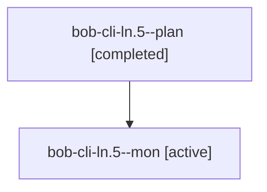

# Session: bob-cli-ln.5

[Agent Hoods](../README.md) / [bbugyi200](../users/bbugyi200/README.md) / [apollo](../users/bbugyi200/machines/apollo/README.md) / [bob-cli-ln](../users/bbugyi200/machines/apollo/hoods/bob-cli-ln/README.md) / bob-cli-ln.5

Owner: `bbugyi200.apollo` · Hood: `bob-cli-ln` · Members: 2 · Bead: [bob-cli-ln.5](https://github.com/bobs-org/bob-cli--beads/blob/main/pages/bob-cli-ln/bob-cli-ln.5.md)

## Lineage

The diagram is an optional enhancement; the ordered table below contains the same lineage in accessible text.

| Role | Agent | State | Model / provider | Timing | Commits | Prompt | Chat |
|---|---|---|---|---|---:|---|---|
| plan | bob-cli-ln.5--plan | completed | gpt-6-luna / codex | 2026-11-15T02:19:21.659554+00:00 → 2026-11-15T02:53:46.610299+00:00 | 0 | [Prompt](../agents/bbugyi200.apollo.bob-cli-ln.5--plan/prompt.md) | [Chat](../agents/bbugyi200.apollo.bob-cli-ln.5--plan/chat.md) |
| mon | bob-cli-ln.5--mon | active | gpt-6-luna / codex | 2026-11-15T02:52:30.806625+00:00 | 0 | — | — |

## Neighbors

| Agent | Relation | State |
|---|---|---|
| [bob-cli-ln.1](../agents/bbugyi200.apollo.bob-cli-ln.1/README.md) | bob-cli-ln hood | completed |
| [bob-cli-ln.2](bbugyi200.apollo.bob-cli-ln.2.md) (session · 7) | bob-cli-ln hood | completed 5, failed 2 |
| [bob-cli-ln.3](bbugyi200.apollo.bob-cli-ln.3.md) (session · 5) | bob-cli-ln hood | completed 4, failed 1 |
| [bob-cli-ln.4](../agents/bbugyi200.apollo.bob-cli-ln.4/README.md) | bob-cli-ln hood | completed |
| [bob-cli-ln.6](../agents/bbugyi200.apollo.bob-cli-ln.6/README.md) | bob-cli-ln hood | waiting |
| [bob-cli-ln.7](../agents/bbugyi200.apollo.bob-cli-ln.7/README.md) | bob-cli-ln hood | waiting |
| [bob-cli-ln.land](../agents/bbugyi200.apollo.bob-cli-ln.land/README.md) | bob-cli-ln hood | waiting |
