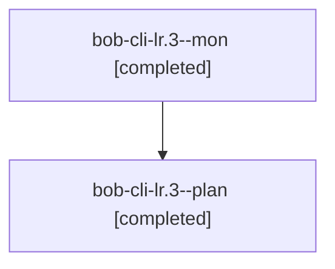

# Session: bob-cli-lr.3

[Agent Hoods](../README.md) / [bbugyi200](../users/bbugyi200/README.md) / [apollo](../users/bbugyi200/machines/apollo/README.md) / [bob-cli-lr](../users/bbugyi200/machines/apollo/hoods/bob-cli-lr/README.md) / bob-cli-lr.3

Owner: `bbugyi200.apollo` · Hood: `bob-cli-lr` · Members: 2 · Bead: [bob-cli-lr.3](https://github.com/bobs-org/bob-cli--beads/blob/main/pages/bob-cli-lr/bob-cli-lr.3.md)

## Lineage

The diagram is an optional enhancement; the ordered table below contains the same lineage in accessible text.

| Role | Agent | State | Model / provider | Timing | Commits | Prompt | Chat |
|---|---|---|---|---|---:|---|---|
| mon | bob-cli-lr.3--mon | completed | grok-4.6 / grok | 2026-11-15T18:47:09.033635+00:00 → 2026-11-15T19:05:57.871574+00:00 | 0 | — | [Chat](../agents/bbugyi200.apollo.bob-cli-lr.3--mon/chat.md) |
| plan | bob-cli-lr.3--plan | completed | grok-4.6 / grok | 2026-11-15T18:23:57.773887+00:00 → 2026-11-15T18:49:09.534952+00:00 | 0 | [Prompt](../agents/bbugyi200.apollo.bob-cli-lr.3--plan/prompt.md) | [Chat](../agents/bbugyi200.apollo.bob-cli-lr.3--plan/chat.md) |

## Neighbors

| Agent | Relation | State |
|---|---|---|
| [bob-cli-lr.1](../agents/bbugyi200.apollo.bob-cli-lr.1/README.md) | bob-cli-lr hood | completed |
| [bob-cli-lr.2](../agents/bbugyi200.apollo.bob-cli-lr.2/README.md) | bob-cli-lr hood | completed |
| [bob-cli-lr.4](../agents/bbugyi200.apollo.bob-cli-lr.4/README.md) | bob-cli-lr hood | waiting |
| [bob-cli-lr.5](../agents/bbugyi200.apollo.bob-cli-lr.5/README.md) | bob-cli-lr hood | waiting |
| [bob-cli-lr.6](../agents/bbugyi200.apollo.bob-cli-lr.6/README.md) | bob-cli-lr hood | waiting |
| [bob-cli-lr.land](../agents/bbugyi200.apollo.bob-cli-lr.land/README.md) | bob-cli-lr hood | waiting |
