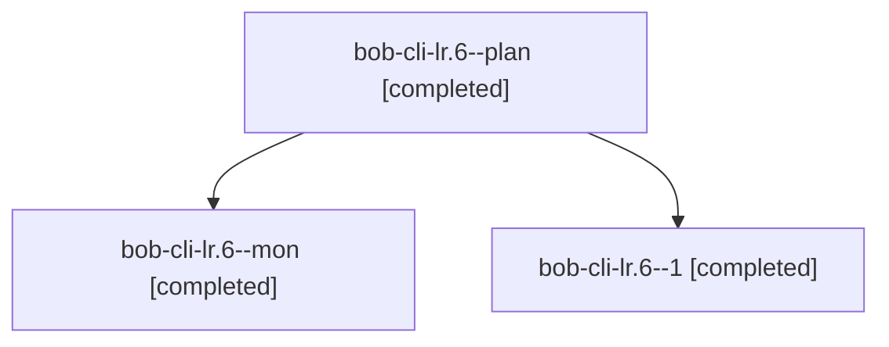

# Session: bob-cli-lr.6

[Agent Hoods](../README.md) / [bbugyi200](../users/bbugyi200/README.md) / [apollo](../users/bbugyi200/machines/apollo/README.md) / [bob-cli-lr](../users/bbugyi200/machines/apollo/hoods/bob-cli-lr/README.md) / bob-cli-lr.6

Owner: `bbugyi200.apollo` · Hood: `bob-cli-lr` · Members: 3 · Bead: [bob-cli-lr.6](https://github.com/bobs-org/bob-cli--beads/blob/main/pages/bob-cli-lr/bob-cli-lr.6.md)

## Lineage

The diagram is an optional enhancement; the ordered table below contains the same lineage in accessible text.

| Role | Agent | State | Model / provider | Timing | Commits | Prompt | Chat |
|---|---|---|---|---|---:|---|---|
| plan | bob-cli-lr.6--plan | completed | muse-spark-1.3-contributor / muse | 2026-11-15T20:12:33.073365+00:00 → 2026-11-15T20:18:34.980349+00:00 | 0 | [Prompt](../agents/bbugyi200.apollo.bob-cli-lr.6--plan/prompt.md) | [Chat](../agents/bbugyi200.apollo.bob-cli-lr.6--plan/chat.md) |
| mon | bob-cli-lr.6--mon | completed | muse-spark-1.3-contributor / muse | 2026-11-15T20:17:21.136721+00:00 → 2026-11-15T20:24:12.868029+00:00 | 0 | — | [Chat](../agents/bbugyi200.apollo.bob-cli-lr.6--mon/chat.md) |
| 1 | bob-cli-lr.6--1 | completed | muse-spark-1.3-contributor / muse | 2026-11-15T20:24:37.839847+00:00 → 2026-11-15T20:27:05.906013+00:00 | 0 | [Prompt](../agents/bbugyi200.apollo.bob-cli-lr.6--1/prompt.md) | [Chat](../agents/bbugyi200.apollo.bob-cli-lr.6--1/chat.md) |

## Neighbors

| Agent | Relation | State |
|---|---|---|
| [bob-cli-lr.1](../agents/bbugyi200.apollo.bob-cli-lr.1/README.md) | bob-cli-lr hood | completed |
| [bob-cli-lr.2](../agents/bbugyi200.apollo.bob-cli-lr.2/README.md) | bob-cli-lr hood | completed |
| [bob-cli-lr.3](bbugyi200.apollo.bob-cli-lr.3.md) (session · 3) | bob-cli-lr hood | completed 3 |
| [bob-cli-lr.4](../agents/bbugyi200.apollo.bob-cli-lr.4/README.md) | bob-cli-lr hood | completed |
| [bob-cli-lr.5](../agents/bbugyi200.apollo.bob-cli-lr.5/README.md) | bob-cli-lr hood | completed |
| [bob-cli-lr.land](../agents/bbugyi200.apollo.bob-cli-lr.land/README.md) | bob-cli-lr hood | completed |
