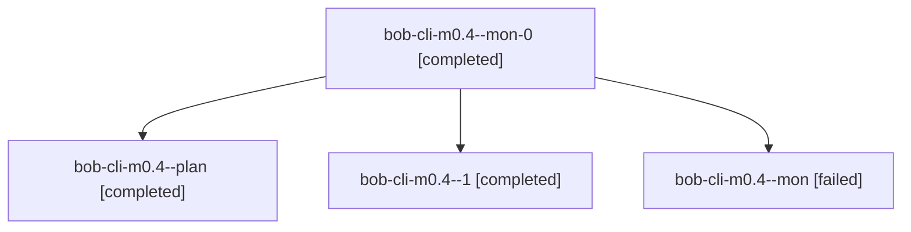

# Session: bob-cli-m0.4

[Agent Hoods](../README.md) / [bbugyi200](../users/bbugyi200/README.md) / [apollo](../users/bbugyi200/machines/apollo/README.md) / [bob-cli-m0](../users/bbugyi200/machines/apollo/hoods/bob-cli-m0/README.md) / bob-cli-m0.4

Owner: `bbugyi200.apollo` · Hood: `bob-cli-m0` · Members: 4 · Bead: [bob-cli-m0.4](https://github.com/bobs-org/bob-cli--beads/blob/main/pages/bob-cli-m0/bob-cli-m0.4.md)

## Lineage

The diagram is an optional enhancement; the ordered table below contains the same lineage in accessible text.

| Role | Agent | State | Model / provider | Timing | Commits | Prompt | Chat |
|---|---|---|---|---|---:|---|---|
| mon-0 | bob-cli-m0.4--mon-0 | completed | grok-4.6 / grok | 2026-11-16T11:50:55.719792+00:00 → 2026-11-16T12:10:12.151546+00:00 | 0 | — | [Chat](../agents/bbugyi200.apollo.bob-cli-m0.4--mon-0/chat.md) |
| plan | bob-cli-m0.4--plan | completed | grok-4.6 / grok | 2026-11-16T11:13:25.353240+00:00 → 2026-11-16T11:52:21.119816+00:00 | 0 | [Prompt](../agents/bbugyi200.apollo.bob-cli-m0.4--plan/prompt.md) | [Chat](../agents/bbugyi200.apollo.bob-cli-m0.4--plan/chat.md) |
| 1 | bob-cli-m0.4--1 | completed | grok-4.6 / grok | 2026-11-16T12:10:56.157412+00:00 → 2026-11-16T12:21:11.336259+00:00 | 0 | [Prompt](../agents/bbugyi200.apollo.bob-cli-m0.4--1/prompt.md) | [Chat](../agents/bbugyi200.apollo.bob-cli-m0.4--1/chat.md) |
| mon | bob-cli-m0.4--mon | failed | grok-4.6 / grok | 2026-11-16T11:50:06.521307+00:00 → 2026-11-16T11:50:09.825941+00:00 | 0 | — | — |

## Neighbors

| Agent | Relation | State |
|---|---|---|
| [bob-cli-m0.1](../agents/bbugyi200.apollo.bob-cli-m0.1/README.md) | bob-cli-m0 hood | completed |
| [bob-cli-m0.2](bbugyi200.apollo.bob-cli-m0.2.md) (session · 3) | bob-cli-m0 hood | completed 3 |
| [bob-cli-m0.3](../agents/bbugyi200.apollo.bob-cli-m0.3/README.md) | bob-cli-m0 hood | completed |
| [bob-cli-m0.5](../agents/bbugyi200.apollo.bob-cli-m0.5/README.md) | bob-cli-m0 hood | completed |
| [bob-cli-m0.6](../agents/bbugyi200.apollo.bob-cli-m0.6/README.md) | bob-cli-m0 hood | completed |
| [bob-cli-m0.land](../agents/bbugyi200.apollo.bob-cli-m0.land/README.md) | bob-cli-m0 hood | waiting |
