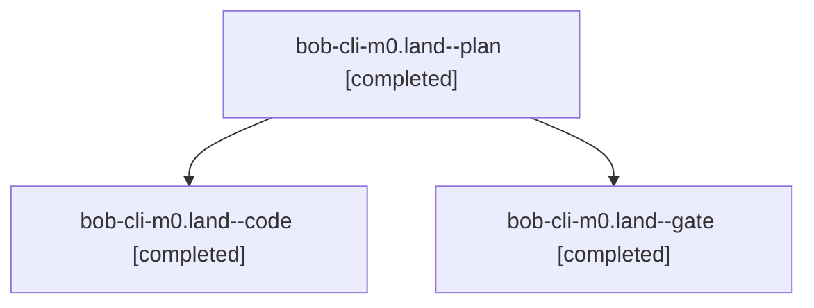

# Session: bob-cli-m0.land

[Agent Hoods](../README.md) / [bbugyi200](../users/bbugyi200/README.md) / [apollo](../users/bbugyi200/machines/apollo/README.md) / [bob-cli-m0](../users/bbugyi200/machines/apollo/hoods/bob-cli-m0/README.md) / bob-cli-m0.land

Owner: `bbugyi200.apollo` · Hood: `bob-cli-m0` · Members: 3 · Bead: [bob-cli-m0](https://github.com/bobs-org/bob-cli--beads/blob/main/pages/bob-cli-m0/README.md)

## Lineage

The diagram is an optional enhancement; the ordered table below contains the same lineage in accessible text.

| Role | Agent | State | Model / provider | Timing | Commits | Prompt | Chat |
|---|---|---|---|---|---:|---|---|
| plan | bob-cli-m0.land--plan | completed | opus / claude | 2026-11-16T14:16:27.852640+00:00 → 2026-11-16T15:19:57.695189+00:00 | 0 | [Prompt](../agents/bbugyi200.apollo.bob-cli-m0.land--plan/prompt.md) | [Chat](../agents/bbugyi200.apollo.bob-cli-m0.land--plan/chat.md) |
| code | bob-cli-m0.land--code | completed | muse-spark-1.3-contributor / muse | 2026-11-16T14:38:54.660019+00:00 → 2026-11-16T15:19:57.695189+00:00 | 0 | — | [Chat](../agents/bbugyi200.apollo.bob-cli-m0.land--code/chat.md) |
| gate | bob-cli-m0.land--gate | completed | opus / claude | 2026-11-16T14:37:10.391645+00:00 → 2026-11-16T14:37:39.159617+00:00 | 0 | — | [Chat](../agents/bbugyi200.apollo.bob-cli-m0.land--gate/chat.md) |

## Neighbors

| Agent | Relation | State |
|---|---|---|
| [bob-cli-m0.1](../agents/bbugyi200.apollo.bob-cli-m0.1/README.md) | bob-cli-m0 hood | completed |
| [bob-cli-m0.2](bbugyi200.apollo.bob-cli-m0.2.md) (session · 3) | bob-cli-m0 hood | completed 3 |
| [bob-cli-m0.3](../agents/bbugyi200.apollo.bob-cli-m0.3/README.md) | bob-cli-m0 hood | completed |
| [bob-cli-m0.4](bbugyi200.apollo.bob-cli-m0.4.md) (session · 4) | bob-cli-m0 hood | completed 3, failed 1 |
| [bob-cli-m0.5](../agents/bbugyi200.apollo.bob-cli-m0.5/README.md) | bob-cli-m0 hood | completed |
| [bob-cli-m0.6](../agents/bbugyi200.apollo.bob-cli-m0.6/README.md) | bob-cli-m0 hood | completed |
