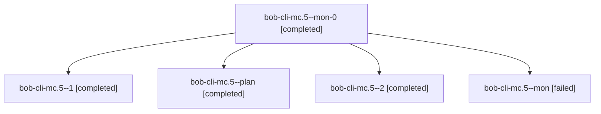

# Session: bob-cli-mc.5

[Agent Hoods](../README.md) / [bbugyi200](../users/bbugyi200/README.md) / [apollo](../users/bbugyi200/machines/apollo/README.md) / [bob-cli-mc](../users/bbugyi200/machines/apollo/hoods/bob-cli-mc/README.md) / bob-cli-mc.5

Owner: `bbugyi200.apollo` · Hood: `bob-cli-mc` · Members: 5 · Bead: [bob-cli-mc.5](https://github.com/bobs-org/bob-cli--beads/blob/main/pages/bob-cli-mc/bob-cli-mc.5.md)

## Lineage

The diagram is an optional enhancement; the ordered table below contains the same lineage in accessible text.

| Role | Agent | State | Model / provider | Timing | Commits | Prompt | Chat |
|---|---|---|---|---|---:|---|---|
| mon-0 | bob-cli-mc.5--mon-0 | completed | gpt-6-luna / codex | 2026-11-16T18:52:18.919292+00:00 → 2026-11-16T18:59:39.554484+00:00 | 0 | — | [Chat](../agents/bbugyi200.apollo.bob-cli-mc.5--mon-0/chat.md) |
| 1 | bob-cli-mc.5--1 | completed | gpt-6-luna / codex | 2026-11-16T18:42:49.080193+00:00 → 2026-11-16T18:53:12.959277+00:00 | 0 | [Prompt](../agents/bbugyi200.apollo.bob-cli-mc.5--1/prompt.md) | [Chat](../agents/bbugyi200.apollo.bob-cli-mc.5--1/chat.md) |
| plan | bob-cli-mc.5--plan | completed | gpt-6-luna / codex | 2026-11-16T18:06:13.896781+00:00 → 2026-11-16T18:34:16.285503+00:00 | 0 | [Prompt](../agents/bbugyi200.apollo.bob-cli-mc.5--plan/prompt.md) | [Chat](../agents/bbugyi200.apollo.bob-cli-mc.5--plan/chat.md) |
| 2 | bob-cli-mc.5--2 | completed | gpt-6-luna / codex | 2026-11-16T18:59:39.170317+00:00 → 2026-11-16T19:07:34.318636+00:00 | 0 | [Prompt](../agents/bbugyi200.apollo.bob-cli-mc.5--2/prompt.md) | [Chat](../agents/bbugyi200.apollo.bob-cli-mc.5--2/chat.md) |
| mon | bob-cli-mc.5--mon | failed | gpt-6-luna / codex | 2026-11-16T18:33:11.681078+00:00 → 2026-11-16T18:42:01.663790+00:00 | 0 | — | [Chat](../agents/bbugyi200.apollo.bob-cli-mc.5--mon/chat.md) |

## Neighbors

| Agent | Relation | State |
|---|---|---|
| [bob-cli-mc.1](../agents/bbugyi200.apollo.bob-cli-mc.1/README.md) | bob-cli-mc hood | completed |
| [bob-cli-mc.2](../agents/bbugyi200.apollo.bob-cli-mc.2/README.md) | bob-cli-mc hood | completed |
| [bob-cli-mc.3](../agents/bbugyi200.apollo.bob-cli-mc.3/README.md) | bob-cli-mc hood | completed |
| [bob-cli-mc.4](../agents/bbugyi200.apollo.bob-cli-mc.4/README.md) | bob-cli-mc hood | completed |
| [bob-cli-mc.land](../agents/bbugyi200.apollo.bob-cli-mc.land/README.md) | bob-cli-mc hood | completed |
