# Session: bob-cli-mf.10

[Agent Hoods](../README.md) / [bbugyi200](../users/bbugyi200/README.md) / [apollo](../users/bbugyi200/machines/apollo/README.md) / [bob-cli-mf](../users/bbugyi200/machines/apollo/hoods/bob-cli-mf/README.md) / bob-cli-mf.10

Owner: `bbugyi200.apollo` · Hood: `bob-cli-mf` · Members: 23 · Bead: [bob-cli-mf.10](https://github.com/bobs-org/bob-cli--beads/blob/main/pages/bob-cli-mf/bob-cli-mf.10.md)

## Lineage

```mermaid
flowchart TD
  n0["bob-cli-mf.10--1 [completed]"]
  n1["bob-cli-mf.10--mon-1 [failed]"]
  n0 --> n1
  n2["bob-cli-mf.10--3 [completed]"]
  n0 --> n2
  n3["bob-cli-mf.10--b [completed]"]
  n0 --> n3
  n4["bob-cli-mf.10--mon-6 [failed]"]
  n0 --> n4
  n5["bob-cli-mf.10--plan [completed]"]
  n0 --> n5
  n6["bob-cli-mf.10--5 [completed]"]
  n0 --> n6
  n7["bob-cli-mf.10--a [completed]"]
  n0 --> n7
  n8["bob-cli-mf.10--mon-7 [failed]"]
  n0 --> n8
  n9["bob-cli-mf.10--mon-8 [failed]"]
  n0 --> n9
  n10["bob-cli-mf.10--mon [failed]"]
  n0 --> n10
  n11["bob-cli-mf.10--2 [completed]"]
  n0 --> n11
  n12["bob-cli-mf.10--mon-5 [failed]"]
  n0 --> n12
  n13["bob-cli-mf.10--mon-4 [failed]"]
  n0 --> n13
  n14["bob-cli-mf.10--mon-9 [completed]"]
  n0 --> n14
  n15["bob-cli-mf.10--8 [completed]"]
  n0 --> n15
  n16["bob-cli-mf.10--mon-2 [failed]"]
  n0 --> n16
  n17["bob-cli-mf.10--9 [completed]"]
  n0 --> n17
  n18["bob-cli-mf.10--4 [completed]"]
  n0 --> n18
  n19["bob-cli-mf.10--6 [completed]"]
  n0 --> n19
  n20["bob-cli-mf.10--mon-0 [failed]"]
  n0 --> n20
  n21["bob-cli-mf.10--7 [completed]"]
  n0 --> n21
  n22["bob-cli-mf.10--mon-3 [failed]"]
  n0 --> n22
```

The diagram is an optional enhancement; the ordered table below contains the same lineage in accessible text.

| Role | Agent | State | Model / provider | Timing | Commits | Prompt | Chat |
|---|---|---|---|---|---:|---|---|
| 1 | bob-cli-mf.10--1 | completed | gpt-6-luna / codex | 2026-11-17T05:29:35.279431+00:00 → 2026-11-17T05:36:20.096618+00:00 | 0 | [Prompt](../agents/bbugyi200.apollo.bob-cli-mf.10--1/prompt.md) | [Chat](../agents/bbugyi200.apollo.bob-cli-mf.10--1/chat.md) |
| mon-1 | bob-cli-mf.10--mon-1 | failed | gpt-6-luna / codex | 2026-11-17T05:42:37.866835+00:00 → 2026-11-17T05:48:14.426442+00:00 | 0 | — | [Chat](../agents/bbugyi200.apollo.bob-cli-mf.10--mon-1/chat.md) |
| 3 | bob-cli-mf.10--3 | completed | gpt-6-luna / codex | 2026-11-17T05:48:14.309164+00:00 → 2026-11-17T05:58:21.281997+00:00 | 0 | [Prompt](../agents/bbugyi200.apollo.bob-cli-mf.10--3/prompt.md) | [Chat](../agents/bbugyi200.apollo.bob-cli-mf.10--3/chat.md) |
| b | bob-cli-mf.10--b | completed | gpt-6-luna / codex | 2026-11-17T08:08:05.067094+00:00 → 2026-11-17T08:19:36.632379+00:00 | 0 | [Prompt](../agents/bbugyi200.apollo.bob-cli-mf.10--b/prompt.md) | [Chat](../agents/bbugyi200.apollo.bob-cli-mf.10--b/chat.md) |
| mon-6 | bob-cli-mf.10--mon-6 | failed | gpt-6-luna / codex | 2026-11-17T07:20:51.549730+00:00 → 2026-11-17T07:24:02.523215+00:00 | 0 | — | [Chat](../agents/bbugyi200.apollo.bob-cli-mf.10--mon-6/chat.md) |
| plan | bob-cli-mf.10--plan | completed | gpt-6-luna / codex | 2026-11-17T04:56:28.248778+00:00 → 2026-11-17T05:24:02.987690+00:00 | 0 | [Prompt](../agents/bbugyi200.apollo.bob-cli-mf.10--plan/prompt.md) | [Chat](../agents/bbugyi200.apollo.bob-cli-mf.10--plan/chat.md) |
| 5 | bob-cli-mf.10--5 | completed | gpt-6-luna / codex | 2026-11-17T06:22:28.111477+00:00 → 2026-11-17T06:43:48.954189+00:00 | 0 | [Prompt](../agents/bbugyi200.apollo.bob-cli-mf.10--5/prompt.md) | [Chat](../agents/bbugyi200.apollo.bob-cli-mf.10--5/chat.md) |
| a | bob-cli-mf.10--a | completed | gpt-6-luna / codex | 2026-11-17T08:00:29.136188+00:00 → 2026-11-17T08:05:59.133401+00:00 | 0 | [Prompt](../agents/bbugyi200.apollo.bob-cli-mf.10--a/prompt.md) | [Chat](../agents/bbugyi200.apollo.bob-cli-mf.10--a/chat.md) |
| mon-7 | bob-cli-mf.10--mon-7 | failed | gpt-6-luna / codex | 2026-11-17T07:39:03.979453+00:00 → 2026-11-17T07:42:56.541815+00:00 | 0 | — | [Chat](../agents/bbugyi200.apollo.bob-cli-mf.10--mon-7/chat.md) |
| mon-8 | bob-cli-mf.10--mon-8 | failed | gpt-6-luna / codex | 2026-11-17T07:56:17.240865+00:00 → 2026-11-17T08:00:29.515913+00:00 | 0 | — | [Chat](../agents/bbugyi200.apollo.bob-cli-mf.10--mon-8/chat.md) |
| mon | bob-cli-mf.10--mon | failed | gpt-6-luna / codex | 2026-11-17T05:23:06.990287+00:00 → 2026-11-17T05:29:35.555952+00:00 | 0 | — | [Chat](../agents/bbugyi200.apollo.bob-cli-mf.10--mon/chat.md) |
| 2 | bob-cli-mf.10--2 | completed | gpt-6-luna / codex | 2026-11-17T05:37:27.824926+00:00 → 2026-11-17T05:44:08.400568+00:00 | 0 | [Prompt](../agents/bbugyi200.apollo.bob-cli-mf.10--2/prompt.md) | [Chat](../agents/bbugyi200.apollo.bob-cli-mf.10--2/chat.md) |
| mon-5 | bob-cli-mf.10--mon-5 | failed | gpt-6-luna / codex | 2026-11-17T07:02:21.946125+00:00 → 2026-11-17T07:06:47.029633+00:00 | 0 | — | [Chat](../agents/bbugyi200.apollo.bob-cli-mf.10--mon-5/chat.md) |
| mon-4 | bob-cli-mf.10--mon-4 | failed | gpt-6-luna / codex | 2026-11-17T06:41:41.741583+00:00 → 2026-11-17T06:47:00.484704+00:00 | 0 | — | [Chat](../agents/bbugyi200.apollo.bob-cli-mf.10--mon-4/chat.md) |
| mon-9 | bob-cli-mf.10--mon-9 | completed | gpt-6-luna / codex | 2026-11-17T08:04:33.659199+00:00 → 2026-11-17T08:08:05.535520+00:00 | 0 | — | [Chat](../agents/bbugyi200.apollo.bob-cli-mf.10--mon-9/chat.md) |
| 8 | bob-cli-mf.10--8 | completed | gpt-6-luna / codex | 2026-11-17T07:24:02.169526+00:00 → 2026-11-17T07:40:50.171115+00:00 | 0 | [Prompt](../agents/bbugyi200.apollo.bob-cli-mf.10--8/prompt.md) | [Chat](../agents/bbugyi200.apollo.bob-cli-mf.10--8/chat.md) |
| mon-2 | bob-cli-mf.10--mon-2 | failed | gpt-6-luna / codex | 2026-11-17T05:57:37.312492+00:00 → 2026-11-17T06:00:47.358213+00:00 | 0 | — | [Chat](../agents/bbugyi200.apollo.bob-cli-mf.10--mon-2/chat.md) |
| 9 | bob-cli-mf.10--9 | completed | gpt-6-luna / codex | 2026-11-17T07:42:56.179093+00:00 → 2026-11-17T07:58:08.616081+00:00 | 0 | [Prompt](../agents/bbugyi200.apollo.bob-cli-mf.10--9/prompt.md) | [Chat](../agents/bbugyi200.apollo.bob-cli-mf.10--9/chat.md) |
| 4 | bob-cli-mf.10--4 | completed | gpt-6-luna / codex | 2026-11-17T06:00:47.121915+00:00 → 2026-11-17T06:19:42.321447+00:00 | 0 | [Prompt](../agents/bbugyi200.apollo.bob-cli-mf.10--4/prompt.md) | [Chat](../agents/bbugyi200.apollo.bob-cli-mf.10--4/chat.md) |
| 6 | bob-cli-mf.10--6 | completed | gpt-6-luna / codex | 2026-11-17T06:47:00.301473+00:00 → 2026-11-17T07:03:34.322172+00:00 | 0 | [Prompt](../agents/bbugyi200.apollo.bob-cli-mf.10--6/prompt.md) | [Chat](../agents/bbugyi200.apollo.bob-cli-mf.10--6/chat.md) |
| mon-0 | bob-cli-mf.10--mon-0 | failed | gpt-6-luna / codex | 2026-11-17T05:35:21.905828+00:00 → 2026-11-17T05:37:28.245065+00:00 | 0 | — | [Chat](../agents/bbugyi200.apollo.bob-cli-mf.10--mon-0/chat.md) |
| 7 | bob-cli-mf.10--7 | completed | gpt-6-luna / codex | 2026-11-17T07:06:46.832655+00:00 → 2026-11-17T07:22:06.138288+00:00 | 0 | [Prompt](../agents/bbugyi200.apollo.bob-cli-mf.10--7/prompt.md) | [Chat](../agents/bbugyi200.apollo.bob-cli-mf.10--7/chat.md) |
| mon-3 | bob-cli-mf.10--mon-3 | failed | gpt-6-luna / codex | 2026-11-17T06:18:21.711161+00:00 → 2026-11-17T06:22:28.312665+00:00 | 0 | — | [Chat](../agents/bbugyi200.apollo.bob-cli-mf.10--mon-3/chat.md) |

## Neighbors

| Agent | Relation | State |
|---|---|---|
| [bob-cli-mf.1](../agents/bbugyi200.apollo.bob-cli-mf.1/README.md) | bob-cli-mf hood | completed |
| [bob-cli-mf.2](../agents/bbugyi200.apollo.bob-cli-mf.2/README.md) | bob-cli-mf hood | completed |
| [bob-cli-mf.3](../agents/bbugyi200.apollo.bob-cli-mf.3/README.md) | bob-cli-mf hood | completed |
| [bob-cli-mf.4](../agents/bbugyi200.apollo.bob-cli-mf.4/README.md) | bob-cli-mf hood | completed |
| [bob-cli-mf.5](../agents/bbugyi200.apollo.bob-cli-mf.5/README.md) | bob-cli-mf hood | completed |
| [bob-cli-mf.6](bbugyi200.apollo.bob-cli-mf.6.md) (session · 11) | bob-cli-mf hood | completed 9, failed 2 |
| [bob-cli-mf.7](../agents/bbugyi200.apollo.bob-cli-mf.7/README.md) | bob-cli-mf hood | completed |
| [bob-cli-mf.8](../agents/bbugyi200.apollo.bob-cli-mf.8/README.md) | bob-cli-mf hood | completed |
| [bob-cli-mf.9](../agents/bbugyi200.apollo.bob-cli-mf.9/README.md) | bob-cli-mf hood | completed |
| [bob-cli-mf.land](../agents/bbugyi200.apollo.bob-cli-mf.land/README.md) | bob-cli-mf hood | completed |
