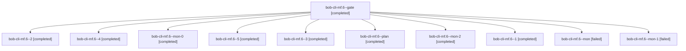

# Session: bob-cli-mf.6

[Agent Hoods](../README.md) / [bbugyi200](../users/bbugyi200/README.md) / [apollo](../users/bbugyi200/machines/apollo/README.md) / [bob-cli-mf](../users/bbugyi200/machines/apollo/hoods/bob-cli-mf/README.md) / bob-cli-mf.6

Owner: `bbugyi200.apollo` · Hood: `bob-cli-mf` · Members: 11 · Bead: [bob-cli-mf.6](https://github.com/bobs-org/bob-cli--beads/blob/main/pages/bob-cli-mf/bob-cli-mf.6.md)

## Lineage

The diagram is an optional enhancement; the ordered table below contains the same lineage in accessible text.

| Role | Agent | State | Model / provider | Timing | Commits | Prompt | Chat |
|---|---|---|---|---|---:|---|---|
| gate | bob-cli-mf.6--gate | completed | gpt-6-luna / codex | 2026-11-17T02:08:18.030763+00:00 → 2026-11-17T02:08:49.797137+00:00 | 0 | — | [Chat](../agents/bbugyi200.apollo.bob-cli-mf.6--gate/chat.md) |
| 2 | bob-cli-mf.6--2 | completed | gpt-6-luna / codex | 2026-11-17T00:20:45.078746+00:00 → 2026-11-17T00:23:34.620123+00:00 | 0 | [Prompt](../agents/bbugyi200.apollo.bob-cli-mf.6--2/prompt.md) | [Chat](../agents/bbugyi200.apollo.bob-cli-mf.6--2/chat.md) |
| 4 | bob-cli-mf.6--4 | completed | gpt-6-luna / codex | 2026-11-17T02:10:10.969740+00:00 → 2026-11-17T02:16:35.896051+00:00 | 0 | [Prompt](../agents/bbugyi200.apollo.bob-cli-mf.6--4/prompt.md) | [Chat](../agents/bbugyi200.apollo.bob-cli-mf.6--4/chat.md) |
| mon-0 | bob-cli-mf.6--mon-0 | completed | gpt-6-luna / codex | 2026-11-17T00:16:34.147748+00:00 → 2026-11-17T00:20:45.137766+00:00 | 0 | — | [Chat](../agents/bbugyi200.apollo.bob-cli-mf.6--mon-0/chat.md) |
| 5 | bob-cli-mf.6--5 | completed | gpt-6-luna / codex | 2026-11-17T02:28:26.650505+00:00 → 2026-11-17T02:34:32.445850+00:00 | 0 | [Prompt](../agents/bbugyi200.apollo.bob-cli-mf.6--5/prompt.md) | [Chat](../agents/bbugyi200.apollo.bob-cli-mf.6--5/chat.md) |
| 3 | bob-cli-mf.6--3 | completed | gpt-6-luna / codex | 2026-11-17T00:29:18.783974+00:00 → 2026-11-17T01:01:21.337309+00:00 | 0 | [Prompt](../agents/bbugyi200.apollo.bob-cli-mf.6--3/prompt.md) | [Chat](../agents/bbugyi200.apollo.bob-cli-mf.6--3/chat.md) |
| plan | bob-cli-mf.6--plan | completed | gpt-6-luna / codex | 2026-11-16T23:19:49.409278+00:00 → 2026-11-17T00:04:16.797791+00:00 | 0 | [Prompt](../agents/bbugyi200.apollo.bob-cli-mf.6--plan/prompt.md) | [Chat](../agents/bbugyi200.apollo.bob-cli-mf.6--plan/chat.md) |
| mon-2 | bob-cli-mf.6--mon-2 | completed | gpt-6-luna / codex | 2026-11-17T02:15:01.540510+00:00 → 2026-11-17T02:28:21.610744+00:00 | 0 | — | [Chat](../agents/bbugyi200.apollo.bob-cli-mf.6--mon-2/chat.md) |
| 1 | bob-cli-mf.6--1 | completed | gpt-6-luna / codex | 2026-11-17T00:10:42.904714+00:00 → 2026-11-17T00:19:23.398532+00:00 | 0 | [Prompt](../agents/bbugyi200.apollo.bob-cli-mf.6--1/prompt.md) | [Chat](../agents/bbugyi200.apollo.bob-cli-mf.6--1/chat.md) |
| mon | bob-cli-mf.6--mon | failed | gpt-6-luna / codex | 2026-11-17T00:03:20.480595+00:00 → 2026-11-17T00:09:57.209689+00:00 | 0 | — | [Chat](../agents/bbugyi200.apollo.bob-cli-mf.6--mon/chat.md) |
| mon-1 | bob-cli-mf.6--mon-1 | failed | gpt-6-luna / codex | 2026-11-17T00:22:43.685408+00:00 → 2026-11-17T00:29:19.097790+00:00 | 0 | — | [Chat](../agents/bbugyi200.apollo.bob-cli-mf.6--mon-1/chat.md) |

## Neighbors

| Agent | Relation | State |
|---|---|---|
| [bob-cli-mf.1](../agents/bbugyi200.apollo.bob-cli-mf.1/README.md) | bob-cli-mf hood | completed |
| [bob-cli-mf.10](../agents/bbugyi200.apollo.bob-cli-mf.10/README.md) | bob-cli-mf hood | waiting |
| [bob-cli-mf.2](../agents/bbugyi200.apollo.bob-cli-mf.2/README.md) | bob-cli-mf hood | completed |
| [bob-cli-mf.3](../agents/bbugyi200.apollo.bob-cli-mf.3/README.md) | bob-cli-mf hood | completed |
| [bob-cli-mf.4](../agents/bbugyi200.apollo.bob-cli-mf.4/README.md) | bob-cli-mf hood | completed |
| [bob-cli-mf.5](../agents/bbugyi200.apollo.bob-cli-mf.5/README.md) | bob-cli-mf hood | completed |
| [bob-cli-mf.7](../agents/bbugyi200.apollo.bob-cli-mf.7/README.md) | bob-cli-mf hood | completed |
| [bob-cli-mf.8](../agents/bbugyi200.apollo.bob-cli-mf.8/README.md) | bob-cli-mf hood | completed |
| [bob-cli-mf.9](../agents/bbugyi200.apollo.bob-cli-mf.9/README.md) | bob-cli-mf hood | completed |
| [bob-cli-mf.land](../agents/bbugyi200.apollo.bob-cli-mf.land/README.md) | bob-cli-mf hood | waiting |
