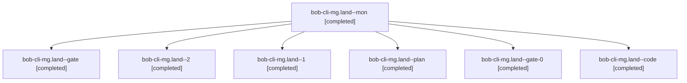

# Session: bob-cli-mg.land

[Agent Hoods](../README.md) / [bbugyi200](../users/bbugyi200/README.md) / [apollo](../users/bbugyi200/machines/apollo/README.md) / [bob-cli-mg](../users/bbugyi200/machines/apollo/hoods/bob-cli-mg/README.md) / bob-cli-mg.land

Owner: `bbugyi200.apollo` · Hood: `bob-cli-mg` · Members: 7 · Bead: [bob-cli-mg](https://github.com/bobs-org/bob-cli--beads/blob/main/pages/bob-cli-mg/README.md)

## Lineage

The diagram is an optional enhancement; the ordered table below contains the same lineage in accessible text.

| Role | Agent | State | Model / provider | Timing | Commits | Prompt | Chat |
|---|---|---|---|---|---:|---|---|
| mon | bob-cli-mg.land--mon | completed | gpt-6-luna / codex | 2026-11-17T02:15:48.825898+00:00 → 2026-11-17T02:37:34.989853+00:00 | 0 | — | [Chat](../agents/bbugyi200.apollo.bob-cli-mg.land--mon/chat.md) |
| gate | bob-cli-mg.land--gate | completed | gpt-6-astra / codex | 2026-11-17T00:30:43.021984+00:00 → 2026-11-17T00:30:55.410427+00:00 | 0 | — | [Chat](../agents/bbugyi200.apollo.bob-cli-mg.land--gate/chat.md) |
| 2 | bob-cli-mg.land--2 | completed | gpt-6-luna / codex | 2026-11-17T02:37:52.605353+00:00 → 2026-11-17T02:44:31.154379+00:00 | [1](../agents/bbugyi200.apollo.bob-cli-mg.land--2/README.md#commits) | [Prompt](../agents/bbugyi200.apollo.bob-cli-mg.land--2/prompt.md) | [Chat](../agents/bbugyi200.apollo.bob-cli-mg.land--2/chat.md) |
| 1 | bob-cli-mg.land--1 | completed | gpt-6-luna / codex | 2026-11-17T01:53:44.655871+00:00 → 2026-11-17T02:17:14.768554+00:00 | 0 | [Prompt](../agents/bbugyi200.apollo.bob-cli-mg.land--1/prompt.md) | [Chat](../agents/bbugyi200.apollo.bob-cli-mg.land--1/chat.md) |
| plan | bob-cli-mg.land--plan | completed | gpt-6-astra / codex | 2026-11-17T00:17:16.002145+00:00 → 2026-11-17T01:42:32.885797+00:00 | 0 | [Prompt](../agents/bbugyi200.apollo.bob-cli-mg.land--plan/prompt.md) | [Chat](../agents/bbugyi200.apollo.bob-cli-mg.land--plan/chat.md) |
| gate-0 | bob-cli-mg.land--gate-0 | completed | gpt-6-luna / codex | 2026-11-17T01:52:15.886439+00:00 → 2026-11-17T01:52:58.460240+00:00 | 0 | — | [Chat](../agents/bbugyi200.apollo.bob-cli-mg.land--gate-0/chat.md) |
| code | bob-cli-mg.land--code | completed | gpt-6-luna / codex | 2026-11-17T00:31:28.829055+00:00 → 2026-11-17T01:42:32.885797+00:00 | 0 | — | [Chat](../agents/bbugyi200.apollo.bob-cli-mg.land--code/chat.md) |

## Commits

| Role | Repo | Commit | Subject | Committed |
|---|---|---|---|---|
| 2 | bob-cli | [`8a81843`](https://github.com/bobs-org/bob-cli/commit/8a81843d1416829323dfb135c384159f783850af) | fix(bank): complete period closing balance landing | 2026-11-16 21:43:54 EST |

## Neighbors

| Agent | Relation | State |
|---|---|---|
| [bob-cli-mg.1](../agents/bbugyi200.apollo.bob-cli-mg.1/README.md) | bob-cli-mg hood | completed |
| [bob-cli-mg.2](../agents/bbugyi200.apollo.bob-cli-mg.2/README.md) | bob-cli-mg hood | completed |
| [bob-cli-mg.3](../agents/bbugyi200.apollo.bob-cli-mg.3/README.md) | bob-cli-mg hood | completed |
| [bob-cli-mg.4](../agents/bbugyi200.apollo.bob-cli-mg.4/README.md) | bob-cli-mg hood | completed |
