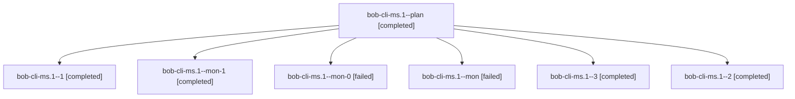

# Session: bob-cli-ms.1

[Agent Hoods](../README.md) / [bbugyi200](../users/bbugyi200/README.md) / [apollo](../users/bbugyi200/machines/apollo/README.md) / [bob-cli-ms](../users/bbugyi200/machines/apollo/hoods/bob-cli-ms/README.md) / bob-cli-ms.1

Owner: `bbugyi200.apollo` · Hood: `bob-cli-ms` · Members: 7 · Bead: [bob-cli-ms.1](https://github.com/bobs-org/bob-cli--beads/blob/main/pages/bob-cli-ms/bob-cli-ms.1.md)

## Lineage

The diagram is an optional enhancement; the ordered table below contains the same lineage in accessible text.

| Role | Agent | State | Model / provider | Timing | Commits | Prompt | Chat |
|---|---|---|---|---|---:|---|---|
| plan | bob-cli-ms.1--plan | completed | grok-4.6 / grok | 2026-11-17T16:31:28.757693+00:00 → 2026-11-17T17:28:15.424156+00:00 | 0 | [Prompt](../agents/bbugyi200.apollo.bob-cli-ms.1--plan/prompt.md) | [Chat](../agents/bbugyi200.apollo.bob-cli-ms.1--plan/chat.md) |
| 1 | bob-cli-ms.1--1 | completed | grok-4.6 / grok | 2026-11-17T17:41:37.979908+00:00 → 2026-11-17T17:53:17.767063+00:00 | 0 | [Prompt](../agents/bbugyi200.apollo.bob-cli-ms.1--1/prompt.md) | [Chat](../agents/bbugyi200.apollo.bob-cli-ms.1--1/chat.md) |
| mon-1 | bob-cli-ms.1--mon-1 | completed | grok-4.6 / grok | 2026-11-17T18:15:36.522325+00:00 → 2026-11-17T18:31:08.917201+00:00 | 0 | — | [Chat](../agents/bbugyi200.apollo.bob-cli-ms.1--mon-1/chat.md) |
| mon-0 | bob-cli-ms.1--mon-0 | failed | grok-4.6 / grok | 2026-11-17T17:51:42.284201+00:00 → 2026-11-17T18:06:21.953683+00:00 | 0 | — | [Chat](../agents/bbugyi200.apollo.bob-cli-ms.1--mon-0/chat.md) |
| mon | bob-cli-ms.1--mon | failed | grok-4.6 / grok | 2026-11-17T17:26:49.703117+00:00 → 2026-11-17T17:41:38.181676+00:00 | 0 | — | [Chat](../agents/bbugyi200.apollo.bob-cli-ms.1--mon/chat.md) |
| 3 | bob-cli-ms.1--3 | completed | grok-4.6 / grok | 2026-11-17T18:31:08.684007+00:00 → 2026-11-17T18:39:01.501781+00:00 | [1](../agents/bbugyi200.apollo.bob-cli-ms.1--3/README.md#commits) | [Prompt](../agents/bbugyi200.apollo.bob-cli-ms.1--3/prompt.md) | [Chat](../agents/bbugyi200.apollo.bob-cli-ms.1--3/chat.md) |
| 2 | bob-cli-ms.1--2 | completed | grok-4.6 / grok | 2026-11-17T18:06:21.429415+00:00 → 2026-11-17T18:17:09.938472+00:00 | 0 | [Prompt](../agents/bbugyi200.apollo.bob-cli-ms.1--2/prompt.md) | [Chat](../agents/bbugyi200.apollo.bob-cli-ms.1--2/chat.md) |

## Commits

| Role | Repo | Commit | Subject | Committed |
|---|---|---|---|---|
| 3 | bob-cli | [`9900597`](https://github.com/bobs-org/bob-cli/commit/99005975e15aaa3c2440b36e8f87dc4481908500) | feat(records): add per-record show STEM and fingerprint | 2026-11-17 13:38:16 EST |

## Neighbors

| Agent | Relation | State |
|---|---|---|
| [bob-cli-ms.2](../agents/bbugyi200.apollo.bob-cli-ms.2/README.md) | bob-cli-ms hood | completed |
| [bob-cli-ms.3](bbugyi200.apollo.bob-cli-ms.3.md) (session · 5) | bob-cli-ms hood | completed 5 |
| [bob-cli-ms.4](../agents/bbugyi200.apollo.bob-cli-ms.4/README.md) | bob-cli-ms hood | completed |
| [bob-cli-ms.5](bbugyi200.apollo.bob-cli-ms.5.md) (session · 5) | bob-cli-ms hood | completed 5 |
| [bob-cli-ms.6](bbugyi200.apollo.bob-cli-ms.6.md) (session · 5) | bob-cli-ms hood | completed 4, failed 1 |
| [bob-cli-ms.6](../agents/bbugyi200.apollo.bob-cli-ms.6/README.md) | bob-cli-ms hood | completed |
| [bob-cli-ms.7](../agents/bbugyi200.apollo.bob-cli-ms.7/README.md) | bob-cli-ms hood | completed |
| [bob-cli-ms.8.1](bbugyi200.apollo.bob-cli-ms.8.1.md) (session · 4) | bob-cli-ms hood | active 1, completed 2, failed 1 |
| [bob-cli-ms.8.2](../agents/bbugyi200.apollo.bob-cli-ms.8.2/README.md) | bob-cli-ms hood | waiting |
| [bob-cli-ms.8.3](../agents/bbugyi200.apollo.bob-cli-ms.8.3/README.md) | bob-cli-ms hood | waiting |
| [bob-cli-ms.8.land](../agents/bbugyi200.apollo.bob-cli-ms.8.land/README.md) | bob-cli-ms hood | waiting |
| [bob-cli-ms.land](bbugyi200.apollo.bob-cli-ms.land.md) (session · 3) | bob-cli-ms hood | active 1, completed 2 |
