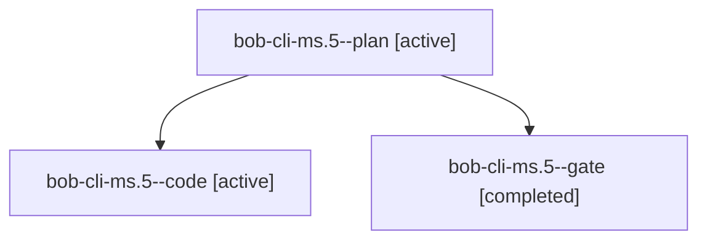

# Session: bob-cli-ms.5

[Agent Hoods](../README.md) / [bbugyi200](../users/bbugyi200/README.md) / [apollo](../users/bbugyi200/machines/apollo/README.md) / [bob-cli-ms](../users/bbugyi200/machines/apollo/hoods/bob-cli-ms/README.md) / bob-cli-ms.5

Owner: `bbugyi200.apollo` · Hood: `bob-cli-ms` · Members: 3 · Bead: [bob-cli-ms.5](https://github.com/bobs-org/bob-cli--beads/blob/main/pages/bob-cli-ms/bob-cli-ms.5.md)

## Lineage

The diagram is an optional enhancement; the ordered table below contains the same lineage in accessible text.

| Role | Agent | State | Model / provider | Timing | Commits | Prompt | Chat |
|---|---|---|---|---|---:|---|---|
| plan | bob-cli-ms.5--plan | active | gpt-6-astra / codex | 2026-11-17T21:25:31.723316+00:00 | 0 | [Prompt](../agents/bbugyi200.apollo.bob-cli-ms.5--plan/prompt.md) | [Chat](../agents/bbugyi200.apollo.bob-cli-ms.5--plan/chat.md) |
| code | bob-cli-ms.5--code | active | grok-4.6 / grok | 2026-11-17T21:34:02.447055+00:00 | 0 | — | — |
| gate | bob-cli-ms.5--gate | completed | gpt-6-astra / codex | 2026-11-17T21:33:07.721234+00:00 → 2026-11-17T21:33:18.774535+00:00 | 0 | — | [Chat](../agents/bbugyi200.apollo.bob-cli-ms.5--gate/chat.md) |

## Neighbors

| Agent | Relation | State |
|---|---|---|
| [bob-cli-ms.1](bbugyi200.apollo.bob-cli-ms.1.md) (session · 7) | bob-cli-ms hood | completed 5, failed 2 |
| [bob-cli-ms.2](../agents/bbugyi200.apollo.bob-cli-ms.2/README.md) | bob-cli-ms hood | completed |
| [bob-cli-ms.3](bbugyi200.apollo.bob-cli-ms.3.md) (session · 5) | bob-cli-ms hood | completed 5 |
| [bob-cli-ms.4](../agents/bbugyi200.apollo.bob-cli-ms.4/README.md) | bob-cli-ms hood | completed |
| [bob-cli-ms.6](../agents/bbugyi200.apollo.bob-cli-ms.6/README.md) | bob-cli-ms hood | waiting |
| [bob-cli-ms.7](../agents/bbugyi200.apollo.bob-cli-ms.7/README.md) | bob-cli-ms hood | waiting |
| [bob-cli-ms.land](../agents/bbugyi200.apollo.bob-cli-ms.land/README.md) | bob-cli-ms hood | waiting |
