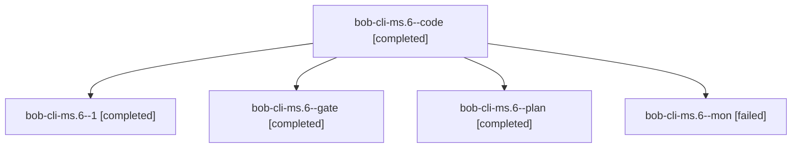

# Session: bob-cli-ms.6

[Agent Hoods](../README.md) / [bbugyi200](../users/bbugyi200/README.md) / [apollo](../users/bbugyi200/machines/apollo/README.md) / [bob-cli-ms](../users/bbugyi200/machines/apollo/hoods/bob-cli-ms/README.md) / bob-cli-ms.6

Owner: `bbugyi200.apollo` · Hood: `bob-cli-ms` · Members: 5 · Bead: [bob-cli-ms.6](https://github.com/bobs-org/bob-cli--beads/blob/main/pages/bob-cli-ms/bob-cli-ms.6.md)

## Lineage

The diagram is an optional enhancement; the ordered table below contains the same lineage in accessible text.

| Role | Agent | State | Model / provider | Timing | Commits | Prompt | Chat |
|---|---|---|---|---|---:|---|---|
| code | bob-cli-ms.6--code | completed | muse-spark-1.3-contributor / muse | 2026-11-17T23:06:11.951650+00:00 → 2026-11-18T00:10:14.304912+00:00 | 0 | — | [Chat](../agents/bbugyi200.apollo.bob-cli-ms.6--code/chat.md) |
| 1 | bob-cli-ms.6--1 | completed | muse-spark-1.3-contributor / muse | 2026-11-18T00:26:22.746779+00:00 → 2026-11-18T00:29:53.548417+00:00 | 0 | [Prompt](../agents/bbugyi200.apollo.bob-cli-ms.6--1/prompt.md) | [Chat](../agents/bbugyi200.apollo.bob-cli-ms.6--1/chat.md) |
| gate | bob-cli-ms.6--gate | completed | gpt-6-astra / codex | 2026-11-17T23:04:59.224222+00:00 → 2026-11-17T23:05:09.980404+00:00 | 0 | — | [Chat](../agents/bbugyi200.apollo.bob-cli-ms.6--gate/chat.md) |
| plan | bob-cli-ms.6--plan | completed | gpt-6-astra / codex | 2026-11-17T22:54:56.155231+00:00 → 2026-11-18T00:10:14.304912+00:00 | 0 | [Prompt](../agents/bbugyi200.apollo.bob-cli-ms.6--plan/prompt.md) | [Chat](../agents/bbugyi200.apollo.bob-cli-ms.6--plan/chat.md) |
| mon | bob-cli-ms.6--mon | failed | muse-spark-1.3-contributor / muse | 2026-11-18T00:08:17.033641+00:00 → 2026-11-18T00:26:22.999156+00:00 | 0 | — | [Chat](../agents/bbugyi200.apollo.bob-cli-ms.6--mon/chat.md) |

## Neighbors

| Agent | Relation | State |
|---|---|---|
| [bob-cli-ms.1](bbugyi200.apollo.bob-cli-ms.1.md) (session · 7) | bob-cli-ms hood | completed 5, failed 2 |
| [bob-cli-ms.2](../agents/bbugyi200.apollo.bob-cli-ms.2/README.md) | bob-cli-ms hood | completed |
| [bob-cli-ms.3](bbugyi200.apollo.bob-cli-ms.3.md) (session · 5) | bob-cli-ms hood | completed 5 |
| [bob-cli-ms.4](../agents/bbugyi200.apollo.bob-cli-ms.4/README.md) | bob-cli-ms hood | completed |
| [bob-cli-ms.5](bbugyi200.apollo.bob-cli-ms.5.md) (session · 5) | bob-cli-ms hood | completed 5 |
| [bob-cli-ms.7](../agents/bbugyi200.apollo.bob-cli-ms.7/README.md) | bob-cli-ms hood | completed |
| [bob-cli-ms.8.1](bbugyi200.apollo.bob-cli-ms.8.1.md) (session · 4) | bob-cli-ms hood | active 1, completed 2, failed 1 |
| [bob-cli-ms.8.2](../agents/bbugyi200.apollo.bob-cli-ms.8.2/README.md) | bob-cli-ms hood | waiting |
| [bob-cli-ms.8.3](../agents/bbugyi200.apollo.bob-cli-ms.8.3/README.md) | bob-cli-ms hood | waiting |
| [bob-cli-ms.8.land](../agents/bbugyi200.apollo.bob-cli-ms.8.land/README.md) | bob-cli-ms hood | waiting |
| [bob-cli-ms.land](bbugyi200.apollo.bob-cli-ms.land.md) (session · 3) | bob-cli-ms hood | active 1, completed 2 |
