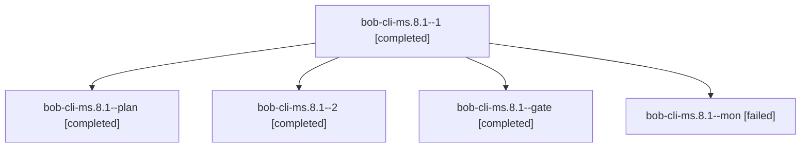

# Session: bob-cli-ms.8.1

[Agent Hoods](../README.md) / [bbugyi200](../users/bbugyi200/README.md) / [apollo](../users/bbugyi200/machines/apollo/README.md) / [bob-cli-ms](../users/bbugyi200/machines/apollo/hoods/bob-cli-ms/README.md) / bob-cli-ms.8.1

Owner: `bbugyi200.apollo` · Hood: `bob-cli-ms` · Members: 5 · Bead: [bob-cli-ms.8.1](https://github.com/bobs-org/bob-cli--beads/blob/main/pages/bob-cli-ms/bob-cli-ms.8.1.md)

## Lineage

The diagram is an optional enhancement; the ordered table below contains the same lineage in accessible text.

| Role | Agent | State | Model / provider | Timing | Commits | Prompt | Chat |
|---|---|---|---|---|---:|---|---|
| 1 | bob-cli-ms.8.1--1 | completed | gpt-6-luna / codex | 2026-11-18T03:55:53.825044+00:00 → 2026-11-18T04:13:50.629734+00:00 | 0 | [Prompt](../agents/bbugyi200.apollo.bob-cli-ms.8.1--1/prompt.md) | [Chat](../agents/bbugyi200.apollo.bob-cli-ms.8.1--1/chat.md) |
| plan | bob-cli-ms.8.1--plan | completed | gpt-6-luna / codex | 2026-11-18T03:28:05.296422+00:00 → 2026-11-18T03:51:22.464834+00:00 | 0 | [Prompt](../agents/bbugyi200.apollo.bob-cli-ms.8.1--plan/prompt.md) | [Chat](../agents/bbugyi200.apollo.bob-cli-ms.8.1--plan/chat.md) |
| 2 | bob-cli-ms.8.1--2 | completed | gpt-6-luna / codex | 2026-11-18T12:08:17.034043+00:00 → 2026-11-18T12:14:56.402588+00:00 | 0 | [Prompt](../agents/bbugyi200.apollo.bob-cli-ms.8.1--2/prompt.md) | [Chat](../agents/bbugyi200.apollo.bob-cli-ms.8.1--2/chat.md) |
| gate | bob-cli-ms.8.1--gate | completed | gpt-6-luna / codex | 2026-11-18T12:07:14.870268+00:00 → 2026-11-18T12:07:34.902039+00:00 | 0 | — | [Chat](../agents/bbugyi200.apollo.bob-cli-ms.8.1--gate/chat.md) |
| mon | bob-cli-ms.8.1--mon | failed | gpt-6-luna / codex | 2026-11-18T03:50:12.589474+00:00 → 2026-11-18T03:55:54.292290+00:00 | 0 | — | [Chat](../agents/bbugyi200.apollo.bob-cli-ms.8.1--mon/chat.md) |

## Neighbors

| Agent | Relation | State |
|---|---|---|
| [bob-cli-ms.8.2](../agents/bbugyi200.apollo.bob-cli-ms.8.2/README.md) | bob-cli-ms.8 hood | completed |
| [bob-cli-ms.8.3](../agents/bbugyi200.apollo.bob-cli-ms.8.3/README.md) | bob-cli-ms.8 hood | waiting |
| [bob-cli-ms.8.land](../agents/bbugyi200.apollo.bob-cli-ms.8.land/README.md) | bob-cli-ms.8 hood | waiting |
| [bob-cli-ms.1](bbugyi200.apollo.bob-cli-ms.1.md) (session · 7) | bob-cli-ms hood | completed 5, failed 2 |
| [bob-cli-ms.2](../agents/bbugyi200.apollo.bob-cli-ms.2/README.md) | bob-cli-ms hood | completed |
| [bob-cli-ms.3](bbugyi200.apollo.bob-cli-ms.3.md) (session · 5) | bob-cli-ms hood | completed 5 |
| [bob-cli-ms.4](../agents/bbugyi200.apollo.bob-cli-ms.4/README.md) | bob-cli-ms hood | completed |
| [bob-cli-ms.5](bbugyi200.apollo.bob-cli-ms.5.md) (session · 5) | bob-cli-ms hood | completed 5 |
| [bob-cli-ms.6](bbugyi200.apollo.bob-cli-ms.6.md) (session · 5) | bob-cli-ms hood | completed 4, failed 1 |
| [bob-cli-ms.6](../agents/bbugyi200.apollo.bob-cli-ms.6/README.md) | bob-cli-ms hood | completed |
| [bob-cli-ms.7](../agents/bbugyi200.apollo.bob-cli-ms.7/README.md) | bob-cli-ms hood | completed |
| [bob-cli-ms.land](bbugyi200.apollo.bob-cli-ms.land.md) (session · 3) | bob-cli-ms hood | active 1, completed 2 |
| [bob-cli-ms.land](../agents/bbugyi200.apollo.bob-cli-ms.land/README.md) | bob-cli-ms hood | completed |
