# Session: bob-cli-ms.8.3.1.1

[Agent Hoods](../README.md) / [bbugyi200](../users/bbugyi200/README.md) / [apollo](../users/bbugyi200/machines/apollo/README.md) / [bob-cli-ms](../users/bbugyi200/machines/apollo/hoods/bob-cli-ms/README.md) / bob-cli-ms.8.3.1.1

Owner: `bbugyi200.apollo` · Hood: `bob-cli-ms` · Members: 25 · Bead: [bob-cli-ms.8.3.1.1](https://github.com/bobs-org/bob-cli--beads/blob/main/pages/bob-cli-ms/bob-cli-ms.8.3.1.1.md)

## Lineage

```mermaid
flowchart TD
  n0["bob-cli-ms.8.3.1.1--mon-6 [failed]"]
  n1["bob-cli-ms.8.3.1.1--mon-4 [failed]"]
  n0 --> n1
  n2["bob-cli-ms.8.3.1.1--8 [completed]"]
  n0 --> n2
  n3["bob-cli-ms.8.3.1.1--mon-a [failed]"]
  n0 --> n3
  n4["bob-cli-ms.8.3.1.1--a [completed]"]
  n0 --> n4
  n5["bob-cli-ms.8.3.1.1--mon-2 [failed]"]
  n0 --> n5
  n6["bob-cli-ms.8.3.1.1--plan [completed]"]
  n0 --> n6
  n7["bob-cli-ms.8.3.1.1--3 [completed]"]
  n0 --> n7
  n8["bob-cli-ms.8.3.1.1--b [completed]"]
  n0 --> n8
  n9["bob-cli-ms.8.3.1.1--mon-0 [failed]"]
  n0 --> n9
  n10["bob-cli-ms.8.3.1.1--9 [completed]"]
  n0 --> n10
  n11["bob-cli-ms.8.3.1.1--mon-9 [failed]"]
  n0 --> n11
  n12["bob-cli-ms.8.3.1.1--mon-7 [failed]"]
  n0 --> n12
  n13["bob-cli-ms.8.3.1.1--2 [completed]"]
  n0 --> n13
  n14["bob-cli-ms.8.3.1.1--5 [completed]"]
  n0 --> n14
  n15["bob-cli-ms.8.3.1.1--c [active]"]
  n0 --> n15
  n16["bob-cli-ms.8.3.1.1--mon [failed]"]
  n0 --> n16
  n17["bob-cli-ms.8.3.1.1--mon-3 [failed]"]
  n0 --> n17
  n18["bob-cli-ms.8.3.1.1--6 [completed]"]
  n0 --> n18
  n19["bob-cli-ms.8.3.1.1--1 [completed]"]
  n0 --> n19
  n20["bob-cli-ms.8.3.1.1--mon-5 [failed]"]
  n0 --> n20
  n21["bob-cli-ms.8.3.1.1--4 [completed]"]
  n0 --> n21
  n22["bob-cli-ms.8.3.1.1--7 [completed]"]
  n0 --> n22
  n23["bob-cli-ms.8.3.1.1--mon-1 [failed]"]
  n0 --> n23
  n24["bob-cli-ms.8.3.1.1--mon-8 [failed]"]
  n0 --> n24
```



The diagram is an optional enhancement; the ordered table below contains the same lineage in accessible text.

| Role | Agent | State | Model / provider | Timing | Commits | Prompt | Chat |
|---|---|---|---|---|---:|---|---|
| <a id="member-mon-6"></a>mon-6 | bob-cli-ms.8.3.1.1--mon-6 | failed | gpt-6-luna / codex | 2026-11-18T16:25:00.907887+00:00 → 2026-11-18T16:27:49.852531+00:00 | 0 | — | [Chat](../agents/bbugyi200.apollo.bob-cli-ms.8.3.1.1--mon-6/chat.md) |
| <a id="member-mon-4"></a>mon-4 | bob-cli-ms.8.3.1.1--mon-4 | failed | gpt-6-luna / codex | 2026-11-18T15:51:44.382840+00:00 → 2026-11-18T15:59:15.964674+00:00 | 0 | — | [Chat](../agents/bbugyi200.apollo.bob-cli-ms.8.3.1.1--mon-4/chat.md) |
| <a id="member-8"></a>8 | bob-cli-ms.8.3.1.1--8 | completed | gpt-6-luna / codex | 2026-11-18T16:27:49.459372+00:00 → 2026-11-18T16:39:17.637932+00:00 | 0 | [Prompt](../agents/bbugyi200.apollo.bob-cli-ms.8.3.1.1--8/prompt.md) | [Chat](../agents/bbugyi200.apollo.bob-cli-ms.8.3.1.1--8/chat.md) |
| <a id="member-mon-a"></a>mon-a | bob-cli-ms.8.3.1.1--mon-a | failed | gpt-6-luna / codex | 2026-11-18T19:35:41.557684+00:00 → 2026-11-18T19:41:45.936470+00:00 | 0 | — | [Chat](../agents/bbugyi200.apollo.bob-cli-ms.8.3.1.1--mon-a/chat.md) |
| <a id="member-a"></a>a | bob-cli-ms.8.3.1.1--a | completed | gpt-6-luna / codex | 2026-11-18T16:52:26.854130+00:00 → 2026-11-18T19:16:30.164536+00:00 | 0 | [Prompt](../agents/bbugyi200.apollo.bob-cli-ms.8.3.1.1--a/prompt.md) | [Chat](../agents/bbugyi200.apollo.bob-cli-ms.8.3.1.1--a/chat.md) |
| <a id="member-mon-2"></a>mon-2 | bob-cli-ms.8.3.1.1--mon-2 | failed | gpt-6-luna / codex | 2026-11-18T15:09:55.828387+00:00 → 2026-11-18T15:17:23.716144+00:00 | 0 | — | [Chat](../agents/bbugyi200.apollo.bob-cli-ms.8.3.1.1--mon-2/chat.md) |
| <a id="member-plan"></a>plan | bob-cli-ms.8.3.1.1--plan | completed | gpt-6-luna / codex | 2026-11-18T14:01:01.141062+00:00 → 2026-11-18T14:32:43.290689+00:00 | 0 | [Prompt](../agents/bbugyi200.apollo.bob-cli-ms.8.3.1.1--plan/prompt.md) | [Chat](../agents/bbugyi200.apollo.bob-cli-ms.8.3.1.1--plan/chat.md) |
| <a id="member-3"></a>3 | bob-cli-ms.8.3.1.1--3 | completed | gpt-6-luna / codex | 2026-11-18T15:05:39.463557+00:00 → 2026-11-18T15:11:01.424635+00:00 | 0 | [Prompt](../agents/bbugyi200.apollo.bob-cli-ms.8.3.1.1--3/prompt.md) | [Chat](../agents/bbugyi200.apollo.bob-cli-ms.8.3.1.1--3/chat.md) |
| <a id="member-b"></a>b | bob-cli-ms.8.3.1.1--b | completed | gpt-6-luna / codex | 2026-11-18T19:18:48.636781+00:00 → 2026-11-18T19:37:39.883068+00:00 | 0 | [Prompt](../agents/bbugyi200.apollo.bob-cli-ms.8.3.1.1--b/prompt.md) | [Chat](../agents/bbugyi200.apollo.bob-cli-ms.8.3.1.1--b/chat.md) |
| <a id="member-mon-0"></a>mon-0 | bob-cli-ms.8.3.1.1--mon-0 | failed | gpt-6-luna / codex | 2026-11-18T14:44:45.592701+00:00 → 2026-11-18T14:51:09.742460+00:00 | 0 | — | [Chat](../agents/bbugyi200.apollo.bob-cli-ms.8.3.1.1--mon-0/chat.md) |
| <a id="member-9"></a>9 | bob-cli-ms.8.3.1.1--9 | completed | gpt-6-luna / codex | 2026-11-18T16:44:02.609143+00:00 → 2026-11-18T16:50:13.001907+00:00 | 0 | [Prompt](../agents/bbugyi200.apollo.bob-cli-ms.8.3.1.1--9/prompt.md) | [Chat](../agents/bbugyi200.apollo.bob-cli-ms.8.3.1.1--9/chat.md) |
| <a id="member-mon-9"></a>mon-9 | bob-cli-ms.8.3.1.1--mon-9 | failed | gpt-6-luna / codex | 2026-11-18T19:14:31.097736+00:00 → 2026-11-18T19:18:48.936810+00:00 | 0 | — | [Chat](../agents/bbugyi200.apollo.bob-cli-ms.8.3.1.1--mon-9/chat.md) |
| <a id="member-mon-7"></a>mon-7 | bob-cli-ms.8.3.1.1--mon-7 | failed | gpt-6-luna / codex | 2026-11-18T16:38:19.299329+00:00 → 2026-11-18T16:44:02.945766+00:00 | 0 | — | [Chat](../agents/bbugyi200.apollo.bob-cli-ms.8.3.1.1--mon-7/chat.md) |
| <a id="member-2"></a>2 | bob-cli-ms.8.3.1.1--2 | completed | gpt-6-luna / codex | 2026-11-18T14:51:09.250133+00:00 → 2026-11-18T14:58:00.827649+00:00 | 0 | [Prompt](../agents/bbugyi200.apollo.bob-cli-ms.8.3.1.1--2/prompt.md) | [Chat](../agents/bbugyi200.apollo.bob-cli-ms.8.3.1.1--2/chat.md) |
| <a id="member-5"></a>5 | bob-cli-ms.8.3.1.1--5 | completed | gpt-6-luna / codex | 2026-11-18T15:45:21.434377+00:00 → 2026-11-18T15:52:45.094809+00:00 | 0 | [Prompt](../agents/bbugyi200.apollo.bob-cli-ms.8.3.1.1--5/prompt.md) | [Chat](../agents/bbugyi200.apollo.bob-cli-ms.8.3.1.1--5/chat.md) |
| <a id="member-c"></a>c | bob-cli-ms.8.3.1.1--c | active | gpt-6-luna / codex | 2026-11-18T19:41:44.983270+00:00 | [1](../agents/bbugyi200.apollo.bob-cli-ms.8.3.1.1--c/README.md#commits) | [Prompt](../agents/bbugyi200.apollo.bob-cli-ms.8.3.1.1--c/prompt.md) | — |
| <a id="member-mon"></a>mon | bob-cli-ms.8.3.1.1--mon | failed | gpt-6-luna / codex | 2026-11-18T14:31:46.477477+00:00 → 2026-11-18T14:38:26.343296+00:00 | 0 | — | [Chat](../agents/bbugyi200.apollo.bob-cli-ms.8.3.1.1--mon/chat.md) |
| <a id="member-mon-3"></a>mon-3 | bob-cli-ms.8.3.1.1--mon-3 | failed | gpt-6-luna / codex | 2026-11-18T15:42:07.766577+00:00 → 2026-11-18T15:45:21.560044+00:00 | 0 | — | [Chat](../agents/bbugyi200.apollo.bob-cli-ms.8.3.1.1--mon-3/chat.md) |
| <a id="member-6"></a>6 | bob-cli-ms.8.3.1.1--6 | completed | gpt-6-luna / codex | 2026-11-18T15:59:15.667151+00:00 → 2026-11-18T16:09:37.564918+00:00 | 0 | [Prompt](../agents/bbugyi200.apollo.bob-cli-ms.8.3.1.1--6/prompt.md) | [Chat](../agents/bbugyi200.apollo.bob-cli-ms.8.3.1.1--6/chat.md) |
| <a id="member-1"></a>1 | bob-cli-ms.8.3.1.1--1 | completed | gpt-6-luna / codex | 2026-11-18T14:38:26.185793+00:00 → 2026-11-18T14:45:43.295654+00:00 | 0 | [Prompt](../agents/bbugyi200.apollo.bob-cli-ms.8.3.1.1--1/prompt.md) | [Chat](../agents/bbugyi200.apollo.bob-cli-ms.8.3.1.1--1/chat.md) |
| <a id="member-mon-5"></a>mon-5 | bob-cli-ms.8.3.1.1--mon-5 | failed | gpt-6-luna / codex | 2026-11-18T16:08:21.303664+00:00 → 2026-11-18T16:15:24.781431+00:00 | 0 | — | [Chat](../agents/bbugyi200.apollo.bob-cli-ms.8.3.1.1--mon-5/chat.md) |
| <a id="member-4"></a>4 | bob-cli-ms.8.3.1.1--4 | completed | gpt-6-luna / codex | 2026-11-18T15:17:23.331340+00:00 → 2026-11-18T15:43:25.989027+00:00 | 0 | [Prompt](../agents/bbugyi200.apollo.bob-cli-ms.8.3.1.1--4/prompt.md) | [Chat](../agents/bbugyi200.apollo.bob-cli-ms.8.3.1.1--4/chat.md) |
| <a id="member-7"></a>7 | bob-cli-ms.8.3.1.1--7 | completed | gpt-6-luna / codex | 2026-11-18T16:15:24.675999+00:00 → 2026-11-18T16:26:13.081033+00:00 | 0 | [Prompt](../agents/bbugyi200.apollo.bob-cli-ms.8.3.1.1--7/prompt.md) | [Chat](../agents/bbugyi200.apollo.bob-cli-ms.8.3.1.1--7/chat.md) |
| <a id="member-mon-1"></a>mon-1 | bob-cli-ms.8.3.1.1--mon-1 | failed | gpt-6-luna / codex | 2026-11-18T14:57:13.036044+00:00 → 2026-11-18T15:05:39.746425+00:00 | 0 | — | [Chat](../agents/bbugyi200.apollo.bob-cli-ms.8.3.1.1--mon-1/chat.md) |
| <a id="member-mon-8"></a>mon-8 | bob-cli-ms.8.3.1.1--mon-8 | failed | gpt-6-luna / codex | 2026-11-18T16:49:17.723463+00:00 → 2026-11-18T16:52:27.198443+00:00 | 0 | — | [Chat](../agents/bbugyi200.apollo.bob-cli-ms.8.3.1.1--mon-8/chat.md) |

## Commits

| Role | Repo | Commit | Subject | Committed |
|---|---|---|---|---|
| c | bob-cli | [`3b5490c`](https://github.com/bobs-org/bob-cli/commit/3b5490c1ad415f61b710f3fe4eea500378c1210d) | feat(records): show, check, and tidy learn the record walk line | 2026-11-18 13:45:59 EST |

## Variables

| Role | Variable | Value |
|---|---|---|
| a | `artifacts` | \[{bead: bob-cli-ms.8.3.1.1, kind: file, label: Record Card phase-one Obsidian acceptance report, path: /home/bryan/.sase/artifacts/agents/gh\_bobs-org\_\_bob-cli/20261118115134/report-a7c939a490e5.json,… |

#### artifacts

**Role:** `a`

```yaml
- bead: bob-cli-ms.8.3.1.1
  kind: file
  label: Record Card phase-one Obsidian acceptance report
  path: /home/bryan/.sase/artifacts/agents/gh_bobs-org__bob-cli/20261118115134/report-a7c939a490e5.json
  ref: file:explicit:bed2e0d97ccd3a2624288065
  source_path: /home/bryan/.local/state/sase/workspaces/bobs-org/bob-cli/bob-cli_10/.evidence/record-card-phase1-20261118/run-21/report.json
- bead: bob-cli-ms.8.3.1.1
  kind: image
  label: Record Card acceptance: frontmatter-only reading
  path: /home/bryan/.sase/artifacts/agents/gh_bobs-org__bob-cli/20261118115134/record-sheet-frontmatter-only-reading-b24cd1f093c2.png
  ref: file:explicit:769e949c1dbb69085e10b4c5
  source_path: /home/bryan/.local/state/sase/workspaces/bobs-org/bob-cli/bob-cli_10/.evidence/record-card-phase1-20261118/run-21/shots/record-sheet-frontmatter-only-reading.png
- bead: bob-cli-ms.8.3.1.1
  kind: image
  label: Record Card acceptance: live dark wide
  path: /home/bryan/.sase/artifacts/agents/gh_bobs-org__bob-cli/20261118115134/record-sheet-live-dark-wide-763ad3c5b0b4.png
  ref: file:explicit:2d289bd2417cd27d4dd5c48c
  source_path: /home/bryan/.local/state/sase/workspaces/bobs-org/bob-cli/bob-cli_10/.evidence/record-card-phase1-20261118/run-21/shots/record-sheet-live-dark-wide.png
- bead: bob-cli-ms.8.3.1.1
  kind: image
  label: Record Card acceptance: folded properties open
  path: /home/bryan/.sase/artifacts/agents/gh_bobs-org__bob-cli/20261118115134/record-sheet-fold-open-6634253d0449.png
  ref: file:explicit:09ac8f1ecf45e0f8ddb8b199
  source_path: /home/bryan/.local/state/sase/workspaces/bobs-org/bob-cli/bob-cli_10/.evidence/record-card-phase1-20261118/run-21/shots/record-sheet-fold-open.png
- bead: bob-cli-ms.8.3.1.1
  kind: image
  label: Record Card acceptance: live light 375px
  path: /home/bryan/.sase/artifacts/agents/gh_bobs-org__bob-cli/20261118115134/record-sheet-live-light-375-ffc1084fb2f6.png
  ref: file:explicit:a95227eb6d04ff49fc29fa6a
  source_path: /home/bryan/.local/state/sase/workspaces/bobs-org/bob-cli/bob-cli_10/.evidence/record-card-phase1-20261118/run-21/shots/record-sheet-live-light-375.png
- bead: bob-cli-ms.8.3.1.1
  kind: image
  label: Record Card acceptance: collapsed
  path: /home/bryan/.sase/artifacts/agents/gh_bobs-org__bob-cli/20261118115134/record-sheet-collapsed-e1efde1a6482.png
  ref: file:explicit:c57752fb786326f0222d5286
  source_path: /home/bryan/.local/state/sase/workspaces/bobs-org/bob-cli/bob-cli_10/.evidence/record-card-phase1-20261118/run-21/shots/record-sheet-collapsed.png
- bead: bob-cli-ms.8.3.1.1
  kind: image
  label: Record Card acceptance: live light wide
  path: /home/bryan/.sase/artifacts/agents/gh_bobs-org__bob-cli/20261118115134/record-sheet-live-light-wide-c000c52ef2bb.png
  ref: file:explicit:e28e8d1413ec5b4b13bfb89e
  source_path: /home/bryan/.local/state/sase/workspaces/bobs-org/bob-cli/bob-cli_10/.evidence/record-card-phase1-20261118/run-21/shots/record-sheet-live-light-wide.png
- bead: bob-cli-ms.8.3.1.1
  kind: file
  label: Bob plugins deployed-vault startup smoke report
  path: /home/bryan/.sase/artifacts/agents/gh_bobs-org__bob-cli/20261118115134/post-sync-startup-smoke-166dd610e8de.json
  ref: file:explicit:36bbab23c7b6af310f23ac9e
  source_path: /home/bryan/.local/state/sase/workspaces/bobs-org/bob-cli/bob-cli_10/.evidence/record-card-phase1-20261118/post-sync-startup-smoke.json
```

Values are truncated for display; see each member's agent meta.json for the full values.

## Neighbors

| Agent | Relation | State |
|---|---|---|
| [bob-cli-ms.8.3](bbugyi200.apollo.bob-cli-ms.8.3.md) (session · 3) | ancestor | active 1, completed 2 |
| [bob-cli-ms.8.3.1.2](../agents/bbugyi200.apollo.bob-cli-ms.8.3.1.2/README.md) | bob-cli-ms.8.3.1 hood | waiting |
| [bob-cli-ms.8.3.1.3](../agents/bbugyi200.apollo.bob-cli-ms.8.3.1.3/README.md) | bob-cli-ms.8.3.1 hood | waiting |
| [bob-cli-ms.8.3.1.land](../agents/bbugyi200.apollo.bob-cli-ms.8.3.1.land/README.md) | bob-cli-ms.8.3.1 hood | waiting |
| [bob-cli-ms.8.1](bbugyi200.apollo.bob-cli-ms.8.1.md) (session · 5) | bob-cli-ms.8 hood | completed 4, failed 1 |
| [bob-cli-ms.8.2](../agents/bbugyi200.apollo.bob-cli-ms.8.2/README.md) | bob-cli-ms.8 hood | completed |
| [bob-cli-ms.8.land](../agents/bbugyi200.apollo.bob-cli-ms.8.land/README.md) | bob-cli-ms.8 hood | waiting |
| [bob-cli-ms.1](bbugyi200.apollo.bob-cli-ms.1.md) (session · 7) | bob-cli-ms hood | completed 5, failed 2 |
| [bob-cli-ms.2](../agents/bbugyi200.apollo.bob-cli-ms.2/README.md) | bob-cli-ms hood | completed |
| [bob-cli-ms.3](bbugyi200.apollo.bob-cli-ms.3.md) (session · 5) | bob-cli-ms hood | completed 5 |
| [bob-cli-ms.4](../agents/bbugyi200.apollo.bob-cli-ms.4/README.md) | bob-cli-ms hood | completed |
| [bob-cli-ms.5](bbugyi200.apollo.bob-cli-ms.5.md) (session · 5) | bob-cli-ms hood | completed 5 |
| [bob-cli-ms.6](bbugyi200.apollo.bob-cli-ms.6.md) (session · 5) | bob-cli-ms hood | completed 4, failed 1 |
| [bob-cli-ms.6](../agents/bbugyi200.apollo.bob-cli-ms.6/README.md) | bob-cli-ms hood | completed |
| [bob-cli-ms.7](../agents/bbugyi200.apollo.bob-cli-ms.7/README.md) | bob-cli-ms hood | completed |
| [bob-cli-ms.land](bbugyi200.apollo.bob-cli-ms.land.md) (session · 3) | bob-cli-ms hood | active 1, completed 2 |
| [bob-cli-ms.land](../agents/bbugyi200.apollo.bob-cli-ms.land/README.md) | bob-cli-ms hood | completed |
