# Session: bob-cli-ms.8.3.1.1

[Agent Hoods](../README.md) / [bbugyi200](../users/bbugyi200/README.md) / [apollo](../users/bbugyi200/machines/apollo/README.md) / [bob-cli-ms](../users/bbugyi200/machines/apollo/hoods/bob-cli-ms/README.md) / bob-cli-ms.8.3.1.1

Owner: `bbugyi200.apollo` · Hood: `bob-cli-ms` · Members: 25 · Bead: [bob-cli-ms.8.3.1.1](https://github.com/bobs-org/bob-cli--beads/blob/main/pages/bob-cli-ms/bob-cli-ms.8.3.1.1.md)

## Lineage

```mermaid
flowchart TD
  n0["bob-cli-ms.8.3.1.1--mon-6 [failed]"]
  n1["bob-cli-ms.8.3.1.1--3 [completed]"]
  n0 --> n1
  n2["bob-cli-ms.8.3.1.1--mon-2 [failed]"]
  n0 --> n2
  n3["bob-cli-ms.8.3.1.1--mon-4 [failed]"]
  n0 --> n3
  n4["bob-cli-ms.8.3.1.1--plan [completed]"]
  n0 --> n4
  n5["bob-cli-ms.8.3.1.1--8 [completed]"]
  n0 --> n5
  n6["bob-cli-ms.8.3.1.1--mon-a [failed]"]
  n0 --> n6
  n7["bob-cli-ms.8.3.1.1--a [completed]"]
  n0 --> n7
  n8["bob-cli-ms.8.3.1.1--mon-1 [failed]"]
  n0 --> n8
  n9["bob-cli-ms.8.3.1.1--b [completed]"]
  n0 --> n9
  n10["bob-cli-ms.8.3.1.1--9 [completed]"]
  n0 --> n10
  n11["bob-cli-ms.8.3.1.1--1 [completed]"]
  n0 --> n11
  n12["bob-cli-ms.8.3.1.1--mon-9 [failed]"]
  n0 --> n12
  n13["bob-cli-ms.8.3.1.1--mon-7 [failed]"]
  n0 --> n13
  n14["bob-cli-ms.8.3.1.1--mon [failed]"]
  n0 --> n14
  n15["bob-cli-ms.8.3.1.1--mon-0 [failed]"]
  n0 --> n15
  n16["bob-cli-ms.8.3.1.1--5 [completed]"]
  n0 --> n16
  n17["bob-cli-ms.8.3.1.1--c [active]"]
  n0 --> n17
  n18["bob-cli-ms.8.3.1.1--2 [completed]"]
  n0 --> n18
  n19["bob-cli-ms.8.3.1.1--4 [completed]"]
  n0 --> n19
  n20["bob-cli-ms.8.3.1.1--mon-3 [failed]"]
  n0 --> n20
  n21["bob-cli-ms.8.3.1.1--6 [completed]"]
  n0 --> n21
  n22["bob-cli-ms.8.3.1.1--mon-5 [failed]"]
  n0 --> n22
  n23["bob-cli-ms.8.3.1.1--7 [completed]"]
  n0 --> n23
  n24["bob-cli-ms.8.3.1.1--mon-8 [failed]"]
  n0 --> n24
```



The diagram is an optional enhancement; the ordered table below contains the same lineage in accessible text.

| Role | Agent | State | Model / provider | Timing | Commits | Prompt | Chat |
|---|---|---|---|---|---:|---|---|
| <a id="member-mon-6"></a>mon-6 | bob-cli-ms.8.3.1.1--mon-6 | failed | gpt-6-luna / codex | 2026-11-18T16:25:00.907887+00:00 → 2026-11-18T16:27:49.852531+00:00 | 0 | — | [Chat](../agents/bbugyi200.apollo.bob-cli-ms.8.3.1.1--mon-6/chat.md) |
| <a id="member-3"></a>3 | bob-cli-ms.8.3.1.1--3 | completed | gpt-6-astra / codex | 2026-11-18T22:29:48.597549+00:00 → 2026-11-18T22:37:57.887062+00:00 | 0 | [Prompt](../agents/bbugyi200.apollo.bob-cli-ms.8.3.1.1--3/prompt.md) | [Chat](../agents/bbugyi200.apollo.bob-cli-ms.8.3.1.1--3/chat.md) |
| <a id="member-mon-2"></a>mon-2 | bob-cli-ms.8.3.1.1--mon-2 | failed | gpt-6-astra / codex | 2026-11-18T22:36:55.339321+00:00 → 2026-11-18T22:54:39.158453+00:00 | 0 | — | [Chat](../agents/bbugyi200.apollo.bob-cli-ms.8.3.1.1--mon-2/chat.md) |
| <a id="member-mon-4"></a>mon-4 | bob-cli-ms.8.3.1.1--mon-4 | failed | gpt-6-luna / codex | 2026-11-18T15:51:44.382840+00:00 → 2026-11-18T15:59:15.964674+00:00 | 0 | — | [Chat](../agents/bbugyi200.apollo.bob-cli-ms.8.3.1.1--mon-4/chat.md) |
| <a id="member-plan"></a>plan | bob-cli-ms.8.3.1.1--plan | completed | gpt-6-astra / codex | 2026-11-18T20:37:24.405697+00:00 → 2026-11-18T20:53:27.040569+00:00 | 0 | [Prompt](../agents/bbugyi200.apollo.bob-cli-ms.8.3.1.1--plan/prompt.md) | [Chat](../agents/bbugyi200.apollo.bob-cli-ms.8.3.1.1--plan/chat.md) |
| <a id="member-8"></a>8 | bob-cli-ms.8.3.1.1--8 | completed | gpt-6-luna / codex | 2026-11-18T16:27:49.459372+00:00 → 2026-11-18T16:39:17.637932+00:00 | 0 | [Prompt](../agents/bbugyi200.apollo.bob-cli-ms.8.3.1.1--8/prompt.md) | [Chat](../agents/bbugyi200.apollo.bob-cli-ms.8.3.1.1--8/chat.md) |
| <a id="member-mon-a"></a>mon-a | bob-cli-ms.8.3.1.1--mon-a | failed | gpt-6-luna / codex | 2026-11-18T19:35:41.557684+00:00 → 2026-11-18T19:41:45.936470+00:00 | 0 | — | [Chat](../agents/bbugyi200.apollo.bob-cli-ms.8.3.1.1--mon-a/chat.md) |
| <a id="member-a"></a>a | bob-cli-ms.8.3.1.1--a | completed | gpt-6-luna / codex | 2026-11-18T16:52:26.854130+00:00 → 2026-11-18T19:16:30.164536+00:00 | 0 | [Prompt](../agents/bbugyi200.apollo.bob-cli-ms.8.3.1.1--a/prompt.md) | [Chat](../agents/bbugyi200.apollo.bob-cli-ms.8.3.1.1--a/chat.md) |
| <a id="member-mon-1"></a>mon-1 | bob-cli-ms.8.3.1.1--mon-1 | failed | gpt-6-astra / codex | 2026-11-18T22:24:04.874872+00:00 → 2026-11-18T22:29:48.915499+00:00 | 0 | — | [Chat](../agents/bbugyi200.apollo.bob-cli-ms.8.3.1.1--mon-1/chat.md) |
| <a id="member-b"></a>b | bob-cli-ms.8.3.1.1--b | completed | gpt-6-luna / codex | 2026-11-18T19:18:48.636781+00:00 → 2026-11-18T19:37:39.883068+00:00 | 0 | [Prompt](../agents/bbugyi200.apollo.bob-cli-ms.8.3.1.1--b/prompt.md) | [Chat](../agents/bbugyi200.apollo.bob-cli-ms.8.3.1.1--b/chat.md) |
| <a id="member-9"></a>9 | bob-cli-ms.8.3.1.1--9 | completed | gpt-6-luna / codex | 2026-11-18T16:44:02.609143+00:00 → 2026-11-18T16:50:13.001907+00:00 | 0 | [Prompt](../agents/bbugyi200.apollo.bob-cli-ms.8.3.1.1--9/prompt.md) | [Chat](../agents/bbugyi200.apollo.bob-cli-ms.8.3.1.1--9/chat.md) |
| <a id="member-1"></a>1 | bob-cli-ms.8.3.1.1--1 | completed | gpt-6-astra / codex | 2026-11-18T21:34:04.093773+00:00 → 2026-11-18T22:11:30.237730+00:00 | 0 | [Prompt](../agents/bbugyi200.apollo.bob-cli-ms.8.3.1.1--1/prompt.md) | [Chat](../agents/bbugyi200.apollo.bob-cli-ms.8.3.1.1--1/chat.md) |
| <a id="member-mon-9"></a>mon-9 | bob-cli-ms.8.3.1.1--mon-9 | failed | gpt-6-luna / codex | 2026-11-18T19:14:31.097736+00:00 → 2026-11-18T19:18:48.936810+00:00 | 0 | — | [Chat](../agents/bbugyi200.apollo.bob-cli-ms.8.3.1.1--mon-9/chat.md) |
| <a id="member-mon-7"></a>mon-7 | bob-cli-ms.8.3.1.1--mon-7 | failed | gpt-6-luna / codex | 2026-11-18T16:38:19.299329+00:00 → 2026-11-18T16:44:02.945766+00:00 | 0 | — | [Chat](../agents/bbugyi200.apollo.bob-cli-ms.8.3.1.1--mon-7/chat.md) |
| <a id="member-mon"></a>mon | bob-cli-ms.8.3.1.1--mon | failed | gpt-6-astra / codex | 2026-11-18T20:52:13.050427+00:00 → 2026-11-18T21:34:04.457697+00:00 | 0 | — | [Chat](../agents/bbugyi200.apollo.bob-cli-ms.8.3.1.1--mon/chat.md) |
| <a id="member-mon-0"></a>mon-0 | bob-cli-ms.8.3.1.1--mon-0 | failed | gpt-6-astra / codex | 2026-11-18T22:10:14.414196+00:00 → 2026-11-18T22:14:44.620774+00:00 | 0 | — | [Chat](../agents/bbugyi200.apollo.bob-cli-ms.8.3.1.1--mon-0/chat.md) |
| <a id="member-5"></a>5 | bob-cli-ms.8.3.1.1--5 | completed | gpt-6-luna / codex | 2026-11-18T15:45:21.434377+00:00 → 2026-11-18T15:52:45.094809+00:00 | 0 | [Prompt](../agents/bbugyi200.apollo.bob-cli-ms.8.3.1.1--5/prompt.md) | [Chat](../agents/bbugyi200.apollo.bob-cli-ms.8.3.1.1--5/chat.md) |
| <a id="member-c"></a>c | bob-cli-ms.8.3.1.1--c | active | gpt-6-luna / codex | 2026-11-18T19:41:44.983270+00:00 | [1](../agents/bbugyi200.apollo.bob-cli-ms.8.3.1.1--c/README.md#commits) | [Prompt](../agents/bbugyi200.apollo.bob-cli-ms.8.3.1.1--c/prompt.md) | — |
| <a id="member-2"></a>2 | bob-cli-ms.8.3.1.1--2 | completed | gpt-6-astra / codex | 2026-11-18T22:14:44.135048+00:00 → 2026-11-18T22:25:15.721809+00:00 | 0 | [Prompt](../agents/bbugyi200.apollo.bob-cli-ms.8.3.1.1--2/prompt.md) | [Chat](../agents/bbugyi200.apollo.bob-cli-ms.8.3.1.1--2/chat.md) |
| <a id="member-4"></a>4 | bob-cli-ms.8.3.1.1--4 | completed | gpt-6-astra / codex | 2026-11-18T22:54:39.028347+00:00 → 2026-11-18T23:03:15.923163+00:00 | 0 | [Prompt](../agents/bbugyi200.apollo.bob-cli-ms.8.3.1.1--4/prompt.md) | [Chat](../agents/bbugyi200.apollo.bob-cli-ms.8.3.1.1--4/chat.md) |
| <a id="member-mon-3"></a>mon-3 | bob-cli-ms.8.3.1.1--mon-3 | failed | gpt-6-luna / codex | 2026-11-18T15:42:07.766577+00:00 → 2026-11-18T15:45:21.560044+00:00 | 0 | — | [Chat](../agents/bbugyi200.apollo.bob-cli-ms.8.3.1.1--mon-3/chat.md) |
| <a id="member-6"></a>6 | bob-cli-ms.8.3.1.1--6 | completed | gpt-6-luna / codex | 2026-11-18T15:59:15.667151+00:00 → 2026-11-18T16:09:37.564918+00:00 | 0 | [Prompt](../agents/bbugyi200.apollo.bob-cli-ms.8.3.1.1--6/prompt.md) | [Chat](../agents/bbugyi200.apollo.bob-cli-ms.8.3.1.1--6/chat.md) |
| <a id="member-mon-5"></a>mon-5 | bob-cli-ms.8.3.1.1--mon-5 | failed | gpt-6-luna / codex | 2026-11-18T16:08:21.303664+00:00 → 2026-11-18T16:15:24.781431+00:00 | 0 | — | [Chat](../agents/bbugyi200.apollo.bob-cli-ms.8.3.1.1--mon-5/chat.md) |
| <a id="member-7"></a>7 | bob-cli-ms.8.3.1.1--7 | completed | gpt-6-luna / codex | 2026-11-18T16:15:24.675999+00:00 → 2026-11-18T16:26:13.081033+00:00 | 0 | [Prompt](../agents/bbugyi200.apollo.bob-cli-ms.8.3.1.1--7/prompt.md) | [Chat](../agents/bbugyi200.apollo.bob-cli-ms.8.3.1.1--7/chat.md) |
| <a id="member-mon-8"></a>mon-8 | bob-cli-ms.8.3.1.1--mon-8 | failed | gpt-6-luna / codex | 2026-11-18T16:49:17.723463+00:00 → 2026-11-18T16:52:27.198443+00:00 | 0 | — | [Chat](../agents/bbugyi200.apollo.bob-cli-ms.8.3.1.1--mon-8/chat.md) |

## Commits

| Role | Repo | Commit | Subject | Committed |
|---|---|---|---|---|
| c | bob-cli | [`3b5490c`](https://github.com/bobs-org/bob-cli/commit/3b5490c1ad415f61b710f3fe4eea500378c1210d) | feat(records): show, check, and tidy learn the record walk line | 2026-11-18 13:45:59 EST |

## Variables

| Role | Variable | Value |
|---|---|---|
| 1 | `artifacts` | \[{bead: bob-cli-ms.8.3.1.1, kind: file, label: Old-build diagnostic: summary.json, path: /home/bryan/.sase/artifacts/agents/gh\_bobs-org\_\_bob-cli/20261118163320/summary-63c175634d44.json, ref: file:ex… |
| 2 | `artifacts` | \[{kind: file, label: Selective Properties exact-source diagnostic visual verdict, path: /home/bryan/.sase/artifacts/agents/gh\_bobs-org\_\_bob-cli/20261118171404/visual-verdict-7482203f18e8.json, ref: f… |
| a | `artifacts` | \[{bead: bob-cli-ms.8.3.1.1, kind: file, label: Record Card phase-one Obsidian acceptance report, path: /home/bryan/.sase/artifacts/agents/gh\_bobs-org\_\_bob-cli/20261118115134/report-a7c939a490e5.json,… |

#### artifacts

**Role:** `1`

```yaml
- bead: bob-cli-ms.8.3.1.1
  kind: file
  label: Old-build diagnostic: summary.json
  path: /home/bryan/.sase/artifacts/agents/gh_bobs-org__bob-cli/20261118163320/summary-63c175634d44.json
  ref: file:explicit:32c4800323de3318e872cd4a
  source_path: /home/bryan/.local/state/sase/workspaces/bobs-org/bob-cli/bob-cli_10/.build/property-hiding/verification/summary.json
- bead: bob-cli-ms.8.3.1.1
  kind: file
  label: Old-build diagnostic: record-proof.json
  path: /home/bryan/.sase/artifacts/agents/gh_bobs-org__bob-cli/20261118163320/record-proof-60a457878a5e.json
  ref: file:explicit:69e78b5146f8344dfbee4b8d
  source_path: /home/bryan/.local/state/sase/workspaces/bobs-org/bob-cli/bob-cli_10/.build/property-hiding/verification/results/record-proof.json
- bead: bob-cli-ms.8.3.1.1
  kind: file
  label: Old-build diagnostic: presync-smoke.json
  path: /home/bryan/.sase/artifacts/agents/gh_bobs-org__bob-cli/20261118163320/presync-smoke-64167800eb75.json
  ref: file:explicit:ecedee8cd441a00ce81a2254
  source_path: /home/bryan/.local/state/sase/workspaces/bobs-org/bob-cli/bob-cli_10/.build/property-hiding/verification/results/presync-smoke.json
- bead: bob-cli-ms.8.3.1.1
  kind: file
  label: Old-build diagnostic: visual-review.json
  path: /home/bryan/.sase/artifacts/agents/gh_bobs-org__bob-cli/20261118163320/visual-review-ec5e3c7bbc73.json
  ref: file:explicit:c42d353930bd8de15dfec953
  source_path: /home/bryan/.local/state/sase/workspaces/bobs-org/bob-cli/bob-cli_10/.build/property-hiding/verification/visual-review.json
- bead: bob-cli-ms.8.3.1.1
  kind: image
  label: Old-build diagnostic: record-sheet-frontmatter-only-reading.png
  path: /home/bryan/.sase/artifacts/agents/gh_bobs-org__bob-cli/20261118163320/record-sheet-frontmatter-only-reading-4541c43ab6f0.png
  ref: file:explicit:e6af3da4c2cf3cca7a5e83be
  source_path: /home/bryan/.local/state/sase/workspaces/bobs-org/bob-cli/bob-cli_10/.build/property-hiding/verification/results/screenshots/record-sheet-frontmatter-only-reading.png
- bead: bob-cli-ms.8.3.1.1
  kind: image
  label: Old-build diagnostic: record-sheet-fold-open.png
  path: /home/bryan/.sase/artifacts/agents/gh_bobs-org__bob-cli/20261118163320/record-sheet-fold-open-3ae2314e498c.png
  ref: file:explicit:b95c3d1b4c03960a27a905fd
  source_path: /home/bryan/.local/state/sase/workspaces/bobs-org/bob-cli/bob-cli_10/.build/property-hiding/verification/results/screenshots/record-sheet-fold-open.png
- bead: bob-cli-ms.8.3.1.1
  kind: image
  label: Old-build diagnostic: record-sheet-live-dark-wide.png
  path: /home/bryan/.sase/artifacts/agents/gh_bobs-org__bob-cli/20261118163320/record-sheet-live-dark-wide-8b178a5c151e.png
  ref: file:explicit:db1f2dd2bb9e80837e28c708
  source_path: /home/bryan/.local/state/sase/workspaces/bobs-org/bob-cli/bob-cli_10/.build/property-hiding/verification/results/screenshots/record-sheet-live-dark-wide.png
- bead: bob-cli-ms.8.3.1.1
  kind: image
  label: Old-build diagnostic: record-sheet-live-light-375.png
  path: /home/bryan/.sase/artifacts/agents/gh_bobs-org__bob-cli/20261118163320/record-sheet-live-light-375-809e6e624d23.png
  ref: file:explicit:b06414849f893e4e157517c7
  source_path: /home/bryan/.local/state/sase/workspaces/bobs-org/bob-cli/bob-cli_10/.build/property-hiding/verification/results/screenshots/record-sheet-live-light-375.png
- bead: bob-cli-ms.8.3.1.1
  kind: image
  label: Old-build diagnostic: record-sheet-live-light-wide.png
  path: /home/bryan/.sase/artifacts/agents/gh_bobs-org__bob-cli/20261118163320/record-sheet-live-light-wide-20b2e07fb13f.png
  ref: file:explicit:df22f4eb9a1dc88cb430e953
  source_path: /home/bryan/.local/state/sase/workspaces/bobs-org/bob-cli/bob-cli_10/.build/property-hiding/verification/results/screenshots/record-sheet-live-light-wide.png
- bead: bob-cli-ms.8.3.1.1
  kind: image
  label: Old-build diagnostic: record-sheet-collapsed.png
  path: /home/bryan/.sase/artifacts/agents/gh_bobs-org__bob-cli/20261118163320/record-sheet-collapsed-b40d97cfe62b.png
  ref: file:explicit:de81e51339d94e94b2928979
  source_path: /home/bryan/.local/state/sase/workspaces/bobs-org/bob-cli/bob-cli_10/.build/property-hiding/verification/results/screenshots/record-sheet-collapsed.png
```

#### artifacts

**Role:** `2`

```yaml
- kind: file
  label: Selective Properties exact-source diagnostic visual verdict
  path: /home/bryan/.sase/artifacts/agents/gh_bobs-org__bob-cli/20261118171404/visual-verdict-7482203f18e8.json
  ref: file:explicit:b866ed001ef9b78d89fe18aa
  source_path: /home/bryan/.local/state/sase/workspaces/bobs-org/bob-cli/bob-cli_10/.build/property-hiding/final-verification/visual-verdict.json
- kind: file
  label: Selective Properties final-verification: results/record-proof.json
  path: /home/bryan/.sase/artifacts/agents/gh_bobs-org__bob-cli/20261118171404/record-proof-90f363c866f6.json
  ref: file:explicit:149695820ede8505661101d4
  source_path: /home/bryan/.local/state/sase/workspaces/bobs-org/bob-cli/bob-cli_10/.build/property-hiding/final-verification/results/record-proof.json
- kind: image
  label: Selective Properties final-verification: results/screenshots/record-sheet-collapsed.png
  path: /home/bryan/.sase/artifacts/agents/gh_bobs-org__bob-cli/20261118171404/record-sheet-collapsed-5ae4ec7c9b51.png
  ref: file:explicit:45917cf5d7b48e643471a620
  source_path: /home/bryan/.local/state/sase/workspaces/bobs-org/bob-cli/bob-cli_10/.build/property-hiding/final-verification/results/screenshots/record-sheet-collapsed.png
- kind: image
  label: Selective Properties final-verification: results/screenshots/record-sheet-fold-open.png
  path: /home/bryan/.sase/artifacts/agents/gh_bobs-org__bob-cli/20261118171404/record-sheet-fold-open-ea1acf89e218.png
  ref: file:explicit:f74936fed466da377be69413
  source_path: /home/bryan/.local/state/sase/workspaces/bobs-org/bob-cli/bob-cli_10/.build/property-hiding/final-verification/results/screenshots/record-sheet-fold-open.png
- kind: image
  label: Selective Properties final-verification: results/screenshots/record-sheet-frontmatter-only-reading.png
  path: /home/bryan/.sase/artifacts/agents/gh_bobs-org__bob-cli/20261118171404/record-sheet-frontmatter-only-reading-c2d36bdfdc09.png
  ref: file:explicit:8f654b32900f0025ff126f68
  source_path: /home/bryan/.local/state/sase/workspaces/bobs-org/bob-cli/bob-cli_10/.build/property-hiding/final-verification/results/screenshots/record-sheet-frontmatter-only-reading.png
- kind: image
  label: Selective Properties final-verification: results/screenshots/record-sheet-live-dark-wide.png
  path: /home/bryan/.sase/artifacts/agents/gh_bobs-org__bob-cli/20261118171404/record-sheet-live-dark-wide-67b1c281ae6c.png
  ref: file:explicit:b692d32b3d9b985aa93e292c
  source_path: /home/bryan/.local/state/sase/workspaces/bobs-org/bob-cli/bob-cli_10/.build/property-hiding/final-verification/results/screenshots/record-sheet-live-dark-wide.png
- kind: image
  label: Selective Properties final-verification: results/screenshots/record-sheet-live-light-375.png
  path: /home/bryan/.sase/artifacts/agents/gh_bobs-org__bob-cli/20261118171404/record-sheet-live-light-375-07fa8831b71a.png
  ref: file:explicit:c51c1633f52d1665eaaf96e8
  source_path: /home/bryan/.local/state/sase/workspaces/bobs-org/bob-cli/bob-cli_10/.build/property-hiding/final-verification/results/screenshots/record-sheet-live-light-375.png
- kind: image
  label: Selective Properties final-verification: results/screenshots/record-sheet-live-light-wide.png
  path: /home/bryan/.sase/artifacts/agents/gh_bobs-org__bob-cli/20261118171404/record-sheet-live-light-wide-f655a98db78e.png
  ref: file:explicit:79458b4ed9127d1aa2c9bd1d
  source_path: /home/bryan/.local/state/sase/workspaces/bobs-org/bob-cli/bob-cli_10/.build/property-hiding/final-verification/results/screenshots/record-sheet-live-light-wide.png
- kind: file
  label: Selective Properties final-verification: summary.json
  path: /home/bryan/.sase/artifacts/agents/gh_bobs-org__bob-cli/20261118171404/summary-01518699ea96.json
  ref: file:explicit:f2a239851674cacc5e02230a
  source_path: /home/bryan/.local/state/sase/workspaces/bobs-org/bob-cli/bob-cli_10/.build/property-hiding/final-verification/summary.json
- kind: file
  label: Selective Properties acceptance-verification: results/record-proof.json
  path: /home/bryan/.sase/artifacts/agents/gh_bobs-org__bob-cli/20261118171404/record-proof-a7d71db68ee2.json
  ref: file:explicit:62daf6b0d27d131efccac8bb
  source_path: /home/bryan/.local/state/sase/workspaces/bobs-org/bob-cli/bob-cli_10/.build/property-hiding/acceptance-verification/results/record-proof.json
- kind: image
  label: Selective Properties acceptance-verification: results/screenshots/record-sheet-collapsed.png
  path: /home/bryan/.sase/artifacts/agents/gh_bobs-org__bob-cli/20261118171404/record-sheet-collapsed-5ae4ec7c9b51.png
  ref: file:explicit:a4c66ea94b18b4d1a575703d
  source_path: /home/bryan/.local/state/sase/workspaces/bobs-org/bob-cli/bob-cli_10/.build/property-hiding/acceptance-verification/results/screenshots/record-sheet-collapsed.png
- kind: image
  label: Selective Properties acceptance-verification: results/screenshots/record-sheet-fold-open.png
  path: /home/bryan/.sase/artifacts/agents/gh_bobs-org__bob-cli/20261118171404/record-sheet-fold-open-ea1acf89e218.png
  ref: file:explicit:6dcb183ca3610a0cf7c7b860
  source_path: /home/bryan/.local/state/sase/workspaces/bobs-org/bob-cli/bob-cli_10/.build/property-hiding/acceptance-verification/results/screenshots/record-sheet-fold-open.png
- kind: image
  label: Selective Properties acceptance-verification: results/screenshots/record-sheet-frontmatter-only-reading.png
  path: /home/bryan/.sase/artifacts/agents/gh_bobs-org__bob-cli/20261118171404/record-sheet-frontmatter-only-reading-c2d36bdfdc09.png
  ref: file:explicit:fb88e3a258d2edc9ae88a4ce
  source_path: /home/bryan/.local/state/sase/workspaces/bobs-org/bob-cli/bob-cli_10/.build/property-hiding/acceptance-verification/results/screenshots/record-sheet-frontmatter-only-reading.png
- kind: image
  label: Selective Properties acceptance-verification: results/screenshots/record-sheet-live-dark-wide.png
  path: /home/bryan/.sase/artifacts/agents/gh_bobs-org__bob-cli/20261118171404/record-sheet-live-dark-wide-67b1c281ae6c.png
  ref: file:explicit:c6b55ee32ec2b6118971a0aa
  source_path: /home/bryan/.local/state/sase/workspaces/bobs-org/bob-cli/bob-cli_10/.build/property-hiding/acceptance-verification/results/screenshots/record-sheet-live-dark-wide.png
- kind: image
  label: Selective Properties acceptance-verification: results/screenshots/record-sheet-live-light-375.png
  path: /home/bryan/.sase/artifacts/agents/gh_bobs-org__bob-cli/20261118171404/record-sheet-live-light-375-07fa8831b71a.png
  ref: file:explicit:ee46af8a7144085d3d8f9182
  source_path: /home/bryan/.local/state/sase/workspaces/bobs-org/bob-cli/bob-cli_10/.build/property-hiding/acceptance-verification/results/screenshots/record-sheet-live-light-375.png
- kind: image
  label: Selective Properties acceptance-verification: results/screenshots/record-sheet-live-light-wide.png
  path: /home/bryan/.sase/artifacts/agents/gh_bobs-org__bob-cli/20261118171404/record-sheet-live-light-wide-f655a98db78e.png
  ref: file:explicit:412a25b313dbe78bb6151c5a
  source_path: /home/bryan/.local/state/sase/workspaces/bobs-org/bob-cli/bob-cli_10/.build/property-hiding/acceptance-verification/results/screenshots/record-sheet-live-light-wide.png
- kind: file
  label: Selective Properties acceptance-verification: summary.json
  path: /home/bryan/.sase/artifacts/agents/gh_bobs-org__bob-cli/20261118171404/summary-87df7b51b37a.json
  ref: file:explicit:d5d94e5ad7ef356b88fc9c8d
  source_path: /home/bryan/.local/state/sase/workspaces/bobs-org/bob-cli/bob-cli_10/.build/property-hiding/acceptance-verification/summary.json
- kind: file
  label: Selective Properties acceptance-verification: visual-verdict.json
  path: /home/bryan/.sase/artifacts/agents/gh_bobs-org__bob-cli/20261118171404/visual-verdict-d54f018a8c7f.json
  ref: file:explicit:665a451b52b54a9612a6f0c8
  source_path: /home/bryan/.local/state/sase/workspaces/bobs-org/bob-cli/bob-cli_10/.build/property-hiding/acceptance-verification/visual-verdict.json
- kind: file
  label: Selective Properties acceptance-focus-verification: results/tab-focus-diagnostic.json
  path: /home/bryan/.sase/artifacts/agents/gh_bobs-org__bob-cli/20261118171404/tab-focus-diagnostic-3dc42199b0f5.json
  ref: file:explicit:6bede79d31d80886e2b2d676
  source_path: /home/bryan/.local/state/sase/workspaces/bobs-org/bob-cli/bob-cli_10/.build/property-hiding/acceptance-focus-verification/results/tab-focus-diagnostic.json
- kind: file
  label: Selective Properties acceptance-focus-verification: results/presync-smoke.json
  path: /home/bryan/.sase/artifacts/agents/gh_bobs-org__bob-cli/20261118171404/presync-smoke-eed442d28304.json
  ref: file:explicit:eab99ab84195820e2c528de3
  source_path: /home/bryan/.local/state/sase/workspaces/bobs-org/bob-cli/bob-cli_10/.build/property-hiding/acceptance-focus-verification/results/presync-smoke.json
- kind: file
  label: Selective Properties acceptance-focus-verification: results/record-proof.json
  path: /home/bryan/.sase/artifacts/agents/gh_bobs-org__bob-cli/20261118171404/record-proof-ea91489e9379.json
  ref: file:explicit:93f3d7699d0c82fc87a8f31f
  source_path: /home/bryan/.local/state/sase/workspaces/bobs-org/bob-cli/bob-cli_10/.build/property-hiding/acceptance-focus-verification/results/record-proof.json
- kind: file
  label: Selective Properties acceptance-focus-verification: results/walk-rail.json
  path: /home/bryan/.sase/artifacts/agents/gh_bobs-org__bob-cli/20261118171404/walk-rail-cf35da14d551.json
  ref: file:explicit:4dda30bc52c7d528522ab690
  source_path: /home/bryan/.local/state/sase/workspaces/bobs-org/bob-cli/bob-cli_10/.build/property-hiding/acceptance-focus-verification/results/walk-rail.json
- kind: image
  label: Selective Properties acceptance-focus-verification: results/screenshots/record-sheet-live-light-375.png
  path: /home/bryan/.sase/artifacts/agents/gh_bobs-org__bob-cli/20261118171404/record-sheet-live-light-375-0ea317ee55ce.png
  ref: file:explicit:ae7f41a064dc494a7bf394fa
  source_path: /home/bryan/.local/state/sase/workspaces/bobs-org/bob-cli/bob-cli_10/.build/property-hiding/acceptance-focus-verification/results/screenshots/record-sheet-live-light-375.png
- kind: image
  label: Selective Properties acceptance-focus-verification: results/screenshots/record-sheet-tab-return.png
  path: /home/bryan/.sase/artifacts/agents/gh_bobs-org__bob-cli/20261118171404/record-sheet-tab-return-deaf973703a8.png
  ref: file:explicit:b0408731cdae670e9060c830
  source_path: /home/bryan/.local/state/sase/workspaces/bobs-org/bob-cli/bob-cli_10/.build/property-hiding/acceptance-focus-verification/results/screenshots/record-sheet-tab-return.png
- kind: image
  label: Selective Properties acceptance-focus-verification: results/walk-rail-screenshots/live-preview.png
  path: /home/bryan/.sase/artifacts/agents/gh_bobs-org__bob-cli/20261118171404/live-preview-48691efc3889.png
  ref: file:explicit:ce91b456c0e0e06789010faa
  source_path: /home/bryan/.local/state/sase/workspaces/bobs-org/bob-cli/bob-cli_10/.build/property-hiding/acceptance-focus-verification/results/walk-rail-screenshots/live-preview.png
- kind: image
  label: Selective Properties acceptance-focus-verification: results/walk-rail-screenshots/reading-narrow.png
  path: /home/bryan/.sase/artifacts/agents/gh_bobs-org__bob-cli/20261118171404/reading-narrow-7a7bf0bb15e0.png
  ref: file:explicit:02f0295a4f4fae872e288609
  source_path: /home/bryan/.local/state/sase/workspaces/bobs-org/bob-cli/bob-cli_10/.build/property-hiding/acceptance-focus-verification/results/walk-rail-screenshots/reading-narrow.png
- kind: file
  label: Selective Properties acceptance-focus-verification: summary.json
  path: /home/bryan/.sase/artifacts/agents/gh_bobs-org__bob-cli/20261118171404/summary-5046bd364394.json
  ref: file:explicit:81a3b2719797c03f33c5f6fd
  source_path: /home/bryan/.local/state/sase/workspaces/bobs-org/bob-cli/bob-cli_10/.build/property-hiding/acceptance-focus-verification/summary.json
- kind: file
  label: Selective Properties acceptance-focus-verification: visual-verdict.json
  path: /home/bryan/.sase/artifacts/agents/gh_bobs-org__bob-cli/20261118171404/visual-verdict-c74c6d24ce33.json
  ref: file:explicit:34da7e4db59a234bf735d791
  source_path: /home/bryan/.local/state/sase/workspaces/bobs-org/bob-cli/bob-cli_10/.build/property-hiding/acceptance-focus-verification/visual-verdict.json
- kind: file
  label: Selective Properties postsync-recovery-verification: results/live-bob-list-1.json
  path: /home/bryan/.sase/artifacts/agents/gh_bobs-org__bob-cli/20261118171404/live-bob-list-1-39c4b98b0d24.json
  ref: file:explicit:b81c9c3c8bed70f9333d1053
  source_path: /home/bryan/.local/state/sase/workspaces/bobs-org/bob-cli/bob-cli_10/.build/property-hiding/postsync-recovery-verification/results/live-bob-list-1.json
- kind: file
  label: Selective Properties postsync-recovery-verification: results/postsync-smoke.json
  path: /home/bryan/.sase/artifacts/agents/gh_bobs-org__bob-cli/20261118171404/postsync-smoke-c883708b642e.json
  ref: file:explicit:61bb4a9e33506642bbab8d33
  source_path: /home/bryan/.local/state/sase/workspaces/bobs-org/bob-cli/bob-cli_10/.build/property-hiding/postsync-recovery-verification/results/postsync-smoke.json
- kind: file
  label: Selective Properties postsync-recovery-verification: results/raw-log-manifest.json
  path: /home/bryan/.sase/artifacts/agents/gh_bobs-org__bob-cli/20261118171404/raw-log-manifest-52adc44cb612.json
  ref: file:explicit:1241273b0e2f0bbcc44243ee
  source_path: /home/bryan/.local/state/sase/workspaces/bobs-org/bob-cli/bob-cli_10/.build/property-hiding/postsync-recovery-verification/results/raw-log-manifest.json
- kind: file
  label: Selective Properties postsync-recovery-verification: summary.json
  path: /home/bryan/.sase/artifacts/agents/gh_bobs-org__bob-cli/20261118171404/summary-294a5a1e638e.json
  ref: file:explicit:ce8c9c46d442edd0b88c4d6d
  source_path: /home/bryan/.local/state/sase/workspaces/bobs-org/bob-cli/bob-cli_10/.build/property-hiding/postsync-recovery-verification/summary.json
- kind: file
  label: Selective Properties postsync-recovery-verification: raw-verification-logs.tar.gz
  path: /home/bryan/.sase/artifacts/agents/gh_bobs-org__bob-cli/20261118171404/raw-verification-logs.tar-680f893464cd.gz
  ref: file:explicit:b9d0780249c7191ceeebe68f
  source_path: /home/bryan/.local/state/sase/workspaces/bobs-org/bob-cli/bob-cli_10/.build/property-hiding/postsync-recovery-verification/raw-verification-logs.tar.gz
```

#### artifacts

**Role:** `a`

```yaml
- bead: bob-cli-ms.8.3.1.1
  kind: file
  label: Record Card phase-one Obsidian acceptance report
  path: /home/bryan/.sase/artifacts/agents/gh_bobs-org__bob-cli/20261118115134/report-a7c939a490e5.json
  ref: file:explicit:bed2e0d97ccd3a2624288065
  source_path: /home/bryan/.local/state/sase/workspaces/bobs-org/bob-cli/bob-cli_10/.evidence/record-card-phase1-20261118/run-21/report.json
- bead: bob-cli-ms.8.3.1.1
  kind: image
  label: Record Card acceptance: frontmatter-only reading
  path: /home/bryan/.sase/artifacts/agents/gh_bobs-org__bob-cli/20261118115134/record-sheet-frontmatter-only-reading-b24cd1f093c2.png
  ref: file:explicit:769e949c1dbb69085e10b4c5
  source_path: /home/bryan/.local/state/sase/workspaces/bobs-org/bob-cli/bob-cli_10/.evidence/record-card-phase1-20261118/run-21/shots/record-sheet-frontmatter-only-reading.png
- bead: bob-cli-ms.8.3.1.1
  kind: image
  label: Record Card acceptance: live dark wide
  path: /home/bryan/.sase/artifacts/agents/gh_bobs-org__bob-cli/20261118115134/record-sheet-live-dark-wide-763ad3c5b0b4.png
  ref: file:explicit:2d289bd2417cd27d4dd5c48c
  source_path: /home/bryan/.local/state/sase/workspaces/bobs-org/bob-cli/bob-cli_10/.evidence/record-card-phase1-20261118/run-21/shots/record-sheet-live-dark-wide.png
- bead: bob-cli-ms.8.3.1.1
  kind: image
  label: Record Card acceptance: folded properties open
  path: /home/bryan/.sase/artifacts/agents/gh_bobs-org__bob-cli/20261118115134/record-sheet-fold-open-6634253d0449.png
  ref: file:explicit:09ac8f1ecf45e0f8ddb8b199
  source_path: /home/bryan/.local/state/sase/workspaces/bobs-org/bob-cli/bob-cli_10/.evidence/record-card-phase1-20261118/run-21/shots/record-sheet-fold-open.png
- bead: bob-cli-ms.8.3.1.1
  kind: image
  label: Record Card acceptance: live light 375px
  path: /home/bryan/.sase/artifacts/agents/gh_bobs-org__bob-cli/20261118115134/record-sheet-live-light-375-ffc1084fb2f6.png
  ref: file:explicit:a95227eb6d04ff49fc29fa6a
  source_path: /home/bryan/.local/state/sase/workspaces/bobs-org/bob-cli/bob-cli_10/.evidence/record-card-phase1-20261118/run-21/shots/record-sheet-live-light-375.png
- bead: bob-cli-ms.8.3.1.1
  kind: image
  label: Record Card acceptance: collapsed
  path: /home/bryan/.sase/artifacts/agents/gh_bobs-org__bob-cli/20261118115134/record-sheet-collapsed-e1efde1a6482.png
  ref: file:explicit:c57752fb786326f0222d5286
  source_path: /home/bryan/.local/state/sase/workspaces/bobs-org/bob-cli/bob-cli_10/.evidence/record-card-phase1-20261118/run-21/shots/record-sheet-collapsed.png
- bead: bob-cli-ms.8.3.1.1
  kind: image
  label: Record Card acceptance: live light wide
  path: /home/bryan/.sase/artifacts/agents/gh_bobs-org__bob-cli/20261118115134/record-sheet-live-light-wide-c000c52ef2bb.png
  ref: file:explicit:e28e8d1413ec5b4b13bfb89e
  source_path: /home/bryan/.local/state/sase/workspaces/bobs-org/bob-cli/bob-cli_10/.evidence/record-card-phase1-20261118/run-21/shots/record-sheet-live-light-wide.png
- bead: bob-cli-ms.8.3.1.1
  kind: file
  label: Bob plugins deployed-vault startup smoke report
  path: /home/bryan/.sase/artifacts/agents/gh_bobs-org__bob-cli/20261118115134/post-sync-startup-smoke-166dd610e8de.json
  ref: file:explicit:36bbab23c7b6af310f23ac9e
  source_path: /home/bryan/.local/state/sase/workspaces/bobs-org/bob-cli/bob-cli_10/.evidence/record-card-phase1-20261118/post-sync-startup-smoke.json
```

Values are truncated for display; see each member's agent meta.json for the full values.

## Neighbors

| Agent | Relation | State |
|---|---|---|
| [bob-cli-ms.8.3](bbugyi200.apollo.bob-cli-ms.8.3.md) (session · 3) | ancestor | active 1, completed 2 |
| [bob-cli-ms.8.3.1.2](bbugyi200.apollo.bob-cli-ms.8.3.1.2.md) (session · 35) | bob-cli-ms.8.3.1 hood | completed 18, failed 17 |
| [bob-cli-ms.8.3.1.3](bbugyi200.apollo.bob-cli-ms.8.3.1.3.md) (session · 7) | bob-cli-ms.8.3.1 hood | completed 5, failed 2 |
| [bob-cli-ms.8.3.1.land](../agents/bbugyi200.apollo.bob-cli-ms.8.3.1.land/README.md) | bob-cli-ms.8.3.1 hood | waiting |
| [bob-cli-ms.8.1](bbugyi200.apollo.bob-cli-ms.8.1.md) (session · 5) | bob-cli-ms.8 hood | completed 4, failed 1 |
| [bob-cli-ms.8.2](../agents/bbugyi200.apollo.bob-cli-ms.8.2/README.md) | bob-cli-ms.8 hood | completed |
| [bob-cli-ms.8.land](../agents/bbugyi200.apollo.bob-cli-ms.8.land/README.md) | bob-cli-ms.8 hood | waiting |
| [bob-cli-ms.1](bbugyi200.apollo.bob-cli-ms.1.md) (session · 7) | bob-cli-ms hood | completed 5, failed 2 |
| [bob-cli-ms.2](../agents/bbugyi200.apollo.bob-cli-ms.2/README.md) | bob-cli-ms hood | completed |
| [bob-cli-ms.3](bbugyi200.apollo.bob-cli-ms.3.md) (session · 5) | bob-cli-ms hood | completed 5 |
| [bob-cli-ms.4](../agents/bbugyi200.apollo.bob-cli-ms.4/README.md) | bob-cli-ms hood | completed |
| [bob-cli-ms.5](bbugyi200.apollo.bob-cli-ms.5.md) (session · 5) | bob-cli-ms hood | completed 5 |
| [bob-cli-ms.6](bbugyi200.apollo.bob-cli-ms.6.md) (session · 5) | bob-cli-ms hood | completed 4, failed 1 |
| [bob-cli-ms.6](../agents/bbugyi200.apollo.bob-cli-ms.6/README.md) | bob-cli-ms hood | completed |
| [bob-cli-ms.7](../agents/bbugyi200.apollo.bob-cli-ms.7/README.md) | bob-cli-ms hood | completed |
| [bob-cli-ms.land](bbugyi200.apollo.bob-cli-ms.land.md) (session · 3) | bob-cli-ms hood | active 1, completed 2 |
| [bob-cli-ms.land](../agents/bbugyi200.apollo.bob-cli-ms.land/README.md) | bob-cli-ms hood | completed |
