# Session: bob-cli-ms.8.3.1.2

[Agent Hoods](../README.md) / [bbugyi200](../users/bbugyi200/README.md) / [apollo](../users/bbugyi200/machines/apollo/README.md) / [bob-cli-ms](../users/bbugyi200/machines/apollo/hoods/bob-cli-ms/README.md) / bob-cli-ms.8.3.1.2

Owner: `bbugyi200.apollo` · Hood: `bob-cli-ms` · Members: 35 · Bead: [bob-cli-ms.8.3.1.2](https://github.com/bobs-org/bob-cli--beads/blob/main/pages/bob-cli-ms/bob-cli-ms.8.3.1.2.md)

## Lineage

```mermaid
flowchart TD
  n0["bob-cli-ms.8.3.1.2--5 [completed]"]
  n1["bob-cli-ms.8.3.1.2--mon-a [failed]"]
  n0 --> n1
  n2["bob-cli-ms.8.3.1.2--1 [completed]"]
  n0 --> n2
  n3["bob-cli-ms.8.3.1.2--plan [completed]"]
  n0 --> n3
  n4["bob-cli-ms.8.3.1.2--mon-f [failed]"]
  n0 --> n4
  n5["bob-cli-ms.8.3.1.2--8 [completed]"]
  n0 --> n5
  n6["bob-cli-ms.8.3.1.2--mon-b [failed]"]
  n0 --> n6
  n7["bob-cli-ms.8.3.1.2--a [completed]"]
  n0 --> n7
  n8["bob-cli-ms.8.3.1.2--mon-7 [failed]"]
  n0 --> n8
  n9["bob-cli-ms.8.3.1.2--mon-d [failed]"]
  n0 --> n9
  n10["bob-cli-ms.8.3.1.2--7 [completed]"]
  n0 --> n10
  n11["bob-cli-ms.8.3.1.2--f [completed]"]
  n0 --> n11
  n12["bob-cli-ms.8.3.1.2--mon-8 [failed]"]
  n0 --> n12
  n13["bob-cli-ms.8.3.1.2--mon-9 [failed]"]
  n0 --> n13
  n14["bob-cli-ms.8.3.1.2--mon-e [failed]"]
  n0 --> n14
  n15["bob-cli-ms.8.3.1.2--c [completed]"]
  n0 --> n15
  n16["bob-cli-ms.8.3.1.2--3 [completed]"]
  n0 --> n16
  n17["bob-cli-ms.8.3.1.2--mon-4 [failed]"]
  n0 --> n17
  n18["bob-cli-ms.8.3.1.2--e [completed]"]
  n0 --> n18
  n19["bob-cli-ms.8.3.1.2--2 [completed]"]
  n0 --> n19
  n20["bob-cli-ms.8.3.1.2--mon-5 [failed]"]
  n0 --> n20
  n21["bob-cli-ms.8.3.1.2--mon-1 [failed]"]
  n0 --> n21
  n22["bob-cli-ms.8.3.1.2--9 [completed]"]
  n0 --> n22
  n23["bob-cli-ms.8.3.1.2--mon-6 [failed]"]
  n0 --> n23
  n24["bob-cli-ms.8.3.1.2--mon-c [failed]"]
  n0 --> n24
  n25["bob-cli-ms.8.3.1.2--mon-2 [failed]"]
  n0 --> n25
  n26["bob-cli-ms.8.3.1.2--6 [completed]"]
  n0 --> n26
  n27["bob-cli-ms.8.3.1.2--mon-0 [failed]"]
  n0 --> n27
  n28["bob-cli-ms.8.3.1.2--h [completed]"]
  n0 --> n28
  n29["bob-cli-ms.8.3.1.2--b [completed]"]
  n0 --> n29
  n30["bob-cli-ms.8.3.1.2--mon-3 [failed]"]
  n0 --> n30
  n31["bob-cli-ms.8.3.1.2--mon [failed]"]
  n0 --> n31
  n32["bob-cli-ms.8.3.1.2--g [completed]"]
  n0 --> n32
  n33["bob-cli-ms.8.3.1.2--d [completed]"]
  n0 --> n33
  n34["bob-cli-ms.8.3.1.2--4 [completed]"]
  n0 --> n34
```



The diagram is an optional enhancement; the ordered table below contains the same lineage in accessible text.

| Role | Agent | State | Model / provider | Timing | Commits | Prompt | Chat |
|---|---|---|---|---|---:|---|---|
| <a id="member-5"></a>5 | bob-cli-ms.8.3.1.2--5 | completed | gpt-6-astra / codex | 2026-11-19T01:12:44.425268+00:00 → 2026-11-19T01:22:01.277465+00:00 | 0 | [Prompt](../agents/bbugyi200.apollo.bob-cli-ms.8.3.1.2--5/prompt.md) | [Chat](../agents/bbugyi200.apollo.bob-cli-ms.8.3.1.2--5/chat.md) |
| <a id="member-mon-a"></a>mon-a | bob-cli-ms.8.3.1.2--mon-a | failed | gpt-6-astra / codex | 2026-11-19T03:58:39.099168+00:00 → 2026-11-19T04:32:26.439791+00:00 | 0 | — | [Chat](../agents/bbugyi200.apollo.bob-cli-ms.8.3.1.2--mon-a/chat.md) |
| <a id="member-1"></a>1 | bob-cli-ms.8.3.1.2--1 | completed | gpt-6-astra / codex | 2026-11-18T23:28:06.275403+00:00 → 2026-11-18T23:37:41.171674+00:00 | 0 | [Prompt](../agents/bbugyi200.apollo.bob-cli-ms.8.3.1.2--1/prompt.md) | [Chat](../agents/bbugyi200.apollo.bob-cli-ms.8.3.1.2--1/chat.md) |
| <a id="member-plan"></a>plan | bob-cli-ms.8.3.1.2--plan | completed | gpt-6-astra / codex | 2026-11-18T23:03:34.765354+00:00 → 2026-11-18T23:18:18.859264+00:00 | 0 | [Prompt](../agents/bbugyi200.apollo.bob-cli-ms.8.3.1.2--plan/prompt.md) | [Chat](../agents/bbugyi200.apollo.bob-cli-ms.8.3.1.2--plan/chat.md) |
| <a id="member-mon-f"></a>mon-f | bob-cli-ms.8.3.1.2--mon-f | failed | gpt-6-astra / codex | 2026-11-19T08:21:23.303427+00:00 → 2026-11-19T08:54:50.736440+00:00 | 0 | — | [Chat](../agents/bbugyi200.apollo.bob-cli-ms.8.3.1.2--mon-f/chat.md) |
| <a id="member-8"></a>8 | bob-cli-ms.8.3.1.2--8 | completed | gpt-6-astra / codex | 2026-11-19T02:16:34.669037+00:00 → 2026-11-19T02:29:29.312017+00:00 | 0 | [Prompt](../agents/bbugyi200.apollo.bob-cli-ms.8.3.1.2--8/prompt.md) | [Chat](../agents/bbugyi200.apollo.bob-cli-ms.8.3.1.2--8/chat.md) |
| <a id="member-mon-b"></a>mon-b | bob-cli-ms.8.3.1.2--mon-b | failed | gpt-6-astra / codex | 2026-11-19T04:42:54.150897+00:00 → 2026-11-19T05:30:28.683584+00:00 | 0 | — | [Chat](../agents/bbugyi200.apollo.bob-cli-ms.8.3.1.2--mon-b/chat.md) |
| <a id="member-a"></a>a | bob-cli-ms.8.3.1.2--a | completed | gpt-6-astra / codex | 2026-11-19T03:17:53.597962+00:00 → 2026-11-19T03:32:10.412115+00:00 | 0 | [Prompt](../agents/bbugyi200.apollo.bob-cli-ms.8.3.1.2--a/prompt.md) | [Chat](../agents/bbugyi200.apollo.bob-cli-ms.8.3.1.2--a/chat.md) |
| <a id="member-mon-7"></a>mon-7 | bob-cli-ms.8.3.1.2--mon-7 | failed | gpt-6-astra / codex | 2026-11-19T02:28:41.513811+00:00 → 2026-11-19T02:47:31.349779+00:00 | 0 | — | [Chat](../agents/bbugyi200.apollo.bob-cli-ms.8.3.1.2--mon-7/chat.md) |
| <a id="member-mon-d"></a>mon-d | bob-cli-ms.8.3.1.2--mon-d | failed | gpt-6-astra / codex | 2026-11-19T06:40:03.182838+00:00 → 2026-11-19T07:14:06.294443+00:00 | 0 | — | [Chat](../agents/bbugyi200.apollo.bob-cli-ms.8.3.1.2--mon-d/chat.md) |
| <a id="member-7"></a>7 | bob-cli-ms.8.3.1.2--7 | completed | gpt-6-astra / codex | 2026-11-19T01:46:08.962167+00:00 → 2026-11-19T02:00:22.771484+00:00 | 0 | [Prompt](../agents/bbugyi200.apollo.bob-cli-ms.8.3.1.2--7/prompt.md) | [Chat](../agents/bbugyi200.apollo.bob-cli-ms.8.3.1.2--7/chat.md) |
| <a id="member-f"></a>f | bob-cli-ms.8.3.1.2--f | completed | gpt-6-astra / codex | 2026-11-19T07:14:05.975480+00:00 → 2026-11-19T07:28:08.376581+00:00 | 0 | [Prompt](../agents/bbugyi200.apollo.bob-cli-ms.8.3.1.2--f/prompt.md) | [Chat](../agents/bbugyi200.apollo.bob-cli-ms.8.3.1.2--f/chat.md) |
| <a id="member-mon-8"></a>mon-8 | bob-cli-ms.8.3.1.2--mon-8 | failed | gpt-6-astra / codex | 2026-11-19T03:01:04.817361+00:00 → 2026-11-19T03:17:53.798344+00:00 | 0 | — | [Chat](../agents/bbugyi200.apollo.bob-cli-ms.8.3.1.2--mon-8/chat.md) |
| <a id="member-mon-9"></a>mon-9 | bob-cli-ms.8.3.1.2--mon-9 | failed | gpt-6-astra / codex | 2026-11-19T03:31:26.446201+00:00 → 2026-11-19T03:47:44.324620+00:00 | 0 | — | [Chat](../agents/bbugyi200.apollo.bob-cli-ms.8.3.1.2--mon-9/chat.md) |
| <a id="member-mon-e"></a>mon-e | bob-cli-ms.8.3.1.2--mon-e | failed | gpt-6-astra / codex | 2026-11-19T07:27:12.604949+00:00 → 2026-11-19T08:01:00.280000+00:00 | 0 | — | [Chat](../agents/bbugyi200.apollo.bob-cli-ms.8.3.1.2--mon-e/chat.md) |
| <a id="member-c"></a>c | bob-cli-ms.8.3.1.2--c | completed | gpt-6-astra / codex | 2026-11-19T04:32:25.973173+00:00 → 2026-11-19T04:43:39.197016+00:00 | 0 | [Prompt](../agents/bbugyi200.apollo.bob-cli-ms.8.3.1.2--c/prompt.md) | [Chat](../agents/bbugyi200.apollo.bob-cli-ms.8.3.1.2--c/chat.md) |
| <a id="member-3"></a>3 | bob-cli-ms.8.3.1.2--3 | completed | gpt-6-astra / codex | 2026-11-19T00:14:53.266188+00:00 → 2026-11-19T00:28:03.821900+00:00 | 0 | [Prompt](../agents/bbugyi200.apollo.bob-cli-ms.8.3.1.2--3/prompt.md) | [Chat](../agents/bbugyi200.apollo.bob-cli-ms.8.3.1.2--3/chat.md) |
| <a id="member-mon-4"></a>mon-4 | bob-cli-ms.8.3.1.2--mon-4 | failed | gpt-6-astra / codex | 2026-11-19T01:21:06.489442+00:00 → 2026-11-19T01:23:30.568450+00:00 | 0 | — | [Chat](../agents/bbugyi200.apollo.bob-cli-ms.8.3.1.2--mon-4/chat.md) |
| <a id="member-e"></a>e | bob-cli-ms.8.3.1.2--e | completed | gpt-6-astra / codex | 2026-11-19T06:30:07.732013+00:00 → 2026-11-19T06:41:04.571217+00:00 | 0 | [Prompt](../agents/bbugyi200.apollo.bob-cli-ms.8.3.1.2--e/prompt.md) | [Chat](../agents/bbugyi200.apollo.bob-cli-ms.8.3.1.2--e/chat.md) |
| <a id="member-2"></a>2 | bob-cli-ms.8.3.1.2--2 | completed | gpt-6-astra / codex | 2026-11-18T23:50:01.873265+00:00 → 2026-11-19T00:01:56.454122+00:00 | 0 | [Prompt](../agents/bbugyi200.apollo.bob-cli-ms.8.3.1.2--2/prompt.md) | [Chat](../agents/bbugyi200.apollo.bob-cli-ms.8.3.1.2--2/chat.md) |
| <a id="member-mon-5"></a>mon-5 | bob-cli-ms.8.3.1.2--mon-5 | failed | gpt-6-astra / codex | 2026-11-19T01:29:29.123250+00:00 → 2026-11-19T01:46:09.061943+00:00 | 0 | — | [Chat](../agents/bbugyi200.apollo.bob-cli-ms.8.3.1.2--mon-5/chat.md) |
| <a id="member-mon-1"></a>mon-1 | bob-cli-ms.8.3.1.2--mon-1 | failed | gpt-6-astra / codex | 2026-11-19T00:00:52.642385+00:00 → 2026-11-19T00:14:53.676560+00:00 | 0 | — | [Chat](../agents/bbugyi200.apollo.bob-cli-ms.8.3.1.2--mon-1/chat.md) |
| <a id="member-9"></a>9 | bob-cli-ms.8.3.1.2--9 | completed | gpt-6-astra / codex | 2026-11-19T02:47:31.242026+00:00 → 2026-11-19T03:01:50.040529+00:00 | 0 | [Prompt](../agents/bbugyi200.apollo.bob-cli-ms.8.3.1.2--9/prompt.md) | [Chat](../agents/bbugyi200.apollo.bob-cli-ms.8.3.1.2--9/chat.md) |
| <a id="member-mon-6"></a>mon-6 | bob-cli-ms.8.3.1.2--mon-6 | failed | gpt-6-astra / codex | 2026-11-19T01:59:23.017421+00:00 → 2026-11-19T02:16:35.087321+00:00 | 0 | — | [Chat](../agents/bbugyi200.apollo.bob-cli-ms.8.3.1.2--mon-6/chat.md) |
| <a id="member-mon-c"></a>mon-c | bob-cli-ms.8.3.1.2--mon-c | failed | gpt-6-astra / codex | 2026-11-19T05:38:36.079968+00:00 → 2026-11-19T06:30:08.037036+00:00 | 0 | — | [Chat](../agents/bbugyi200.apollo.bob-cli-ms.8.3.1.2--mon-c/chat.md) |
| <a id="member-mon-2"></a>mon-2 | bob-cli-ms.8.3.1.2--mon-2 | failed | gpt-6-astra / codex | 2026-11-19T00:27:09.158557+00:00 → 2026-11-19T00:44:04.657249+00:00 | 0 | — | [Chat](../agents/bbugyi200.apollo.bob-cli-ms.8.3.1.2--mon-2/chat.md) |
| <a id="member-6"></a>6 | bob-cli-ms.8.3.1.2--6 | completed | gpt-6-astra / codex | 2026-11-19T01:23:30.375179+00:00 → 2026-11-19T01:30:19.781413+00:00 | 0 | [Prompt](../agents/bbugyi200.apollo.bob-cli-ms.8.3.1.2--6/prompt.md) | [Chat](../agents/bbugyi200.apollo.bob-cli-ms.8.3.1.2--6/chat.md) |
| <a id="member-mon-0"></a>mon-0 | bob-cli-ms.8.3.1.2--mon-0 | failed | gpt-6-astra / codex | 2026-11-18T23:36:59.140231+00:00 → 2026-11-18T23:50:02.383063+00:00 | 0 | — | [Chat](../agents/bbugyi200.apollo.bob-cli-ms.8.3.1.2--mon-0/chat.md) |
| <a id="member-h"></a>h | bob-cli-ms.8.3.1.2--h | completed | gpt-6-astra / codex | 2026-11-19T08:54:50.568211+00:00 → 2026-11-19T09:11:42.941792+00:00 | [1](../agents/bbugyi200.apollo.bob-cli-ms.8.3.1.2--h/README.md#commits) | [Prompt](../agents/bbugyi200.apollo.bob-cli-ms.8.3.1.2--h/prompt.md) | [Chat](../agents/bbugyi200.apollo.bob-cli-ms.8.3.1.2--h/chat.md) |
| <a id="member-b"></a>b | bob-cli-ms.8.3.1.2--b | completed | gpt-6-astra / codex | 2026-11-19T03:47:43.934283+00:00 → 2026-11-19T04:01:02.505509+00:00 | 0 | [Prompt](../agents/bbugyi200.apollo.bob-cli-ms.8.3.1.2--b/prompt.md) | [Chat](../agents/bbugyi200.apollo.bob-cli-ms.8.3.1.2--b/chat.md) |
| <a id="member-mon-3"></a>mon-3 | bob-cli-ms.8.3.1.2--mon-3 | failed | gpt-6-astra / codex | 2026-11-19T00:55:54.441165+00:00 → 2026-11-19T01:12:44.494385+00:00 | 0 | — | [Chat](../agents/bbugyi200.apollo.bob-cli-ms.8.3.1.2--mon-3/chat.md) |
| <a id="member-mon"></a>mon | bob-cli-ms.8.3.1.2--mon | failed | gpt-6-astra / codex | 2026-11-18T23:17:05.399300+00:00 → 2026-11-18T23:28:06.314587+00:00 | 0 | — | [Chat](../agents/bbugyi200.apollo.bob-cli-ms.8.3.1.2--mon/chat.md) |
| <a id="member-g"></a>g | bob-cli-ms.8.3.1.2--g | completed | gpt-6-astra / codex | 2026-11-19T08:00:59.802214+00:00 → 2026-11-19T08:22:25.276893+00:00 | 0 | [Prompt](../agents/bbugyi200.apollo.bob-cli-ms.8.3.1.2--g/prompt.md) | [Chat](../agents/bbugyi200.apollo.bob-cli-ms.8.3.1.2--g/chat.md) |
| <a id="member-d"></a>d | bob-cli-ms.8.3.1.2--d | completed | gpt-6-astra / codex | 2026-11-19T05:30:28.261978+00:00 → 2026-11-19T05:39:31.229955+00:00 | 0 | [Prompt](../agents/bbugyi200.apollo.bob-cli-ms.8.3.1.2--d/prompt.md) | [Chat](../agents/bbugyi200.apollo.bob-cli-ms.8.3.1.2--d/chat.md) |
| <a id="member-4"></a>4 | bob-cli-ms.8.3.1.2--4 | completed | gpt-6-astra / codex | 2026-11-19T00:44:04.572895+00:00 → 2026-11-19T00:56:55.475440+00:00 | 0 | [Prompt](../agents/bbugyi200.apollo.bob-cli-ms.8.3.1.2--4/prompt.md) | [Chat](../agents/bbugyi200.apollo.bob-cli-ms.8.3.1.2--4/chat.md) |

## Commits

| Role | Repo | Commit | Subject | Committed |
|---|---|---|---|---|
| h | bob-cli | [`e07a26b`](https://github.com/bobs-org/bob-cli/commit/e07a26bf86b93fe12df571ac6cb00f8b71d28cca) | fix(records): preserve literal YAML values in reads and undo | 2026-11-19 04:10:03 EST |

## Variables

| Role | Variable | Value |
|---|---|---|
| 1 | `artifacts` | \[{kind: file, label: Record workflows failed run 231817: summary.json, path: /home/bryan/.sase/artifacts/agents/gh\_bobs-org\_\_bob-cli/20261118182726/summary-c3d70a451dfd.json, ref: file:explicit:56b15… |
| 2 | `artifacts` | \[{kind: file, label: Record Card second run visual verdicts, path: /home/bryan/.sase/artifacts/agents/gh\_bobs-org\_\_bob-cli/20261118184920/visual-verdict-51a5aad6ef76.json, ref: file:explicit:4054aecb… |
| 3 | `artifacts` | \[{kind: file, label: Record Card run 000156: summary.json, path: /home/bryan/.sase/artifacts/agents/gh\_bobs-org\_\_bob-cli/20261118191409/summary-3421c9982504.json, ref: file:explicit:c60dfcd379788a815… |
| 4 | `artifacts` | \[{kind: file, label: Record workflows run 4: summary.json, path: /home/bryan/.sase/artifacts/agents/gh\_bobs-org\_\_bob-cli/20261118194322/summary-467afe64eb22.json, ref: file:explicit:e211c25e66f4094f2… |
| 5 | `artifacts` | \[{kind: file, label: Record workflows run 5: summary.json, path: /home/bryan/.sase/artifacts/agents/gh\_bobs-org\_\_bob-cli/20261118201204/summary-1dd4e420cf8d.json, ref: file:explicit:7a76884885ba8cbb0… |
| 6 | `artifacts` | \[{kind: file, label: Record workflows run 5: plugin-test.log, path: /home/bryan/.sase/artifacts/agents/gh\_bobs-org\_\_bob-cli/20261118202243/plugin-test-d918bc5083a1.log, ref: file:explicit:292ed641abd… |
| 7 | `artifacts` | \[{kind: file, label: Record workflows run 6: summary.json, path: /home/bryan/.sase/artifacts/agents/gh\_bobs-org\_\_bob-cli/20261118204527/summary-1171eb532728.json, ref: file:explicit:cb3c1ef6a4b08166a… |
| 8 | `artifacts` | \[{kind: file, label: Record workflows run 7: summary.json, path: /home/bryan/.sase/artifacts/agents/gh\_bobs-org\_\_bob-cli/20261118211550/summary-b4addfcb034d.json, ref: file:explicit:46fa0c63f3e3fe42e… |
| 9 | `artifacts` | \[{kind: file, label: Record workflows run 8: summary.json, path: /home/bryan/.sase/artifacts/agents/gh\_bobs-org\_\_bob-cli/20261118214648/summary-b6309fc3ea5f.json, ref: file:explicit:3af810178c69c1559… |
| a | `artifacts` | \[{kind: file, label: Record workflows run 9: baseline-checkout.log, path: /home/bryan/.sase/artifacts/agents/gh\_bobs-org\_\_bob-cli/20261118221711/baseline-checkout-a4d337cf18f0.log, ref: file:explicit… |
| b | `artifacts` | \[{kind: file, label: Record workflows run 10: baseline-checkout.log, path: /home/bryan/.sase/artifacts/agents/gh\_bobs-org\_\_bob-cli/20261118224701/baseline-checkout-a4d337cf18f0.log, ref: file:explici… |
| c | `artifacts` | \[{kind: file, label: Record Card run 11 complete logs and provenance repair, path: /home/bryan/.sase/artifacts/agents/gh\_bobs-org\_\_bob-cli/20261118233141/eleventh-evidence.tar-b29a04330e8b.gz, ref: f… |
| d | `artifacts` | \[{kind: file, label: Record Card run12 full evidence and Cargo isolation repair, path: /home/bryan/.sase/artifacts/agents/gh\_bobs-org\_\_bob-cli/20261119002945/twelfth-evidence.tar-bfc52f92c04f.gz, ref… |
| e | `artifacts` | \[{kind: file, label: Record Card run13 complete evidence: 83 files and manifest, path: /home/bryan/.sase/artifacts/agents/gh\_bobs-org\_\_bob-cli/20261119012926/run13-evidence.tar-1936dbd07c29.gz, ref:… |
| f | `artifacts` | \[{kind: file, label: Run14 complete Record Card evidence: 23 inspected screenshots, all logs and stale repair, path: /home/bryan/.sase/artifacts/agents/gh\_bobs-org\_\_bob-cli/20261119021316/run14-evide… |
| g | `artifacts` | \[{bead: bob-cli-ms.8.3.1.2, kind: file, label: Run15 complete Record Card evidence, 91 files and verified manifest, path: /home/bryan/.sase/artifacts/agents/gh\_bobs-org\_\_bob-cli/20261119030019/run15-… |
| h | `artifacts` | \[{bead: bob-cli-ms.8.3.1.2, kind: file, label: Record Card run16 complete accepted proof and deployment (115 files), path: /home/bryan/.sase/artifacts/agents/gh\_bobs-org\_\_bob-cli/20261119035409/run16… |

#### artifacts

**Role:** `1`

```yaml
- kind: file
  label: Record workflows failed run 231817: summary.json
  path: /home/bryan/.sase/artifacts/agents/gh_bobs-org__bob-cli/20261118182726/summary-c3d70a451dfd.json
  ref: file:explicit:56b1574e6b0e35bf4ea531fc
  source_path: /home/bryan/.local/state/sase/workspaces/bobs-org/bob-cli/bob-cli_10/.build/record-workflows/run-20261118-231817/summary.json
- kind: file
  label: Record workflows failed run 231817: record-proof.json
  path: /home/bryan/.sase/artifacts/agents/gh_bobs-org__bob-cli/20261118182726/record-proof-a0274765127a.json
  ref: file:explicit:5d1c261f63d36f29858d0022
  source_path: /home/bryan/.local/state/sase/workspaces/bobs-org/bob-cli/bob-cli_10/.build/record-workflows/run-20261118-231817/results/record-proof.json
- kind: file
  label: Record workflows failed run 231817: visual-verdict.json
  path: /home/bryan/.sase/artifacts/agents/gh_bobs-org__bob-cli/20261118182726/visual-verdict-d5e108f72c03.json
  ref: file:explicit:8a3111f7a7d84910f684a843
  source_path: /home/bryan/.local/state/sase/workspaces/bobs-org/bob-cli/bob-cli_10/.build/record-workflows/run-20261118-231817/visual-verdict.json
- kind: file
  label: Record workflows failed run 231817: writer-evidence.json
  path: /home/bryan/.sase/artifacts/agents/gh_bobs-org__bob-cli/20261118182726/writer-evidence-d8871e50e54a.json
  ref: file:explicit:874301c2df2e5cc264be8258
  source_path: /home/bryan/.local/state/sase/workspaces/bobs-org/bob-cli/bob-cli_10/.build/record-workflows/run-20261118-231817/writer-evidence.json
- kind: file
  label: Record workflows failed run 231817: plugin-files.json
  path: /home/bryan/.sase/artifacts/agents/gh_bobs-org__bob-cli/20261118182726/plugin-files-49f57b6fae8c.json
  ref: file:explicit:bf6d3a319e8e851ea5b54ebe
  source_path: /home/bryan/.local/state/sase/workspaces/bobs-org/bob-cli/bob-cli_10/.build/record-workflows/run-20261118-231817/plugin-files.json
- kind: file
  label: Record workflows failed run 231817: real-obsidian.log
  path: /home/bryan/.sase/artifacts/agents/gh_bobs-org__bob-cli/20261118182726/real-obsidian-9a3b1a85dcd7.log
  ref: file:explicit:e94bef88d12a8f3ac716a04b
  source_path: /home/bryan/.local/state/sase/workspaces/bobs-org/bob-cli/bob-cli_10/.build/record-workflows/run-20261118-231817/real-obsidian.log
- kind: file
  label: Record workflows failed run 231817: focused-54-tests.log
  path: /home/bryan/.sase/artifacts/agents/gh_bobs-org__bob-cli/20261118182726/focused-54-tests-1a7b63468888.log
  ref: file:explicit:12452c26d54613d47f5c2e42
  source_path: /home/bryan/.local/state/sase/workspaces/bobs-org/bob-cli/bob-cli_10/.build/record-workflows/run-20261118-231817/focused-54-tests.log
- kind: image
  label: Record workflows failed run 231817: record-card-entry-toolbar.png
  path: /home/bryan/.sase/artifacts/agents/gh_bobs-org__bob-cli/20261118182726/record-card-entry-toolbar-045eae4d1933.png
  ref: file:explicit:82aa701db77c409f2063c050
  source_path: /home/bryan/.local/state/sase/workspaces/bobs-org/bob-cli/bob-cli_10/.build/record-workflows/run-20261118-231817/results/screenshots/record-card-entry-toolbar.png
- kind: image
  label: Record workflows failed run 231817: record-sheet-collapsed.png
  path: /home/bryan/.sase/artifacts/agents/gh_bobs-org__bob-cli/20261118182726/record-sheet-collapsed-5efead80d8cf.png
  ref: file:explicit:fbdce3ff0db100da336c943a
  source_path: /home/bryan/.local/state/sase/workspaces/bobs-org/bob-cli/bob-cli_10/.build/record-workflows/run-20261118-231817/results/screenshots/record-sheet-collapsed.png
- kind: image
  label: Record workflows failed run 231817: record-sheet-fold-open.png
  path: /home/bryan/.sase/artifacts/agents/gh_bobs-org__bob-cli/20261118182726/record-sheet-fold-open-3e102a58a6d9.png
  ref: file:explicit:c321e2b8a1d0c450c25af487
  source_path: /home/bryan/.local/state/sase/workspaces/bobs-org/bob-cli/bob-cli_10/.build/record-workflows/run-20261118-231817/results/screenshots/record-sheet-fold-open.png
- kind: image
  label: Record workflows failed run 231817: record-sheet-frontmatter-only-reading.png
  path: /home/bryan/.sase/artifacts/agents/gh_bobs-org__bob-cli/20261118182726/record-sheet-frontmatter-only-reading-ef18c0502f6e.png
  ref: file:explicit:66efe0ebe73c4a06e1614342
  source_path: /home/bryan/.local/state/sase/workspaces/bobs-org/bob-cli/bob-cli_10/.build/record-workflows/run-20261118-231817/results/screenshots/record-sheet-frontmatter-only-reading.png
- kind: image
  label: Record workflows failed run 231817: record-sheet-live-dark-wide.png
  path: /home/bryan/.sase/artifacts/agents/gh_bobs-org__bob-cli/20261118182726/record-sheet-live-dark-wide-60004a6e3792.png
  ref: file:explicit:37a7606d7c18e0d2e8ae21d4
  source_path: /home/bryan/.local/state/sase/workspaces/bobs-org/bob-cli/bob-cli_10/.build/record-workflows/run-20261118-231817/results/screenshots/record-sheet-live-dark-wide.png
- kind: image
  label: Record workflows failed run 231817: record-sheet-live-light-375.png
  path: /home/bryan/.sase/artifacts/agents/gh_bobs-org__bob-cli/20261118182726/record-sheet-live-light-375-dcf56875dc5d.png
  ref: file:explicit:e5742fe7fa83af9cb0de8d44
  source_path: /home/bryan/.local/state/sase/workspaces/bobs-org/bob-cli/bob-cli_10/.build/record-workflows/run-20261118-231817/results/screenshots/record-sheet-live-light-375.png
- kind: image
  label: Record workflows failed run 231817: record-sheet-live-light-wide.png
  path: /home/bryan/.sase/artifacts/agents/gh_bobs-org__bob-cli/20261118182726/record-sheet-live-light-wide-cc2400ea3191.png
  ref: file:explicit:8f804ac4c68dcc121f4e0d79
  source_path: /home/bryan/.local/state/sase/workspaces/bobs-org/bob-cli/bob-cli_10/.build/record-workflows/run-20261118-231817/results/screenshots/record-sheet-live-light-wide.png
- kind: image
  label: Record workflows failed run 231817: record-sheet-runner-failure.png
  path: /home/bryan/.sase/artifacts/agents/gh_bobs-org__bob-cli/20261118182726/record-sheet-runner-failure-39b2adedb15f.png
  ref: file:explicit:43c73e4c1a4a04da23a17a3a
  source_path: /home/bryan/.local/state/sase/workspaces/bobs-org/bob-cli/bob-cli_10/.build/record-workflows/run-20261118-231817/results/screenshots/record-sheet-runner-failure.png
- kind: image
  label: Record workflows failed run 231817: record-sheet-tab-return.png
  path: /home/bryan/.sase/artifacts/agents/gh_bobs-org__bob-cli/20261118182726/record-sheet-tab-return-8824817a321e.png
  ref: file:explicit:5d9acb32d02d9118c6b6f1af
  source_path: /home/bryan/.local/state/sase/workspaces/bobs-org/bob-cli/bob-cli_10/.build/record-workflows/run-20261118-231817/results/screenshots/record-sheet-tab-return.png
- kind: file
  label: Record workflows keyboard and Undo regression tests: 55 passing
  path: /home/bryan/.sase/artifacts/agents/gh_bobs-org__bob-cli/20261118182726/focused-55-tests-c4039d2f5106.log
  ref: file:explicit:69ccc73912024a54f0a5464e
  source_path: /home/bryan/.local/state/sase/workspaces/bobs-org/bob-cli/bob-cli_10/.build/record-workflows/focused-55-tests.log
- kind: file
  label: Record workflows failed run 231817: all published evidence
  path: /home/bryan/.sase/artifacts/agents/gh_bobs-org__bob-cli/20261118182726/publication-index-3fc4ffe8d317.json
  ref: file:explicit:f0223f5806fe8bb8cf2aabaf
  source_path: /home/bryan/.local/state/sase/workspaces/bobs-org/bob-cli/bob-cli_10/.build/record-workflows/run-20261118-231817/publication-index.json
```

#### artifacts

**Role:** `2`

```yaml
- kind: file
  label: Record Card second run visual verdicts
  path: /home/bryan/.sase/artifacts/agents/gh_bobs-org__bob-cli/20261118184920/visual-verdict-51a5aad6ef76.json
  ref: file:explicit:4054aecb2c0543809f037001
  source_path: /home/bryan/.local/state/sase/workspaces/bobs-org/bob-cli/bob-cli_10/.build/record-workflows/run-20261118-233740/visual-verdict.json
- kind: file
  label: Record Card run 233740: summary.json
  path: /home/bryan/.sase/artifacts/agents/gh_bobs-org__bob-cli/20261118184920/summary-6ff7fa0b0b65.json
  ref: file:explicit:2db1ab5029f5cb4f845813eb
  source_path: /home/bryan/.local/state/sase/workspaces/bobs-org/bob-cli/bob-cli_10/.build/record-workflows/run-20261118-233740/summary.json
- kind: file
  label: Record Card run 233740: record-proof.json
  path: /home/bryan/.sase/artifacts/agents/gh_bobs-org__bob-cli/20261118184920/record-proof-5977c058c7eb.json
  ref: file:explicit:eddf079b3c8690a87584522e
  source_path: /home/bryan/.local/state/sase/workspaces/bobs-org/bob-cli/bob-cli_10/.build/record-workflows/run-20261118-233740/results/record-proof.json
- kind: file
  label: Record Card run 233740: visual-verdict.json
  path: /home/bryan/.sase/artifacts/agents/gh_bobs-org__bob-cli/20261118184920/visual-verdict-51a5aad6ef76.json
  ref: file:explicit:2d49cdd07be108cbfa9015ff
  source_path: /home/bryan/.local/state/sase/workspaces/bobs-org/bob-cli/bob-cli_10/.build/record-workflows/run-20261118-233740/visual-verdict.json
- kind: file
  label: Record Card run 233740: writer-evidence.json
  path: /home/bryan/.sase/artifacts/agents/gh_bobs-org__bob-cli/20261118184920/writer-evidence-ea2b99387d8d.json
  ref: file:explicit:6cf1e926c2a5b6a6467270e3
  source_path: /home/bryan/.local/state/sase/workspaces/bobs-org/bob-cli/bob-cli_10/.build/record-workflows/run-20261118-233740/writer-evidence.json
- kind: file
  label: Record Card run 233740: plugin-files.json
  path: /home/bryan/.sase/artifacts/agents/gh_bobs-org__bob-cli/20261118184920/plugin-files-26acc001f508.json
  ref: file:explicit:694ea428b486960e9913efa1
  source_path: /home/bryan/.local/state/sase/workspaces/bobs-org/bob-cli/bob-cli_10/.build/record-workflows/run-20261118-233740/plugin-files.json
- kind: file
  label: Record Card run 233740: real-obsidian.log
  path: /home/bryan/.sase/artifacts/agents/gh_bobs-org__bob-cli/20261118184920/real-obsidian-a0d93f6bdf0a.log
  ref: file:explicit:612f82784530945474a3bdec
  source_path: /home/bryan/.local/state/sase/workspaces/bobs-org/bob-cli/bob-cli_10/.build/record-workflows/run-20261118-233740/real-obsidian.log
- kind: file
  label: Record Card run 233740: plugin-test.log
  path: /home/bryan/.sase/artifacts/agents/gh_bobs-org__bob-cli/20261118184920/plugin-test-ece926e76ebb.log
  ref: file:explicit:2d48f487272852c5ef5dbd1d
  source_path: /home/bryan/.local/state/sase/workspaces/bobs-org/bob-cli/bob-cli_10/.build/record-workflows/run-20261118-233740/plugin-test.log
- kind: file
  label: Record Card run 233740: plugin-docs-check.log
  path: /home/bryan/.sase/artifacts/agents/gh_bobs-org__bob-cli/20261118184920/plugin-docs-check-37558eb84f10.log
  ref: file:explicit:197fb046ff2deeaa04a610d9
  source_path: /home/bryan/.local/state/sase/workspaces/bobs-org/bob-cli/bob-cli_10/.build/record-workflows/run-20261118-233740/plugin-docs-check.log
- kind: file
  label: Record Card run 233740: plugin-build.log
  path: /home/bryan/.sase/artifacts/agents/gh_bobs-org__bob-cli/20261118184920/plugin-build-d89c49e375ca.log
  ref: file:explicit:c706d656255ec50921de129e
  source_path: /home/bryan/.local/state/sase/workspaces/bobs-org/bob-cli/bob-cli_10/.build/record-workflows/run-20261118-233740/plugin-build.log
- kind: file
  label: Record Card run 233740: plugin-docs-gen.log
  path: /home/bryan/.sase/artifacts/agents/gh_bobs-org__bob-cli/20261118184920/plugin-docs-gen-3ae8f92cd790.log
  ref: file:explicit:6db8d0b3b7576bbb54297dc5
  source_path: /home/bryan/.local/state/sase/workspaces/bobs-org/bob-cli/bob-cli_10/.build/record-workflows/run-20261118-233740/plugin-docs-gen.log
- kind: file
  label: Record Card second run gate classification
  path: /home/bryan/.sase/artifacts/agents/gh_bobs-org__bob-cli/20261118184920/gate-analysis-06e2c3a4e9c9.json
  ref: file:explicit:ece16aa762ae7e2c87ca1153
  source_path: /home/bryan/.local/state/sase/workspaces/bobs-org/bob-cli/bob-cli_10/.build/record-workflows/run-20261118-233740/gate-analysis.json
- kind: file
  label: Record Card run 233740: plugin-validate.log
  path: /home/bryan/.sase/artifacts/agents/gh_bobs-org__bob-cli/20261118184920/plugin-validate-89edcac20548.log
  ref: file:explicit:95b23c86fa214c8f5dd61ac1
  source_path: /home/bryan/.local/state/sase/workspaces/bobs-org/bob-cli/bob-cli_10/.build/record-workflows/run-20261118-233740/plugin-validate.log
- kind: file
  label: Record Card row focus: focused-row-focus.log
  path: /home/bryan/.sase/artifacts/agents/gh_bobs-org__bob-cli/20261118184920/focused-row-focus-e6b24870c763.log
  ref: file:explicit:5fb7e8bbd7bde5230135271e
  source_path: /home/bryan/.local/state/sase/workspaces/bobs-org/bob-cli/bob-cli_10/.build/record-workflows/focused-row-focus.log
- kind: image
  label: Record Card run 233740: record-card-entry-toolbar.png
  path: /home/bryan/.sase/artifacts/agents/gh_bobs-org__bob-cli/20261118184920/record-card-entry-toolbar-045eae4d1933.png
  ref: file:explicit:8420770793a8d01b9abcf116
  source_path: /home/bryan/.local/state/sase/workspaces/bobs-org/bob-cli/bob-cli_10/.build/record-workflows/run-20261118-233740/results/screenshots/record-card-entry-toolbar.png
- kind: image
  label: Record Card run 233740: record-sheet-collapsed.png
  path: /home/bryan/.sase/artifacts/agents/gh_bobs-org__bob-cli/20261118184920/record-sheet-collapsed-5efead80d8cf.png
  ref: file:explicit:c0879436418b54e09c92deb4
  source_path: /home/bryan/.local/state/sase/workspaces/bobs-org/bob-cli/bob-cli_10/.build/record-workflows/run-20261118-233740/results/screenshots/record-sheet-collapsed.png
- kind: image
  label: Record Card run 233740: record-sheet-fold-open.png
  path: /home/bryan/.sase/artifacts/agents/gh_bobs-org__bob-cli/20261118184920/record-sheet-fold-open-3e102a58a6d9.png
  ref: file:explicit:1b2266d341f4b483faf90a96
  source_path: /home/bryan/.local/state/sase/workspaces/bobs-org/bob-cli/bob-cli_10/.build/record-workflows/run-20261118-233740/results/screenshots/record-sheet-fold-open.png
- kind: image
  label: Record Card run 233740: record-sheet-frontmatter-only-reading.png
  path: /home/bryan/.sase/artifacts/agents/gh_bobs-org__bob-cli/20261118184920/record-sheet-frontmatter-only-reading-ef18c0502f6e.png
  ref: file:explicit:1d38a7289391a29f03a5d189
  source_path: /home/bryan/.local/state/sase/workspaces/bobs-org/bob-cli/bob-cli_10/.build/record-workflows/run-20261118-233740/results/screenshots/record-sheet-frontmatter-only-reading.png
- kind: image
  label: Record Card run 233740: record-sheet-live-dark-wide.png
  path: /home/bryan/.sase/artifacts/agents/gh_bobs-org__bob-cli/20261118184920/record-sheet-live-dark-wide-60004a6e3792.png
  ref: file:explicit:a08f9af3a37ad4694a6174bf
  source_path: /home/bryan/.local/state/sase/workspaces/bobs-org/bob-cli/bob-cli_10/.build/record-workflows/run-20261118-233740/results/screenshots/record-sheet-live-dark-wide.png
- kind: image
  label: Record Card run 233740: record-sheet-live-light-375.png
  path: /home/bryan/.sase/artifacts/agents/gh_bobs-org__bob-cli/20261118184920/record-sheet-live-light-375-a62c7c76cd7e.png
  ref: file:explicit:0fde1a0bace4c0e42c54bb90
  source_path: /home/bryan/.local/state/sase/workspaces/bobs-org/bob-cli/bob-cli_10/.build/record-workflows/run-20261118-233740/results/screenshots/record-sheet-live-light-375.png
- kind: image
  label: Record Card run 233740: record-sheet-live-light-wide.png
  path: /home/bryan/.sase/artifacts/agents/gh_bobs-org__bob-cli/20261118184920/record-sheet-live-light-wide-cc2400ea3191.png
  ref: file:explicit:19673224ce039413c89f3045
  source_path: /home/bryan/.local/state/sase/workspaces/bobs-org/bob-cli/bob-cli_10/.build/record-workflows/run-20261118-233740/results/screenshots/record-sheet-live-light-wide.png
- kind: image
  label: Record Card run 233740: record-sheet-runner-failure.png
  path: /home/bryan/.sase/artifacts/agents/gh_bobs-org__bob-cli/20261118184920/record-sheet-runner-failure-76388f31037e.png
  ref: file:explicit:5c2ae6ad249ffb08980d72e2
  source_path: /home/bryan/.local/state/sase/workspaces/bobs-org/bob-cli/bob-cli_10/.build/record-workflows/run-20261118-233740/results/screenshots/record-sheet-runner-failure.png
- kind: image
  label: Record Card run 233740: record-sheet-tab-return.png
  path: /home/bryan/.sase/artifacts/agents/gh_bobs-org__bob-cli/20261118184920/record-sheet-tab-return-b1013056da9d.png
  ref: file:explicit:2cd44fe1c76dcaf4942d5a35
  source_path: /home/bryan/.local/state/sase/workspaces/bobs-org/bob-cli/bob-cli_10/.build/record-workflows/run-20261118-233740/results/screenshots/record-sheet-tab-return.png
- kind: file
  label: Record Card run 233740 complete artifact index
  path: /home/bryan/.sase/artifacts/agents/gh_bobs-org__bob-cli/20261118184920/second-run-artifact-index-2d497b5b5394.json
  ref: file:explicit:d570dc0b94e563b32a6a0086
  source_path: /home/bryan/.local/state/sase/workspaces/bobs-org/bob-cli/bob-cli_10/.build/record-workflows/second-run-artifact-index.json
```

#### artifacts

**Role:** `3`

```yaml
- kind: file
  label: Record Card run 000156: summary.json
  path: /home/bryan/.sase/artifacts/agents/gh_bobs-org__bob-cli/20261118191409/summary-3421c9982504.json
  ref: file:explicit:c60dfcd379788a8152e607a1
  source_path: /home/bryan/.local/state/sase/workspaces/bobs-org/bob-cli/bob-cli_10/.build/record-workflows/run-20261119-000156/summary.json
- kind: file
  label: Record Card run 000156: record-proof.json
  path: /home/bryan/.sase/artifacts/agents/gh_bobs-org__bob-cli/20261118191409/record-proof-b8bf3fc35b51.json
  ref: file:explicit:e11945147c5e5e50690c8610
  source_path: /home/bryan/.local/state/sase/workspaces/bobs-org/bob-cli/bob-cli_10/.build/record-workflows/run-20261119-000156/results/record-proof.json
- kind: file
  label: Record Card run 000156: record-proof-inspected.json
  path: /home/bryan/.sase/artifacts/agents/gh_bobs-org__bob-cli/20261118191409/record-proof-inspected-76caa78cabe5.json
  ref: file:explicit:3b30a00ba9c7d4c216098d81
  source_path: /home/bryan/.local/state/sase/workspaces/bobs-org/bob-cli/bob-cli_10/.build/record-workflows/run-20261119-000156/record-proof-inspected.json
- kind: file
  label: Record Card run 000156: visual-verdict.json
  path: /home/bryan/.sase/artifacts/agents/gh_bobs-org__bob-cli/20261118191409/visual-verdict-4b55dd3b7c06.json
  ref: file:explicit:eecff8310a4289411c59b97f
  source_path: /home/bryan/.local/state/sase/workspaces/bobs-org/bob-cli/bob-cli_10/.build/record-workflows/run-20261119-000156/visual-verdict.json
- kind: file
  label: Record Card run 000156: writer-evidence.json
  path: /home/bryan/.sase/artifacts/agents/gh_bobs-org__bob-cli/20261118191409/writer-evidence-2cfa374e55e6.json
  ref: file:explicit:1388dc5bcef905edc7f90e18
  source_path: /home/bryan/.local/state/sase/workspaces/bobs-org/bob-cli/bob-cli_10/.build/record-workflows/run-20261119-000156/writer-evidence.json
- kind: file
  label: Record Card run 000156: plugin-files.json
  path: /home/bryan/.sase/artifacts/agents/gh_bobs-org__bob-cli/20261118191409/plugin-files-923c890bb337.json
  ref: file:explicit:c0eba8ff55adc13b9a2aaf42
  source_path: /home/bryan/.local/state/sase/workspaces/bobs-org/bob-cli/bob-cli_10/.build/record-workflows/run-20261119-000156/plugin-files.json
- kind: file
  label: Record Card run 000156: gate-classification.json
  path: /home/bryan/.sase/artifacts/agents/gh_bobs-org__bob-cli/20261118191409/gate-classification-4047b84bb5df.json
  ref: file:explicit:f658e9a75e254cbd0131e5f8
  source_path: /home/bryan/.local/state/sase/workspaces/bobs-org/bob-cli/bob-cli_10/.build/record-workflows/run-20261119-000156/gate-classification.json
- kind: file
  label: Record Card run 000156: real-obsidian.log
  path: /home/bryan/.sase/artifacts/agents/gh_bobs-org__bob-cli/20261118191409/real-obsidian-f76ac3f9caa7.log
  ref: file:explicit:ed1adb62e5a9acbf4f55593e
  source_path: /home/bryan/.local/state/sase/workspaces/bobs-org/bob-cli/bob-cli_10/.build/record-workflows/run-20261119-000156/real-obsidian.log
- kind: file
  label: Record Card run 000156: plugin-test.log
  path: /home/bryan/.sase/artifacts/agents/gh_bobs-org__bob-cli/20261118191409/plugin-test-1ee6a285b281.log
  ref: file:explicit:403a72299ae2ca89a050f01b
  source_path: /home/bryan/.local/state/sase/workspaces/bobs-org/bob-cli/bob-cli_10/.build/record-workflows/run-20261119-000156/plugin-test.log
- kind: file
  label: Record Card run 000156: plugin-docs-check.log
  path: /home/bryan/.sase/artifacts/agents/gh_bobs-org__bob-cli/20261118191409/plugin-docs-check-a657ae657bd9.log
  ref: file:explicit:5796ce70a79af16172eb9e36
  source_path: /home/bryan/.local/state/sase/workspaces/bobs-org/bob-cli/bob-cli_10/.build/record-workflows/run-20261119-000156/plugin-docs-check.log
- kind: file
  label: Record Card run 000156: plugin-build.log
  path: /home/bryan/.sase/artifacts/agents/gh_bobs-org__bob-cli/20261118191409/plugin-build-d89c49e375ca.log
  ref: file:explicit:9a17fb5080883c7271871800
  source_path: /home/bryan/.local/state/sase/workspaces/bobs-org/bob-cli/bob-cli_10/.build/record-workflows/run-20261119-000156/plugin-build.log
- kind: file
  label: Record Card run 000156: plugin-docs-gen.log
  path: /home/bryan/.sase/artifacts/agents/gh_bobs-org__bob-cli/20261118191409/plugin-docs-gen-3ae8f92cd790.log
  ref: file:explicit:d69386d15364527a66ecf39a
  source_path: /home/bryan/.local/state/sase/workspaces/bobs-org/bob-cli/bob-cli_10/.build/record-workflows/run-20261119-000156/plugin-docs-gen.log
- kind: file
  label: Record Card run 000156: plugin-validate.log
  path: /home/bryan/.sase/artifacts/agents/gh_bobs-org__bob-cli/20261118191409/plugin-validate-89edcac20548.log
  ref: file:explicit:ed029df6a0f5bc9f642bd68b
  source_path: /home/bryan/.local/state/sase/workspaces/bobs-org/bob-cli/bob-cli_10/.build/record-workflows/run-20261119-000156/plugin-validate.log
- kind: file
  label: Record Card run 000156: yaml-focused-tests.log
  path: /home/bryan/.sase/artifacts/agents/gh_bobs-org__bob-cli/20261118191409/yaml-focused-tests-5c386c4e812d.log
  ref: file:explicit:367aaa18bcae6aa3e4e0a64d
  source_path: /home/bryan/.local/state/sase/workspaces/bobs-org/bob-cli/bob-cli_10/.build/record-workflows/yaml-focused-tests.log
- kind: image
  label: Record Card run 000156: record-card-entry-ghost.png
  path: /home/bryan/.sase/artifacts/agents/gh_bobs-org__bob-cli/20261118191409/record-card-entry-ghost-20fae81bbd84.png
  ref: file:explicit:493c9c2d4021dff129a5a401
  source_path: /home/bryan/.local/state/sase/workspaces/bobs-org/bob-cli/bob-cli_10/.build/record-workflows/run-20261119-000156/results/screenshots/record-card-entry-ghost.png
- kind: image
  label: Record Card run 000156: record-card-entry-missing.png
  path: /home/bryan/.sase/artifacts/agents/gh_bobs-org__bob-cli/20261118191409/record-card-entry-missing-1c4fcd31026a.png
  ref: file:explicit:84cdffa6cc1ca40cf0ec2d52
  source_path: /home/bryan/.local/state/sase/workspaces/bobs-org/bob-cli/bob-cli_10/.build/record-workflows/run-20261119-000156/results/screenshots/record-card-entry-missing.png
- kind: image
  label: Record Card run 000156: record-card-entry-toolbar.png
  path: /home/bryan/.sase/artifacts/agents/gh_bobs-org__bob-cli/20261118191409/record-card-entry-toolbar-045eae4d1933.png
  ref: file:explicit:4dbd67bfbcae470c4f55f8df
  source_path: /home/bryan/.local/state/sase/workspaces/bobs-org/bob-cli/bob-cli_10/.build/record-workflows/run-20261119-000156/results/screenshots/record-card-entry-toolbar.png
- kind: image
  label: Record Card run 000156: record-sheet-collapsed.png
  path: /home/bryan/.sase/artifacts/agents/gh_bobs-org__bob-cli/20261118191409/record-sheet-collapsed-5efead80d8cf.png
  ref: file:explicit:5112426a03314547cb0ad506
  source_path: /home/bryan/.local/state/sase/workspaces/bobs-org/bob-cli/bob-cli_10/.build/record-workflows/run-20261119-000156/results/screenshots/record-sheet-collapsed.png
- kind: image
  label: Record Card run 000156: record-sheet-fold-open.png
  path: /home/bryan/.sase/artifacts/agents/gh_bobs-org__bob-cli/20261118191409/record-sheet-fold-open-3e102a58a6d9.png
  ref: file:explicit:0b1c3f203560773e89cf128f
  source_path: /home/bryan/.local/state/sase/workspaces/bobs-org/bob-cli/bob-cli_10/.build/record-workflows/run-20261119-000156/results/screenshots/record-sheet-fold-open.png
- kind: image
  label: Record Card run 000156: record-sheet-frontmatter-only-reading.png
  path: /home/bryan/.sase/artifacts/agents/gh_bobs-org__bob-cli/20261118191409/record-sheet-frontmatter-only-reading-ef18c0502f6e.png
  ref: file:explicit:76f00749344c4842205f338e
  source_path: /home/bryan/.local/state/sase/workspaces/bobs-org/bob-cli/bob-cli_10/.build/record-workflows/run-20261119-000156/results/screenshots/record-sheet-frontmatter-only-reading.png
- kind: image
  label: Record Card run 000156: record-sheet-live-dark-wide.png
  path: /home/bryan/.sase/artifacts/agents/gh_bobs-org__bob-cli/20261118191409/record-sheet-live-dark-wide-60004a6e3792.png
  ref: file:explicit:90c752a58f34a0e84f705d9d
  source_path: /home/bryan/.local/state/sase/workspaces/bobs-org/bob-cli/bob-cli_10/.build/record-workflows/run-20261119-000156/results/screenshots/record-sheet-live-dark-wide.png
- kind: image
  label: Record Card run 000156: record-sheet-live-light-375.png
  path: /home/bryan/.sase/artifacts/agents/gh_bobs-org__bob-cli/20261118191409/record-sheet-live-light-375-a62c7c76cd7e.png
  ref: file:explicit:c88ae88c471167b331571c66
  source_path: /home/bryan/.local/state/sase/workspaces/bobs-org/bob-cli/bob-cli_10/.build/record-workflows/run-20261119-000156/results/screenshots/record-sheet-live-light-375.png
- kind: image
  label: Record Card run 000156: record-sheet-live-light-wide.png
  path: /home/bryan/.sase/artifacts/agents/gh_bobs-org__bob-cli/20261118191409/record-sheet-live-light-wide-cc2400ea3191.png
  ref: file:explicit:def27bba33c276c3c78bd9d2
  source_path: /home/bryan/.local/state/sase/workspaces/bobs-org/bob-cli/bob-cli_10/.build/record-workflows/run-20261119-000156/results/screenshots/record-sheet-live-light-wide.png
- kind: image
  label: Record Card run 000156: record-sheet-row-keyboard-focus.png
  path: /home/bryan/.sase/artifacts/agents/gh_bobs-org__bob-cli/20261118191409/record-sheet-row-keyboard-focus-f81db281a8b6.png
  ref: file:explicit:32b4b1b84639311457c336d5
  source_path: /home/bryan/.local/state/sase/workspaces/bobs-org/bob-cli/bob-cli_10/.build/record-workflows/run-20261119-000156/results/screenshots/record-sheet-row-keyboard-focus.png
- kind: image
  label: Record Card run 000156: record-sheet-runner-failure.png
  path: /home/bryan/.sase/artifacts/agents/gh_bobs-org__bob-cli/20261118191409/record-sheet-runner-failure-71d6e2aa81f2.png
  ref: file:explicit:87d16ca1f0a2552c5a82a0bb
  source_path: /home/bryan/.local/state/sase/workspaces/bobs-org/bob-cli/bob-cli_10/.build/record-workflows/run-20261119-000156/results/screenshots/record-sheet-runner-failure.png
- kind: image
  label: Record Card run 000156: record-sheet-tab-return.png
  path: /home/bryan/.sase/artifacts/agents/gh_bobs-org__bob-cli/20261118191409/record-sheet-tab-return-8824817a321e.png
  ref: file:explicit:39be666f8f4ed339a1ce607e
  source_path: /home/bryan/.local/state/sase/workspaces/bobs-org/bob-cli/bob-cli_10/.build/record-workflows/run-20261119-000156/results/screenshots/record-sheet-tab-return.png
- kind: file
  label: Record Card 000156 complete inspected evidence index
  path: /home/bryan/.sase/artifacts/agents/gh_bobs-org__bob-cli/20261118191409/third-run-artifact-index-ce5e7ae191d4.json
  ref: file:explicit:7709525eb4fa6dcf79f2bb7a
  source_path: /home/bryan/.local/state/sase/workspaces/bobs-org/bob-cli/bob-cli_10/.build/record-workflows/third-run-artifact-index.json
```

#### artifacts

**Role:** `4`

```yaml
- kind: file
  label: Record workflows run 4: summary.json
  path: /home/bryan/.sase/artifacts/agents/gh_bobs-org__bob-cli/20261118194322/summary-467afe64eb22.json
  ref: file:explicit:e211c25e66f4094f2b3903f9
  source_path: /home/bryan/.local/state/sase/workspaces/bobs-org/bob-cli/bob-cli_10/.build/record-workflows/run-20261119-002803/summary.json
- kind: file
  label: Record workflows run 4: record-proof.json
  path: /home/bryan/.sase/artifacts/agents/gh_bobs-org__bob-cli/20261118194322/record-proof-d06efe980563.json
  ref: file:explicit:f6a67b32004d399423077e21
  source_path: /home/bryan/.local/state/sase/workspaces/bobs-org/bob-cli/bob-cli_10/.build/record-workflows/run-20261119-002803/results/record-proof.json
- kind: file
  label: Record workflows run 4: record-proof-inspected.json
  path: /home/bryan/.sase/artifacts/agents/gh_bobs-org__bob-cli/20261118194322/record-proof-inspected-b230670768c1.json
  ref: file:explicit:822b1da12ec6d48a02da011f
  source_path: /home/bryan/.local/state/sase/workspaces/bobs-org/bob-cli/bob-cli_10/.build/record-workflows/run-20261119-002803/record-proof-inspected.json
- kind: file
  label: Record workflows run 4: visual-verdict.json
  path: /home/bryan/.sase/artifacts/agents/gh_bobs-org__bob-cli/20261118194322/visual-verdict-dffbd7b00a2f.json
  ref: file:explicit:e7edbc5cf905ddb522d9c96f
  source_path: /home/bryan/.local/state/sase/workspaces/bobs-org/bob-cli/bob-cli_10/.build/record-workflows/run-20261119-002803/visual-verdict.json
- kind: file
  label: Record workflows run 4: writer-evidence.json
  path: /home/bryan/.sase/artifacts/agents/gh_bobs-org__bob-cli/20261118194322/writer-evidence-f759f83d9271.json
  ref: file:explicit:8a245274dea9c849446dc018
  source_path: /home/bryan/.local/state/sase/workspaces/bobs-org/bob-cli/bob-cli_10/.build/record-workflows/run-20261119-002803/writer-evidence.json
- kind: file
  label: Record workflows run 4: plugin-files.json
  path: /home/bryan/.sase/artifacts/agents/gh_bobs-org__bob-cli/20261118194322/plugin-files-0aa916ee8d2c.json
  ref: file:explicit:09f0c8911a99d9ddbebe3794
  source_path: /home/bryan/.local/state/sase/workspaces/bobs-org/bob-cli/bob-cli_10/.build/record-workflows/run-20261119-002803/plugin-files.json
- kind: file
  label: Record workflows: exact-source verification and corrected clean baseline harness
  path: /home/bryan/.sase/artifacts/agents/gh_bobs-org__bob-cli/20261118194322/verify-4b8851786014.py
  ref: file:explicit:69a52700f323e3056ca3da65
  source_path: /home/bryan/.local/state/sase/workspaces/bobs-org/bob-cli/bob-cli_10/.build/record-workflows/verify.py
- kind: file
  label: Record workflows run 4: gate-classification.json
  path: /home/bryan/.sase/artifacts/agents/gh_bobs-org__bob-cli/20261118194322/gate-classification-8260c7374853.json
  ref: file:explicit:fad8ae487c9ac9a01a45cc33
  source_path: /home/bryan/.local/state/sase/workspaces/bobs-org/bob-cli/bob-cli_10/.build/record-workflows/run-20261119-002803/gate-classification.json
- kind: file
  label: Record workflows run 4: real-obsidian.log
  path: /home/bryan/.sase/artifacts/agents/gh_bobs-org__bob-cli/20261118194322/real-obsidian-449610eb7502.log
  ref: file:explicit:6c14742912353feb3bd1a2b1
  source_path: /home/bryan/.local/state/sase/workspaces/bobs-org/bob-cli/bob-cli_10/.build/record-workflows/run-20261119-002803/real-obsidian.log
- kind: file
  label: Record workflows run 4: plugin-test.log
  path: /home/bryan/.sase/artifacts/agents/gh_bobs-org__bob-cli/20261118194322/plugin-test-437d7784f92d.log
  ref: file:explicit:975ad5451ca712999ae71f01
  source_path: /home/bryan/.local/state/sase/workspaces/bobs-org/bob-cli/bob-cli_10/.build/record-workflows/run-20261119-002803/plugin-test.log
- kind: file
  label: Record workflows run 4: baseline-plugin-test.log
  path: /home/bryan/.sase/artifacts/agents/gh_bobs-org__bob-cli/20261118194322/baseline-plugin-test-6646fe1e2222.log
  ref: file:explicit:95dd45a3a163166a192c0521
  source_path: /home/bryan/.local/state/sase/workspaces/bobs-org/bob-cli/bob-cli_10/.build/record-workflows/run-20261119-002803/baseline-plugin-test.log
- kind: file
  label: Record workflows run 4: patched-timing-control.log
  path: /home/bryan/.sase/artifacts/agents/gh_bobs-org__bob-cli/20261118194322/patched-timing-control-435b9999bae0.log
  ref: file:explicit:53c2fd7b0ce20fde24264d89
  source_path: /home/bryan/.local/state/sase/workspaces/bobs-org/bob-cli/bob-cli_10/.build/record-workflows/run-20261119-002803/patched-timing-control.log
- kind: file
  label: Record workflows run 4: baseline-timing-control.log
  path: /home/bryan/.sase/artifacts/agents/gh_bobs-org__bob-cli/20261118194322/baseline-timing-control-997ae7dc06ac.log
  ref: file:explicit:ef4a7a2e4e61fe4bd7d2fee6
  source_path: /home/bryan/.local/state/sase/workspaces/bobs-org/bob-cli/bob-cli_10/.build/record-workflows/run-20261119-002803/baseline-timing-control.log
- kind: file
  label: Record workflows run 4: plugin-docs-check.log
  path: /home/bryan/.sase/artifacts/agents/gh_bobs-org__bob-cli/20261118194322/plugin-docs-check-6353ed51d2b5.log
  ref: file:explicit:e93576eee1a508213b1dd432
  source_path: /home/bryan/.local/state/sase/workspaces/bobs-org/bob-cli/bob-cli_10/.build/record-workflows/run-20261119-002803/plugin-docs-check.log
- kind: file
  label: Record workflows run 4: plugin-build.log
  path: /home/bryan/.sase/artifacts/agents/gh_bobs-org__bob-cli/20261118194322/plugin-build-d89c49e375ca.log
  ref: file:explicit:189e66f76d490e00739d854a
  source_path: /home/bryan/.local/state/sase/workspaces/bobs-org/bob-cli/bob-cli_10/.build/record-workflows/run-20261119-002803/plugin-build.log
- kind: file
  label: Record workflows run 4: plugin-validate.log
  path: /home/bryan/.sase/artifacts/agents/gh_bobs-org__bob-cli/20261118194322/plugin-validate-89edcac20548.log
  ref: file:explicit:fe2b5bfc044abbaf0d143501
  source_path: /home/bryan/.local/state/sase/workspaces/bobs-org/bob-cli/bob-cli_10/.build/record-workflows/run-20261119-002803/plugin-validate.log
- kind: file
  label: Record workflows run 4: fourth-repair-focused.log
  path: /home/bryan/.sase/artifacts/agents/gh_bobs-org__bob-cli/20261118194322/fourth-repair-focused-b82ca42f2747.log
  ref: file:explicit:e3316da544453069ef4d3369
  source_path: /home/bryan/.local/state/sase/workspaces/bobs-org/bob-cli/bob-cli_10/.build/record-workflows/fourth-repair-focused.log
- kind: file
  label: Record workflows run 4: fourth-repair-build.log
  path: /home/bryan/.sase/artifacts/agents/gh_bobs-org__bob-cli/20261118194322/fourth-repair-build-f6369efac7fe.log
  ref: file:explicit:fbbf91326082c0a1e468d0d1
  source_path: /home/bryan/.local/state/sase/workspaces/bobs-org/bob-cli/bob-cli_10/.build/record-workflows/fourth-repair-build.log
- kind: image
  label: Record workflows run 4: record-card-entry-ghost.png
  path: /home/bryan/.sase/artifacts/agents/gh_bobs-org__bob-cli/20261118194322/record-card-entry-ghost-20fae81bbd84.png
  ref: file:explicit:81b928f5e53284e8c8f235c0
  source_path: /home/bryan/.local/state/sase/workspaces/bobs-org/bob-cli/bob-cli_10/.build/record-workflows/run-20261119-002803/results/screenshots/record-card-entry-ghost.png
- kind: image
  label: Record workflows run 4: record-card-entry-missing.png
  path: /home/bryan/.sase/artifacts/agents/gh_bobs-org__bob-cli/20261118194322/record-card-entry-missing-1c4fcd31026a.png
  ref: file:explicit:69d02c45f1fbd6f35b68996f
  source_path: /home/bryan/.local/state/sase/workspaces/bobs-org/bob-cli/bob-cli_10/.build/record-workflows/run-20261119-002803/results/screenshots/record-card-entry-missing.png
- kind: image
  label: Record workflows run 4: record-card-entry-toolbar.png
  path: /home/bryan/.sase/artifacts/agents/gh_bobs-org__bob-cli/20261118194322/record-card-entry-toolbar-045eae4d1933.png
  ref: file:explicit:3f6cb4a7f7be8a32a2455afa
  source_path: /home/bryan/.local/state/sase/workspaces/bobs-org/bob-cli/bob-cli_10/.build/record-workflows/run-20261119-002803/results/screenshots/record-card-entry-toolbar.png
- kind: image
  label: Record workflows run 4: record-card-yaml-source.png
  path: /home/bryan/.sase/artifacts/agents/gh_bobs-org__bob-cli/20261118194322/record-card-yaml-source-29d9240a9e40.png
  ref: file:explicit:242f153f9a934114791298bb
  source_path: /home/bryan/.local/state/sase/workspaces/bobs-org/bob-cli/bob-cli_10/.build/record-workflows/run-20261119-002803/results/screenshots/record-card-yaml-source.png
- kind: image
  label: Record workflows run 4: record-sheet-collapsed.png
  path: /home/bryan/.sase/artifacts/agents/gh_bobs-org__bob-cli/20261118194322/record-sheet-collapsed-5efead80d8cf.png
  ref: file:explicit:f2eee5500f3594187cac4b45
  source_path: /home/bryan/.local/state/sase/workspaces/bobs-org/bob-cli/bob-cli_10/.build/record-workflows/run-20261119-002803/results/screenshots/record-sheet-collapsed.png
- kind: image
  label: Record workflows run 4: record-sheet-fold-open.png
  path: /home/bryan/.sase/artifacts/agents/gh_bobs-org__bob-cli/20261118194322/record-sheet-fold-open-3e102a58a6d9.png
  ref: file:explicit:9e62622fb2695ea2f6436d7e
  source_path: /home/bryan/.local/state/sase/workspaces/bobs-org/bob-cli/bob-cli_10/.build/record-workflows/run-20261119-002803/results/screenshots/record-sheet-fold-open.png
- kind: image
  label: Record workflows run 4: record-sheet-frontmatter-only-reading.png
  path: /home/bryan/.sase/artifacts/agents/gh_bobs-org__bob-cli/20261118194322/record-sheet-frontmatter-only-reading-ef18c0502f6e.png
  ref: file:explicit:7d0b0cda2a0a61110e06ac70
  source_path: /home/bryan/.local/state/sase/workspaces/bobs-org/bob-cli/bob-cli_10/.build/record-workflows/run-20261119-002803/results/screenshots/record-sheet-frontmatter-only-reading.png
- kind: image
  label: Record workflows run 4: record-sheet-live-dark-wide.png
  path: /home/bryan/.sase/artifacts/agents/gh_bobs-org__bob-cli/20261118194322/record-sheet-live-dark-wide-60004a6e3792.png
  ref: file:explicit:c247b979b94aa9841979c1b4
  source_path: /home/bryan/.local/state/sase/workspaces/bobs-org/bob-cli/bob-cli_10/.build/record-workflows/run-20261119-002803/results/screenshots/record-sheet-live-dark-wide.png
- kind: image
  label: Record workflows run 4: record-sheet-live-light-375.png
  path: /home/bryan/.sase/artifacts/agents/gh_bobs-org__bob-cli/20261118194322/record-sheet-live-light-375-a62c7c76cd7e.png
  ref: file:explicit:b942fe85a6819768d42e3f5b
  source_path: /home/bryan/.local/state/sase/workspaces/bobs-org/bob-cli/bob-cli_10/.build/record-workflows/run-20261119-002803/results/screenshots/record-sheet-live-light-375.png
- kind: image
  label: Record workflows run 4: record-sheet-live-light-wide.png
  path: /home/bryan/.sase/artifacts/agents/gh_bobs-org__bob-cli/20261118194322/record-sheet-live-light-wide-cc2400ea3191.png
  ref: file:explicit:55451983d386e6d8a89c7341
  source_path: /home/bryan/.local/state/sase/workspaces/bobs-org/bob-cli/bob-cli_10/.build/record-workflows/run-20261119-002803/results/screenshots/record-sheet-live-light-wide.png
- kind: image
  label: Record workflows run 4: record-sheet-row-keyboard-focus.png
  path: /home/bryan/.sase/artifacts/agents/gh_bobs-org__bob-cli/20261118194322/record-sheet-row-keyboard-focus-f81db281a8b6.png
  ref: file:explicit:fba160697dfa00a735e8d4d2
  source_path: /home/bryan/.local/state/sase/workspaces/bobs-org/bob-cli/bob-cli_10/.build/record-workflows/run-20261119-002803/results/screenshots/record-sheet-row-keyboard-focus.png
- kind: image
  label: Record workflows run 4: record-sheet-runner-failure.png
  path: /home/bryan/.sase/artifacts/agents/gh_bobs-org__bob-cli/20261118194322/record-sheet-runner-failure-cf1ab31ab003.png
  ref: file:explicit:1d53eed91972fa1795000f26
  source_path: /home/bryan/.local/state/sase/workspaces/bobs-org/bob-cli/bob-cli_10/.build/record-workflows/run-20261119-002803/results/screenshots/record-sheet-runner-failure.png
- kind: image
  label: Record workflows run 4: record-sheet-tab-return.png
  path: /home/bryan/.sase/artifacts/agents/gh_bobs-org__bob-cli/20261118194322/record-sheet-tab-return-fe5462a91b31.png
  ref: file:explicit:900f4e139d24962d653319a2
  source_path: /home/bryan/.local/state/sase/workspaces/bobs-org/bob-cli/bob-cli_10/.build/record-workflows/run-20261119-002803/results/screenshots/record-sheet-tab-return.png
- kind: file
  label: Record workflows run 4: complete inspected evidence index
  path: /home/bryan/.sase/artifacts/agents/gh_bobs-org__bob-cli/20261118194322/fourth-run-artifact-index-71c36997b214.json
  ref: file:explicit:7aace767a3248b9e54f43f48
  source_path: /home/bryan/.local/state/sase/workspaces/bobs-org/bob-cli/bob-cli_10/.build/record-workflows/fourth-run-artifact-index.json
```

#### artifacts

**Role:** `5`

```yaml
- kind: file
  label: Record workflows run 5: summary.json
  path: /home/bryan/.sase/artifacts/agents/gh_bobs-org__bob-cli/20261118201204/summary-1dd4e420cf8d.json
  ref: file:explicit:7a76884885ba8cbb02356183
  source_path: /home/bryan/.local/state/sase/workspaces/bobs-org/bob-cli/bob-cli_10/.build/record-workflows/run-20261119-005655/summary.json
- kind: file
  label: Record workflows run 5: record-proof.json
  path: /home/bryan/.sase/artifacts/agents/gh_bobs-org__bob-cli/20261118201204/record-proof-96c059b1840a.json
  ref: file:explicit:6e9699ac4da972ed11cf80a5
  source_path: /home/bryan/.local/state/sase/workspaces/bobs-org/bob-cli/bob-cli_10/.build/record-workflows/run-20261119-005655/results/record-proof.json
- kind: file
  label: Record workflows run 5: record-proof-inspected.json
  path: /home/bryan/.sase/artifacts/agents/gh_bobs-org__bob-cli/20261118201204/record-proof-inspected-8d967e911a3d.json
  ref: file:explicit:b360d065d17f8312f9f3debb
  source_path: /home/bryan/.local/state/sase/workspaces/bobs-org/bob-cli/bob-cli_10/.build/record-workflows/run-20261119-005655/record-proof-inspected.json
- kind: file
  label: Record workflows run 5: visual-verdict.json
  path: /home/bryan/.sase/artifacts/agents/gh_bobs-org__bob-cli/20261118201204/visual-verdict-708231e42251.json
  ref: file:explicit:74dd01794fe22f9d5a82c8a3
  source_path: /home/bryan/.local/state/sase/workspaces/bobs-org/bob-cli/bob-cli_10/.build/record-workflows/run-20261119-005655/visual-verdict.json
- kind: file
  label: Record workflows run 5: writer-evidence.json
  path: /home/bryan/.sase/artifacts/agents/gh_bobs-org__bob-cli/20261118201204/writer-evidence-657b4a7bb041.json
  ref: file:explicit:7c360ec6dac694ec9e34b997
  source_path: /home/bryan/.local/state/sase/workspaces/bobs-org/bob-cli/bob-cli_10/.build/record-workflows/run-20261119-005655/writer-evidence.json
- kind: file
  label: Record workflows run 5: plugin-files.json
  path: /home/bryan/.sase/artifacts/agents/gh_bobs-org__bob-cli/20261118201204/plugin-files-7b0a89799ba5.json
  ref: file:explicit:d57a40c9f1ab2fdde31c1df8
  source_path: /home/bryan/.local/state/sase/workspaces/bobs-org/bob-cli/bob-cli_10/.build/record-workflows/run-20261119-005655/plugin-files.json
- kind: file
  label: Record workflows run 5: gate-classification.json
  path: /home/bryan/.sase/artifacts/agents/gh_bobs-org__bob-cli/20261118201204/gate-classification-310eff2dbcd2.json
  ref: file:explicit:4f189f672777c2da90e7cd5c
  source_path: /home/bryan/.local/state/sase/workspaces/bobs-org/bob-cli/bob-cli_10/.build/record-workflows/run-20261119-005655/gate-classification.json
- kind: file
  label: Record workflows run 5: real-obsidian.log
  path: /home/bryan/.sase/artifacts/agents/gh_bobs-org__bob-cli/20261118201204/real-obsidian-b9ef009a0746.log
  ref: file:explicit:c28d07dfb5aa7cb4819b3e75
  source_path: /home/bryan/.local/state/sase/workspaces/bobs-org/bob-cli/bob-cli_10/.build/record-workflows/run-20261119-005655/real-obsidian.log
```

#### artifacts

**Role:** `6`

```yaml
- kind: file
  label: Record workflows run 5: plugin-test.log
  path: /home/bryan/.sase/artifacts/agents/gh_bobs-org__bob-cli/20261118202243/plugin-test-d918bc5083a1.log
  ref: file:explicit:292ed641abd8b5d1a1b107e9
  source_path: /home/bryan/.local/state/sase/workspaces/bobs-org/bob-cli/bob-cli_10/.build/record-workflows/run-20261119-005655/plugin-test.log
- kind: file
  label: Record workflows run 5: baseline-plugin-test.log
  path: /home/bryan/.sase/artifacts/agents/gh_bobs-org__bob-cli/20261118202243/baseline-plugin-test-51ca27828618.log
  ref: file:explicit:3cf8ae80cd256261597551ab
  source_path: /home/bryan/.local/state/sase/workspaces/bobs-org/bob-cli/bob-cli_10/.build/record-workflows/run-20261119-005655/baseline-plugin-test.log
- kind: file
  label: Record workflows run 5: patched-timing-control.log
  path: /home/bryan/.sase/artifacts/agents/gh_bobs-org__bob-cli/20261118202243/patched-timing-control-f59b4f882a9e.log
  ref: file:explicit:7b60a2d4dc04c11665eb13ae
  source_path: /home/bryan/.local/state/sase/workspaces/bobs-org/bob-cli/bob-cli_10/.build/record-workflows/run-20261119-005655/patched-timing-control.log
- kind: file
  label: Record workflows run 5: baseline-timing-control.log
  path: /home/bryan/.sase/artifacts/agents/gh_bobs-org__bob-cli/20261118202243/baseline-timing-control-293d2be2a3a8.log
  ref: file:explicit:306f6d85ebbf3584948ba1f4
  source_path: /home/bryan/.local/state/sase/workspaces/bobs-org/bob-cli/bob-cli_10/.build/record-workflows/run-20261119-005655/baseline-timing-control.log
- kind: file
  label: Record workflows run 5: plugin-docs-check.log
  path: /home/bryan/.sase/artifacts/agents/gh_bobs-org__bob-cli/20261118202243/plugin-docs-check-571edb2e8e2f.log
  ref: file:explicit:361fe167d5cd871d1e0a5021
  source_path: /home/bryan/.local/state/sase/workspaces/bobs-org/bob-cli/bob-cli_10/.build/record-workflows/run-20261119-005655/plugin-docs-check.log
- kind: file
  label: Record workflows run 5: plugin-build.log
  path: /home/bryan/.sase/artifacts/agents/gh_bobs-org__bob-cli/20261118202243/plugin-build-d89c49e375ca.log
  ref: file:explicit:8a8afa7358959e31bfbfda5a
  source_path: /home/bryan/.local/state/sase/workspaces/bobs-org/bob-cli/bob-cli_10/.build/record-workflows/run-20261119-005655/plugin-build.log
- kind: file
  label: Record workflows run 5: plugin-docs-gen.log
  path: /home/bryan/.sase/artifacts/agents/gh_bobs-org__bob-cli/20261118202243/plugin-docs-gen-3ae8f92cd790.log
  ref: file:explicit:a94c77f67b597880fe833088
  source_path: /home/bryan/.local/state/sase/workspaces/bobs-org/bob-cli/bob-cli_10/.build/record-workflows/run-20261119-005655/plugin-docs-gen.log
- kind: file
  label: Record workflows run 5: plugin-validate.log
  path: /home/bryan/.sase/artifacts/agents/gh_bobs-org__bob-cli/20261118202243/plugin-validate-89edcac20548.log
  ref: file:explicit:7173eac26411c8d77fa80fb3
  source_path: /home/bryan/.local/state/sase/workspaces/bobs-org/bob-cli/bob-cli_10/.build/record-workflows/run-20261119-005655/plugin-validate.log
- kind: file
  label: Record workflows run 5: vim-diagnostic.cjs
  path: /home/bryan/.sase/artifacts/agents/gh_bobs-org__bob-cli/20261118202243/vim-diagnostic-88dac1ab7775.cjs
  ref: file:explicit:ddc6968a8b268221e8d206f1
  source_path: /home/bryan/.local/state/sase/workspaces/bobs-org/bob-cli/bob-cli_10/.build/record-workflows/vim-diagnostic.cjs
- kind: file
  label: Record workflows run 5: vim-diagnostic.json
  path: /home/bryan/.sase/artifacts/agents/gh_bobs-org__bob-cli/20261118202243/vim-diagnostic-e940538f52a2.json
  ref: file:explicit:684db32f4f3e1b6fb6768780
  source_path: /home/bryan/.local/state/sase/workspaces/bobs-org/bob-cli/bob-cli_10/.build/record-workflows/vim-diagnostic.json
- kind: file
  label: Record workflows run 5: fifth-repair-summary.json
  path: /home/bryan/.sase/artifacts/agents/gh_bobs-org__bob-cli/20261118202243/fifth-repair-summary-6fd0ee50a342.json
  ref: file:explicit:eb60ff8a5e605f3450cd0ab3
  source_path: /home/bryan/.local/state/sase/workspaces/bobs-org/bob-cli/bob-cli_10/.build/record-workflows/fifth-repair-summary.json
- kind: file
  label: Record workflows run 5: fifth-repair-focused.log
  path: /home/bryan/.sase/artifacts/agents/gh_bobs-org__bob-cli/20261118202243/fifth-repair-focused-1afa6a049b27.log
  ref: file:explicit:1288507d65e39a4eb438a213
  source_path: /home/bryan/.local/state/sase/workspaces/bobs-org/bob-cli/bob-cli_10/.build/record-workflows/fifth-repair-focused.log
- kind: file
  label: Record workflows run 5: fifth-related-focused.log
  path: /home/bryan/.sase/artifacts/agents/gh_bobs-org__bob-cli/20261118202243/fifth-related-focused-29e2a9c2c445.log
  ref: file:explicit:fbad3921eb19c1904888a4ab
  source_path: /home/bryan/.local/state/sase/workspaces/bobs-org/bob-cli/bob-cli_10/.build/record-workflows/fifth-related-focused.log
- kind: image
  label: Record workflows run 5: record-card-entry-ghost.png
  path: /home/bryan/.sase/artifacts/agents/gh_bobs-org__bob-cli/20261118202243/record-card-entry-ghost-20fae81bbd84.png
  ref: file:explicit:53e0a1df40476afd2f1165f5
  source_path: /home/bryan/.local/state/sase/workspaces/bobs-org/bob-cli/bob-cli_10/.build/record-workflows/run-20261119-005655/results/screenshots/record-card-entry-ghost.png
- kind: image
  label: Record workflows run 5: record-card-entry-missing.png
  path: /home/bryan/.sase/artifacts/agents/gh_bobs-org__bob-cli/20261118202243/record-card-entry-missing-1c4fcd31026a.png
  ref: file:explicit:156323b40cb3cb67102d01c4
  source_path: /home/bryan/.local/state/sase/workspaces/bobs-org/bob-cli/bob-cli_10/.build/record-workflows/run-20261119-005655/results/screenshots/record-card-entry-missing.png
- kind: image
  label: Record workflows run 5: record-card-entry-toolbar.png
  path: /home/bryan/.sase/artifacts/agents/gh_bobs-org__bob-cli/20261118202243/record-card-entry-toolbar-045eae4d1933.png
  ref: file:explicit:ab26a55a7c154ed2c9d3ea91
  source_path: /home/bryan/.local/state/sase/workspaces/bobs-org/bob-cli/bob-cli_10/.build/record-workflows/run-20261119-005655/results/screenshots/record-card-entry-toolbar.png
- kind: image
  label: Record workflows run 5: record-card-schema-claim.png
  path: /home/bryan/.sase/artifacts/agents/gh_bobs-org__bob-cli/20261118202243/record-card-schema-claim-5e1098d4c416.png
  ref: file:explicit:138c1ead617246d062a06b74
  source_path: /home/bryan/.local/state/sase/workspaces/bobs-org/bob-cli/bob-cli_10/.build/record-workflows/run-20261119-005655/results/screenshots/record-card-schema-claim.png
- kind: image
  label: Record workflows run 5: record-card-yaml-source.png
  path: /home/bryan/.sase/artifacts/agents/gh_bobs-org__bob-cli/20261118202243/record-card-yaml-source-29d9240a9e40.png
  ref: file:explicit:28d1108b2459107a6391df6d
  source_path: /home/bryan/.local/state/sase/workspaces/bobs-org/bob-cli/bob-cli_10/.build/record-workflows/run-20261119-005655/results/screenshots/record-card-yaml-source.png
- kind: image
  label: Record workflows run 5: record-sheet-collapsed.png
  path: /home/bryan/.sase/artifacts/agents/gh_bobs-org__bob-cli/20261118202243/record-sheet-collapsed-5efead80d8cf.png
  ref: file:explicit:603660d474f132116bd0edca
  source_path: /home/bryan/.local/state/sase/workspaces/bobs-org/bob-cli/bob-cli_10/.build/record-workflows/run-20261119-005655/results/screenshots/record-sheet-collapsed.png
- kind: image
  label: Record workflows run 5: record-sheet-fold-open.png
  path: /home/bryan/.sase/artifacts/agents/gh_bobs-org__bob-cli/20261118202243/record-sheet-fold-open-3e102a58a6d9.png
  ref: file:explicit:96a4996430651b69ad313bb0
  source_path: /home/bryan/.local/state/sase/workspaces/bobs-org/bob-cli/bob-cli_10/.build/record-workflows/run-20261119-005655/results/screenshots/record-sheet-fold-open.png
- kind: image
  label: Record workflows run 5: record-sheet-frontmatter-only-reading.png
  path: /home/bryan/.sase/artifacts/agents/gh_bobs-org__bob-cli/20261118202243/record-sheet-frontmatter-only-reading-ef18c0502f6e.png
  ref: file:explicit:11c941d606ad69ce0def8ecd
  source_path: /home/bryan/.local/state/sase/workspaces/bobs-org/bob-cli/bob-cli_10/.build/record-workflows/run-20261119-005655/results/screenshots/record-sheet-frontmatter-only-reading.png
- kind: image
  label: Record workflows run 5: record-sheet-live-dark-wide.png
  path: /home/bryan/.sase/artifacts/agents/gh_bobs-org__bob-cli/20261118202243/record-sheet-live-dark-wide-60004a6e3792.png
  ref: file:explicit:91357114d3f07cfcb687965f
  source_path: /home/bryan/.local/state/sase/workspaces/bobs-org/bob-cli/bob-cli_10/.build/record-workflows/run-20261119-005655/results/screenshots/record-sheet-live-dark-wide.png
- kind: image
  label: Record workflows run 5: record-sheet-live-light-375.png
  path: /home/bryan/.sase/artifacts/agents/gh_bobs-org__bob-cli/20261118202243/record-sheet-live-light-375-dcf56875dc5d.png
  ref: file:explicit:cd0e7a4652017e7787b649b2
  source_path: /home/bryan/.local/state/sase/workspaces/bobs-org/bob-cli/bob-cli_10/.build/record-workflows/run-20261119-005655/results/screenshots/record-sheet-live-light-375.png
- kind: image
  label: Record workflows run 5: record-sheet-live-light-wide.png
  path: /home/bryan/.sase/artifacts/agents/gh_bobs-org__bob-cli/20261118202243/record-sheet-live-light-wide-cc2400ea3191.png
  ref: file:explicit:974d11004e0e4a07f216d2ee
  source_path: /home/bryan/.local/state/sase/workspaces/bobs-org/bob-cli/bob-cli_10/.build/record-workflows/run-20261119-005655/results/screenshots/record-sheet-live-light-wide.png
- kind: image
  label: Record workflows run 5: record-sheet-row-keyboard-focus.png
  path: /home/bryan/.sase/artifacts/agents/gh_bobs-org__bob-cli/20261118202243/record-sheet-row-keyboard-focus-f81db281a8b6.png
  ref: file:explicit:861941bc484aa4b7e3de794e
  source_path: /home/bryan/.local/state/sase/workspaces/bobs-org/bob-cli/bob-cli_10/.build/record-workflows/run-20261119-005655/results/screenshots/record-sheet-row-keyboard-focus.png
- kind: image
  label: Record workflows run 5: record-sheet-runner-failure.png
  path: /home/bryan/.sase/artifacts/agents/gh_bobs-org__bob-cli/20261118202243/record-sheet-runner-failure-75b978f28b3f.png
  ref: file:explicit:1196a5e65c4fd49344e7bac6
  source_path: /home/bryan/.local/state/sase/workspaces/bobs-org/bob-cli/bob-cli_10/.build/record-workflows/run-20261119-005655/results/screenshots/record-sheet-runner-failure.png
- kind: image
  label: Record workflows run 5: record-sheet-tab-return.png
  path: /home/bryan/.sase/artifacts/agents/gh_bobs-org__bob-cli/20261118202243/record-sheet-tab-return-3d64735bdab3.png
  ref: file:explicit:5669298fbd7593aa08105f24
  source_path: /home/bryan/.local/state/sase/workspaces/bobs-org/bob-cli/bob-cli_10/.build/record-workflows/run-20261119-005655/results/screenshots/record-sheet-tab-return.png
- kind: file
  label: Record workflows run 5 complete evidence index
  path: /home/bryan/.sase/artifacts/agents/gh_bobs-org__bob-cli/20261118202243/fifth-run-artifact-index-38c077d4a563.json
  ref: file:explicit:8a5f8071735b0f6f069ba11d
  source_path: /home/bryan/.local/state/sase/workspaces/bobs-org/bob-cli/bob-cli_10/.build/record-workflows/fifth-run-artifact-index.json
```

#### artifacts

**Role:** `7`

```yaml
- kind: file
  label: Record workflows run 6: summary.json
  path: /home/bryan/.sase/artifacts/agents/gh_bobs-org__bob-cli/20261118204527/summary-1171eb532728.json
  ref: file:explicit:cb3c1ef6a4b08166a6f86e8f
  source_path: /home/bryan/.local/state/sase/workspaces/bobs-org/bob-cli/bob-cli_10/.build/record-workflows/run-20261119-013019/summary.json
- kind: file
  label: Record workflows run 6: record-proof.json
  path: /home/bryan/.sase/artifacts/agents/gh_bobs-org__bob-cli/20261118204527/record-proof-8f4e54e2551f.json
  ref: file:explicit:445d2dfe07ce3f43bad74198
  source_path: /home/bryan/.local/state/sase/workspaces/bobs-org/bob-cli/bob-cli_10/.build/record-workflows/run-20261119-013019/results/record-proof.json
- kind: file
  label: Record workflows run 6: record-proof-inspected.json
  path: /home/bryan/.sase/artifacts/agents/gh_bobs-org__bob-cli/20261118204527/record-proof-inspected-5c6ceca596b6.json
  ref: file:explicit:b74ce91d24e40c057511d8df
  source_path: /home/bryan/.local/state/sase/workspaces/bobs-org/bob-cli/bob-cli_10/.build/record-workflows/run-20261119-013019/record-proof-inspected.json
- kind: file
  label: Record workflows run 6: visual-verdict.json
  path: /home/bryan/.sase/artifacts/agents/gh_bobs-org__bob-cli/20261118204527/visual-verdict-741bcc650a6d.json
  ref: file:explicit:73c1a41476c0ed3cccb9f970
  source_path: /home/bryan/.local/state/sase/workspaces/bobs-org/bob-cli/bob-cli_10/.build/record-workflows/run-20261119-013019/visual-verdict.json
- kind: file
  label: Record workflows run 6: writer-evidence.json
  path: /home/bryan/.sase/artifacts/agents/gh_bobs-org__bob-cli/20261118204527/writer-evidence-7df8267447f6.json
  ref: file:explicit:7ae6b3e1503271e0148c9ee2
  source_path: /home/bryan/.local/state/sase/workspaces/bobs-org/bob-cli/bob-cli_10/.build/record-workflows/run-20261119-013019/writer-evidence.json
- kind: file
  label: Record workflows run 6: plugin-files.json
  path: /home/bryan/.sase/artifacts/agents/gh_bobs-org__bob-cli/20261118204527/plugin-files-3837960c70b1.json
  ref: file:explicit:65c41dcddea92c48fd382af4
  source_path: /home/bryan/.local/state/sase/workspaces/bobs-org/bob-cli/bob-cli_10/.build/record-workflows/run-20261119-013019/plugin-files.json
- kind: file
  label: Record workflows run 6: gate-classification.json
  path: /home/bryan/.sase/artifacts/agents/gh_bobs-org__bob-cli/20261118204527/gate-classification-ddc1e6f5a22f.json
  ref: file:explicit:7f2997f1298fd0f1b676aeed
  source_path: /home/bryan/.local/state/sase/workspaces/bobs-org/bob-cli/bob-cli_10/.build/record-workflows/run-20261119-013019/gate-classification.json
- kind: file
  label: Record workflows run 6: real-obsidian.log
  path: /home/bryan/.sase/artifacts/agents/gh_bobs-org__bob-cli/20261118204527/real-obsidian-ed6619535db3.log
  ref: file:explicit:208e3ff43994632df32c1b9d
  source_path: /home/bryan/.local/state/sase/workspaces/bobs-org/bob-cli/bob-cli_10/.build/record-workflows/run-20261119-013019/real-obsidian.log
- kind: file
  label: Record workflows run 6: plugin-test.log
  path: /home/bryan/.sase/artifacts/agents/gh_bobs-org__bob-cli/20261118204527/plugin-test-bc90a2ac292d.log
  ref: file:explicit:3dcfeb2bda8d571308c1198e
  source_path: /home/bryan/.local/state/sase/workspaces/bobs-org/bob-cli/bob-cli_10/.build/record-workflows/run-20261119-013019/plugin-test.log
- kind: file
  label: Record workflows run 6: baseline-plugin-test.log
  path: /home/bryan/.sase/artifacts/agents/gh_bobs-org__bob-cli/20261118204527/baseline-plugin-test-e38764bfa136.log
  ref: file:explicit:ada4a77c4a2d6b5d91898261
  source_path: /home/bryan/.local/state/sase/workspaces/bobs-org/bob-cli/bob-cli_10/.build/record-workflows/run-20261119-013019/baseline-plugin-test.log
- kind: file
  label: Record workflows run 6: patched-timing-control.log
  path: /home/bryan/.sase/artifacts/agents/gh_bobs-org__bob-cli/20261118204527/patched-timing-control-3f08d275c7a4.log
  ref: file:explicit:506f3c037549b3a278bac733
  source_path: /home/bryan/.local/state/sase/workspaces/bobs-org/bob-cli/bob-cli_10/.build/record-workflows/run-20261119-013019/patched-timing-control.log
- kind: file
  label: Record workflows run 6: baseline-timing-control.log
  path: /home/bryan/.sase/artifacts/agents/gh_bobs-org__bob-cli/20261118204527/baseline-timing-control-8cc2369c32d6.log
  ref: file:explicit:08e1bc510e5b4afd5f4f222d
  source_path: /home/bryan/.local/state/sase/workspaces/bobs-org/bob-cli/bob-cli_10/.build/record-workflows/run-20261119-013019/baseline-timing-control.log
- kind: file
  label: Record workflows run 6: plugin-docs-check.log
  path: /home/bryan/.sase/artifacts/agents/gh_bobs-org__bob-cli/20261118204527/plugin-docs-check-1f426319c6a6.log
  ref: file:explicit:1ec23b400993bc76c5a0b34a
  source_path: /home/bryan/.local/state/sase/workspaces/bobs-org/bob-cli/bob-cli_10/.build/record-workflows/run-20261119-013019/plugin-docs-check.log
- kind: file
  label: Record workflows run 6: plugin-build.log
  path: /home/bryan/.sase/artifacts/agents/gh_bobs-org__bob-cli/20261118204527/plugin-build-d89c49e375ca.log
  ref: file:explicit:504093b20df6db2b6286de6c
  source_path: /home/bryan/.local/state/sase/workspaces/bobs-org/bob-cli/bob-cli_10/.build/record-workflows/run-20261119-013019/plugin-build.log
- kind: file
  label: Record workflows run 6: plugin-docs-gen.log
  path: /home/bryan/.sase/artifacts/agents/gh_bobs-org__bob-cli/20261118204527/plugin-docs-gen-3ae8f92cd790.log
  ref: file:explicit:de6abe8481158dc5989ce751
  source_path: /home/bryan/.local/state/sase/workspaces/bobs-org/bob-cli/bob-cli_10/.build/record-workflows/run-20261119-013019/plugin-docs-gen.log
- kind: file
  label: Record workflows run 6: plugin-validate.log
  path: /home/bryan/.sase/artifacts/agents/gh_bobs-org__bob-cli/20261118204527/plugin-validate-89edcac20548.log
  ref: file:explicit:35a44ce4f19f4a73dfbb7136
  source_path: /home/bryan/.local/state/sase/workspaces/bobs-org/bob-cli/bob-cli_10/.build/record-workflows/run-20261119-013019/plugin-validate.log
- kind: file
  label: Record workflows run 6: remote-hashes.log
  path: /home/bryan/.sase/artifacts/agents/gh_bobs-org__bob-cli/20261118204527/remote-hashes-e1491e9f3f64.log
  ref: file:explicit:78ccc78dddc314aa4a3e470e
  source_path: /home/bryan/.local/state/sase/workspaces/bobs-org/bob-cli/bob-cli_10/.build/record-workflows/run-20261119-013019/remote-hashes.log
- kind: file
  label: Record workflows run 6: bob-build.log
  path: /home/bryan/.sase/artifacts/agents/gh_bobs-org__bob-cli/20261118204527/bob-build-32d47f791ead.log
  ref: file:explicit:d1dcd0dde975f1147debcf53
  source_path: /home/bryan/.local/state/sase/workspaces/bobs-org/bob-cli/bob-cli_10/.build/record-workflows/run-20261119-013019/bob-build.log
- kind: file
  label: Record workflows run 6: sixth-repair-summary.json
  path: /home/bryan/.sase/artifacts/agents/gh_bobs-org__bob-cli/20261118204527/sixth-repair-summary-7071e9654e7f.json
  ref: file:explicit:af5d1f4b0d5ff2026dff9448
  source_path: /home/bryan/.local/state/sase/workspaces/bobs-org/bob-cli/bob-cli_10/.build/record-workflows/sixth-repair-summary.json
- kind: file
  label: Record workflows run 6: sixth-repair-red.log
  path: /home/bryan/.sase/artifacts/agents/gh_bobs-org__bob-cli/20261118204527/sixth-repair-red-0c160094df37.log
  ref: file:explicit:e679769ab3768d5dea101d21
  source_path: /home/bryan/.local/state/sase/workspaces/bobs-org/bob-cli/bob-cli_10/.build/record-workflows/sixth-repair-red.log
- kind: file
  label: Record workflows run 6: sixth-repair-build.log
  path: /home/bryan/.sase/artifacts/agents/gh_bobs-org__bob-cli/20261118204527/sixth-repair-build-f6369efac7fe.log
  ref: file:explicit:f15304bf8b57adcdd595d665
  source_path: /home/bryan/.local/state/sase/workspaces/bobs-org/bob-cli/bob-cli_10/.build/record-workflows/sixth-repair-build.log
- kind: file
  label: Record workflows run 6: sixth-repair-focused.log
  path: /home/bryan/.sase/artifacts/agents/gh_bobs-org__bob-cli/20261118204527/sixth-repair-focused-b1f9989c2ef5.log
  ref: file:explicit:1589bae8340f96dc5a718a7f
  source_path: /home/bryan/.local/state/sase/workspaces/bobs-org/bob-cli/bob-cli_10/.build/record-workflows/sixth-repair-focused.log
- kind: image
  label: Record workflows run 6: record-card-entry-ghost.png
  path: /home/bryan/.sase/artifacts/agents/gh_bobs-org__bob-cli/20261118204527/record-card-entry-ghost-20fae81bbd84.png
  ref: file:explicit:c6d759b86013c939b5cbc70c
  source_path: /home/bryan/.local/state/sase/workspaces/bobs-org/bob-cli/bob-cli_10/.build/record-workflows/run-20261119-013019/results/screenshots/record-card-entry-ghost.png
- kind: image
  label: Record workflows run 6: record-card-entry-missing.png
  path: /home/bryan/.sase/artifacts/agents/gh_bobs-org__bob-cli/20261118204527/record-card-entry-missing-1c4fcd31026a.png
  ref: file:explicit:8f8f674e6cef07bcd6d7f6e8
  source_path: /home/bryan/.local/state/sase/workspaces/bobs-org/bob-cli/bob-cli_10/.build/record-workflows/run-20261119-013019/results/screenshots/record-card-entry-missing.png
- kind: image
  label: Record workflows run 6: record-card-entry-toolbar.png
  path: /home/bryan/.sase/artifacts/agents/gh_bobs-org__bob-cli/20261118204527/record-card-entry-toolbar-045eae4d1933.png
  ref: file:explicit:c88cb9ec4a68e36ea3938ebe
  source_path: /home/bryan/.local/state/sase/workspaces/bobs-org/bob-cli/bob-cli_10/.build/record-workflows/run-20261119-013019/results/screenshots/record-card-entry-toolbar.png
- kind: image
  label: Record workflows run 6: record-sheet-collapsed.png
  path: /home/bryan/.sase/artifacts/agents/gh_bobs-org__bob-cli/20261118204527/record-sheet-collapsed-5efead80d8cf.png
  ref: file:explicit:a99b9547aacaffd1bec70a1b
  source_path: /home/bryan/.local/state/sase/workspaces/bobs-org/bob-cli/bob-cli_10/.build/record-workflows/run-20261119-013019/results/screenshots/record-sheet-collapsed.png
- kind: image
  label: Record workflows run 6: record-sheet-fold-open.png
  path: /home/bryan/.sase/artifacts/agents/gh_bobs-org__bob-cli/20261118204527/record-sheet-fold-open-3e102a58a6d9.png
  ref: file:explicit:68604c16afb8e9d684de1a08
  source_path: /home/bryan/.local/state/sase/workspaces/bobs-org/bob-cli/bob-cli_10/.build/record-workflows/run-20261119-013019/results/screenshots/record-sheet-fold-open.png
- kind: image
  label: Record workflows run 6: record-sheet-frontmatter-only-reading.png
  path: /home/bryan/.sase/artifacts/agents/gh_bobs-org__bob-cli/20261118204527/record-sheet-frontmatter-only-reading-ef18c0502f6e.png
  ref: file:explicit:e7c3f3c272f41efae8ff1e2a
  source_path: /home/bryan/.local/state/sase/workspaces/bobs-org/bob-cli/bob-cli_10/.build/record-workflows/run-20261119-013019/results/screenshots/record-sheet-frontmatter-only-reading.png
- kind: image
  label: Record workflows run 6: record-sheet-live-dark-wide.png
  path: /home/bryan/.sase/artifacts/agents/gh_bobs-org__bob-cli/20261118204527/record-sheet-live-dark-wide-60004a6e3792.png
  ref: file:explicit:3331a52d1fb1d81160bdd1b8
  source_path: /home/bryan/.local/state/sase/workspaces/bobs-org/bob-cli/bob-cli_10/.build/record-workflows/run-20261119-013019/results/screenshots/record-sheet-live-dark-wide.png
- kind: image
  label: Record workflows run 6: record-sheet-live-light-375.png
  path: /home/bryan/.sase/artifacts/agents/gh_bobs-org__bob-cli/20261118204527/record-sheet-live-light-375-3ed76f14965e.png
  ref: file:explicit:36436a040a531d127bd1d48a
  source_path: /home/bryan/.local/state/sase/workspaces/bobs-org/bob-cli/bob-cli_10/.build/record-workflows/run-20261119-013019/results/screenshots/record-sheet-live-light-375.png
- kind: image
  label: Record workflows run 6: record-sheet-live-light-wide.png
  path: /home/bryan/.sase/artifacts/agents/gh_bobs-org__bob-cli/20261118204527/record-sheet-live-light-wide-cc2400ea3191.png
  ref: file:explicit:eca86d40842bc131a5ed6c9e
  source_path: /home/bryan/.local/state/sase/workspaces/bobs-org/bob-cli/bob-cli_10/.build/record-workflows/run-20261119-013019/results/screenshots/record-sheet-live-light-wide.png
- kind: image
  label: Record workflows run 6: record-sheet-row-keyboard-focus.png
  path: /home/bryan/.sase/artifacts/agents/gh_bobs-org__bob-cli/20261118204527/record-sheet-row-keyboard-focus-f81db281a8b6.png
  ref: file:explicit:3fef84f20255881cd3f28ede
  source_path: /home/bryan/.local/state/sase/workspaces/bobs-org/bob-cli/bob-cli_10/.build/record-workflows/run-20261119-013019/results/screenshots/record-sheet-row-keyboard-focus.png
- kind: image
  label: Record workflows run 6: record-sheet-runner-failure.png
  path: /home/bryan/.sase/artifacts/agents/gh_bobs-org__bob-cli/20261118204527/record-sheet-runner-failure-62fdbf0926b7.png
  ref: file:explicit:5bff61f0cbd280f758fd9fba
  source_path: /home/bryan/.local/state/sase/workspaces/bobs-org/bob-cli/bob-cli_10/.build/record-workflows/run-20261119-013019/results/screenshots/record-sheet-runner-failure.png
- kind: image
  label: Record workflows run 6: record-sheet-tab-return.png
  path: /home/bryan/.sase/artifacts/agents/gh_bobs-org__bob-cli/20261118204527/record-sheet-tab-return-3d64735bdab3.png
  ref: file:explicit:bf04baee3c02b8c1d29f28f6
  source_path: /home/bryan/.local/state/sase/workspaces/bobs-org/bob-cli/bob-cli_10/.build/record-workflows/run-20261119-013019/results/screenshots/record-sheet-tab-return.png
- kind: file
  label: Record workflows run 6: sixth-related-focused.log
  path: /home/bryan/.sase/artifacts/agents/gh_bobs-org__bob-cli/20261118204527/sixth-related-focused-8a35d4a10fea.log
  ref: file:explicit:1e2307d2b06ff0316f2aa7d2
  source_path: /home/bryan/.local/state/sase/workspaces/bobs-org/bob-cli/bob-cli_10/.build/record-workflows/sixth-related-focused.log
- kind: file
  label: Record workflows run 6 complete evidence index
  path: /home/bryan/.sase/artifacts/agents/gh_bobs-org__bob-cli/20261118204527/sixth-run-artifact-index-be71103fa072.json
  ref: file:explicit:ada6f67bcfefb9e4ca2f7bdb
  source_path: /home/bryan/.local/state/sase/workspaces/bobs-org/bob-cli/bob-cli_10/.build/record-workflows/sixth-run-artifact-index.json
```

#### artifacts

**Role:** `8`

```yaml
- kind: file
  label: Record workflows run 7: summary.json
  path: /home/bryan/.sase/artifacts/agents/gh_bobs-org__bob-cli/20261118211550/summary-b4addfcb034d.json
  ref: file:explicit:46fa0c63f3e3fe42ef789558
  source_path: /home/bryan/.local/state/sase/workspaces/bobs-org/bob-cli/bob-cli_10/.build/record-workflows/run-20261119-020022/summary.json
- kind: file
  label: Record workflows run 7: record-proof.json
  path: /home/bryan/.sase/artifacts/agents/gh_bobs-org__bob-cli/20261118211550/record-proof-72f675c5445c.json
  ref: file:explicit:71a06dc33c817ed3a04c6155
  source_path: /home/bryan/.local/state/sase/workspaces/bobs-org/bob-cli/bob-cli_10/.build/record-workflows/run-20261119-020022/results/record-proof.json
- kind: file
  label: Record workflows run 7: record-proof-inspected.json
  path: /home/bryan/.sase/artifacts/agents/gh_bobs-org__bob-cli/20261118211550/record-proof-inspected-bee49b55c300.json
  ref: file:explicit:a94737b0a8bcab360a0cfb23
  source_path: /home/bryan/.local/state/sase/workspaces/bobs-org/bob-cli/bob-cli_10/.build/record-workflows/run-20261119-020022/results/record-proof-inspected.json
- kind: file
  label: Record workflows run 7: visual-verdict.json
  path: /home/bryan/.sase/artifacts/agents/gh_bobs-org__bob-cli/20261118211550/visual-verdict-eaf7a834ab96.json
  ref: file:explicit:dd879852f7df86e410ece5a2
  source_path: /home/bryan/.local/state/sase/workspaces/bobs-org/bob-cli/bob-cli_10/.build/record-workflows/run-20261119-020022/visual-verdict.json
- kind: file
  label: Record workflows run 7: writer-evidence.json
  path: /home/bryan/.sase/artifacts/agents/gh_bobs-org__bob-cli/20261118211550/writer-evidence-b3c95e4780e4.json
  ref: file:explicit:0d78b984c7fea68be688e071
  source_path: /home/bryan/.local/state/sase/workspaces/bobs-org/bob-cli/bob-cli_10/.build/record-workflows/run-20261119-020022/writer-evidence.json
- kind: file
  label: Record workflows run 7: plugin-files.json
  path: /home/bryan/.sase/artifacts/agents/gh_bobs-org__bob-cli/20261118211550/plugin-files-e605011836e9.json
  ref: file:explicit:a90eab45224c3742249b764c
  source_path: /home/bryan/.local/state/sase/workspaces/bobs-org/bob-cli/bob-cli_10/.build/record-workflows/run-20261119-020022/plugin-files.json
- kind: file
  label: Record workflows run 7: gate-classification.json
  path: /home/bryan/.sase/artifacts/agents/gh_bobs-org__bob-cli/20261118211550/gate-classification-5199df35dfb9.json
  ref: file:explicit:1fbca38402d297b21942f024
  source_path: /home/bryan/.local/state/sase/workspaces/bobs-org/bob-cli/bob-cli_10/.build/record-workflows/run-20261119-020022/gate-classification.json
- kind: file
  label: Record workflows run 7: real-obsidian.log
  path: /home/bryan/.sase/artifacts/agents/gh_bobs-org__bob-cli/20261118211550/real-obsidian-bda68d1f89f4.log
  ref: file:explicit:4c191d1256cb33769845ba83
  source_path: /home/bryan/.local/state/sase/workspaces/bobs-org/bob-cli/bob-cli_10/.build/record-workflows/run-20261119-020022/real-obsidian.log
- kind: file
  label: Record workflows run 7: plugin-test.log
  path: /home/bryan/.sase/artifacts/agents/gh_bobs-org__bob-cli/20261118211550/plugin-test-8c49e6357b37.log
  ref: file:explicit:039622a04bfbfe69dc55788e
  source_path: /home/bryan/.local/state/sase/workspaces/bobs-org/bob-cli/bob-cli_10/.build/record-workflows/run-20261119-020022/plugin-test.log
- kind: file
  label: Record workflows run 7: baseline-plugin-test.log
  path: /home/bryan/.sase/artifacts/agents/gh_bobs-org__bob-cli/20261118211550/baseline-plugin-test-4c62d28a85f6.log
  ref: file:explicit:304ea77b15b040ffb2efe8be
  source_path: /home/bryan/.local/state/sase/workspaces/bobs-org/bob-cli/bob-cli_10/.build/record-workflows/run-20261119-020022/baseline-plugin-test.log
- kind: file
  label: Record workflows run 7: patched-timing-control.log
  path: /home/bryan/.sase/artifacts/agents/gh_bobs-org__bob-cli/20261118211550/patched-timing-control-a06f91258ba4.log
  ref: file:explicit:11836b09b7ad5ab8645c30e6
  source_path: /home/bryan/.local/state/sase/workspaces/bobs-org/bob-cli/bob-cli_10/.build/record-workflows/run-20261119-020022/patched-timing-control.log
- kind: file
  label: Record workflows run 7: baseline-timing-control.log
  path: /home/bryan/.sase/artifacts/agents/gh_bobs-org__bob-cli/20261118211550/baseline-timing-control-99f9bd51691f.log
  ref: file:explicit:3727a827c7ab7b16ac316643
  source_path: /home/bryan/.local/state/sase/workspaces/bobs-org/bob-cli/bob-cli_10/.build/record-workflows/run-20261119-020022/baseline-timing-control.log
- kind: file
  label: Record workflows run 7: plugin-docs-check.log
  path: /home/bryan/.sase/artifacts/agents/gh_bobs-org__bob-cli/20261118211550/plugin-docs-check-2ac7280345c2.log
  ref: file:explicit:d8ad4df191f821fc259fe9f6
  source_path: /home/bryan/.local/state/sase/workspaces/bobs-org/bob-cli/bob-cli_10/.build/record-workflows/run-20261119-020022/plugin-docs-check.log
- kind: file
  label: Record workflows run 7: plugin-build.log
  path: /home/bryan/.sase/artifacts/agents/gh_bobs-org__bob-cli/20261118211550/plugin-build-d89c49e375ca.log
  ref: file:explicit:c5c5995bac1e9fdebc7ca919
  source_path: /home/bryan/.local/state/sase/workspaces/bobs-org/bob-cli/bob-cli_10/.build/record-workflows/run-20261119-020022/plugin-build.log
- kind: file
  label: Record workflows run 7: plugin-docs-gen.log
  path: /home/bryan/.sase/artifacts/agents/gh_bobs-org__bob-cli/20261118211550/plugin-docs-gen-3ae8f92cd790.log
  ref: file:explicit:8fbdc5f7ac5c0a05f85946b3
  source_path: /home/bryan/.local/state/sase/workspaces/bobs-org/bob-cli/bob-cli_10/.build/record-workflows/run-20261119-020022/plugin-docs-gen.log
- kind: file
  label: Record workflows run 7: plugin-validate.log
  path: /home/bryan/.sase/artifacts/agents/gh_bobs-org__bob-cli/20261118211550/plugin-validate-89edcac20548.log
  ref: file:explicit:43c270711dd9b8105f45ea6b
  source_path: /home/bryan/.local/state/sase/workspaces/bobs-org/bob-cli/bob-cli_10/.build/record-workflows/run-20261119-020022/plugin-validate.log
- kind: file
  label: Record workflows run 7: remote-hashes.log
  path: /home/bryan/.sase/artifacts/agents/gh_bobs-org__bob-cli/20261118211550/remote-hashes-e1491e9f3f64.log
  ref: file:explicit:7dbd257319e6e114c9b8383e
  source_path: /home/bryan/.local/state/sase/workspaces/bobs-org/bob-cli/bob-cli_10/.build/record-workflows/run-20261119-020022/remote-hashes.log
- kind: file
  label: Record workflows run 7: bob-build.log
  path: /home/bryan/.sase/artifacts/agents/gh_bobs-org__bob-cli/20261118211550/bob-build-9d892c5778d0.log
  ref: file:explicit:dac3180f4fd6ee14e8a24787
  source_path: /home/bryan/.local/state/sase/workspaces/bobs-org/bob-cli/bob-cli_10/.build/record-workflows/run-20261119-020022/bob-build.log
- kind: file
  label: Record workflows run 7: seventh-repair-summary.json
  path: /home/bryan/.sase/artifacts/agents/gh_bobs-org__bob-cli/20261118211550/seventh-repair-summary-865b38130bbf.json
  ref: file:explicit:56cf146e4c151dcc46f808bd
  source_path: /home/bryan/.local/state/sase/workspaces/bobs-org/bob-cli/bob-cli_10/.build/record-workflows/seventh-repair-summary.json
- kind: file
  label: Record workflows run 7: seventh-repair-focused.log
  path: /home/bryan/.sase/artifacts/agents/gh_bobs-org__bob-cli/20261118211550/seventh-repair-focused-947c3bc4be28.log
  ref: file:explicit:371e3a8f6506885f1b111da1
  source_path: /home/bryan/.local/state/sase/workspaces/bobs-org/bob-cli/bob-cli_10/.build/record-workflows/seventh-repair-focused.log
- kind: file
  label: Record workflows run 7: seventh-entry-focused.log
  path: /home/bryan/.sase/artifacts/agents/gh_bobs-org__bob-cli/20261118211550/seventh-entry-focused-067b1f2f3084.log
  ref: file:explicit:78249db8b6abf73b90d199a3
  source_path: /home/bryan/.local/state/sase/workspaces/bobs-org/bob-cli/bob-cli_10/.build/record-workflows/seventh-entry-focused.log
- kind: file
  label: Record workflows run 7: palette-diagnostic-first.json
  path: /home/bryan/.sase/artifacts/agents/gh_bobs-org__bob-cli/20261118211550/palette-diagnostic-first-5f847e4a0a55.json
  ref: file:explicit:da69b7a878654b4d27784801
  source_path: /home/bryan/.local/state/sase/workspaces/bobs-org/bob-cli/bob-cli_10/.build/record-workflows/palette-diagnostic-first.json
- kind: file
  label: Record workflows run 7: palette-diagnostic.json
  path: /home/bryan/.sase/artifacts/agents/gh_bobs-org__bob-cli/20261118211550/palette-diagnostic-b26c4ef8f863.json
  ref: file:explicit:b78edbd44ea9aa9dd0a645e7
  source_path: /home/bryan/.local/state/sase/workspaces/bobs-org/bob-cli/bob-cli_10/.build/record-workflows/palette-diagnostic.json
- kind: file
  label: Record workflows run 7: palette-diagnostic.cjs
  path: /home/bryan/.sase/artifacts/agents/gh_bobs-org__bob-cli/20261118211550/palette-diagnostic-10a19c41dfd9.cjs
  ref: file:explicit:b79dc3f3987f5f738f0415a8
  source_path: /home/bryan/.local/state/sase/workspaces/bobs-org/bob-cli/bob-cli_10/.build/record-workflows/palette-diagnostic.cjs
- kind: file
  label: Record workflows run 7: verify.py
  path: /home/bryan/.sase/artifacts/agents/gh_bobs-org__bob-cli/20261118211550/verify-4b8851786014.py
  ref: file:explicit:16ed3bbb4bef365f6706e827
  source_path: /home/bryan/.local/state/sase/workspaces/bobs-org/bob-cli/bob-cli_10/.build/record-workflows/verify.py
- kind: image
  label: Record workflows run 7: record-card-entry-ghost.png
  path: /home/bryan/.sase/artifacts/agents/gh_bobs-org__bob-cli/20261118211550/record-card-entry-ghost-5e62bb0860b2.png
  ref: file:explicit:09444c92405ff29200af5889
  source_path: /home/bryan/.local/state/sase/workspaces/bobs-org/bob-cli/bob-cli_10/.build/record-workflows/run-20261119-020022/results/screenshots/record-card-entry-ghost.png
- kind: image
  label: Record workflows run 7: record-card-entry-missing.png
  path: /home/bryan/.sase/artifacts/agents/gh_bobs-org__bob-cli/20261118211550/record-card-entry-missing-1c4fcd31026a.png
  ref: file:explicit:322f34e51a2be4cde9d73993
  source_path: /home/bryan/.local/state/sase/workspaces/bobs-org/bob-cli/bob-cli_10/.build/record-workflows/run-20261119-020022/results/screenshots/record-card-entry-missing.png
- kind: image
  label: Record workflows run 7: record-card-entry-toolbar.png
  path: /home/bryan/.sase/artifacts/agents/gh_bobs-org__bob-cli/20261118211550/record-card-entry-toolbar-045eae4d1933.png
  ref: file:explicit:23f8802be6dc0739e1cd5c5d
  source_path: /home/bryan/.local/state/sase/workspaces/bobs-org/bob-cli/bob-cli_10/.build/record-workflows/run-20261119-020022/results/screenshots/record-card-entry-toolbar.png
- kind: image
  label: Record workflows run 7: record-sheet-collapsed.png
  path: /home/bryan/.sase/artifacts/agents/gh_bobs-org__bob-cli/20261118211550/record-sheet-collapsed-5efead80d8cf.png
  ref: file:explicit:48d1a003609a269fce4c0814
  source_path: /home/bryan/.local/state/sase/workspaces/bobs-org/bob-cli/bob-cli_10/.build/record-workflows/run-20261119-020022/results/screenshots/record-sheet-collapsed.png
- kind: image
  label: Record workflows run 7: record-sheet-fold-open.png
  path: /home/bryan/.sase/artifacts/agents/gh_bobs-org__bob-cli/20261118211550/record-sheet-fold-open-3e102a58a6d9.png
  ref: file:explicit:3b1358e32058532fd1c44a3d
  source_path: /home/bryan/.local/state/sase/workspaces/bobs-org/bob-cli/bob-cli_10/.build/record-workflows/run-20261119-020022/results/screenshots/record-sheet-fold-open.png
- kind: image
  label: Record workflows run 7: record-sheet-frontmatter-only-reading.png
  path: /home/bryan/.sase/artifacts/agents/gh_bobs-org__bob-cli/20261118211550/record-sheet-frontmatter-only-reading-ef18c0502f6e.png
  ref: file:explicit:47b15a68ca85b410b4106109
  source_path: /home/bryan/.local/state/sase/workspaces/bobs-org/bob-cli/bob-cli_10/.build/record-workflows/run-20261119-020022/results/screenshots/record-sheet-frontmatter-only-reading.png
- kind: image
  label: Record workflows run 7: record-sheet-live-dark-wide.png
  path: /home/bryan/.sase/artifacts/agents/gh_bobs-org__bob-cli/20261118211550/record-sheet-live-dark-wide-60004a6e3792.png
  ref: file:explicit:2e68e5ee9db7aa07bc27f280
  source_path: /home/bryan/.local/state/sase/workspaces/bobs-org/bob-cli/bob-cli_10/.build/record-workflows/run-20261119-020022/results/screenshots/record-sheet-live-dark-wide.png
- kind: image
  label: Record workflows run 7: record-sheet-live-light-375.png
  path: /home/bryan/.sase/artifacts/agents/gh_bobs-org__bob-cli/20261118211550/record-sheet-live-light-375-dcf56875dc5d.png
  ref: file:explicit:1e4365d91f05d0c3e79cf7f7
  source_path: /home/bryan/.local/state/sase/workspaces/bobs-org/bob-cli/bob-cli_10/.build/record-workflows/run-20261119-020022/results/screenshots/record-sheet-live-light-375.png
- kind: image
  label: Record workflows run 7: record-sheet-live-light-wide.png
  path: /home/bryan/.sase/artifacts/agents/gh_bobs-org__bob-cli/20261118211550/record-sheet-live-light-wide-cc2400ea3191.png
  ref: file:explicit:e9590894a311eea9aa344c89
  source_path: /home/bryan/.local/state/sase/workspaces/bobs-org/bob-cli/bob-cli_10/.build/record-workflows/run-20261119-020022/results/screenshots/record-sheet-live-light-wide.png
- kind: image
  label: Record workflows run 7: record-sheet-row-keyboard-focus.png
  path: /home/bryan/.sase/artifacts/agents/gh_bobs-org__bob-cli/20261118211550/record-sheet-row-keyboard-focus-f81db281a8b6.png
  ref: file:explicit:6648c953fae3ab6b5b0a08b2
  source_path: /home/bryan/.local/state/sase/workspaces/bobs-org/bob-cli/bob-cli_10/.build/record-workflows/run-20261119-020022/results/screenshots/record-sheet-row-keyboard-focus.png
- kind: image
  label: Record workflows run 7: record-sheet-runner-failure.png
  path: /home/bryan/.sase/artifacts/agents/gh_bobs-org__bob-cli/20261118211550/record-sheet-runner-failure-49f66a5bbbfa.png
  ref: file:explicit:d364dc415bdf75806c167fc6
  source_path: /home/bryan/.local/state/sase/workspaces/bobs-org/bob-cli/bob-cli_10/.build/record-workflows/run-20261119-020022/results/screenshots/record-sheet-runner-failure.png
- kind: image
  label: Record workflows run 7: record-sheet-tab-return.png
  path: /home/bryan/.sase/artifacts/agents/gh_bobs-org__bob-cli/20261118211550/record-sheet-tab-return-3d64735bdab3.png
  ref: file:explicit:46d7f5153edbcbb5a528a3e0
  source_path: /home/bryan/.local/state/sase/workspaces/bobs-org/bob-cli/bob-cli_10/.build/record-workflows/run-20261119-020022/results/screenshots/record-sheet-tab-return.png
- kind: file
  label: Record workflows run 7 complete evidence index
  path: /home/bryan/.sase/artifacts/agents/gh_bobs-org__bob-cli/20261118211550/seventh-run-artifact-index-59bd29c6c666.json
  ref: file:explicit:9b62262c1d87b471b0ee133c
  source_path: /home/bryan/.local/state/sase/workspaces/bobs-org/bob-cli/bob-cli_10/.build/record-workflows/seventh-run-artifact-index.json
```

#### artifacts

**Role:** `9`

```yaml
- kind: file
  label: Record workflows run 8: summary.json
  path: /home/bryan/.sase/artifacts/agents/gh_bobs-org__bob-cli/20261118214648/summary-b6309fc3ea5f.json
  ref: file:explicit:3af810178c69c1559193be93
  source_path: /home/bryan/.local/state/sase/workspaces/bobs-org/bob-cli/bob-cli_10/.build/record-workflows/run-20261119-022928/summary.json
- kind: file
  label: Record workflows run 8: record-proof.json
  path: /home/bryan/.sase/artifacts/agents/gh_bobs-org__bob-cli/20261118214648/record-proof-1c2b48de7977.json
  ref: file:explicit:76df8178939ecde719b7e396
  source_path: /home/bryan/.local/state/sase/workspaces/bobs-org/bob-cli/bob-cli_10/.build/record-workflows/run-20261119-022928/results/record-proof.json
- kind: file
  label: Record workflows run 8: record-proof-inspected.json
  path: /home/bryan/.sase/artifacts/agents/gh_bobs-org__bob-cli/20261118214648/record-proof-inspected-5291e9446944.json
  ref: file:explicit:58a67034f718370bc9ee3949
  source_path: /home/bryan/.local/state/sase/workspaces/bobs-org/bob-cli/bob-cli_10/.build/record-workflows/run-20261119-022928/record-proof-inspected.json
- kind: file
  label: Record workflows run 8: visual-verdict.json
  path: /home/bryan/.sase/artifacts/agents/gh_bobs-org__bob-cli/20261118214648/visual-verdict-9b0d0b08059f.json
  ref: file:explicit:0b6a1c81922ac65085072716
  source_path: /home/bryan/.local/state/sase/workspaces/bobs-org/bob-cli/bob-cli_10/.build/record-workflows/run-20261119-022928/visual-verdict.json
- kind: file
  label: Record workflows run 8: writer-evidence.json
  path: /home/bryan/.sase/artifacts/agents/gh_bobs-org__bob-cli/20261118214648/writer-evidence-6468eb293801.json
  ref: file:explicit:da5f62040af14a3069023536
  source_path: /home/bryan/.local/state/sase/workspaces/bobs-org/bob-cli/bob-cli_10/.build/record-workflows/run-20261119-022928/writer-evidence.json
- kind: file
  label: Record workflows run 8: gate-classification.json
  path: /home/bryan/.sase/artifacts/agents/gh_bobs-org__bob-cli/20261118214648/gate-classification-8c6e55e759b2.json
  ref: file:explicit:f5e199a6cc1db65d5ba83405
  source_path: /home/bryan/.local/state/sase/workspaces/bobs-org/bob-cli/bob-cli_10/.build/record-workflows/run-20261119-022928/gate-classification.json
- kind: file
  label: Record workflows run 8: plugin-files.json
  path: /home/bryan/.sase/artifacts/agents/gh_bobs-org__bob-cli/20261118214648/plugin-files-26859db1fcb8.json
  ref: file:explicit:14500bbb51480a45a325faab
  source_path: /home/bryan/.local/state/sase/workspaces/bobs-org/bob-cli/bob-cli_10/.build/record-workflows/run-20261119-022928/plugin-files.json
- kind: file
  label: Record workflows run 8: baseline-checkout.log
  path: /home/bryan/.sase/artifacts/agents/gh_bobs-org__bob-cli/20261118214648/baseline-checkout-a4d337cf18f0.log
  ref: file:explicit:22ad9a6f8acb3b0d12c6d45c
  source_path: /home/bryan/.local/state/sase/workspaces/bobs-org/bob-cli/bob-cli_10/.build/record-workflows/run-20261119-022928/baseline-checkout.log
- kind: file
  label: Record workflows run 8: baseline-cleanup.log
  path: /home/bryan/.sase/artifacts/agents/gh_bobs-org__bob-cli/20261118214648/baseline-cleanup-e3b0c44298fc.log
  ref: file:explicit:66ad12e3a80e1d42c9908738
  source_path: /home/bryan/.local/state/sase/workspaces/bobs-org/bob-cli/bob-cli_10/.build/record-workflows/run-20261119-022928/baseline-cleanup.log
- kind: file
  label: Record workflows run 8: baseline-plugin-test.log
  path: /home/bryan/.sase/artifacts/agents/gh_bobs-org__bob-cli/20261118214648/baseline-plugin-test-c43c99f46d35.log
  ref: file:explicit:f59a1d4adf660f45d5046c67
  source_path: /home/bryan/.local/state/sase/workspaces/bobs-org/bob-cli/bob-cli_10/.build/record-workflows/run-20261119-022928/baseline-plugin-test.log
- kind: file
  label: Record workflows run 8: baseline-timing-control.log
  path: /home/bryan/.sase/artifacts/agents/gh_bobs-org__bob-cli/20261118214648/baseline-timing-control-e204f732750d.log
  ref: file:explicit:b0fcc136908052a89527277d
  source_path: /home/bryan/.local/state/sase/workspaces/bobs-org/bob-cli/bob-cli_10/.build/record-workflows/run-20261119-022928/baseline-timing-control.log
- kind: file
  label: Record workflows run 8: bob-build.log
  path: /home/bryan/.sase/artifacts/agents/gh_bobs-org__bob-cli/20261118214648/bob-build-641fe5d2ad74.log
  ref: file:explicit:95fe5457562f22c060c5240e
  source_path: /home/bryan/.local/state/sase/workspaces/bobs-org/bob-cli/bob-cli_10/.build/record-workflows/run-20261119-022928/bob-build.log
- kind: file
  label: Record workflows run 8: cli-bundle.log
  path: /home/bryan/.sase/artifacts/agents/gh_bobs-org__bob-cli/20261118214648/cli-bundle-e3b0c44298fc.log
  ref: file:explicit:d9b03992ae4124ee52070384
  source_path: /home/bryan/.local/state/sase/workspaces/bobs-org/bob-cli/bob-cli_10/.build/record-workflows/run-20261119-022928/cli-bundle.log
- kind: file
  label: Record workflows run 8: copy-results.log
  path: /home/bryan/.sase/artifacts/agents/gh_bobs-org__bob-cli/20261118214648/copy-results-e3b0c44298fc.log
  ref: file:explicit:3ca5ed629dccbe977bd68c05
  source_path: /home/bryan/.local/state/sase/workspaces/bobs-org/bob-cli/bob-cli_10/.build/record-workflows/run-20261119-022928/copy-results.log
- kind: file
  label: Record workflows run 8: patched-timing-control.log
  path: /home/bryan/.sase/artifacts/agents/gh_bobs-org__bob-cli/20261118214648/patched-timing-control-ec6786e79934.log
  ref: file:explicit:5594945210432e6d2c80fd03
  source_path: /home/bryan/.local/state/sase/workspaces/bobs-org/bob-cli/bob-cli_10/.build/record-workflows/run-20261119-022928/patched-timing-control.log
- kind: file
  label: Record workflows run 8: plugin-build.log
  path: /home/bryan/.sase/artifacts/agents/gh_bobs-org__bob-cli/20261118214648/plugin-build-d89c49e375ca.log
  ref: file:explicit:6e4a200a27a71703f9290816
  source_path: /home/bryan/.local/state/sase/workspaces/bobs-org/bob-cli/bob-cli_10/.build/record-workflows/run-20261119-022928/plugin-build.log
- kind: file
  label: Record workflows run 8: plugin-docs-check.log
  path: /home/bryan/.sase/artifacts/agents/gh_bobs-org__bob-cli/20261118214648/plugin-docs-check-c4c0741f0cb2.log
  ref: file:explicit:9e0e76bbe17927d64c392da6
  source_path: /home/bryan/.local/state/sase/workspaces/bobs-org/bob-cli/bob-cli_10/.build/record-workflows/run-20261119-022928/plugin-docs-check.log
- kind: file
  label: Record workflows run 8: plugin-docs-gen.log
  path: /home/bryan/.sase/artifacts/agents/gh_bobs-org__bob-cli/20261118214648/plugin-docs-gen-3ae8f92cd790.log
  ref: file:explicit:00e72a1dc049f5cbe5ce2bd7
  source_path: /home/bryan/.local/state/sase/workspaces/bobs-org/bob-cli/bob-cli_10/.build/record-workflows/run-20261119-022928/plugin-docs-gen.log
- kind: file
  label: Record workflows run 8: plugin-test.log
  path: /home/bryan/.sase/artifacts/agents/gh_bobs-org__bob-cli/20261118214648/plugin-test-11c0efea2a06.log
  ref: file:explicit:2a26704f5c4e173b886100fa
  source_path: /home/bryan/.local/state/sase/workspaces/bobs-org/bob-cli/bob-cli_10/.build/record-workflows/run-20261119-022928/plugin-test.log
- kind: file
  label: Record workflows run 8: plugin-validate.log
  path: /home/bryan/.sase/artifacts/agents/gh_bobs-org__bob-cli/20261118214648/plugin-validate-89edcac20548.log
  ref: file:explicit:a8877ce59545a5e5d71220f8
  source_path: /home/bryan/.local/state/sase/workspaces/bobs-org/bob-cli/bob-cli_10/.build/record-workflows/run-20261119-022928/plugin-validate.log
- kind: file
  label: Record workflows run 8: real-obsidian.log
  path: /home/bryan/.sase/artifacts/agents/gh_bobs-org__bob-cli/20261118214648/real-obsidian-14a449d0ad10.log
  ref: file:explicit:b636847ecc186b767b19c360
  source_path: /home/bryan/.local/state/sase/workspaces/bobs-org/bob-cli/bob-cli_10/.build/record-workflows/run-20261119-022928/real-obsidian.log
- kind: file
  label: Record workflows run 8: remote-hashes.log
  path: /home/bryan/.sase/artifacts/agents/gh_bobs-org__bob-cli/20261118214648/remote-hashes-e1491e9f3f64.log
  ref: file:explicit:28f0c963e574cd1c287b7b82
  source_path: /home/bryan/.local/state/sase/workspaces/bobs-org/bob-cli/bob-cli_10/.build/record-workflows/run-20261119-022928/remote-hashes.log
- kind: file
  label: Record workflows run 8: remote-setup.log
  path: /home/bryan/.sase/artifacts/agents/gh_bobs-org__bob-cli/20261118214648/remote-setup-e3b0c44298fc.log
  ref: file:explicit:aed5dc3559d3fc34948199ca
  source_path: /home/bryan/.local/state/sase/workspaces/bobs-org/bob-cli/bob-cli_10/.build/record-workflows/run-20261119-022928/remote-setup.log
- kind: file
  label: Record workflows run 8: transfer-binary.log
  path: /home/bryan/.sase/artifacts/agents/gh_bobs-org__bob-cli/20261118214648/transfer-binary-e3b0c44298fc.log
  ref: file:explicit:05c380b655d82454c83ace7e
  source_path: /home/bryan/.local/state/sase/workspaces/bobs-org/bob-cli/bob-cli_10/.build/record-workflows/run-20261119-022928/transfer-binary.log
- kind: file
  label: Record workflows run 8: transfer-source.log
  path: /home/bryan/.sase/artifacts/agents/gh_bobs-org__bob-cli/20261118214648/transfer-source-e3b0c44298fc.log
  ref: file:explicit:c740652fb40d2e49481cc890
  source_path: /home/bryan/.local/state/sase/workspaces/bobs-org/bob-cli/bob-cli_10/.build/record-workflows/run-20261119-022928/transfer-source.log
- kind: file
  label: Record workflows run 8: eighth-repair-summary.json
  path: /home/bryan/.sase/artifacts/agents/gh_bobs-org__bob-cli/20261118214648/eighth-repair-summary-ded81ddf1558.json
  ref: file:explicit:485fb9f5bb91d38b1429d234
  source_path: /home/bryan/.local/state/sase/workspaces/bobs-org/bob-cli/bob-cli_10/.build/record-workflows/eighth-repair-summary.json
- kind: file
  label: Record workflows run 8: eighth-source-diff.patch
  path: /home/bryan/.sase/artifacts/agents/gh_bobs-org__bob-cli/20261118214648/eighth-source-diff-b7cfde6afa2e.patch
  ref: file:explicit:f36cfa731596e5a431fc2b0f
  source_path: /home/bryan/.local/state/sase/workspaces/bobs-org/bob-cli/bob-cli_10/.build/record-workflows/eighth-source-diff.patch
- kind: file
  label: Record workflows run 8: eighth-repair-red.log
  path: /home/bryan/.sase/artifacts/agents/gh_bobs-org__bob-cli/20261118214648/eighth-repair-red-d7926826835c.log
  ref: file:explicit:f64c4c334210725e84d4510c
  source_path: /home/bryan/.local/state/sase/workspaces/bobs-org/bob-cli/bob-cli_10/.build/record-workflows/eighth-repair-red.log
- kind: file
  label: Record workflows run 8: eighth-repair-focused.log
  path: /home/bryan/.sase/artifacts/agents/gh_bobs-org__bob-cli/20261118214648/eighth-repair-focused-0dbb670dcef0.log
  ref: file:explicit:fc94f90e134a7239718ef102
  source_path: /home/bryan/.local/state/sase/workspaces/bobs-org/bob-cli/bob-cli_10/.build/record-workflows/eighth-repair-focused.log
- kind: file
  label: Record workflows run 8: eighth-repair-build.log
  path: /home/bryan/.sase/artifacts/agents/gh_bobs-org__bob-cli/20261118214648/eighth-repair-build-f6369efac7fe.log
  ref: file:explicit:d3fdb3ed84847ae321803c1a
  source_path: /home/bryan/.local/state/sase/workspaces/bobs-org/bob-cli/bob-cli_10/.build/record-workflows/eighth-repair-build.log
- kind: file
  label: Record workflows run 8: eighth-repair-docs-gen.log
  path: /home/bryan/.sase/artifacts/agents/gh_bobs-org__bob-cli/20261118214648/eighth-repair-docs-gen-3ae8f92cd790.log
  ref: file:explicit:e34e80b9120a4cd2027fb56c
  source_path: /home/bryan/.local/state/sase/workspaces/bobs-org/bob-cli/bob-cli_10/.build/record-workflows/eighth-repair-docs-gen.log
- kind: image
  label: Record workflows run 8: record-card-entry-ghost.png
  path: /home/bryan/.sase/artifacts/agents/gh_bobs-org__bob-cli/20261118214648/record-card-entry-ghost-5e62bb0860b2.png
  ref: file:explicit:81f1c2eb068bffb33da0a5e9
  source_path: /home/bryan/.local/state/sase/workspaces/bobs-org/bob-cli/bob-cli_10/.build/record-workflows/run-20261119-022928/results/screenshots/record-card-entry-ghost.png
- kind: image
  label: Record workflows run 8: record-card-entry-missing.png
  path: /home/bryan/.sase/artifacts/agents/gh_bobs-org__bob-cli/20261118214648/record-card-entry-missing-1c4fcd31026a.png
  ref: file:explicit:b54960704bded8955ade54a9
  source_path: /home/bryan/.local/state/sase/workspaces/bobs-org/bob-cli/bob-cli_10/.build/record-workflows/run-20261119-022928/results/screenshots/record-card-entry-missing.png
- kind: image
  label: Record workflows run 8: record-card-entry-toolbar.png
  path: /home/bryan/.sase/artifacts/agents/gh_bobs-org__bob-cli/20261118214648/record-card-entry-toolbar-045eae4d1933.png
  ref: file:explicit:f15121bf38734d3b51ab96bf
  source_path: /home/bryan/.local/state/sase/workspaces/bobs-org/bob-cli/bob-cli_10/.build/record-workflows/run-20261119-022928/results/screenshots/record-card-entry-toolbar.png
- kind: image
  label: Record workflows run 8: record-card-schema-claim.png
  path: /home/bryan/.sase/artifacts/agents/gh_bobs-org__bob-cli/20261118214648/record-card-schema-claim-5e1098d4c416.png
  ref: file:explicit:f89edee2000f0fcd4bd2d08d
  source_path: /home/bryan/.local/state/sase/workspaces/bobs-org/bob-cli/bob-cli_10/.build/record-workflows/run-20261119-022928/results/screenshots/record-card-schema-claim.png
- kind: image
  label: Record workflows run 8: record-card-stage-number.png
  path: /home/bryan/.sase/artifacts/agents/gh_bobs-org__bob-cli/20261118214648/record-card-stage-number-f64199cc5c74.png
  ref: file:explicit:bd41c4f60c82b8404db29edc
  source_path: /home/bryan/.local/state/sase/workspaces/bobs-org/bob-cli/bob-cli_10/.build/record-workflows/run-20261119-022928/results/screenshots/record-card-stage-number.png
- kind: image
  label: Record workflows run 8: record-card-status-saved.png
  path: /home/bryan/.sase/artifacts/agents/gh_bobs-org__bob-cli/20261118214648/record-card-status-saved-184594a2d26f.png
  ref: file:explicit:66e42515ef6f041c727f239f
  source_path: /home/bryan/.local/state/sase/workspaces/bobs-org/bob-cli/bob-cli_10/.build/record-workflows/run-20261119-022928/results/screenshots/record-card-status-saved.png
- kind: image
  label: Record workflows run 8: record-card-yaml-source.png
  path: /home/bryan/.sase/artifacts/agents/gh_bobs-org__bob-cli/20261118214648/record-card-yaml-source-29d9240a9e40.png
  ref: file:explicit:931d87195c6e633d8b7f2b59
  source_path: /home/bryan/.local/state/sase/workspaces/bobs-org/bob-cli/bob-cli_10/.build/record-workflows/run-20261119-022928/results/screenshots/record-card-yaml-source.png
- kind: image
  label: Record workflows run 8: record-sheet-collapsed.png
  path: /home/bryan/.sase/artifacts/agents/gh_bobs-org__bob-cli/20261118214648/record-sheet-collapsed-5efead80d8cf.png
  ref: file:explicit:ad5ae5e93abb292438552cbe
  source_path: /home/bryan/.local/state/sase/workspaces/bobs-org/bob-cli/bob-cli_10/.build/record-workflows/run-20261119-022928/results/screenshots/record-sheet-collapsed.png
- kind: image
  label: Record workflows run 8: record-sheet-fold-open.png
  path: /home/bryan/.sase/artifacts/agents/gh_bobs-org__bob-cli/20261118214648/record-sheet-fold-open-3e102a58a6d9.png
  ref: file:explicit:645347e318b95b3a0d687d49
…
```

#### artifacts

**Role:** `a`

```yaml
- kind: file
  label: Record workflows run 9: baseline-checkout.log
  path: /home/bryan/.sase/artifacts/agents/gh_bobs-org__bob-cli/20261118221711/baseline-checkout-a4d337cf18f0.log
  ref: file:explicit:f354ea8429689244dd83503d
  source_path: /home/bryan/.local/state/sase/workspaces/bobs-org/bob-cli/bob-cli_10/.build/record-workflows/run-20261119-030149/baseline-checkout.log
- kind: file
  label: Record workflows run 9: baseline-cleanup.log
  path: /home/bryan/.sase/artifacts/agents/gh_bobs-org__bob-cli/20261118221711/baseline-cleanup-e3b0c44298fc.log
  ref: file:explicit:bf2159d99b958d17acf45832
  source_path: /home/bryan/.local/state/sase/workspaces/bobs-org/bob-cli/bob-cli_10/.build/record-workflows/run-20261119-030149/baseline-cleanup.log
- kind: file
  label: Record workflows run 9: baseline-plugin-test.log
  path: /home/bryan/.sase/artifacts/agents/gh_bobs-org__bob-cli/20261118221711/baseline-plugin-test-379e8846d821.log
  ref: file:explicit:b2565a38fe1e8ab829463159
  source_path: /home/bryan/.local/state/sase/workspaces/bobs-org/bob-cli/bob-cli_10/.build/record-workflows/run-20261119-030149/baseline-plugin-test.log
- kind: file
  label: Record workflows run 9: baseline-timing-control.log
  path: /home/bryan/.sase/artifacts/agents/gh_bobs-org__bob-cli/20261118221711/baseline-timing-control-d340322b03d8.log
  ref: file:explicit:569421c8d2c0b6e00f01fd23
  source_path: /home/bryan/.local/state/sase/workspaces/bobs-org/bob-cli/bob-cli_10/.build/record-workflows/run-20261119-030149/baseline-timing-control.log
- kind: file
  label: Record workflows run 9: bob-build.log
  path: /home/bryan/.sase/artifacts/agents/gh_bobs-org__bob-cli/20261118221711/bob-build-8a2933ae25e5.log
  ref: file:explicit:94b08ebb1eaeea16b00d94aa
  source_path: /home/bryan/.local/state/sase/workspaces/bobs-org/bob-cli/bob-cli_10/.build/record-workflows/run-20261119-030149/bob-build.log
- kind: file
  label: Record workflows run 9: cli-bundle.log
  path: /home/bryan/.sase/artifacts/agents/gh_bobs-org__bob-cli/20261118221711/cli-bundle-e3b0c44298fc.log
  ref: file:explicit:2e9ce09f9ba270a5a7ab2202
  source_path: /home/bryan/.local/state/sase/workspaces/bobs-org/bob-cli/bob-cli_10/.build/record-workflows/run-20261119-030149/cli-bundle.log
- kind: file
  label: Record workflows run 9: copy-results.log
  path: /home/bryan/.sase/artifacts/agents/gh_bobs-org__bob-cli/20261118221711/copy-results-e3b0c44298fc.log
  ref: file:explicit:4599e70ce9717156062677d0
  source_path: /home/bryan/.local/state/sase/workspaces/bobs-org/bob-cli/bob-cli_10/.build/record-workflows/run-20261119-030149/copy-results.log
- kind: file
  label: Record workflows run 9: gate-classification.json
  path: /home/bryan/.sase/artifacts/agents/gh_bobs-org__bob-cli/20261118221711/gate-classification-5603b45f4372.json
  ref: file:explicit:7d0ca283c132b0041cf4a95a
  source_path: /home/bryan/.local/state/sase/workspaces/bobs-org/bob-cli/bob-cli_10/.build/record-workflows/run-20261119-030149/gate-classification.json
- kind: file
  label: Record workflows run 9: ninth-final-focused.log
  path: /home/bryan/.sase/artifacts/agents/gh_bobs-org__bob-cli/20261118221711/ninth-final-focused-89b4e0ef752a.log
  ref: file:explicit:e25dbab8ead7d4187d3700ba
  source_path: /home/bryan/.local/state/sase/workspaces/bobs-org/bob-cli/bob-cli_10/.build/record-workflows/run-20261119-030149/ninth-final-focused.log
- kind: file
  label: Record workflows run 9: ninth-focused.log
  path: /home/bryan/.sase/artifacts/agents/gh_bobs-org__bob-cli/20261118221711/ninth-focused-5d8283a16e23.log
  ref: file:explicit:d22da6ef1343bcabf89f350f
  source_path: /home/bryan/.local/state/sase/workspaces/bobs-org/bob-cli/bob-cli_10/.build/record-workflows/run-20261119-030149/ninth-focused.log
- kind: file
  label: Record workflows run 9: ninth-repair-summary.json
  path: /home/bryan/.sase/artifacts/agents/gh_bobs-org__bob-cli/20261118221711/ninth-repair-summary-9374831896f4.json
  ref: file:explicit:c11c44b826ede3773af9bf67
  source_path: /home/bryan/.local/state/sase/workspaces/bobs-org/bob-cli/bob-cli_10/.build/record-workflows/run-20261119-030149/ninth-repair-summary.json
- kind: file
  label: Record workflows run 9: ninth-repair.patch
  path: /home/bryan/.sase/artifacts/agents/gh_bobs-org__bob-cli/20261118221711/ninth-repair-4debe509b494.patch
  ref: file:explicit:6f304b7225bca9a0eae35bc0
  source_path: /home/bryan/.local/state/sase/workspaces/bobs-org/bob-cli/bob-cli_10/.build/record-workflows/run-20261119-030149/ninth-repair.patch
- kind: file
  label: Record workflows run 9: patched-timing-control.log
  path: /home/bryan/.sase/artifacts/agents/gh_bobs-org__bob-cli/20261118221711/patched-timing-control-4c7132b517e3.log
  ref: file:explicit:f0d79578c402e93e7d9f071a
  source_path: /home/bryan/.local/state/sase/workspaces/bobs-org/bob-cli/bob-cli_10/.build/record-workflows/run-20261119-030149/patched-timing-control.log
- kind: file
  label: Record workflows run 9: plugin-build.log
  path: /home/bryan/.sase/artifacts/agents/gh_bobs-org__bob-cli/20261118221711/plugin-build-d89c49e375ca.log
  ref: file:explicit:ca4f357208aa4808b9ea3255
  source_path: /home/bryan/.local/state/sase/workspaces/bobs-org/bob-cli/bob-cli_10/.build/record-workflows/run-20261119-030149/plugin-build.log
- kind: file
  label: Record workflows run 9: plugin-docs-check.log
  path: /home/bryan/.sase/artifacts/agents/gh_bobs-org__bob-cli/20261118221711/plugin-docs-check-85b303b507fb.log
  ref: file:explicit:75aef9c2f8ca0e15e6341aa8
  source_path: /home/bryan/.local/state/sase/workspaces/bobs-org/bob-cli/bob-cli_10/.build/record-workflows/run-20261119-030149/plugin-docs-check.log
- kind: file
  label: Record workflows run 9: plugin-docs-gen.log
  path: /home/bryan/.sase/artifacts/agents/gh_bobs-org__bob-cli/20261118221711/plugin-docs-gen-3ae8f92cd790.log
  ref: file:explicit:90fec9117531019d2f2b0419
  source_path: /home/bryan/.local/state/sase/workspaces/bobs-org/bob-cli/bob-cli_10/.build/record-workflows/run-20261119-030149/plugin-docs-gen.log
- kind: file
  label: Record workflows run 9: plugin-files.json
  path: /home/bryan/.sase/artifacts/agents/gh_bobs-org__bob-cli/20261118221711/plugin-files-b2c24276eacd.json
  ref: file:explicit:5a6a2c3dc15735c4805964bb
  source_path: /home/bryan/.local/state/sase/workspaces/bobs-org/bob-cli/bob-cli_10/.build/record-workflows/run-20261119-030149/plugin-files.json
- kind: file
  label: Record workflows run 9: plugin-test.log
  path: /home/bryan/.sase/artifacts/agents/gh_bobs-org__bob-cli/20261118221711/plugin-test-442d29eb474a.log
  ref: file:explicit:1bc6523157f8efedaa051160
  source_path: /home/bryan/.local/state/sase/workspaces/bobs-org/bob-cli/bob-cli_10/.build/record-workflows/run-20261119-030149/plugin-test.log
- kind: file
  label: Record workflows run 9: plugin-validate.log
  path: /home/bryan/.sase/artifacts/agents/gh_bobs-org__bob-cli/20261118221711/plugin-validate-89edcac20548.log
  ref: file:explicit:86ffffd91a5113030d1f9952
  source_path: /home/bryan/.local/state/sase/workspaces/bobs-org/bob-cli/bob-cli_10/.build/record-workflows/run-20261119-030149/plugin-validate.log
- kind: file
  label: Record workflows run 9: real-obsidian.log
  path: /home/bryan/.sase/artifacts/agents/gh_bobs-org__bob-cli/20261118221711/real-obsidian-829a6f407717.log
  ref: file:explicit:c6b3e3547b33afb1aae080e2
  source_path: /home/bryan/.local/state/sase/workspaces/bobs-org/bob-cli/bob-cli_10/.build/record-workflows/run-20261119-030149/real-obsidian.log
- kind: file
  label: Record workflows run 9: record-proof-inspected.json
  path: /home/bryan/.sase/artifacts/agents/gh_bobs-org__bob-cli/20261118221711/record-proof-inspected-2b74c9a7f293.json
  ref: file:explicit:727f6b0901d1f15131ef5617
  source_path: /home/bryan/.local/state/sase/workspaces/bobs-org/bob-cli/bob-cli_10/.build/record-workflows/run-20261119-030149/record-proof-inspected.json
- kind: file
  label: Record workflows run 9: remote-hashes.log
  path: /home/bryan/.sase/artifacts/agents/gh_bobs-org__bob-cli/20261118221711/remote-hashes-e1491e9f3f64.log
  ref: file:explicit:9f60234e3bdef23a323f5cdd
  source_path: /home/bryan/.local/state/sase/workspaces/bobs-org/bob-cli/bob-cli_10/.build/record-workflows/run-20261119-030149/remote-hashes.log
- kind: file
  label: Record workflows run 9: remote-setup.log
  path: /home/bryan/.sase/artifacts/agents/gh_bobs-org__bob-cli/20261118221711/remote-setup-e3b0c44298fc.log
  ref: file:explicit:6909eb6e1944f6068a5c4ee7
  source_path: /home/bryan/.local/state/sase/workspaces/bobs-org/bob-cli/bob-cli_10/.build/record-workflows/run-20261119-030149/remote-setup.log
- kind: file
  label: Record workflows run 9: obsidian-record-card-e2e.cjs
  path: /home/bryan/.sase/artifacts/agents/gh_bobs-org__bob-cli/20261118221711/obsidian-record-card-e2e-ee82d843b4f9.cjs
  ref: file:explicit:51e2fcb887c41f1196e1a441
  source_path: /home/bryan/.local/state/sase/workspaces/bobs-org/bob-cli/bob-cli_10/.build/record-workflows/run-20261119-030149/repair-source/obsidian-record-card-e2e.cjs
- kind: file
  label: Record workflows run 9: obsidian-record-card-workflow-lib.cjs
  path: /home/bryan/.sase/artifacts/agents/gh_bobs-org__bob-cli/20261118221711/obsidian-record-card-workflow-lib-bbd0b4d63af5.cjs
  ref: file:explicit:ff6b1a1ff9bb2c8a6b6a05e9
  source_path: /home/bryan/.local/state/sase/workspaces/bobs-org/bob-cli/bob-cli_10/.build/record-workflows/run-20261119-030149/repair-source/obsidian-record-card-workflow-lib.cjs
- kind: file
  label: Record workflows run 9: obsidian-record-card-workflows.cjs
  path: /home/bryan/.sase/artifacts/agents/gh_bobs-org__bob-cli/20261118221711/obsidian-record-card-workflows-2e0cbca93875.cjs
  ref: file:explicit:bd203b3e886cab09052010ad
  source_path: /home/bryan/.local/state/sase/workspaces/bobs-org/bob-cli/bob-cli_10/.build/record-workflows/run-20261119-030149/repair-source/obsidian-record-card-workflows.cjs
- kind: file
  label: Record workflows run 9: test-obsidian-record-card-e2e.cjs
  path: /home/bryan/.sase/artifacts/agents/gh_bobs-org__bob-cli/20261118221711/test-obsidian-record-card-e2e-8686f6396d7b.cjs
  ref: file:explicit:6e7102c94ba308c3dabf3c5f
  source_path: /home/bryan/.local/state/sase/workspaces/bobs-org/bob-cli/bob-cli_10/.build/record-workflows/run-20261119-030149/repair-source/test-obsidian-record-card-e2e.cjs
- kind: file
  label: Record workflows run 9: record-proof.json
  path: /home/bryan/.sase/artifacts/agents/gh_bobs-org__bob-cli/20261118221711/record-proof-05072914d119.json
  ref: file:explicit:c76acf186c575c8d3a40693c
  source_path: /home/bryan/.local/state/sase/workspaces/bobs-org/bob-cli/bob-cli_10/.build/record-workflows/run-20261119-030149/results/record-proof.json
- kind: image
  label: Record workflows run 9: record-card-entry-ghost.png
  path: /home/bryan/.sase/artifacts/agents/gh_bobs-org__bob-cli/20261118221711/record-card-entry-ghost-5e62bb0860b2.png
  ref: file:explicit:6f59041571a16b33b97a7c15
  source_path: /home/bryan/.local/state/sase/workspaces/bobs-org/bob-cli/bob-cli_10/.build/record-workflows/run-20261119-030149/results/screenshots/record-card-entry-ghost.png
- kind: image
  label: Record workflows run 9: record-card-entry-missing.png
  path: /home/bryan/.sase/artifacts/agents/gh_bobs-org__bob-cli/20261118221711/record-card-entry-missing-1c4fcd31026a.png
  ref: file:explicit:69bbcdee14bc8e2551adbcdb
  source_path: /home/bryan/.local/state/sase/workspaces/bobs-org/bob-cli/bob-cli_10/.build/record-workflows/run-20261119-030149/results/screenshots/record-card-entry-missing.png
- kind: image
  label: Record workflows run 9: record-card-entry-toolbar.png
  path: /home/bryan/.sase/artifacts/agents/gh_bobs-org__bob-cli/20261118221711/record-card-entry-toolbar-045eae4d1933.png
  ref: file:explicit:42d7578939037f3c7221beff
  source_path: /home/bryan/.local/state/sase/workspaces/bobs-org/bob-cli/bob-cli_10/.build/record-workflows/run-20261119-030149/results/screenshots/record-card-entry-toolbar.png
- kind: image
  label: Record workflows run 9: record-card-schema-claim.png
  path: /home/bryan/.sase/artifacts/agents/gh_bobs-org__bob-cli/20261118221711/record-card-schema-claim-5e1098d4c416.png
  ref: file:explicit:99dafb4a06e93cc9c60942a4
  source_path: /home/bryan/.local/state/sase/workspaces/bobs-org/bob-cli/bob-cli_10/.build/record-workflows/run-20261119-030149/results/screenshots/record-card-schema-claim.png
- kind: image
  label: Record workflows run 9: record-card-stage-number.png
  path: /home/bryan/.sase/artifacts/agents/gh_bobs-org__bob-cli/20261118221711/record-card-stage-number-f64199cc5c74.png
  ref: file:explicit:84a55df14a728081e5eaad48
  source_path: /home/bryan/.local/state/sase/workspaces/bobs-org/bob-cli/bob-cli_10/.build/record-workflows/run-20261119-030149/results/screenshots/record-card-stage-number.png
- kind: image
  label: Record workflows run 9: record-card-status-saved.png
  path: /home/bryan/.sase/artifacts/agents/gh_bobs-org__bob-cli/20261118221711/record-card-status-saved-184594a2d26f.png
  ref: file:explicit:e5a79c53dd8e00b5824d5db6
  source_path: /home/bryan/.local/state/sase/workspaces/bobs-org/bob-cli/bob-cli_10/.build/record-workflows/run-20261119-030149/results/screenshots/record-card-status-saved.png
- kind: image
  label: Record workflows run 9: record-card-yaml-source.png
  path: /home/bryan/.sase/artifacts/agents/gh_bobs-org__bob-cli/20261118221711/record-card-yaml-source-29d9240a9e40.png
  ref: file:explicit:7a077169aecc57ea6f49fd74
  source_path: /home/bryan/.local/state/sase/workspaces/bobs-org/bob-cli/bob-cli_10/.build/record-workflows/run-20261119-030149/results/screenshots/record-card-yaml-source.png
- kind: image
  label: Record workflows run 9: record-sheet-collapsed.png
  path: /home/bryan/.sase/artifacts/agents/gh_bobs-org__bob-cli/20261118221711/record-sheet-collapsed-5efead80d8cf.png
  ref: file:explicit:0fcba5d04e2e0f97ab463ea6
  source_path: /home/bryan/.local/state/sase/workspaces/bobs-org/bob-cli/bob-cli_10/.build/record-workflows/run-20261119-030149/results/screenshots/record-sheet-collapsed.png
- kind: image
  label: Record workflows run 9: record-sheet-fold-open.png
  path: /home/bryan/.sase/artifacts/agents/gh_bobs-org__bob-cli/20261118221711/record-sheet-fold-open-3e102a58a6d9.png
  ref: file:explicit:72cbe1da3d72be48fd1a555a
  source_path: /home/bryan/.local/state/sase/workspaces/bobs-org/bob-cli/bob-cli_10/.build/record-workflows/run-20261119-030149/results/screenshots/record-sheet-fold-open.png
- kind: image
  label: Record workflows run 9: record-sheet-frontmatter-only-reading.png
  path: /home/bryan/.sase/artifacts/agents/gh_bobs-org__bob-cli/20261118221711/record-sheet-frontmatter-only-reading-ef18c0502f6e.png
  ref: file:explicit:20f2674cac5ba765effa8643
  source_path: /home/bryan/.local/state/sase/workspaces/bobs-org/bob-cli/bob-cli_10/.build/record-workflows/run-20261119-030149/results/screenshots/record-sheet-frontmatter-only-reading.png
- kind: image
  label: Record workflows run 9: record-sheet-live-dark-wide.png
  path: /home/bryan/.sase/artifacts/agents/gh_bobs-org__bob-cli/20261118221711/record-sheet-live-dark-wide-60004a6e3792.png
  ref: file:explicit:08d209a4feb56f3a2ac62ac9
  source_path: /home/bryan/.local/state/sase/workspaces/bobs-org/bob-cli/bob-cli_10/.build/record-workflows/run-20261119-030149/results/screenshots/record-sheet-live-dark-wide.png
- kind: image
  label: Record workflows run 9: record-sheet-live-light-375.png
  path: /home/bryan/.sase/artifacts/agents/gh_bobs-org__bob-cli/20261118221711/record-sheet-live-light-375-a62c7c76cd7e.png
  ref: file:explicit:5492df6da65b74cdca4e72d5
…
```

#### artifacts

**Role:** `b`

```yaml
- kind: file
  label: Record workflows run 10: baseline-checkout.log
  path: /home/bryan/.sase/artifacts/agents/gh_bobs-org__bob-cli/20261118224701/baseline-checkout-a4d337cf18f0.log
  ref: file:explicit:f847c31b22ad7cfe502cfcce
  source_path: /home/bryan/.local/state/sase/workspaces/bobs-org/bob-cli/bob-cli_10/.build/record-workflows/run-20261119-033208/baseline-checkout.log
- kind: file
  label: Record workflows run 10: baseline-cleanup.log
  path: /home/bryan/.sase/artifacts/agents/gh_bobs-org__bob-cli/20261118224701/baseline-cleanup-e3b0c44298fc.log
  ref: file:explicit:76246df28cb14d407c4e0f0c
  source_path: /home/bryan/.local/state/sase/workspaces/bobs-org/bob-cli/bob-cli_10/.build/record-workflows/run-20261119-033208/baseline-cleanup.log
- kind: file
  label: Record workflows run 10: baseline-plugin-test.log
  path: /home/bryan/.sase/artifacts/agents/gh_bobs-org__bob-cli/20261118224701/baseline-plugin-test-b51c20c36c64.log
  ref: file:explicit:0ab5ed046aa7ec1ea7788cfb
  source_path: /home/bryan/.local/state/sase/workspaces/bobs-org/bob-cli/bob-cli_10/.build/record-workflows/run-20261119-033208/baseline-plugin-test.log
- kind: file
  label: Record workflows run 10: baseline-timing-control.log
  path: /home/bryan/.sase/artifacts/agents/gh_bobs-org__bob-cli/20261118224701/baseline-timing-control-38020f3693bf.log
  ref: file:explicit:66339b2335daa08843d6dfe1
  source_path: /home/bryan/.local/state/sase/workspaces/bobs-org/bob-cli/bob-cli_10/.build/record-workflows/run-20261119-033208/baseline-timing-control.log
- kind: file
  label: Record workflows run 10: bob-build.log
  path: /home/bryan/.sase/artifacts/agents/gh_bobs-org__bob-cli/20261118224701/bob-build-9a30d54c8b16.log
  ref: file:explicit:b990b196d7cabe1b74108263
  source_path: /home/bryan/.local/state/sase/workspaces/bobs-org/bob-cli/bob-cli_10/.build/record-workflows/run-20261119-033208/bob-build.log
- kind: file
  label: Record workflows run 10: cli-bundle.log
  path: /home/bryan/.sase/artifacts/agents/gh_bobs-org__bob-cli/20261118224701/cli-bundle-e3b0c44298fc.log
  ref: file:explicit:fe6d232e3ee1a2e3a73a9344
  source_path: /home/bryan/.local/state/sase/workspaces/bobs-org/bob-cli/bob-cli_10/.build/record-workflows/run-20261119-033208/cli-bundle.log
- kind: file
  label: Record workflows run 10: copy-results.log
  path: /home/bryan/.sase/artifacts/agents/gh_bobs-org__bob-cli/20261118224701/copy-results-e3b0c44298fc.log
  ref: file:explicit:fc2cdbc106b7de98a8569b81
  source_path: /home/bryan/.local/state/sase/workspaces/bobs-org/bob-cli/bob-cli_10/.build/record-workflows/run-20261119-033208/copy-results.log
- kind: file
  label: Record workflows run 10: gate-classification.json
  path: /home/bryan/.sase/artifacts/agents/gh_bobs-org__bob-cli/20261118224701/gate-classification-f70317108e91.json
  ref: file:explicit:407667c92b5abd30f6308915
  source_path: /home/bryan/.local/state/sase/workspaces/bobs-org/bob-cli/bob-cli_10/.build/record-workflows/run-20261119-033208/gate-classification.json
- kind: file
  label: Record workflows run 10: literal-list-baseline.json
  path: /home/bryan/.sase/artifacts/agents/gh_bobs-org__bob-cli/20261118224701/literal-list-baseline-fc6d1d3d18f4.json
  ref: file:explicit:1c51c7eae1212a6cb795af81
  source_path: /home/bryan/.local/state/sase/workspaces/bobs-org/bob-cli/bob-cli_10/.build/record-workflows/run-20261119-033208/literal-list-baseline.json
- kind: file
  label: Record workflows run 10: patched-timing-control.log
  path: /home/bryan/.sase/artifacts/agents/gh_bobs-org__bob-cli/20261118224701/patched-timing-control-266246626699.log
  ref: file:explicit:58bc9c38517c000b26a25d66
  source_path: /home/bryan/.local/state/sase/workspaces/bobs-org/bob-cli/bob-cli_10/.build/record-workflows/run-20261119-033208/patched-timing-control.log
- kind: file
  label: Record workflows run 10: plugin-build.log
  path: /home/bryan/.sase/artifacts/agents/gh_bobs-org__bob-cli/20261118224701/plugin-build-d89c49e375ca.log
  ref: file:explicit:068125dba51b6169cacd90da
  source_path: /home/bryan/.local/state/sase/workspaces/bobs-org/bob-cli/bob-cli_10/.build/record-workflows/run-20261119-033208/plugin-build.log
- kind: file
  label: Record workflows run 10: plugin-docs-check.log
  path: /home/bryan/.sase/artifacts/agents/gh_bobs-org__bob-cli/20261118224701/plugin-docs-check-4800f083da7f.log
  ref: file:explicit:f7cd07cc0828fb15511aa69a
  source_path: /home/bryan/.local/state/sase/workspaces/bobs-org/bob-cli/bob-cli_10/.build/record-workflows/run-20261119-033208/plugin-docs-check.log
- kind: file
  label: Record workflows run 10: complete evidence bundle (22 inspected PNGs, full reports, logs and CLI repair)
  path: /home/bryan/.sase/artifacts/agents/gh_bobs-org__bob-cli/20261118224701/tenth-evidence.tar-fd1dfcf5d3b1.gz
  ref: file:explicit:d19f91d113990f620118aba5
  source_path: /home/bryan/.local/state/sase/workspaces/bobs-org/bob-cli/bob-cli_10/.build/record-workflows/tenth-evidence.tar.gz
- kind: file
  label: Record workflows run 10: complete evidence index
  path: /home/bryan/.sase/artifacts/agents/gh_bobs-org__bob-cli/20261118224701/tenth-complete-evidence-index-4c6fe99e72bd.json
  ref: file:explicit:a3202e177ff9160f949e8933
  source_path: /home/bryan/.local/state/sase/workspaces/bobs-org/bob-cli/bob-cli_10/.build/record-workflows/tenth-complete-evidence-index.json
- kind: file
  label: Record workflows run 10 supplement: exact CLI patch transfer for carried checkout
  path: /home/bryan/.sase/artifacts/agents/gh_bobs-org__bob-cli/20261118224701/verify-6ac6da2779f3.py
  ref: file:explicit:19df0af06b810476dec6f4b8
  source_path: /home/bryan/.local/state/sase/workspaces/bobs-org/bob-cli/bob-cli_10/.build/record-workflows/verify.py
```

#### artifacts

**Role:** `c`

```yaml
- kind: file
  label: Record Card run 11 complete logs and provenance repair
  path: /home/bryan/.sase/artifacts/agents/gh_bobs-org__bob-cli/20261118233141/eleventh-evidence.tar-b29a04330e8b.gz
  ref: file:explicit:0682f304639382f00cf062fa
  source_path: /home/bryan/.local/state/sase/workspaces/bobs-org/bob-cli/bob-cli_10/.build/record-workflows/eleventh-evidence.tar.gz
- kind: file
  label: Record Card run 11 summary
  path: /home/bryan/.sase/artifacts/agents/gh_bobs-org__bob-cli/20261118233141/summary-bd421a9743b7.json
  ref: file:explicit:021e29c0f38c9e254766a0ae
  source_path: /home/bryan/.local/state/sase/workspaces/bobs-org/bob-cli/bob-cli_10/.build/record-workflows/run-20261119-040102/summary.json
- kind: file
  label: Record Card run 11 record-proof
  path: /home/bryan/.sase/artifacts/agents/gh_bobs-org__bob-cli/20261118233141/record-proof-c3877a43607b.json
  ref: file:explicit:44281869de83453d3bb6d8dc
  source_path: /home/bryan/.local/state/sase/workspaces/bobs-org/bob-cli/bob-cli_10/.build/record-workflows/run-20261119-040102/results/record-proof.json
- kind: file
  label: Record Card run 11 eleventh-repair-summary
  path: /home/bryan/.sase/artifacts/agents/gh_bobs-org__bob-cli/20261118233141/eleventh-repair-summary-0cc6ebb23188.json
  ref: file:explicit:5e46896e45ea2d66251b13b6
  source_path: /home/bryan/.local/state/sase/workspaces/bobs-org/bob-cli/bob-cli_10/.build/record-workflows/run-20261119-040102/eleventh-repair-summary.json
- kind: file
  label: Record Card run 11 final complete evidence bundle
  path: /home/bryan/.sase/artifacts/agents/gh_bobs-org__bob-cli/20261118233141/eleventh-evidence.tar-11c5124167bf.gz
  ref: file:explicit:c1e7f95c35e3241d737b6f31
  source_path: /home/bryan/.local/state/sase/workspaces/bobs-org/bob-cli/bob-cli_10/.build/record-workflows/eleventh-evidence.tar.gz
- kind: file
  label: Record Card run 11 complete evidence index
  path: /home/bryan/.sase/artifacts/agents/gh_bobs-org__bob-cli/20261118233141/eleventh-complete-evidence-index-12aaba125eab.json
  ref: file:explicit:6162d7a8b3bdbadc5618eb09
  source_path: /home/bryan/.local/state/sase/workspaces/bobs-org/bob-cli/bob-cli_10/.build/record-workflows/eleventh-complete-evidence-index.json
```

#### artifacts

**Role:** `d`

```yaml
- kind: file
  label: Record Card run12 full evidence and Cargo isolation repair
  path: /home/bryan/.sase/artifacts/agents/gh_bobs-org__bob-cli/20261119002945/twelfth-evidence.tar-bfc52f92c04f.gz
  ref: file:explicit:58417e2218334d940ee2b4b3
  source_path: /home/bryan/.local/state/sase/workspaces/bobs-org/bob-cli/bob-cli_10/.build/record-workflows/twelfth-evidence.tar.gz
- kind: file
  label: Record Card run12 raw summary
  path: /home/bryan/.sase/artifacts/agents/gh_bobs-org__bob-cli/20261119002945/summary-74ddb04db7a6.json
  ref: file:explicit:48f3d0ee1ffbd155cd39106e
  source_path: /home/bryan/.local/state/sase/workspaces/bobs-org/bob-cli/bob-cli_10/.build/record-workflows/run-20261119-044338/summary.json
- kind: file
  label: Record Card run12 identical 12 tick failure signatures
  path: /home/bryan/.sase/artifacts/agents/gh_bobs-org__bob-cli/20261119002945/cli-failure-comparison-9cfad87ca65a.json
  ref: file:explicit:82b63063f3a7f2b618b7ef1a
  source_path: /home/bryan/.local/state/sase/workspaces/bobs-org/bob-cli/bob-cli_10/.build/record-workflows/run-20261119-044338/cli-failure-comparison.json
- kind: file
  label: Record Card run12 Cargo isolation repair summary
  path: /home/bryan/.sase/artifacts/agents/gh_bobs-org__bob-cli/20261119002945/repair-summary-e87eae8b7d36.json
  ref: file:explicit:ce98fc7f4a450cc0b5adc8fe
  source_path: /home/bryan/.local/state/sase/workspaces/bobs-org/bob-cli/bob-cli_10/.build/record-workflows/run-20261119-044338/repair-summary.json
- kind: file
  label: Record Card real Cargo isolation regression
  path: /home/bryan/.sase/artifacts/agents/gh_bobs-org__bob-cli/20261119002945/cargo-isolation-regression-82f75310c2c8.log
  ref: file:explicit:ff498b794e822c243eca8ec5
  source_path: /home/bryan/.local/state/sase/workspaces/bobs-org/bob-cli/bob-cli_10/.build/record-workflows/run-20261119-044338/cargo-isolation-regression.log
- kind: file
  label: Record Card run12 complete evidence index
  path: /home/bryan/.sase/artifacts/agents/gh_bobs-org__bob-cli/20261119002945/twelfth-complete-evidence-index-257094f1c250.json
  ref: file:explicit:020c13291f70e570bac10cc7
  source_path: /home/bryan/.local/state/sase/workspaces/bobs-org/bob-cli/bob-cli_10/.build/record-workflows/twelfth-complete-evidence-index.json
```

#### artifacts

**Role:** `e`

```yaml
- kind: file
  label: Record Card run13 complete evidence: 83 files and manifest
  path: /home/bryan/.sase/artifacts/agents/gh_bobs-org__bob-cli/20261119012926/run13-evidence.tar-1936dbd07c29.gz
  ref: file:explicit:5d8e88bf4134ad804283aa13
  source_path: /home/bryan/.local/state/sase/workspaces/bobs-org/bob-cli/bob-cli_10/.build/record-workflows/run13-evidence.tar.gz
- kind: file
  label: Record Card run13 raw verification summary
  path: /home/bryan/.sase/artifacts/agents/gh_bobs-org__bob-cli/20261119012926/summary-e813efbcd316.json
  ref: file:explicit:aea0871fd671bf9e2481b38e
  source_path: /home/bryan/.local/state/sase/workspaces/bobs-org/bob-cli/bob-cli_10/.build/record-workflows/run-20261119-053927/summary.json
- kind: file
  label: Record Card run13 real Obsidian report: 136 pass and 7 fail
  path: /home/bryan/.sase/artifacts/agents/gh_bobs-org__bob-cli/20261119012926/record-proof-060e8c66d2d2.json
  ref: file:explicit:713bed10d5a3978a1f3a30ee
  source_path: /home/bryan/.local/state/sase/workspaces/bobs-org/bob-cli/bob-cli_10/.build/record-workflows/run-20261119-053927/results/record-proof.json
- kind: file
  label: Record Card run13: all 22 screenshot hashes and visual verdicts
  path: /home/bryan/.sase/artifacts/agents/gh_bobs-org__bob-cli/20261119012926/screenshot-review-424ecc0235c8.json
  ref: file:explicit:131f2a252c8c9c410102978b
  source_path: /home/bryan/.local/state/sase/workspaces/bobs-org/bob-cli/bob-cli_10/.build/record-workflows/run-20261119-053927/screenshot-review.json
- kind: file
  label: Record Card run13 link-selection harness repair
  path: /home/bryan/.sase/artifacts/agents/gh_bobs-org__bob-cli/20261119012926/recovery-review-d6280be95bbb.json
  ref: file:explicit:9904535eaa74b93c6818628b
  source_path: /home/bryan/.local/state/sase/workspaces/bobs-org/bob-cli/bob-cli_10/.build/record-workflows/run-20261119-053927/recovery-review.json
- kind: file
  label: Record Card run13 complete evidence index
  path: /home/bryan/.sase/artifacts/agents/gh_bobs-org__bob-cli/20261119012926/run13-evidence-index-587e61c3a838.json
  ref: file:explicit:ffa746bfeb043a59ac8b7886
  source_path: /home/bryan/.local/state/sase/workspaces/bobs-org/bob-cli/bob-cli_10/.build/record-workflows/run13-evidence-index.json
```

#### artifacts

**Role:** `f`

```yaml
- kind: file
  label: Run14 complete Record Card evidence: 23 inspected screenshots, all logs and stale repair
  path: /home/bryan/.sase/artifacts/agents/gh_bobs-org__bob-cli/20261119021316/run14-evidence.tar-37a1fc951992.gz
  ref: file:explicit:9470974eb357acc4cf64ec4a
  source_path: /home/bryan/.local/state/sase/workspaces/bobs-org/bob-cli/bob-cli_10/.build/record-workflows/run14-evidence.tar.gz
- kind: file
  label: Run14 raw verification summary
  path: /home/bryan/.sase/artifacts/agents/gh_bobs-org__bob-cli/20261119021316/summary-bc62ffae4b86.json
  ref: file:explicit:f639aa7cbb2aec4f8e0e8614
  source_path: /home/bryan/.local/state/sase/workspaces/bobs-org/bob-cli/bob-cli_10/.build/record-workflows/run-20261119-064100/summary.json
- kind: file
  label: Run14 actual Obsidian report: 141 passes, stale workflow failed
  path: /home/bryan/.sase/artifacts/agents/gh_bobs-org__bob-cli/20261119021316/record-proof-5af49c3dcb1e.json
  ref: file:explicit:bc71ea5567f0f7eaa1668a09
  source_path: /home/bryan/.local/state/sase/workspaces/bobs-org/bob-cli/bob-cli_10/.build/record-workflows/run-20261119-064100/results/record-proof.json
- kind: file
  label: Run14 visual review: all 23 PNG hashes, dimensions and verdicts
  path: /home/bryan/.sase/artifacts/agents/gh_bobs-org__bob-cli/20261119021316/screenshot-review-2b4b37c6b733.json
  ref: file:explicit:5b08c614d991511f35deb3d2
  source_path: /home/bryan/.local/state/sase/workspaces/bobs-org/bob-cli/bob-cli_10/.build/record-workflows/run-20261119-064100/screenshot-review.json
- kind: file
  label: Run14 stale refresh repair and 142 focused-test result
  path: /home/bryan/.sase/artifacts/agents/gh_bobs-org__bob-cli/20261119021316/recovery-review-637bfa46ac0b.json
  ref: file:explicit:692d506d0aa265dcb85cdd7d
  source_path: /home/bryan/.local/state/sase/workspaces/bobs-org/bob-cli/bob-cli_10/.build/record-workflows/run-20261119-064100/recovery-review.json
- kind: file
  label: Run14 complete evidence index with 92 verified files and all screenshot verdicts
  path: /home/bryan/.sase/artifacts/agents/gh_bobs-org__bob-cli/20261119021316/run14-evidence-index-03e86c2c666f.json
  ref: file:explicit:376601eb1c29c86b71e88b4a
  source_path: /home/bryan/.local/state/sase/workspaces/bobs-org/bob-cli/bob-cli_10/.build/record-workflows/run14-evidence-index.json
```

#### artifacts

**Role:** `g`

```yaml
- bead: bob-cli-ms.8.3.1.2
  kind: file
  label: Run15 complete Record Card evidence, 91 files and verified manifest
  path: /home/bryan/.sase/artifacts/agents/gh_bobs-org__bob-cli/20261119030019/run15-complete-evidence.tar-d7226e1a21c1.gz
  ref: file:explicit:b5d9f297d9a1816494117d5c
  source_path: /home/bryan/.local/state/sase/workspaces/bobs-org/bob-cli/bob-cli_10/.build/record-workflows/run15-complete-evidence.tar.gz
- bead: bob-cli-ms.8.3.1.2
  kind: file
  label: Run15 raw verification summary
  path: /home/bryan/.sase/artifacts/agents/gh_bobs-org__bob-cli/20261119030019/summary-568d1dea248e.json
  ref: file:explicit:d261482c78a83d29fd563381
  source_path: /home/bryan/.local/state/sase/workspaces/bobs-org/bob-cli/bob-cli_10/.build/record-workflows/run-20261119-072804/summary.json
- bead: bob-cli-ms.8.3.1.2
  kind: file
  label: Run15 raw real Obsidian report, 140 pass and 4 fail
  path: /home/bryan/.sase/artifacts/agents/gh_bobs-org__bob-cli/20261119030019/record-proof-af8ff4ff325a.json
  ref: file:explicit:f4d35aae42abc765e89ee7ed
  source_path: /home/bryan/.local/state/sase/workspaces/bobs-org/bob-cli/bob-cli_10/.build/record-workflows/run-20261119-072804/results/record-proof.json
- bead: bob-cli-ms.8.3.1.2
  kind: file
  label: Run15 all 22 inspected PNG verdicts and SHA256 hashes
  path: /home/bryan/.sase/artifacts/agents/gh_bobs-org__bob-cli/20261119030019/screenshot-review-d4424b88a82e.json
  ref: file:explicit:5c45e0c873bf93b2fdf765be
  source_path: /home/bryan/.local/state/sase/workspaces/bobs-org/bob-cli/bob-cli_10/.build/record-workflows/run-20261119-072804/screenshot-review.json
- bead: bob-cli-ms.8.3.1.2
  kind: file
  label: Run15 settled refusal repair and regression results
  path: /home/bryan/.sase/artifacts/agents/gh_bobs-org__bob-cli/20261119030019/recovery-review-ee83681fe80f.json
  ref: file:explicit:cf5f71ee9a86c4b5d6f8453f
  source_path: /home/bryan/.local/state/sase/workspaces/bobs-org/bob-cli/bob-cli_10/.build/record-workflows/run-20261119-072804/recovery-review.json
```

#### artifacts

**Role:** `h`

```yaml
- bead: bob-cli-ms.8.3.1.2
  kind: file
  label: Record Card run16 complete accepted proof and deployment (115 files)
  path: /home/bryan/.sase/artifacts/agents/gh_bobs-org__bob-cli/20261119035409/run16-complete-evidence.tar-6896bb7a6664.gz
  ref: file:explicit:5ed730e7dc7e25751c173f79
  source_path: /home/bryan/.local/state/sase/workspaces/bobs-org/bob-cli/bob-cli_10/.build/record-workflows/run16-complete-evidence.tar.gz
- bead: bob-cli-ms.8.3.1.2
  kind: file
  label: Record Card run16 final acceptance index, hashes and deployment verdict
  path: /home/bryan/.sase/artifacts/agents/gh_bobs-org__bob-cli/20261119035409/run16-evidence-index-306d98704f54.json
  ref: file:explicit:c7152b287d5c14283393fafe
  source_path: /home/bryan/.local/state/sase/workspaces/bobs-org/bob-cli/bob-cli_10/.build/record-workflows/run16-evidence-index.json
```

Values are truncated for display; see each member's agent meta.json for the full values.

## Neighbors

| Agent | Relation | State |
|---|---|---|
| [bob-cli-ms.8.3](bbugyi200.apollo.bob-cli-ms.8.3.md) (session · 3) | ancestor | active 1, completed 2 |
| [bob-cli-ms.8.3.1.1](bbugyi200.apollo.bob-cli-ms.8.3.1.1.md) (session · 25) | bob-cli-ms.8.3.1 hood | active 1, completed 12, failed 12 |
| [bob-cli-ms.8.3.1.3](bbugyi200.apollo.bob-cli-ms.8.3.1.3.md) (session · 7) | bob-cli-ms.8.3.1 hood | completed 5, failed 2 |
| [bob-cli-ms.8.3.1.land](../agents/bbugyi200.apollo.bob-cli-ms.8.3.1.land/README.md) | bob-cli-ms.8.3.1 hood | waiting |
| [bob-cli-ms.8.1](bbugyi200.apollo.bob-cli-ms.8.1.md) (session · 5) | bob-cli-ms.8 hood | completed 4, failed 1 |
| [bob-cli-ms.8.2](../agents/bbugyi200.apollo.bob-cli-ms.8.2/README.md) | bob-cli-ms.8 hood | completed |
| [bob-cli-ms.8.land](../agents/bbugyi200.apollo.bob-cli-ms.8.land/README.md) | bob-cli-ms.8 hood | waiting |
| [bob-cli-ms.1](bbugyi200.apollo.bob-cli-ms.1.md) (session · 7) | bob-cli-ms hood | completed 5, failed 2 |
| [bob-cli-ms.2](../agents/bbugyi200.apollo.bob-cli-ms.2/README.md) | bob-cli-ms hood | completed |
| [bob-cli-ms.3](bbugyi200.apollo.bob-cli-ms.3.md) (session · 5) | bob-cli-ms hood | completed 5 |
| [bob-cli-ms.4](../agents/bbugyi200.apollo.bob-cli-ms.4/README.md) | bob-cli-ms hood | completed |
| [bob-cli-ms.5](bbugyi200.apollo.bob-cli-ms.5.md) (session · 5) | bob-cli-ms hood | completed 5 |
| [bob-cli-ms.6](bbugyi200.apollo.bob-cli-ms.6.md) (session · 5) | bob-cli-ms hood | completed 4, failed 1 |
| [bob-cli-ms.6](../agents/bbugyi200.apollo.bob-cli-ms.6/README.md) | bob-cli-ms hood | completed |
| [bob-cli-ms.7](../agents/bbugyi200.apollo.bob-cli-ms.7/README.md) | bob-cli-ms hood | completed |
| [bob-cli-ms.land](bbugyi200.apollo.bob-cli-ms.land.md) (session · 3) | bob-cli-ms hood | active 1, completed 2 |
| [bob-cli-ms.land](../agents/bbugyi200.apollo.bob-cli-ms.land/README.md) | bob-cli-ms hood | completed |
