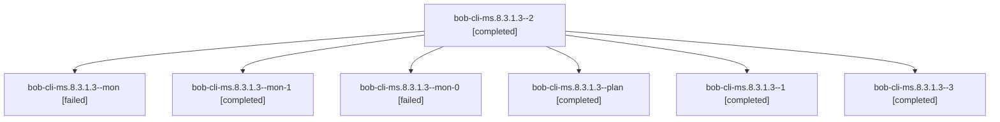

# Session: bob-cli-ms.8.3.1.3

[Agent Hoods](../README.md) / [bbugyi200](../users/bbugyi200/README.md) / [apollo](../users/bbugyi200/machines/apollo/README.md) / [bob-cli-ms](../users/bbugyi200/machines/apollo/hoods/bob-cli-ms/README.md) / bob-cli-ms.8.3.1.3

Owner: `bbugyi200.apollo` · Hood: `bob-cli-ms` · Members: 7 · Bead: [bob-cli-ms.8.3.1.3](https://github.com/bobs-org/bob-cli--beads/blob/main/pages/bob-cli-ms/bob-cli-ms.8.3.1.3.md)

## Lineage



The diagram is an optional enhancement; the ordered table below contains the same lineage in accessible text.

| Role | Agent | State | Model / provider | Timing | Commits | Prompt | Chat |
|---|---|---|---|---|---:|---|---|
| <a id="member-2"></a>2 | bob-cli-ms.8.3.1.3--2 | completed | gpt-6-astra / codex | 2026-11-19T11:25:21.187925+00:00 → 2026-11-19T11:34:57.049295+00:00 | 0 | [Prompt](../agents/bbugyi200.apollo.bob-cli-ms.8.3.1.3--2/prompt.md) | [Chat](../agents/bbugyi200.apollo.bob-cli-ms.8.3.1.3--2/chat.md) |
| <a id="member-mon"></a>mon | bob-cli-ms.8.3.1.3--mon | failed | gpt-6-astra / codex | 2026-11-19T09:21:22.305864+00:00 → 2026-11-19T10:35:46.082253+00:00 | 0 | — | [Chat](../agents/bbugyi200.apollo.bob-cli-ms.8.3.1.3--mon/chat.md) |
| <a id="member-mon-1"></a>mon-1 | bob-cli-ms.8.3.1.3--mon-1 | completed | gpt-6-astra / codex | 2026-11-19T11:34:05.744433+00:00 → 2026-11-19T11:49:51.416065+00:00 | 0 | — | [Chat](../agents/bbugyi200.apollo.bob-cli-ms.8.3.1.3--mon-1/chat.md) |
| <a id="member-mon-0"></a>mon-0 | bob-cli-ms.8.3.1.3--mon-0 | failed | gpt-6-astra / codex | 2026-11-19T10:49:32.010475+00:00 → 2026-11-19T11:25:21.285312+00:00 | 0 | — | [Chat](../agents/bbugyi200.apollo.bob-cli-ms.8.3.1.3--mon-0/chat.md) |
| <a id="member-plan"></a>plan | bob-cli-ms.8.3.1.3--plan | completed | gpt-6-astra / codex | 2026-11-19T09:12:01.332871+00:00 → 2026-11-19T09:22:00.503444+00:00 | 0 | [Prompt](../agents/bbugyi200.apollo.bob-cli-ms.8.3.1.3--plan/prompt.md) | [Chat](../agents/bbugyi200.apollo.bob-cli-ms.8.3.1.3--plan/chat.md) |
| <a id="member-1"></a>1 | bob-cli-ms.8.3.1.3--1 | completed | gpt-6-astra / codex | 2026-11-19T10:35:45.608236+00:00 → 2026-11-19T10:52:32.238355+00:00 | 0 | [Prompt](../agents/bbugyi200.apollo.bob-cli-ms.8.3.1.3--1/prompt.md) | [Chat](../agents/bbugyi200.apollo.bob-cli-ms.8.3.1.3--1/chat.md) |
| <a id="member-3"></a>3 | bob-cli-ms.8.3.1.3--3 | completed | gpt-6-astra / codex | 2026-11-19T11:49:51.252547+00:00 → 2026-11-19T12:05:40.497269+00:00 | 0 | [Prompt](../agents/bbugyi200.apollo.bob-cli-ms.8.3.1.3--3/prompt.md) | [Chat](../agents/bbugyi200.apollo.bob-cli-ms.8.3.1.3--3/chat.md) |

## Variables

| Role | Variable | Value |
|---|---|---|
| 1 | `artifacts` | \[{bead: bob-cli-ms.8.3.1.3, kind: file, label: Record coverage: baseline-identical parent mismatch, path: /home/bryan/.sase/artifacts/agents/gh\_bobs-org\_\_bob-cli/20261119053450/read-failure-investiga… |
| 2 | `artifacts` | \[{bead: bob-cli-ms.8.3.1.3, kind: file, label: Record coverage release failure, raw gates and bounded concurrency repair, path: /home/bryan/.sase/artifacts/agents/gh\_bobs-org\_\_bob-cli/20261119062429/… |
| 3 | `artifacts` | \[{bead: bob-cli-ms.8.3.1.3, kind: file, label: Record Card final acceptance: full evidence, 25 inspected PNGs, raw gates and deployment, path: /home/bryan/.sase/artifacts/agents/gh\_bobs-org\_\_bob-cli/… |

#### artifacts

**Role:** `1`

```yaml
- bead: bob-cli-ms.8.3.1.3
  kind: file
  label: Record coverage: baseline-identical parent mismatch
  path: /home/bryan/.sase/artifacts/agents/gh_bobs-org__bob-cli/20261119053450/read-failure-investigation-dd8219d18fb0.json
  ref: file:explicit:925b70926af44650172dea5b
  source_path: /home/bryan/.local/state/sase/workspaces/bobs-org/bob-cli/bob-cli_10/.build/record-coverage/run-20261119-092200/read-failure-investigation.json
- bead: bob-cli-ms.8.3.1.3
  kind: file
  label: Record Card: 25 inspected final-run screenshots
  path: /home/bryan/.sase/artifacts/agents/gh_bobs-org__bob-cli/20261119053450/screenshot-review-cec313c72f99.json
  ref: file:explicit:0f30e6da56a61167008fb26b
  source_path: /home/bryan/.local/state/sase/workspaces/bobs-org/bob-cli/bob-cli_10/.build/record-coverage/run-20261119-092200/screenshot-review.json
- bead: bob-cli-ms.8.3.1.3
  kind: file
  label: Record Card: raw gates and baseline comparison
  path: /home/bryan/.sase/artifacts/agents/gh_bobs-org__bob-cli/20261119053450/gate-review-750709e5fe9b.json
  ref: file:explicit:d49f87761753c59199815bbc
  source_path: /home/bryan/.local/state/sase/workspaces/bobs-org/bob-cli/bob-cli_10/.build/record-coverage/run-20261119-092200/gate-review.json
```

#### artifacts

**Role:** `2`

```yaml
- bead: bob-cli-ms.8.3.1.3
  kind: file
  label: Record coverage release failure, raw gates and bounded concurrency repair
  path: /home/bryan/.sase/artifacts/agents/gh_bobs-org__bob-cli/20261119062429/release-20261119-105232-investigation.tar-b716ef9b9f88.gz
  ref: file:explicit:8e1f53f2d73873a2908568ea
  source_path: /home/bryan/.local/state/sase/workspaces/bobs-org/bob-cli/bob-cli_10/.build/record-coverage/release-20261119-105232-investigation.tar.gz
```

#### artifacts

**Role:** `3`

```yaml
- bead: bob-cli-ms.8.3.1.3
  kind: file
  label: Record Card final acceptance: full evidence, 25 inspected PNGs, raw gates and deployment
  path: /home/bryan/.sase/artifacts/agents/gh_bobs-org__bob-cli/20261119064902/record-card-final-acceptance-20261119.tar-0d36013369ed.gz
  ref: file:explicit:1989925b303385554af4b7ee
  source_path: /home/bryan/.local/state/sase/workspaces/bobs-org/bob-cli/bob-cli_10/.build/record-coverage/record-card-final-acceptance-20261119.tar.gz
- bead: bob-cli-ms.8.3.1.3
  kind: file
  label: Record Card final acceptance report with coverage exceptions and deployment proof
  path: /home/bryan/.sase/artifacts/agents/gh_bobs-org__bob-cli/20261119064902/record-card-final-acceptance-published-5a0f61aa9090.json
  ref: file:explicit:6c29e2ed7ad7cd9f4e9a88db
  source_path: /home/bryan/.local/state/sase/workspaces/bobs-org/bob-cli/bob-cli_10/.build/record-coverage/record-card-final-acceptance-published.json
```

Values are truncated for display; see each member's agent meta.json for the full values.

## Neighbors

| Agent | Relation | State |
|---|---|---|
| [bob-cli-ms.8.3](bbugyi200.apollo.bob-cli-ms.8.3.md) (session · 3) | ancestor | active 1, completed 2 |
| [bob-cli-ms.8.3.1.1](bbugyi200.apollo.bob-cli-ms.8.3.1.1.md) (session · 25) | bob-cli-ms.8.3.1 hood | active 1, completed 12, failed 12 |
| [bob-cli-ms.8.3.1.2](bbugyi200.apollo.bob-cli-ms.8.3.1.2.md) (session · 35) | bob-cli-ms.8.3.1 hood | completed 18, failed 17 |
| [bob-cli-ms.8.3.1.land](bbugyi200.apollo.bob-cli-ms.8.3.1.land.md) (session · 3) | bob-cli-ms.8.3.1 hood | active 2, completed 1 |
| [bob-cli-ms.8.1](bbugyi200.apollo.bob-cli-ms.8.1.md) (session · 5) | bob-cli-ms.8 hood | completed 4, failed 1 |
| [bob-cli-ms.8.2](../agents/bbugyi200.apollo.bob-cli-ms.8.2/README.md) | bob-cli-ms.8 hood | completed |
| [bob-cli-ms.8.land](../agents/bbugyi200.apollo.bob-cli-ms.8.land/README.md) | bob-cli-ms.8 hood | waiting |
| [bob-cli-ms.1](bbugyi200.apollo.bob-cli-ms.1.md) (session · 7) | bob-cli-ms hood | completed 5, failed 2 |
| [bob-cli-ms.2](../agents/bbugyi200.apollo.bob-cli-ms.2/README.md) | bob-cli-ms hood | completed |
| [bob-cli-ms.3](bbugyi200.apollo.bob-cli-ms.3.md) (session · 5) | bob-cli-ms hood | completed 5 |
| [bob-cli-ms.4](../agents/bbugyi200.apollo.bob-cli-ms.4/README.md) | bob-cli-ms hood | completed |
| [bob-cli-ms.5](bbugyi200.apollo.bob-cli-ms.5.md) (session · 5) | bob-cli-ms hood | completed 5 |
| [bob-cli-ms.6](bbugyi200.apollo.bob-cli-ms.6.md) (session · 5) | bob-cli-ms hood | completed 4, failed 1 |
| [bob-cli-ms.6](../agents/bbugyi200.apollo.bob-cli-ms.6/README.md) | bob-cli-ms hood | completed |
| [bob-cli-ms.7](../agents/bbugyi200.apollo.bob-cli-ms.7/README.md) | bob-cli-ms hood | completed |
| [bob-cli-ms.land](bbugyi200.apollo.bob-cli-ms.land.md) (session · 3) | bob-cli-ms hood | active 1, completed 2 |
| [bob-cli-ms.land](../agents/bbugyi200.apollo.bob-cli-ms.land/README.md) | bob-cli-ms hood | completed |
