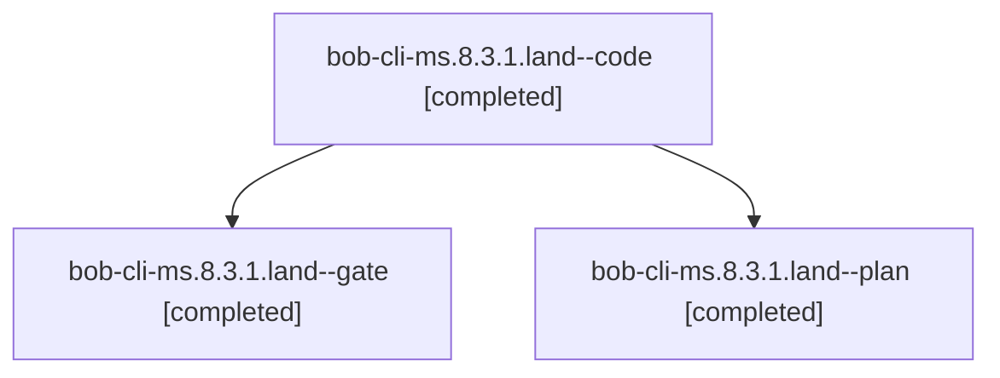

# Session: bob-cli-ms.8.3.1.land

[Agent Hoods](../README.md) / [bbugyi200](../users/bbugyi200/README.md) / [apollo](../users/bbugyi200/machines/apollo/README.md) / [bob-cli-ms](../users/bbugyi200/machines/apollo/hoods/bob-cli-ms/README.md) / bob-cli-ms.8.3.1.land

Owner: `bbugyi200.apollo` · Hood: `bob-cli-ms` · Members: 3 · Bead: [bob-cli-ms.8.3.1](https://github.com/bobs-org/bob-cli--beads/blob/main/pages/bob-cli-ms/bob-cli-ms.8.3.1.md)

## Lineage



The diagram is an optional enhancement; the ordered table below contains the same lineage in accessible text.

| Role | Agent | State | Model / provider | Timing | Commits | Prompt | Chat |
|---|---|---|---|---|---:|---|---|
| <a id="member-code"></a>code | bob-cli-ms.8.3.1.land--code | completed | muse-spark-1.3-contributor / muse | 2026-11-19T12:18:58.286494+00:00 → 2026-11-19T13:12:44.153951+00:00 | [1](../agents/bbugyi200.apollo.bob-cli-ms.8.3.1.land--code/README.md#commits) | — | [Chat](../agents/bbugyi200.apollo.bob-cli-ms.8.3.1.land--code/chat.md) |
| <a id="member-gate"></a>gate | bob-cli-ms.8.3.1.land--gate | completed | gpt-6-astra / codex | 2026-11-19T12:18:11.361888+00:00 → 2026-11-19T12:18:20.382569+00:00 | 0 | — | [Chat](../agents/bbugyi200.apollo.bob-cli-ms.8.3.1.land--gate/chat.md) |
| <a id="member-plan"></a>plan | bob-cli-ms.8.3.1.land--plan | completed | gpt-6-astra / codex | 2026-11-19T12:06:02.586525+00:00 → 2026-11-19T13:12:44.153951+00:00 | 0 | [Prompt](../agents/bbugyi200.apollo.bob-cli-ms.8.3.1.land--plan/prompt.md) | [Chat](../agents/bbugyi200.apollo.bob-cli-ms.8.3.1.land--plan/chat.md) |

## Commits

| Role | Repo | Commit | Subject | Committed |
|---|---|---|---|---|
| code | — | `5b4c263` | fix(records): validate stored literal lists without CLI comma splitting | 2026-11-19 08:11:18 EST |

## Variables

| Role | Variable | Value |
|---|---|---|
| plan | `artifacts` | \[{kind: file, label: Record Card landing: literal list grouping and warning reproduction, path: /home/bryan/.sase/artifacts/agents/gh\_bobs-org\_\_bob-cli/20261118090031/literal-integration-repro-50e300… |

#### artifacts

**Role:** `plan`

```yaml
- kind: file
  label: Record Card landing: literal list grouping and warning reproduction
  path: /home/bryan/.sase/artifacts/agents/gh_bobs-org__bob-cli/20261118090031/literal-integration-repro-50e300200f9f.json
  ref: file:explicit:2031403c6a2f28b860534cfa
  source_path: /home/bryan/.local/state/sase/workspaces/bobs-org/bob-cli/bob-cli_10/.build/record-card-landing/literal-integration-repro.json
- kind: file
  label: Reproducer for Record Card literal YAML integration gap
  path: /home/bryan/.sase/artifacts/agents/gh_bobs-org__bob-cli/20261118090031/repro-4796abdd9c46.py
  ref: file:explicit:510e2d5881cc4678f20c4a39
  source_path: /home/bryan/.local/state/sase/workspaces/bobs-org/bob-cli/bob-cli_10/.build/record-card-landing/repro.py
```

Values are truncated for display; see each member's agent meta.json for the full values.

## Neighbors

| Agent | Relation | State |
|---|---|---|
| [bob-cli-ms.8.3](bbugyi200.apollo.bob-cli-ms.8.3.md) (session · 3) | ancestor | completed 2, dismissed 1 |
| [bob-cli-ms.8.3.1.1](bbugyi200.apollo.bob-cli-ms.8.3.1.1.md) (session · 25) | bob-cli-ms.8.3.1 hood | active 1, completed 12, failed 12 |
| [bob-cli-ms.8.3.1.2](bbugyi200.apollo.bob-cli-ms.8.3.1.2.md) (session · 35) | bob-cli-ms.8.3.1 hood | completed 18, failed 17 |
| [bob-cli-ms.8.3.1.3](bbugyi200.apollo.bob-cli-ms.8.3.1.3.md) (session · 7) | bob-cli-ms.8.3.1 hood | completed 5, failed 2 |
| [bob-cli-ms.8.1](bbugyi200.apollo.bob-cli-ms.8.1.md) (session · 5) | bob-cli-ms.8 hood | completed 4, failed 1 |
| [bob-cli-ms.8.2](../agents/bbugyi200.apollo.bob-cli-ms.8.2/README.md) | bob-cli-ms.8 hood | completed |
| [bob-cli-ms.8.land](bbugyi200.apollo.bob-cli-ms.8.land.md) (session · 4) | bob-cli-ms.8 hood | completed 2, failed 2 |
| [bob-cli-ms.1](bbugyi200.apollo.bob-cli-ms.1.md) (session · 7) | bob-cli-ms hood | completed 5, failed 2 |
| [bob-cli-ms.2](../agents/bbugyi200.apollo.bob-cli-ms.2/README.md) | bob-cli-ms hood | completed |
| [bob-cli-ms.3](bbugyi200.apollo.bob-cli-ms.3.md) (session · 5) | bob-cli-ms hood | completed 5 |
| [bob-cli-ms.4](../agents/bbugyi200.apollo.bob-cli-ms.4/README.md) | bob-cli-ms hood | completed |
| [bob-cli-ms.5](bbugyi200.apollo.bob-cli-ms.5.md) (session · 5) | bob-cli-ms hood | completed 5 |
| [bob-cli-ms.6](bbugyi200.apollo.bob-cli-ms.6.md) (session · 5) | bob-cli-ms hood | completed 4, failed 1 |
| [bob-cli-ms.6](../agents/bbugyi200.apollo.bob-cli-ms.6/README.md) | bob-cli-ms hood | completed |
| [bob-cli-ms.7](../agents/bbugyi200.apollo.bob-cli-ms.7/README.md) | bob-cli-ms hood | completed |
| [bob-cli-ms.land](bbugyi200.apollo.bob-cli-ms.land.md) (session · 3) | bob-cli-ms hood | completed 2, dismissed 1 |
| [bob-cli-ms.land](../agents/bbugyi200.apollo.bob-cli-ms.land/README.md) | bob-cli-ms hood | completed |
