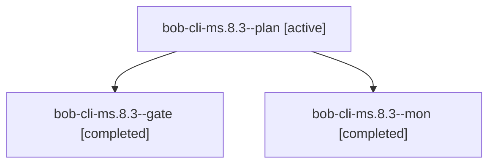

# Session: bob-cli-ms.8.3

[Agent Hoods](../README.md) / [bbugyi200](../users/bbugyi200/README.md) / [apollo](../users/bbugyi200/machines/apollo/README.md) / [bob-cli-ms](../users/bbugyi200/machines/apollo/hoods/bob-cli-ms/README.md) / bob-cli-ms.8.3

Owner: `bbugyi200.apollo` · Hood: `bob-cli-ms` · Members: 3 · Bead: [bob-cli-ms.8.3](https://github.com/bobs-org/bob-cli--beads/blob/main/pages/bob-cli-ms/bob-cli-ms.8.3.md)

## Lineage

The diagram is an optional enhancement; the ordered table below contains the same lineage in accessible text.

| Role | Agent | State | Model / provider | Timing | Commits | Prompt | Chat |
|---|---|---|---|---|---:|---|---|
| plan | bob-cli-ms.8.3--plan | active | gpt-6-astra / codex | 2026-11-18T13:52:30.442651+00:00 → 2026-11-18T13:59:25.291664+00:00 | 0 | [Prompt](../agents/bbugyi200.apollo.bob-cli-ms.8.3--plan/prompt.md) | [Chat](../agents/bbugyi200.apollo.bob-cli-ms.8.3--plan/chat.md) |
| gate | bob-cli-ms.8.3--gate | completed | gpt-6-astra / codex | 2026-11-18T13:58:59.620245+00:00 → 2026-11-18T13:59:16.885331+00:00 | 0 | — | [Chat](../agents/bbugyi200.apollo.bob-cli-ms.8.3--gate/chat.md) |
| mon | bob-cli-ms.8.3--mon | completed | gpt-6-astra / codex | 2026-11-18T13:59:15.357305+00:00 → 2026-11-18T14:00:52.428045+00:00 | 0 | — | [Chat](../agents/bbugyi200.apollo.bob-cli-ms.8.3--mon/chat.md) |

## Neighbors

| Agent | Relation | State |
|---|---|---|
| [bob-cli-ms.8.3.1.1](bbugyi200.apollo.bob-cli-ms.8.3.1.1.md) (session · 25) | descendant | active 1, completed 12, failed 12 |
| [bob-cli-ms.8.3.1.2](bbugyi200.apollo.bob-cli-ms.8.3.1.2.md) (session · 35) | descendant | completed 18, failed 17 |
| [bob-cli-ms.8.3.1.3](../agents/bbugyi200.apollo.bob-cli-ms.8.3.1.3/README.md) | descendant | waiting |
| [bob-cli-ms.8.3.1.land](../agents/bbugyi200.apollo.bob-cli-ms.8.3.1.land/README.md) | descendant | waiting |
| [bob-cli-ms.8.1](bbugyi200.apollo.bob-cli-ms.8.1.md) (session · 5) | bob-cli-ms.8 hood | completed 4, failed 1 |
| [bob-cli-ms.8.2](../agents/bbugyi200.apollo.bob-cli-ms.8.2/README.md) | bob-cli-ms.8 hood | completed |
| [bob-cli-ms.8.land](../agents/bbugyi200.apollo.bob-cli-ms.8.land/README.md) | bob-cli-ms.8 hood | waiting |
| [bob-cli-ms.1](bbugyi200.apollo.bob-cli-ms.1.md) (session · 7) | bob-cli-ms hood | completed 5, failed 2 |
| [bob-cli-ms.2](../agents/bbugyi200.apollo.bob-cli-ms.2/README.md) | bob-cli-ms hood | completed |
| [bob-cli-ms.3](bbugyi200.apollo.bob-cli-ms.3.md) (session · 5) | bob-cli-ms hood | completed 5 |
| [bob-cli-ms.4](../agents/bbugyi200.apollo.bob-cli-ms.4/README.md) | bob-cli-ms hood | completed |
| [bob-cli-ms.5](bbugyi200.apollo.bob-cli-ms.5.md) (session · 5) | bob-cli-ms hood | completed 5 |
| [bob-cli-ms.6](bbugyi200.apollo.bob-cli-ms.6.md) (session · 5) | bob-cli-ms hood | completed 4, failed 1 |
| [bob-cli-ms.6](../agents/bbugyi200.apollo.bob-cli-ms.6/README.md) | bob-cli-ms hood | completed |
| [bob-cli-ms.7](../agents/bbugyi200.apollo.bob-cli-ms.7/README.md) | bob-cli-ms hood | completed |
| [bob-cli-ms.land](bbugyi200.apollo.bob-cli-ms.land.md) (session · 3) | bob-cli-ms hood | active 1, completed 2 |
| [bob-cli-ms.land](../agents/bbugyi200.apollo.bob-cli-ms.land/README.md) | bob-cli-ms hood | completed |
