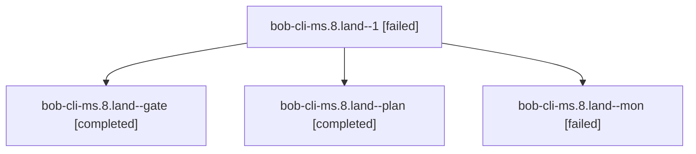

# Session: bob-cli-ms.8.land

[Agent Hoods](../README.md) / [bbugyi200](../users/bbugyi200/README.md) / [apollo](../users/bbugyi200/machines/apollo/README.md) / [bob-cli-ms](../users/bbugyi200/machines/apollo/hoods/bob-cli-ms/README.md) / bob-cli-ms.8.land

Owner: `bbugyi200.apollo` · Hood: `bob-cli-ms` · Members: 4 · Bead: [bob-cli-ms.8](https://github.com/bobs-org/bob-cli--beads/blob/main/pages/bob-cli-ms/bob-cli-ms.8.md)

## Lineage



The diagram is an optional enhancement; the ordered table below contains the same lineage in accessible text.

| Role | Agent | State | Model / provider | Timing | Commits | Prompt | Chat |
|---|---|---|---|---|---:|---|---|
| <a id="member-1"></a>1 | bob-cli-ms.8.land--1 | failed | gpt-6-astra / codex | 2026-11-19T18:44:22.683329+00:00 → 2026-11-19T18:56:31.238679+00:00 | 0 | [Prompt](../agents/bbugyi200.apollo.bob-cli-ms.8.land--1/prompt.md) | [Chat](../agents/bbugyi200.apollo.bob-cli-ms.8.land--1/chat.md) |
| <a id="member-gate"></a>gate | bob-cli-ms.8.land--gate | completed | gpt-6-astra / codex | 2026-11-19T18:56:01.547571+00:00 → 2026-11-19T18:56:12.589809+00:00 | 0 | — | [Chat](../agents/bbugyi200.apollo.bob-cli-ms.8.land--gate/chat.md) |
| <a id="member-plan"></a>plan | bob-cli-ms.8.land--plan | completed | gpt-6-astra / codex | 2026-11-19T17:57:48.066821+00:00 → 2026-11-19T18:17:05.226751+00:00 | 0 | [Prompt](../agents/bbugyi200.apollo.bob-cli-ms.8.land--plan/prompt.md) | [Chat](../agents/bbugyi200.apollo.bob-cli-ms.8.land--plan/chat.md) |
| <a id="member-mon"></a>mon | bob-cli-ms.8.land--mon | failed | gpt-6-astra / codex | 2026-11-19T18:16:11.887944+00:00 → 2026-11-19T18:44:19.136081+00:00 | 0 | — | [Chat](../agents/bbugyi200.apollo.bob-cli-ms.8.land--mon/chat.md) |

## Variables

| Role | Variable | Value |
|---|---|---|
| 1 | `artifacts` | \[{bead: bob-cli-ms.8, kind: file, label: Record Card landing gates and failure diagnosis, path: /home/bryan/.sase/artifacts/agents/gh\_bobs-org\_\_bob-cli/20261119134318/gate-evidence.tar-b77c384df879.g… |
| plan | `artifacts` | \[{bead: bob-cli-ms.8, kind: file, label: bob-cli-ms.8 and parent ms landing audit before final gates, path: /home/bryan/.sase/artifacts/agents/gh\_bobs-org\_\_bob-cli/20261117222727/audit-824a5953a639.j… |

#### artifacts

**Role:** `1`

```yaml
- bead: bob-cli-ms.8
  kind: file
  label: Record Card landing gates and failure diagnosis
  path: /home/bryan/.sase/artifacts/agents/gh_bobs-org__bob-cli/20261119134318/gate-evidence.tar-b77c384df879.gz
  ref: file:explicit:99f77573d0f7c4cc8d5ac10c
  source_path: /home/bryan/.local/state/sase/workspaces/bobs-org/bob-cli/bob-cli_13/.build/ms8-land/gate-evidence.tar.gz
```

#### artifacts

**Role:** `plan`

```yaml
- bead: bob-cli-ms.8
  kind: file
  label: bob-cli-ms.8 and parent ms landing audit before final gates
  path: /home/bryan/.sase/artifacts/agents/gh_bobs-org__bob-cli/20261117222727/audit-824a5953a639.json
  ref: file:explicit:efc9308543f16a6e01f1e753
  source_path: /home/bryan/.local/state/sase/workspaces/bobs-org/bob-cli/bob-cli_13/.build/ms8-land/audit.json
```

Values are truncated for display; see each member's agent meta.json for the full values.

## Neighbors

| Agent | Relation | State |
|---|---|---|
| [bob-cli-ms.8.1](bbugyi200.apollo.bob-cli-ms.8.1.md) (session · 5) | bob-cli-ms.8 hood | completed 4, failed 1 |
| [bob-cli-ms.8.2](../agents/bbugyi200.apollo.bob-cli-ms.8.2/README.md) | bob-cli-ms.8 hood | completed |
| [bob-cli-ms.8.3](bbugyi200.apollo.bob-cli-ms.8.3.md) (session · 3) | bob-cli-ms.8 hood | completed 2, dismissed 1 |
| [bob-cli-ms.8.3.1.1](bbugyi200.apollo.bob-cli-ms.8.3.1.1.md) (session · 25) | bob-cli-ms.8 hood | active 1, completed 12, failed 12 |
| [bob-cli-ms.8.3.1.2](bbugyi200.apollo.bob-cli-ms.8.3.1.2.md) (session · 35) | bob-cli-ms.8 hood | completed 18, failed 17 |
| [bob-cli-ms.8.3.1.3](bbugyi200.apollo.bob-cli-ms.8.3.1.3.md) (session · 7) | bob-cli-ms.8 hood | completed 5, failed 2 |
| [bob-cli-ms.8.3.1.land](bbugyi200.apollo.bob-cli-ms.8.3.1.land.md) (session · 3) | bob-cli-ms.8 hood | completed 3 |
| [bob-cli-ms.1](bbugyi200.apollo.bob-cli-ms.1.md) (session · 7) | bob-cli-ms hood | completed 5, failed 2 |
| [bob-cli-ms.2](../agents/bbugyi200.apollo.bob-cli-ms.2/README.md) | bob-cli-ms hood | completed |
| [bob-cli-ms.3](bbugyi200.apollo.bob-cli-ms.3.md) (session · 5) | bob-cli-ms hood | completed 5 |
| [bob-cli-ms.4](../agents/bbugyi200.apollo.bob-cli-ms.4/README.md) | bob-cli-ms hood | completed |
| [bob-cli-ms.5](bbugyi200.apollo.bob-cli-ms.5.md) (session · 5) | bob-cli-ms hood | completed 5 |
| [bob-cli-ms.6](bbugyi200.apollo.bob-cli-ms.6.md) (session · 5) | bob-cli-ms hood | completed 4, failed 1 |
| [bob-cli-ms.6](../agents/bbugyi200.apollo.bob-cli-ms.6/README.md) | bob-cli-ms hood | completed |
| [bob-cli-ms.7](../agents/bbugyi200.apollo.bob-cli-ms.7/README.md) | bob-cli-ms hood | completed |
| [bob-cli-ms.land](bbugyi200.apollo.bob-cli-ms.land.md) (session · 3) | bob-cli-ms hood | completed 2, dismissed 1 |
| [bob-cli-ms.land](../agents/bbugyi200.apollo.bob-cli-ms.land/README.md) | bob-cli-ms hood | completed |
