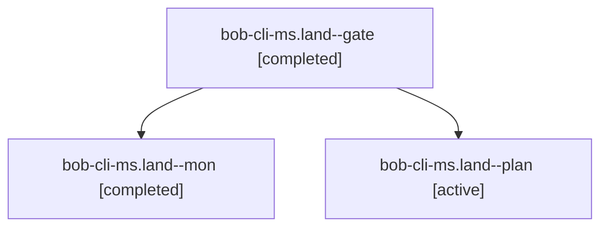

# Session: bob-cli-ms.land

[Agent Hoods](../README.md) / [bbugyi200](../users/bbugyi200/README.md) / [apollo](../users/bbugyi200/machines/apollo/README.md) / [bob-cli-ms](../users/bbugyi200/machines/apollo/hoods/bob-cli-ms/README.md) / bob-cli-ms.land

Owner: `bbugyi200.apollo` · Hood: `bob-cli-ms` · Members: 3 · Bead: [bob-cli-ms](https://github.com/bobs-org/bob-cli--beads/blob/main/pages/bob-cli-ms/README.md)

## Lineage

The diagram is an optional enhancement; the ordered table below contains the same lineage in accessible text.

| Role | Agent | State | Model / provider | Timing | Commits | Prompt | Chat |
|---|---|---|---|---|---:|---|---|
| gate | bob-cli-ms.land--gate | completed | opus / claude | 2026-11-18T03:24:52.697075+00:00 → 2026-11-18T03:25:20.806576+00:00 | 0 | — | [Chat](../agents/bbugyi200.apollo.bob-cli-ms.land--gate/chat.md) |
| mon | bob-cli-ms.land--mon | completed | opus / claude | 2026-11-18T03:25:17.566738+00:00 → 2026-11-18T03:28:44.234687+00:00 | 0 | — | [Chat](../agents/bbugyi200.apollo.bob-cli-ms.land--mon/chat.md) |
| plan | bob-cli-ms.land--plan | active | opus / claude | 2026-11-18T02:57:01.362932+00:00 → 2026-11-18T03:25:33.286276+00:00 | [1](../agents/bbugyi200.apollo.bob-cli-ms.land--plan/README.md#commits) | [Prompt](../agents/bbugyi200.apollo.bob-cli-ms.land--plan/prompt.md) | [Chat](../agents/bbugyi200.apollo.bob-cli-ms.land--plan/chat.md) |

## Commits

| Role | Repo | Commit | Subject | Committed |
|---|---|---|---|---|
| plan | bob-cli | [`03ab2b3`](https://github.com/bobs-org/bob-cli/commit/03ab2b3d41dc5734e15be04a61da71b80455d43f) | docs(glossary): regenerate the capture alias item-start dot entry | 2026-11-17 22:23:24 EST |

## Neighbors

| Agent | Relation | State |
|---|---|---|
| [bob-cli-ms.1](bbugyi200.apollo.bob-cli-ms.1.md) (session · 7) | bob-cli-ms hood | completed 5, failed 2 |
| [bob-cli-ms.2](../agents/bbugyi200.apollo.bob-cli-ms.2/README.md) | bob-cli-ms hood | completed |
| [bob-cli-ms.3](bbugyi200.apollo.bob-cli-ms.3.md) (session · 5) | bob-cli-ms hood | completed 5 |
| [bob-cli-ms.4](../agents/bbugyi200.apollo.bob-cli-ms.4/README.md) | bob-cli-ms hood | completed |
| [bob-cli-ms.5](bbugyi200.apollo.bob-cli-ms.5.md) (session · 5) | bob-cli-ms hood | completed 5 |
| [bob-cli-ms.6](bbugyi200.apollo.bob-cli-ms.6.md) (session · 5) | bob-cli-ms hood | completed 4, failed 1 |
| [bob-cli-ms.6](../agents/bbugyi200.apollo.bob-cli-ms.6/README.md) | bob-cli-ms hood | completed |
| [bob-cli-ms.7](../agents/bbugyi200.apollo.bob-cli-ms.7/README.md) | bob-cli-ms hood | completed |
| [bob-cli-ms.8.1](bbugyi200.apollo.bob-cli-ms.8.1.md) (session · 5) | bob-cli-ms hood | completed 4, failed 1 |
| [bob-cli-ms.8.2](../agents/bbugyi200.apollo.bob-cli-ms.8.2/README.md) | bob-cli-ms hood | completed |
| [bob-cli-ms.8.3](bbugyi200.apollo.bob-cli-ms.8.3.md) (session · 3) | bob-cli-ms hood | active 1, completed 2 |
| [bob-cli-ms.8.3.1.1](bbugyi200.apollo.bob-cli-ms.8.3.1.1.md) (session · 25) | bob-cli-ms hood | active 1, completed 12, failed 12 |
| [bob-cli-ms.8.3.1.2](bbugyi200.apollo.bob-cli-ms.8.3.1.2.md) (session · 35) | bob-cli-ms hood | completed 18, failed 17 |
| [bob-cli-ms.8.3.1.3](../agents/bbugyi200.apollo.bob-cli-ms.8.3.1.3/README.md) | bob-cli-ms hood | waiting |
| [bob-cli-ms.8.3.1.land](../agents/bbugyi200.apollo.bob-cli-ms.8.3.1.land/README.md) | bob-cli-ms hood | waiting |
| [bob-cli-ms.8.land](../agents/bbugyi200.apollo.bob-cli-ms.8.land/README.md) | bob-cli-ms hood | waiting |
