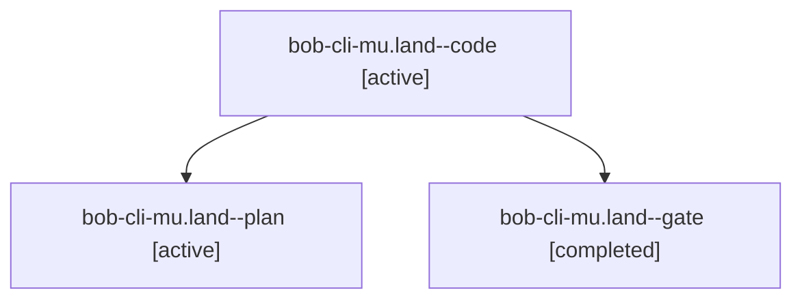

# Session: bob-cli-mu.land

[Agent Hoods](../README.md) / [bbugyi200](../users/bbugyi200/README.md) / [apollo](../users/bbugyi200/machines/apollo/README.md) / [bob-cli-mu](../users/bbugyi200/machines/apollo/hoods/bob-cli-mu/README.md) / bob-cli-mu.land

Owner: `bbugyi200.apollo` · Hood: `bob-cli-mu` · Members: 3 · Bead: [bob-cli-mu](https://github.com/bobs-org/bob-cli--beads/blob/main/pages/bob-cli-mu/README.md)

## Lineage



The diagram is an optional enhancement; the ordered table below contains the same lineage in accessible text.

| Role | Agent | State | Model / provider | Timing | Commits | Prompt | Chat |
|---|---|---|---|---|---:|---|---|
| <a id="member-code"></a>code | bob-cli-mu.land--code | active | grok-4.6 / grok | 2026-11-17T22:07:32.808491+00:00 | 0 | — | — |
| <a id="member-plan"></a>plan | bob-cli-mu.land--plan | active | gpt-6-astra / codex | 2026-11-17T21:52:16.663811+00:00 | 0 | [Prompt](../agents/bbugyi200.apollo.bob-cli-mu.land--plan/prompt.md) | [Chat](../agents/bbugyi200.apollo.bob-cli-mu.land--plan/chat.md) |
| <a id="member-gate"></a>gate | bob-cli-mu.land--gate | completed | gpt-6-astra / codex | 2026-11-17T22:06:39.480297+00:00 → 2026-11-17T22:06:48.300303+00:00 | 0 | — | [Chat](../agents/bbugyi200.apollo.bob-cli-mu.land--gate/chat.md) |

## Variables

| Role | Variable | Value |
|---|---|---|
| plan | `artifacts` | \[{bead: bob-cli-mu, kind: markdown, label: bob-cli-mu landing audit and reproducible geometry defects, path: /home/bryan/.sase/artifacts/agents/gh\_bobs-org\_\_bob-cli/20261117153957/bob-cli-mu-landing-… |

#### artifacts

**Role:** `plan`

```yaml
- bead: bob-cli-mu
  kind: markdown
  label: bob-cli-mu landing audit and reproducible geometry defects
  path: /home/bryan/.sase/artifacts/agents/gh_bobs-org__bob-cli/20261117153957/bob-cli-mu-landing-evidence-aaebf36e3f73.md
  ref: file:explicit:8c900ff7e5039639f9276cc6
  source_path: /tmp/bob-cli-mu-landing-evidence.md
```

Values are truncated for display; see each member's agent meta.json for the full values.

## Neighbors

| Agent | Relation | State |
|---|---|---|
| [bob-cli-mu.1](../agents/bbugyi200.apollo.bob-cli-mu.1/README.md) | bob-cli-mu hood | completed |
| [bob-cli-mu.2](../agents/bbugyi200.apollo.bob-cli-mu.2/README.md) | bob-cli-mu hood | completed |
| [bob-cli-mu.3](../agents/bbugyi200.apollo.bob-cli-mu.3/README.md) | bob-cli-mu hood | completed |
