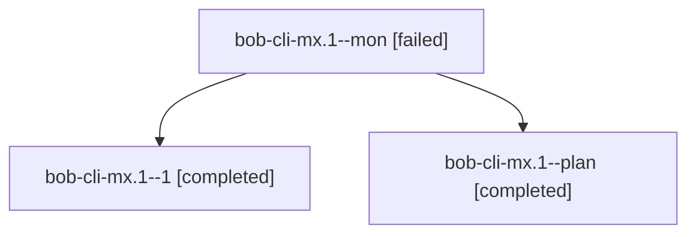

# Session: bob-cli-mx.1

[Agent Hoods](../README.md) / [bbugyi200](../users/bbugyi200/README.md) / [apollo](../users/bbugyi200/machines/apollo/README.md) / [bob-cli-mx](../users/bbugyi200/machines/apollo/hoods/bob-cli-mx/README.md) / bob-cli-mx.1

Owner: `bbugyi200.apollo` · Hood: `bob-cli-mx` · Members: 3 · Bead: [bob-cli-mx.1](https://github.com/bobs-org/bob-cli--beads/blob/main/pages/bob-cli-mx/bob-cli-mx.1.md)

## Lineage

The diagram is an optional enhancement; the ordered table below contains the same lineage in accessible text.

| Role | Agent | State | Model / provider | Timing | Commits | Prompt | Chat |
|---|---|---|---|---|---:|---|---|
| mon | bob-cli-mx.1--mon | failed | gpt-6-luna / codex | 2026-11-17T23:45:02.822575+00:00 → 2026-11-18T00:03:42.599876+00:00 | 0 | — | [Chat](../agents/bbugyi200.apollo.bob-cli-mx.1--mon/chat.md) |
| 1 | bob-cli-mx.1--1 | completed | gpt-6-luna / codex | 2026-11-18T00:03:41.751758+00:00 → 2026-11-18T00:17:50.468133+00:00 | [1](../agents/bbugyi200.apollo.bob-cli-mx.1--1/README.md#commits) | [Prompt](../agents/bbugyi200.apollo.bob-cli-mx.1--1/prompt.md) | [Chat](../agents/bbugyi200.apollo.bob-cli-mx.1--1/chat.md) |
| plan | bob-cli-mx.1--plan | completed | gpt-6-luna / codex | 2026-11-17T23:10:06.065958+00:00 → 2026-11-17T23:46:33.157611+00:00 | 0 | [Prompt](../agents/bbugyi200.apollo.bob-cli-mx.1--plan/prompt.md) | [Chat](../agents/bbugyi200.apollo.bob-cli-mx.1--plan/chat.md) |

## Commits

| Role | Repo | Commit | Subject | Committed |
|---|---|---|---|---|
| 1 | bob-cli | [`3c796c7`](https://github.com/bobs-org/bob-cli/commit/3c796c7c2d70b728b2a17e16174ba5083c62bd28) | perf(freshness): reuse task index during scans | 2026-11-17 19:17:09 EST |

## Neighbors

| Agent | Relation | State |
|---|---|---|
| [bob-cli-mx.2](bbugyi200.apollo.bob-cli-mx.2.md) (session · 5) | bob-cli-mx hood | completed 4, failed 1 |
| [bob-cli-mx.3](../agents/bbugyi200.apollo.bob-cli-mx.3/README.md) | bob-cli-mx hood | completed |
| [bob-cli-mx.4](bbugyi200.apollo.bob-cli-mx.4.md) (session · 3) | bob-cli-mx hood | completed 2, failed 1 |
| [bob-cli-mx.5](bbugyi200.apollo.bob-cli-mx.5.md) (session · 11) | bob-cli-mx hood | completed 8, failed 3 |
| [bob-cli-mx.land](../agents/bbugyi200.apollo.bob-cli-mx.land/README.md) | bob-cli-mx hood | completed |
