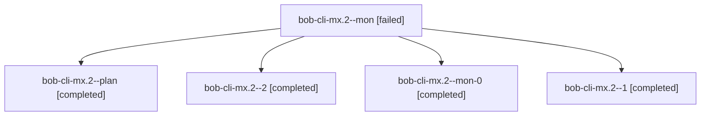

# Session: bob-cli-mx.2

[Agent Hoods](../README.md) / [bbugyi200](../users/bbugyi200/README.md) / [apollo](../users/bbugyi200/machines/apollo/README.md) / [bob-cli-mx](../users/bbugyi200/machines/apollo/hoods/bob-cli-mx/README.md) / bob-cli-mx.2

Owner: `bbugyi200.apollo` · Hood: `bob-cli-mx` · Members: 5 · Bead: [bob-cli-mx.2](https://github.com/bobs-org/bob-cli--beads/blob/main/pages/bob-cli-mx/bob-cli-mx.2.md)

## Lineage

The diagram is an optional enhancement; the ordered table below contains the same lineage in accessible text.

| Role | Agent | State | Model / provider | Timing | Commits | Prompt | Chat |
|---|---|---|---|---|---:|---|---|
| mon | bob-cli-mx.2--mon | failed | grok-4.6 / grok | 2026-11-18T00:09:52.636705+00:00 → 2026-11-18T00:18:27.506176+00:00 | 0 | — | [Chat](../agents/bbugyi200.apollo.bob-cli-mx.2--mon/chat.md) |
| plan | bob-cli-mx.2--plan | completed | grok-4.6 / grok | 2026-11-17T23:01:29.775562+00:00 → 2026-11-18T00:11:24.743436+00:00 | 0 | [Prompt](../agents/bbugyi200.apollo.bob-cli-mx.2--plan/prompt.md) | [Chat](../agents/bbugyi200.apollo.bob-cli-mx.2--plan/chat.md) |
| 2 | bob-cli-mx.2--2 | completed | grok-4.6 / grok | 2026-11-18T00:50:23.348783+00:00 → 2026-11-18T01:25:41.370371+00:00 | [1](../agents/bbugyi200.apollo.bob-cli-mx.2--2/README.md#commits) | [Prompt](../agents/bbugyi200.apollo.bob-cli-mx.2--2/prompt.md) | [Chat](../agents/bbugyi200.apollo.bob-cli-mx.2--2/chat.md) |
| mon-0 | bob-cli-mx.2--mon-0 | completed | grok-4.6 / grok | 2026-11-18T00:39:06.705062+00:00 → 2026-11-18T00:50:23.864504+00:00 | 0 | — | [Chat](../agents/bbugyi200.apollo.bob-cli-mx.2--mon-0/chat.md) |
| 1 | bob-cli-mx.2--1 | completed | grok-4.6 / grok | 2026-11-18T00:18:27.105911+00:00 → 2026-11-18T00:40:21.202087+00:00 | 0 | [Prompt](../agents/bbugyi200.apollo.bob-cli-mx.2--1/prompt.md) | [Chat](../agents/bbugyi200.apollo.bob-cli-mx.2--1/chat.md) |

## Commits

| Role | Repo | Commit | Subject | Committed |
|---|---|---|---|---|
| 2 | bob-cli | [`c50f889`](https://github.com/bobs-org/bob-cli/commit/c50f8895b5487722d2072a7d1c47a43f2ced9814) | feat(walks): add read-only attention report and contract | 2026-11-17 20:24:29 EST |

## Neighbors

| Agent | Relation | State |
|---|---|---|
| [bob-cli-mx.1](bbugyi200.apollo.bob-cli-mx.1.md) (session · 3) | bob-cli-mx hood | completed 2, failed 1 |
| [bob-cli-mx.3](../agents/bbugyi200.apollo.bob-cli-mx.3/README.md) | bob-cli-mx hood | completed |
| [bob-cli-mx.4](bbugyi200.apollo.bob-cli-mx.4.md) (session · 2) | bob-cli-mx hood | active 1, completed 1 |
| [bob-cli-mx.5](../agents/bbugyi200.apollo.bob-cli-mx.5/README.md) | bob-cli-mx hood | waiting |
| [bob-cli-mx.land](../agents/bbugyi200.apollo.bob-cli-mx.land/README.md) | bob-cli-mx hood | waiting |
