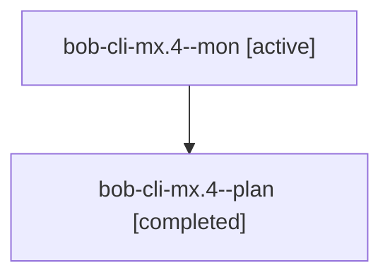

# Session: bob-cli-mx.4

[Agent Hoods](../README.md) / [bbugyi200](../users/bbugyi200/README.md) / [apollo](../users/bbugyi200/machines/apollo/README.md) / [bob-cli-mx](../users/bbugyi200/machines/apollo/hoods/bob-cli-mx/README.md) / bob-cli-mx.4

Owner: `bbugyi200.apollo` · Hood: `bob-cli-mx` · Members: 2 · Bead: [bob-cli-mx.4](https://github.com/bobs-org/bob-cli--beads/blob/main/pages/bob-cli-mx/bob-cli-mx.4.md)

## Lineage

The diagram is an optional enhancement; the ordered table below contains the same lineage in accessible text.

| Role | Agent | State | Model / provider | Timing | Commits | Prompt | Chat |
|---|---|---|---|---|---:|---|---|
| mon | bob-cli-mx.4--mon | active | muse-spark-1.3-contributor / muse | 2026-11-18T01:45:59.895263+00:00 | 0 | — | — |
| plan | bob-cli-mx.4--plan | completed | muse-spark-1.3-contributor / muse | 2026-11-18T01:26:09.274456+00:00 → 2026-11-18T01:47:18.462819+00:00 | 0 | [Prompt](../agents/bbugyi200.apollo.bob-cli-mx.4--plan/prompt.md) | [Chat](../agents/bbugyi200.apollo.bob-cli-mx.4--plan/chat.md) |

## Neighbors

| Agent | Relation | State |
|---|---|---|
| [bob-cli-mx.1](bbugyi200.apollo.bob-cli-mx.1.md) (session · 3) | bob-cli-mx hood | completed 2, failed 1 |
| [bob-cli-mx.2](bbugyi200.apollo.bob-cli-mx.2.md) (session · 5) | bob-cli-mx hood | completed 4, failed 1 |
| [bob-cli-mx.3](../agents/bbugyi200.apollo.bob-cli-mx.3/README.md) | bob-cli-mx hood | completed |
| [bob-cli-mx.5](../agents/bbugyi200.apollo.bob-cli-mx.5/README.md) | bob-cli-mx hood | waiting |
| [bob-cli-mx.land](../agents/bbugyi200.apollo.bob-cli-mx.land/README.md) | bob-cli-mx hood | waiting |
