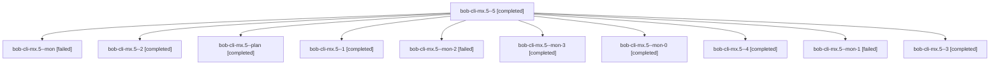

# Session: bob-cli-mx.5

[Agent Hoods](../README.md) / [bbugyi200](../users/bbugyi200/README.md) / [apollo](../users/bbugyi200/machines/apollo/README.md) / [bob-cli-mx](../users/bbugyi200/machines/apollo/hoods/bob-cli-mx/README.md) / bob-cli-mx.5

Owner: `bbugyi200.apollo` · Hood: `bob-cli-mx` · Members: 11 · Bead: [bob-cli-mx.5](https://github.com/bobs-org/bob-cli--beads/blob/main/pages/bob-cli-mx/bob-cli-mx.5.md)

## Lineage

The diagram is an optional enhancement; the ordered table below contains the same lineage in accessible text.

| Role | Agent | State | Model / provider | Timing | Commits | Prompt | Chat |
|---|---|---|---|---|---:|---|---|
| 5 | bob-cli-mx.5--5 | completed | gpt-6-luna / codex | 2026-11-18T04:35:06.837642+00:00 → 2026-11-18T04:50:11.061733+00:00 | [1](../agents/bbugyi200.apollo.bob-cli-mx.5--5/README.md#commits) | [Prompt](../agents/bbugyi200.apollo.bob-cli-mx.5--5/prompt.md) | [Chat](../agents/bbugyi200.apollo.bob-cli-mx.5--5/chat.md) |
| mon | bob-cli-mx.5--mon | failed | gpt-6-luna / codex | 2026-11-18T02:48:15.292689+00:00 → 2026-11-18T03:02:00.885851+00:00 | 0 | — | [Chat](../agents/bbugyi200.apollo.bob-cli-mx.5--mon/chat.md) |
| 2 | bob-cli-mx.5--2 | completed | gpt-6-luna / codex | 2026-11-18T03:10:49.995187+00:00 → 2026-11-18T03:14:58.605854+00:00 | 0 | [Prompt](../agents/bbugyi200.apollo.bob-cli-mx.5--2/prompt.md) | [Chat](../agents/bbugyi200.apollo.bob-cli-mx.5--2/chat.md) |
| plan | bob-cli-mx.5--plan | completed | gpt-6-luna / codex | 2026-11-18T02:14:49.237090+00:00 → 2026-11-18T02:49:46.849881+00:00 | 0 | [Prompt](../agents/bbugyi200.apollo.bob-cli-mx.5--plan/prompt.md) | [Chat](../agents/bbugyi200.apollo.bob-cli-mx.5--plan/chat.md) |
| 1 | bob-cli-mx.5--1 | completed | gpt-6-luna / codex | 2026-11-18T03:02:00.707735+00:00 → 2026-11-18T03:09:43.691175+00:00 | 0 | [Prompt](../agents/bbugyi200.apollo.bob-cli-mx.5--1/prompt.md) | [Chat](../agents/bbugyi200.apollo.bob-cli-mx.5--1/chat.md) |
| mon-2 | bob-cli-mx.5--mon-2 | failed | gpt-6-luna / codex | 2026-11-18T03:20:20.452304+00:00 → 2026-11-18T03:45:25.567535+00:00 | 0 | — | [Chat](../agents/bbugyi200.apollo.bob-cli-mx.5--mon-2/chat.md) |
| mon-3 | bob-cli-mx.5--mon-3 | completed | gpt-6-luna / codex | 2026-11-18T04:07:41.855083+00:00 → 2026-11-18T04:35:07.030779+00:00 | 0 | — | [Chat](../agents/bbugyi200.apollo.bob-cli-mx.5--mon-3/chat.md) |
| mon-0 | bob-cli-mx.5--mon-0 | completed | gpt-6-luna / codex | 2026-11-18T03:06:41.202308+00:00 → 2026-11-18T03:10:50.117878+00:00 | 0 | — | [Chat](../agents/bbugyi200.apollo.bob-cli-mx.5--mon-0/chat.md) |
| 4 | bob-cli-mx.5--4 | completed | gpt-6-luna / codex | 2026-11-18T03:45:25.285270+00:00 → 2026-11-18T04:08:31.980642+00:00 | 0 | [Prompt](../agents/bbugyi200.apollo.bob-cli-mx.5--4/prompt.md) | [Chat](../agents/bbugyi200.apollo.bob-cli-mx.5--4/chat.md) |
| mon-1 | bob-cli-mx.5--mon-1 | failed | gpt-6-luna / codex | 2026-11-18T03:13:53.868068+00:00 → 2026-11-18T03:16:31.130457+00:00 | 0 | — | [Chat](../agents/bbugyi200.apollo.bob-cli-mx.5--mon-1/chat.md) |
| 3 | bob-cli-mx.5--3 | completed | gpt-6-luna / codex | 2026-11-18T03:16:30.697439+00:00 → 2026-11-18T03:21:26.059650+00:00 | 0 | [Prompt](../agents/bbugyi200.apollo.bob-cli-mx.5--3/prompt.md) | [Chat](../agents/bbugyi200.apollo.bob-cli-mx.5--3/chat.md) |

## Commits

| Role | Repo | Commit | Subject | Committed |
|---|---|---|---|---|
| 5 | bob-cli | [`4f801ee`](https://github.com/bobs-org/bob-cli/commit/4f801ee2032c441a3eb0b5b4ce0b53927395076c) | docs(memory): record idle capture walk attention decision | 2026-11-17 23:49:14 EST |

## Neighbors

| Agent | Relation | State |
|---|---|---|
| [bob-cli-mx.1](bbugyi200.apollo.bob-cli-mx.1.md) (session · 3) | bob-cli-mx hood | completed 2, failed 1 |
| [bob-cli-mx.2](bbugyi200.apollo.bob-cli-mx.2.md) (session · 5) | bob-cli-mx hood | completed 4, failed 1 |
| [bob-cli-mx.3](../agents/bbugyi200.apollo.bob-cli-mx.3/README.md) | bob-cli-mx hood | completed |
| [bob-cli-mx.4](bbugyi200.apollo.bob-cli-mx.4.md) (session · 3) | bob-cli-mx hood | completed 2, failed 1 |
| [bob-cli-mx.land](../agents/bbugyi200.apollo.bob-cli-mx.land/README.md) | bob-cli-mx hood | waiting |
