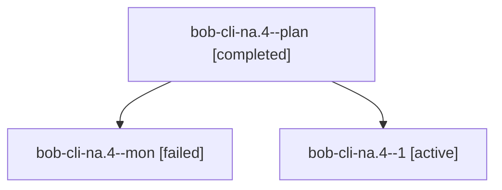

# Session: bob-cli-na.4

[Agent Hoods](../README.md) / [bbugyi200](../users/bbugyi200/README.md) / [apollo](../users/bbugyi200/machines/apollo/README.md) / [bob-cli-na](../users/bbugyi200/machines/apollo/hoods/bob-cli-na/README.md) / bob-cli-na.4

Owner: `bbugyi200.apollo` · Hood: `bob-cli-na` · Members: 3 · Bead: [bob-cli-na.4](https://github.com/bobs-org/bob-cli--beads/blob/main/pages/bob-cli-na/bob-cli-na.4.md)

## Lineage

The diagram is an optional enhancement; the ordered table below contains the same lineage in accessible text.

| Role | Agent | State | Model / provider | Timing | Commits | Prompt | Chat |
|---|---|---|---|---|---:|---|---|
| plan | bob-cli-na.4--plan | completed | gpt-6-luna / codex | 2026-11-18T16:41:54.269897+00:00 → 2026-11-18T17:11:08.552315+00:00 | 0 | [Prompt](../agents/bbugyi200.apollo.bob-cli-na.4--plan/prompt.md) | [Chat](../agents/bbugyi200.apollo.bob-cli-na.4--plan/chat.md) |
| mon | bob-cli-na.4--mon | failed | gpt-6-luna / codex | 2026-11-18T17:09:49.392563+00:00 → 2026-11-18T17:12:46.603140+00:00 | 0 | — | [Chat](../agents/bbugyi200.apollo.bob-cli-na.4--mon/chat.md) |
| 1 | bob-cli-na.4--1 | active | gpt-6-luna / codex | 2026-11-18T17:20:33.941491+00:00 | 0 | [Prompt](../agents/bbugyi200.apollo.bob-cli-na.4--1/prompt.md) | — |

## Neighbors

| Agent | Relation | State |
|---|---|---|
| [bob-cli-na.1](../agents/bbugyi200.apollo.bob-cli-na.1/README.md) | bob-cli-na hood | completed |
| [bob-cli-na.2](../agents/bbugyi200.apollo.bob-cli-na.2/README.md) | bob-cli-na hood | completed |
| [bob-cli-na.3](../agents/bbugyi200.apollo.bob-cli-na.3/README.md) | bob-cli-na hood | active |
| [bob-cli-na.5](bbugyi200.apollo.bob-cli-na.5.md) (session · 8) | bob-cli-na hood | active 1, completed 7 |
| [bob-cli-na.6](../agents/bbugyi200.apollo.bob-cli-na.6/README.md) | bob-cli-na hood | waiting |
| [bob-cli-na.7](../agents/bbugyi200.apollo.bob-cli-na.7/README.md) | bob-cli-na hood | waiting |
| [bob-cli-na.8](../agents/bbugyi200.apollo.bob-cli-na.8/README.md) | bob-cli-na hood | waiting |
| [bob-cli-na.land](../agents/bbugyi200.apollo.bob-cli-na.land/README.md) | bob-cli-na hood | waiting |
