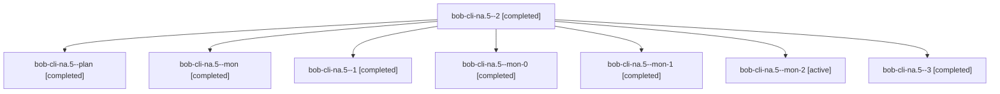

# Session: bob-cli-na.5

[Agent Hoods](../README.md) / [bbugyi200](../users/bbugyi200/README.md) / [apollo](../users/bbugyi200/machines/apollo/README.md) / [bob-cli-na](../users/bbugyi200/machines/apollo/hoods/bob-cli-na/README.md) / bob-cli-na.5

Owner: `bbugyi200.apollo` · Hood: `bob-cli-na` · Members: 8 · Bead: [bob-cli-na.5](https://github.com/bobs-org/bob-cli--beads/blob/main/pages/bob-cli-na/bob-cli-na.5.md)

## Lineage

The diagram is an optional enhancement; the ordered table below contains the same lineage in accessible text.

| Role | Agent | State | Model / provider | Timing | Commits | Prompt | Chat |
|---|---|---|---|---|---:|---|---|
| 2 | bob-cli-na.5--2 | completed | gpt-6-luna / codex | 2026-11-18T16:38:16.087986+00:00 → 2026-11-18T16:42:42.921567+00:00 | 0 | [Prompt](../agents/bbugyi200.apollo.bob-cli-na.5--2/prompt.md) | [Chat](../agents/bbugyi200.apollo.bob-cli-na.5--2/chat.md) |
| plan | bob-cli-na.5--plan | completed | gpt-6-luna / codex | 2026-11-18T16:09:13.718223+00:00 → 2026-11-18T16:33:45.412067+00:00 | 0 | [Prompt](../agents/bbugyi200.apollo.bob-cli-na.5--plan/prompt.md) | [Chat](../agents/bbugyi200.apollo.bob-cli-na.5--plan/chat.md) |
| mon | bob-cli-na.5--mon | completed | gpt-6-luna / codex | 2026-11-18T16:32:47.320149+00:00 → 2026-11-18T16:35:13.702577+00:00 | 0 | — | [Chat](../agents/bbugyi200.apollo.bob-cli-na.5--mon/chat.md) |
| 1 | bob-cli-na.5--1 | completed | gpt-6-luna / codex | 2026-11-18T16:35:13.275422+00:00 → 2026-11-18T16:36:53.529125+00:00 | 0 | [Prompt](../agents/bbugyi200.apollo.bob-cli-na.5--1/prompt.md) | [Chat](../agents/bbugyi200.apollo.bob-cli-na.5--1/chat.md) |
| mon-0 | bob-cli-na.5--mon-0 | completed | gpt-6-luna / codex | 2026-11-18T16:36:08.574520+00:00 → 2026-11-18T16:38:16.583164+00:00 | 0 | — | [Chat](../agents/bbugyi200.apollo.bob-cli-na.5--mon-0/chat.md) |
| mon-1 | bob-cli-na.5--mon-1 | completed | gpt-6-luna / codex | 2026-11-18T16:41:59.274230+00:00 → 2026-11-18T16:53:18.144227+00:00 | 0 | — | [Chat](../agents/bbugyi200.apollo.bob-cli-na.5--mon-1/chat.md) |
| mon-2 | bob-cli-na.5--mon-2 | active | gpt-6-luna / codex | 2026-11-18T17:06:59.788247+00:00 | 0 | — | — |
| 3 | bob-cli-na.5--3 | completed | gpt-6-luna / codex | 2026-11-18T17:06:04.310989+00:00 → 2026-11-18T17:07:45.378716+00:00 | 0 | [Prompt](../agents/bbugyi200.apollo.bob-cli-na.5--3/prompt.md) | [Chat](../agents/bbugyi200.apollo.bob-cli-na.5--3/chat.md) |

## Neighbors

| Agent | Relation | State |
|---|---|---|
| [bob-cli-na.1](../agents/bbugyi200.apollo.bob-cli-na.1/README.md) | bob-cli-na hood | completed |
| [bob-cli-na.2](../agents/bbugyi200.apollo.bob-cli-na.2/README.md) | bob-cli-na hood | completed |
| [bob-cli-na.3](../agents/bbugyi200.apollo.bob-cli-na.3/README.md) | bob-cli-na hood | active |
| [bob-cli-na.4](bbugyi200.apollo.bob-cli-na.4.md) (session · 3) | bob-cli-na hood | active 1, completed 1, failed 1 |
| [bob-cli-na.6](../agents/bbugyi200.apollo.bob-cli-na.6/README.md) | bob-cli-na hood | waiting |
| [bob-cli-na.7](../agents/bbugyi200.apollo.bob-cli-na.7/README.md) | bob-cli-na hood | waiting |
| [bob-cli-na.8](../agents/bbugyi200.apollo.bob-cli-na.8/README.md) | bob-cli-na hood | waiting |
| [bob-cli-na.land](../agents/bbugyi200.apollo.bob-cli-na.land/README.md) | bob-cli-na hood | waiting |
