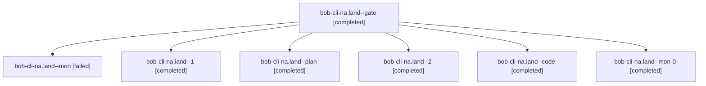

# Session: bob-cli-na.land

[Agent Hoods](../README.md) / [bbugyi200](../users/bbugyi200/README.md) / [apollo](../users/bbugyi200/machines/apollo/README.md) / [bob-cli-na](../users/bbugyi200/machines/apollo/hoods/bob-cli-na/README.md) / bob-cli-na.land

Owner: `bbugyi200.apollo` · Hood: `bob-cli-na` · Members: 7 · Bead: [bob-cli-na](https://github.com/bobs-org/bob-cli--beads/blob/main/pages/bob-cli-na/README.md)

## Lineage

The diagram is an optional enhancement; the ordered table below contains the same lineage in accessible text.

| Role | Agent | State | Model / provider | Timing | Commits | Prompt | Chat |
|---|---|---|---|---|---:|---|---|
| gate | bob-cli-na.land--gate | completed | opus / claude | 2026-11-18T22:18:41.615700+00:00 → 2026-11-18T22:18:51.231492+00:00 | 0 | — | [Chat](../agents/bbugyi200.apollo.bob-cli-na.land--gate/chat.md) |
| mon | bob-cli-na.land--mon | failed | gpt-6-luna / codex | 2026-11-18T22:45:05.857131+00:00 → 2026-11-18T22:56:14.591521+00:00 | 0 | — | [Chat](../agents/bbugyi200.apollo.bob-cli-na.land--mon/chat.md) |
| 1 | bob-cli-na.land--1 | completed | gpt-6-luna / codex | 2026-11-18T22:56:14.167506+00:00 → 2026-11-18T23:06:08.026758+00:00 | 0 | [Prompt](../agents/bbugyi200.apollo.bob-cli-na.land--1/prompt.md) | [Chat](../agents/bbugyi200.apollo.bob-cli-na.land--1/chat.md) |
| plan | bob-cli-na.land--plan | completed | opus / claude | 2026-11-18T21:47:41.054655+00:00 → 2026-11-18T22:47:10.336296+00:00 | [1](../agents/bbugyi200.apollo.bob-cli-na.land--plan/README.md#commits) | [Prompt](../agents/bbugyi200.apollo.bob-cli-na.land--plan/prompt.md) | [Chat](../agents/bbugyi200.apollo.bob-cli-na.land--plan/chat.md) |
| 2 | bob-cli-na.land--2 | completed | grok-4.6 / grok | 2026-11-18T23:21:33.152356+00:00 → 2026-11-18T23:27:21.592775+00:00 | [1](../agents/bbugyi200.apollo.bob-cli-na.land--2/README.md#commits) | [Prompt](../agents/bbugyi200.apollo.bob-cli-na.land--2/prompt.md) | [Chat](../agents/bbugyi200.apollo.bob-cli-na.land--2/chat.md) |
| code | bob-cli-na.land--code | completed | gpt-6-luna / codex | 2026-11-18T22:19:30.447601+00:00 → 2026-11-18T22:47:10.336296+00:00 | 0 | — | [Chat](../agents/bbugyi200.apollo.bob-cli-na.land--code/chat.md) |
| mon-0 | bob-cli-na.land--mon-0 | completed | gpt-6-luna / codex | 2026-11-18T23:05:05.156869+00:00 → 2026-11-18T23:21:33.415453+00:00 | 0 | — | [Chat](../agents/bbugyi200.apollo.bob-cli-na.land--mon-0/chat.md) |

## Commits

| Role | Repo | Commit | Subject | Committed |
|---|---|---|---|---|
| plan | bob-cli | [`f5939f9`](https://github.com/bobs-org/bob-cli/commit/f5939f9a8e6049c1ffd0be6aa08ec7de3fb093e0) | refactor(albums): drop record walk phase dead-code scaffolding | 2026-11-18 17:17:54 EST |
| 2 | bob-cli | [`28eec33`](https://github.com/bobs-org/bob-cli/commit/28eec33520d8f67668fca2ce435d23885a3bb8ba) | feat(albums): plan each album walk once and pin landing tests | 2026-11-18 18:26:05 EST |

## Neighbors

| Agent | Relation | State |
|---|---|---|
| [bob-cli-na.1](../agents/bbugyi200.apollo.bob-cli-na.1/README.md) | bob-cli-na hood | completed |
| [bob-cli-na.2](../agents/bbugyi200.apollo.bob-cli-na.2/README.md) | bob-cli-na hood | completed |
| [bob-cli-na.3](../agents/bbugyi200.apollo.bob-cli-na.3/README.md) | bob-cli-na hood | completed |
| [bob-cli-na.4](bbugyi200.apollo.bob-cli-na.4.md) (session · 3) | bob-cli-na hood | completed 2, failed 1 |
| [bob-cli-na.5](bbugyi200.apollo.bob-cli-na.5.md) (session · 15) | bob-cli-na hood | completed 13, failed 2 |
| [bob-cli-na.6](../agents/bbugyi200.apollo.bob-cli-na.6/README.md) | bob-cli-na hood | completed |
| [bob-cli-na.7](../agents/bbugyi200.apollo.bob-cli-na.7/README.md) | bob-cli-na hood | completed |
| [bob-cli-na.8](../agents/bbugyi200.apollo.bob-cli-na.8/README.md) | bob-cli-na hood | completed |
