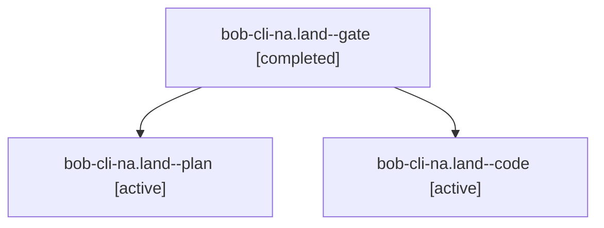

# Session: bob-cli-na.land

[Agent Hoods](../README.md) / [bbugyi200](../users/bbugyi200/README.md) / [apollo](../users/bbugyi200/machines/apollo/README.md) / [bob-cli-na](../users/bbugyi200/machines/apollo/hoods/bob-cli-na/README.md) / bob-cli-na.land

Owner: `bbugyi200.apollo` · Hood: `bob-cli-na` · Members: 3 · Bead: [bob-cli-na](https://github.com/bobs-org/bob-cli--beads/blob/main/pages/bob-cli-na/README.md)

## Lineage

The diagram is an optional enhancement; the ordered table below contains the same lineage in accessible text.

| Role | Agent | State | Model / provider | Timing | Commits | Prompt | Chat |
|---|---|---|---|---|---:|---|---|
| gate | bob-cli-na.land--gate | completed | opus / claude | 2026-11-18T22:18:41.615700+00:00 → 2026-11-18T22:18:51.231492+00:00 | 0 | — | [Chat](../agents/bbugyi200.apollo.bob-cli-na.land--gate/chat.md) |
| plan | bob-cli-na.land--plan | active | opus / claude | 2026-11-18T21:47:41.054655+00:00 | [1](../agents/bbugyi200.apollo.bob-cli-na.land--plan/README.md#commits) | [Prompt](../agents/bbugyi200.apollo.bob-cli-na.land--plan/prompt.md) | [Chat](../agents/bbugyi200.apollo.bob-cli-na.land--plan/chat.md) |
| code | bob-cli-na.land--code | active | gpt-6-luna / codex | 2026-11-18T22:19:30.447601+00:00 | 0 | — | — |

## Commits

| Role | Repo | Commit | Subject | Committed |
|---|---|---|---|---|
| plan | bob-cli | [`f5939f9`](https://github.com/bobs-org/bob-cli/commit/f5939f9a8e6049c1ffd0be6aa08ec7de3fb093e0) | refactor(albums): drop record walk phase dead-code scaffolding | 2026-11-18 17:17:54 EST |

## Neighbors

| Agent | Relation | State |
|---|---|---|
| [bob-cli-na.1](../agents/bbugyi200.apollo.bob-cli-na.1/README.md) | bob-cli-na hood | completed |
| [bob-cli-na.2](../agents/bbugyi200.apollo.bob-cli-na.2/README.md) | bob-cli-na hood | completed |
| [bob-cli-na.3](../agents/bbugyi200.apollo.bob-cli-na.3/README.md) | bob-cli-na hood | completed |
| [bob-cli-na.4](bbugyi200.apollo.bob-cli-na.4.md) (session · 3) | bob-cli-na hood | completed 2, failed 1 |
| [bob-cli-na.5](bbugyi200.apollo.bob-cli-na.5.md) (session · 15) | bob-cli-na hood | completed 13, failed 2 |
| [bob-cli-na.6](../agents/bbugyi200.apollo.bob-cli-na.6/README.md) | bob-cli-na hood | completed |
| [bob-cli-na.7](../agents/bbugyi200.apollo.bob-cli-na.7/README.md) | bob-cli-na hood | completed |
| [bob-cli-na.8](../agents/bbugyi200.apollo.bob-cli-na.8/README.md) | bob-cli-na hood | completed |
