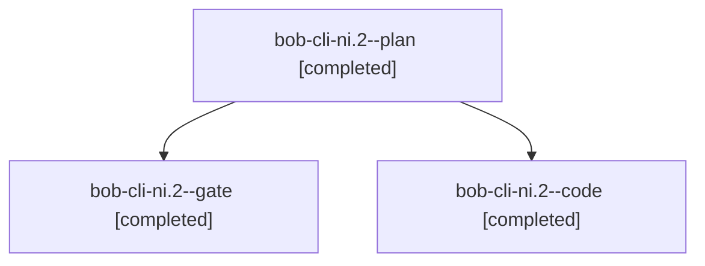

# Session: bob-cli-ni.2

[Agent Hoods](../README.md) / [bbugyi200](../users/bbugyi200/README.md) / [apollo](../users/bbugyi200/machines/apollo/README.md) / [bob-cli-ni](../users/bbugyi200/machines/apollo/hoods/bob-cli-ni/README.md) / bob-cli-ni.2

Owner: `bbugyi200.apollo` · Hood: `bob-cli-ni` · Members: 3 · Bead: [bob-cli-ni.2](https://github.com/bobs-org/bob-cli--beads/blob/main/pages/bob-cli-ni/bob-cli-ni.2.md)

## Lineage

The diagram is an optional enhancement; the ordered table below contains the same lineage in accessible text.

| Role | Agent | State | Model / provider | Timing | Commits | Prompt | Chat |
|---|---|---|---|---|---:|---|---|
| plan | bob-cli-ni.2--plan | completed | gpt-6-astra / codex | 2026-11-19T16:09:11.817397+00:00 → 2026-11-19T17:12:52.081436+00:00 | 0 | [Prompt](../agents/bbugyi200.apollo.bob-cli-ni.2--plan/prompt.md) | [Chat](../agents/bbugyi200.apollo.bob-cli-ni.2--plan/chat.md) |
| gate | bob-cli-ni.2--gate | completed | gpt-6-astra / codex | 2026-11-19T16:17:01.008622+00:00 → 2026-11-19T16:17:13.082174+00:00 | 0 | — | [Chat](../agents/bbugyi200.apollo.bob-cli-ni.2--gate/chat.md) |
| code | bob-cli-ni.2--code | completed | muse-spark-1.3-contributor / muse | 2026-11-19T16:17:53.971573+00:00 → 2026-11-19T17:12:52.081436+00:00 | 0 | — | [Chat](../agents/bbugyi200.apollo.bob-cli-ni.2--code/chat.md) |

## Neighbors

| Agent | Relation | State |
|---|---|---|
| [bob-cli-ni.1](../agents/bbugyi200.apollo.bob-cli-ni.1/README.md) | bob-cli-ni hood | completed |
| [bob-cli-ni.3](../agents/bbugyi200.apollo.bob-cli-ni.3/README.md) | bob-cli-ni hood | completed |
| [bob-cli-ni.4](../agents/bbugyi200.apollo.bob-cli-ni.4/README.md) | bob-cli-ni hood | completed |
| [bob-cli-ni.5](bbugyi200.apollo.bob-cli-ni.5.md) (session · 3) | bob-cli-ni hood | completed 3 |
| [bob-cli-ni.6](../agents/bbugyi200.apollo.bob-cli-ni.6/README.md) | bob-cli-ni hood | completed |
| [bob-cli-ni.land](../agents/bbugyi200.apollo.bob-cli-ni.land/README.md) | bob-cli-ni hood | waiting |
