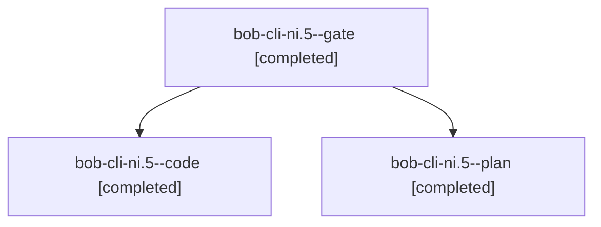

# Session: bob-cli-ni.5

[Agent Hoods](../README.md) / [bbugyi200](../users/bbugyi200/README.md) / [apollo](../users/bbugyi200/machines/apollo/README.md) / [bob-cli-ni](../users/bbugyi200/machines/apollo/hoods/bob-cli-ni/README.md) / bob-cli-ni.5

Owner: `bbugyi200.apollo` · Hood: `bob-cli-ni` · Members: 3 · Bead: [bob-cli-ni.5](https://github.com/bobs-org/bob-cli--beads/blob/main/pages/bob-cli-ni/bob-cli-ni.5.md)

## Lineage

The diagram is an optional enhancement; the ordered table below contains the same lineage in accessible text.

| Role | Agent | State | Model / provider | Timing | Commits | Prompt | Chat |
|---|---|---|---|---|---:|---|---|
| gate | bob-cli-ni.5--gate | completed | gpt-6-astra / codex | 2026-11-19T17:50:34.121445+00:00 → 2026-11-19T17:50:44.242607+00:00 | 0 | — | [Chat](../agents/bbugyi200.apollo.bob-cli-ni.5--gate/chat.md) |
| code | bob-cli-ni.5--code | completed | grok-4.6 / grok | 2026-11-19T17:51:32.736460+00:00 → 2026-11-19T18:58:28.454014+00:00 | 0 | — | [Chat](../agents/bbugyi200.apollo.bob-cli-ni.5--code/chat.md) |
| plan | bob-cli-ni.5--plan | completed | gpt-6-astra / codex | 2026-11-19T17:43:16.850900+00:00 → 2026-11-19T18:58:28.454014+00:00 | 0 | [Prompt](../agents/bbugyi200.apollo.bob-cli-ni.5--plan/prompt.md) | [Chat](../agents/bbugyi200.apollo.bob-cli-ni.5--plan/chat.md) |

## Neighbors

| Agent | Relation | State |
|---|---|---|
| [bob-cli-ni.1](../agents/bbugyi200.apollo.bob-cli-ni.1/README.md) | bob-cli-ni hood | completed |
| [bob-cli-ni.2](bbugyi200.apollo.bob-cli-ni.2.md) (session · 3) | bob-cli-ni hood | completed 3 |
| [bob-cli-ni.3](../agents/bbugyi200.apollo.bob-cli-ni.3/README.md) | bob-cli-ni hood | completed |
| [bob-cli-ni.4](../agents/bbugyi200.apollo.bob-cli-ni.4/README.md) | bob-cli-ni hood | completed |
| [bob-cli-ni.6](../agents/bbugyi200.apollo.bob-cli-ni.6/README.md) | bob-cli-ni hood | completed |
| [bob-cli-ni.land](bbugyi200.apollo.bob-cli-ni.land.md) (session · 3) | bob-cli-ni hood | active 2, completed 1 |
