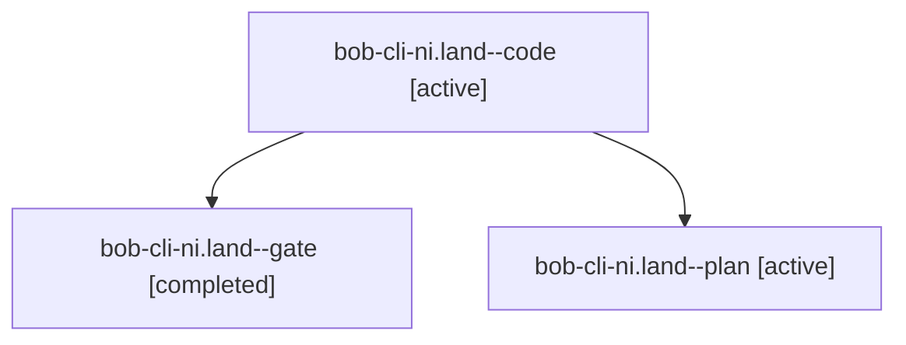

# Session: bob-cli-ni.land

[Agent Hoods](../README.md) / [bbugyi200](../users/bbugyi200/README.md) / [apollo](../users/bbugyi200/machines/apollo/README.md) / [bob-cli-ni](../users/bbugyi200/machines/apollo/hoods/bob-cli-ni/README.md) / bob-cli-ni.land

Owner: `bbugyi200.apollo` · Hood: `bob-cli-ni` · Members: 3 · Bead: [bob-cli-ni](https://github.com/bobs-org/bob-cli--beads/blob/main/pages/bob-cli-ni/README.md)

## Lineage

The diagram is an optional enhancement; the ordered table below contains the same lineage in accessible text.

| Role | Agent | State | Model / provider | Timing | Commits | Prompt | Chat |
|---|---|---|---|---|---:|---|---|
| code | bob-cli-ni.land--code | active | muse-spark-1.3-contributor / muse | 2026-11-19T19:31:02.965435+00:00 | 0 | — | — |
| gate | bob-cli-ni.land--gate | completed | opus / claude | 2026-11-19T19:30:07.990141+00:00 → 2026-11-19T19:30:18.622932+00:00 | 0 | — | [Chat](../agents/bbugyi200.apollo.bob-cli-ni.land--gate/chat.md) |
| plan | bob-cli-ni.land--plan | active | opus / claude | 2026-11-19T19:11:40.030481+00:00 | 0 | [Prompt](../agents/bbugyi200.apollo.bob-cli-ni.land--plan/prompt.md) | [Chat](../agents/bbugyi200.apollo.bob-cli-ni.land--plan/chat.md) |

## Neighbors

| Agent | Relation | State |
|---|---|---|
| [bob-cli-ni.1](../agents/bbugyi200.apollo.bob-cli-ni.1/README.md) | bob-cli-ni hood | completed |
| [bob-cli-ni.2](bbugyi200.apollo.bob-cli-ni.2.md) (session · 3) | bob-cli-ni hood | completed 3 |
| [bob-cli-ni.3](../agents/bbugyi200.apollo.bob-cli-ni.3/README.md) | bob-cli-ni hood | completed |
| [bob-cli-ni.4](../agents/bbugyi200.apollo.bob-cli-ni.4/README.md) | bob-cli-ni hood | completed |
| [bob-cli-ni.5](bbugyi200.apollo.bob-cli-ni.5.md) (session · 3) | bob-cli-ni hood | completed 3 |
| [bob-cli-ni.6](../agents/bbugyi200.apollo.bob-cli-ni.6/README.md) | bob-cli-ni hood | completed |
