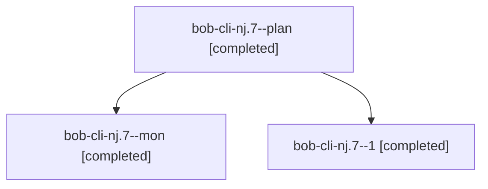

# Session: bob-cli-nj.7

[Agent Hoods](../README.md) / [bbugyi200](../users/bbugyi200/README.md) / [apollo](../users/bbugyi200/machines/apollo/README.md) / [bob-cli-nj](../users/bbugyi200/machines/apollo/hoods/bob-cli-nj/README.md) / bob-cli-nj.7

Owner: `bbugyi200.apollo` · Hood: `bob-cli-nj` · Members: 3 · Bead: [bob-cli-nj.7](https://github.com/bobs-org/bob-cli--beads/blob/main/pages/bob-cli-nj/bob-cli-nj.7.md)

## Lineage

The diagram is an optional enhancement; the ordered table below contains the same lineage in accessible text.

| Role | Agent | State | Model / provider | Timing | Commits | Prompt | Chat |
|---|---|---|---|---|---:|---|---|
| plan | bob-cli-nj.7--plan | completed | muse-spark-1.3-contributor / muse | 2026-11-19T20:23:53.810707+00:00 → 2026-11-19T21:41:40.489916+00:00 | 0 | [Prompt](../agents/bbugyi200.apollo.bob-cli-nj.7--plan/prompt.md) | [Chat](../agents/bbugyi200.apollo.bob-cli-nj.7--plan/chat.md) |
| mon | bob-cli-nj.7--mon | completed | muse-spark-1.3-contributor / muse | 2026-11-19T20:50:38.736507+00:00 → 2026-11-19T21:43:00.921889+00:00 | 0 | — | [Chat](../agents/bbugyi200.apollo.bob-cli-nj.7--mon/chat.md) |
| 1 | bob-cli-nj.7--1 | completed | muse-spark-1.3-contributor / muse | 2026-11-19T21:43:00.808305+00:00 → 2026-11-19T21:45:10.602289+00:00 | 0 | [Prompt](../agents/bbugyi200.apollo.bob-cli-nj.7--1/prompt.md) | [Chat](../agents/bbugyi200.apollo.bob-cli-nj.7--1/chat.md) |

## Neighbors

| Agent | Relation | State |
|---|---|---|
| [bob-cli-nj.1](../agents/bbugyi200.apollo.bob-cli-nj.1/README.md) | bob-cli-nj hood | completed |
| [bob-cli-nj.2](../agents/bbugyi200.apollo.bob-cli-nj.2/README.md) | bob-cli-nj hood | completed |
| [bob-cli-nj.3](../agents/bbugyi200.apollo.bob-cli-nj.3/README.md) | bob-cli-nj hood | completed |
| [bob-cli-nj.4](bbugyi200.apollo.bob-cli-nj.4.md) (session · 3) | bob-cli-nj hood | completed 2, failed 1 |
| [bob-cli-nj.5](../agents/bbugyi200.apollo.bob-cli-nj.5/README.md) | bob-cli-nj hood | completed |
| [bob-cli-nj.6](../agents/bbugyi200.apollo.bob-cli-nj.6/README.md) | bob-cli-nj hood | completed |
| [bob-cli-nj.8](../agents/bbugyi200.apollo.bob-cli-nj.8/README.md) | bob-cli-nj hood | completed |
| [bob-cli-nj.land](../agents/bbugyi200.apollo.bob-cli-nj.land/README.md) | bob-cli-nj hood | waiting |
