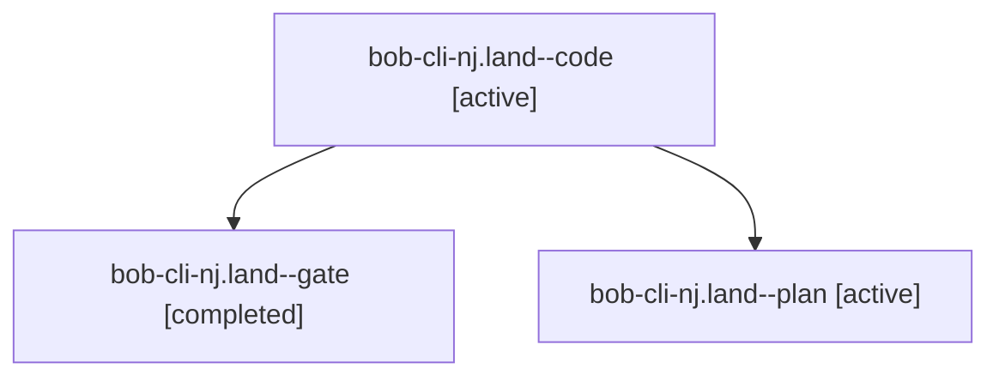

# Session: bob-cli-nj.land

[Agent Hoods](../README.md) / [bbugyi200](../users/bbugyi200/README.md) / [apollo](../users/bbugyi200/machines/apollo/README.md) / [bob-cli-nj](../users/bbugyi200/machines/apollo/hoods/bob-cli-nj/README.md) / bob-cli-nj.land

Owner: `bbugyi200.apollo` · Hood: `bob-cli-nj` · Members: 3 · Bead: [bob-cli-nj](https://github.com/bobs-org/bob-cli--beads/blob/main/pages/bob-cli-nj/README.md)

## Lineage

The diagram is an optional enhancement; the ordered table below contains the same lineage in accessible text.

| Role | Agent | State | Model / provider | Timing | Commits | Prompt | Chat |
|---|---|---|---|---|---:|---|---|
| code | bob-cli-nj.land--code | active | muse-spark-1.3-contributor / muse | 2026-11-20T01:48:04.604055+00:00 | 0 | — | — |
| gate | bob-cli-nj.land--gate | completed | opus / claude | 2026-11-20T01:47:15.000334+00:00 → 2026-11-20T01:47:24.434062+00:00 | 0 | — | [Chat](../agents/bbugyi200.apollo.bob-cli-nj.land--gate/chat.md) |
| plan | bob-cli-nj.land--plan | active | opus / claude | 2026-11-20T01:16:04.738533+00:00 | 0 | [Prompt](../agents/bbugyi200.apollo.bob-cli-nj.land--plan/prompt.md) | [Chat](../agents/bbugyi200.apollo.bob-cli-nj.land--plan/chat.md) |

## Neighbors

| Agent | Relation | State |
|---|---|---|
| [bob-cli-nj.1](../agents/bbugyi200.apollo.bob-cli-nj.1/README.md) | bob-cli-nj hood | completed |
| [bob-cli-nj.2](../agents/bbugyi200.apollo.bob-cli-nj.2/README.md) | bob-cli-nj hood | completed |
| [bob-cli-nj.3](../agents/bbugyi200.apollo.bob-cli-nj.3/README.md) | bob-cli-nj hood | completed |
| [bob-cli-nj.4](bbugyi200.apollo.bob-cli-nj.4.md) (session · 3) | bob-cli-nj hood | completed 2, failed 1 |
| [bob-cli-nj.5](../agents/bbugyi200.apollo.bob-cli-nj.5/README.md) | bob-cli-nj hood | completed |
| [bob-cli-nj.6](../agents/bbugyi200.apollo.bob-cli-nj.6/README.md) | bob-cli-nj hood | completed |
| [bob-cli-nj.7](bbugyi200.apollo.bob-cli-nj.7.md) (session · 3) | bob-cli-nj hood | completed 3 |
| [bob-cli-nj.8](../agents/bbugyi200.apollo.bob-cli-nj.8/README.md) | bob-cli-nj hood | completed |
