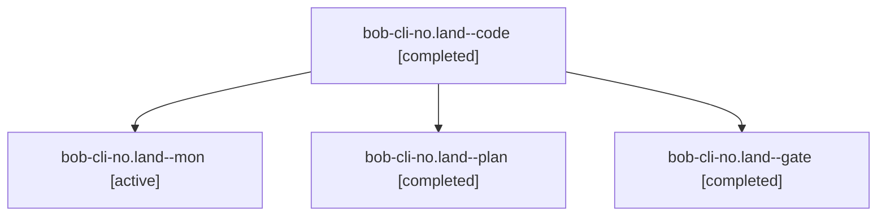

# Session: bob-cli-no.land

[Agent Hoods](../README.md) / [bbugyi200](../users/bbugyi200/README.md) / [apollo](../users/bbugyi200/machines/apollo/README.md) / [bob-cli-no](../users/bbugyi200/machines/apollo/hoods/bob-cli-no/README.md) / bob-cli-no.land

Owner: `bbugyi200.apollo` · Hood: `bob-cli-no` · Members: 4 · Bead: [bob-cli-no](https://github.com/bobs-org/bob-cli--beads/blob/main/pages/bob-cli-no/README.md)

## Lineage



The diagram is an optional enhancement; the ordered table below contains the same lineage in accessible text.

| Role | Agent | State | Model / provider | Timing | Commits | Prompt | Chat |
|---|---|---|---|---|---:|---|---|
| <a id="member-code"></a>code | bob-cli-no.land--code | completed | gpt-6-luna / codex | 2026-11-19T22:46:19.671013+00:00 → 2026-11-19T22:54:13.594293+00:00 | 0 | — | [Chat](../agents/bbugyi200.apollo.bob-cli-no.land--code/chat.md) |
| <a id="member-mon"></a>mon | bob-cli-no.land--mon | active | gpt-6-luna / codex | 2026-11-19T22:53:15.918519+00:00 | 0 | — | — |
| <a id="member-plan"></a>plan | bob-cli-no.land--plan | completed | gpt-6-astra / codex | 2026-11-19T22:29:15.544817+00:00 → 2026-11-19T22:54:13.594293+00:00 | 0 | [Prompt](../agents/bbugyi200.apollo.bob-cli-no.land--plan/prompt.md) | [Chat](../agents/bbugyi200.apollo.bob-cli-no.land--plan/chat.md) |
| <a id="member-gate"></a>gate | bob-cli-no.land--gate | completed | gpt-6-astra / codex | 2026-11-19T22:45:26.704445+00:00 → 2026-11-19T22:45:37.332084+00:00 | 0 | — | [Chat](../agents/bbugyi200.apollo.bob-cli-no.land--gate/chat.md) |

## Variables

| Role | Variable | Value |
|---|---|---|
| plan | `artifacts` | \[{bead: bob-cli-no, kind: file, label: bob-cli-no landing reproduction and focused verification, path: /home/bryan/.sase/artifacts/agents/gh\_bobs-org\_\_bob-cli/20261119144822/bob-no-landing-evidence-c… |

#### artifacts

**Role:** `plan`

```yaml
- bead: bob-cli-no
  kind: file
  label: bob-cli-no landing reproduction and focused verification
  path: /home/bryan/.sase/artifacts/agents/gh_bobs-org__bob-cli/20261119144822/bob-no-landing-evidence-c7409078e213.txt
  ref: file:explicit:a98fd800433efd364c6531af
  source_path: /tmp/bob-no-landing-evidence.txt
```

Values are truncated for display; see each member's agent meta.json for the full values.

## Neighbors

| Agent | Relation | State |
|---|---|---|
| [bob-cli-no.1](../agents/bbugyi200.apollo.bob-cli-no.1/README.md) | bob-cli-no hood | completed |
| [bob-cli-no.2](../agents/bbugyi200.apollo.bob-cli-no.2/README.md) | bob-cli-no hood | completed |
| [bob-cli-no.3](../agents/bbugyi200.apollo.bob-cli-no.3/README.md) | bob-cli-no hood | completed |
