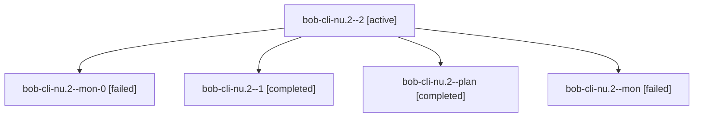

# Session: bob-cli-nu.2

[Agent Hoods](../README.md) / [bbugyi200](../users/bbugyi200/README.md) / [apollo](../users/bbugyi200/machines/apollo/README.md) / [bob-cli-nu](../users/bbugyi200/machines/apollo/hoods/bob-cli-nu/README.md) / bob-cli-nu.2

Owner: `bbugyi200.apollo` · Hood: `bob-cli-nu` · Members: 5 · Bead: [bob-cli-nu.2](https://github.com/bobs-org/bob-cli--beads/blob/main/pages/bob-cli-nu/bob-cli-nu.2.md)

## Lineage

The diagram is an optional enhancement; the ordered table below contains the same lineage in accessible text.

| Role | Agent | State | Model / provider | Timing | Commits | Prompt | Chat |
|---|---|---|---|---|---:|---|---|
| 2 | bob-cli-nu.2--2 | active | gpt-6-luna / codex | 2026-11-20T11:52:35.426539+00:00 | 0 | [Prompt](../agents/bbugyi200.apollo.bob-cli-nu.2--2/prompt.md) | — |
| mon-0 | bob-cli-nu.2--mon-0 | failed | gpt-6-luna / codex | 2026-11-20T11:46:48.285848+00:00 → 2026-11-20T11:52:35.569533+00:00 | 0 | — | [Chat](../agents/bbugyi200.apollo.bob-cli-nu.2--mon-0/chat.md) |
| 1 | bob-cli-nu.2--1 | completed | gpt-6-luna / codex | 2026-11-20T11:44:24.296581+00:00 → 2026-11-20T11:47:42.451570+00:00 | 0 | [Prompt](../agents/bbugyi200.apollo.bob-cli-nu.2--1/prompt.md) | [Chat](../agents/bbugyi200.apollo.bob-cli-nu.2--1/chat.md) |
| plan | bob-cli-nu.2--plan | completed | gpt-6-luna / codex | 2026-11-20T11:01:10.072948+00:00 → 2026-11-20T11:39:35.372276+00:00 | 0 | [Prompt](../agents/bbugyi200.apollo.bob-cli-nu.2--plan/prompt.md) | [Chat](../agents/bbugyi200.apollo.bob-cli-nu.2--plan/chat.md) |
| mon | bob-cli-nu.2--mon | failed | gpt-6-luna / codex | 2026-11-20T11:38:32.281354+00:00 → 2026-11-20T11:44:24.549290+00:00 | 0 | — | [Chat](../agents/bbugyi200.apollo.bob-cli-nu.2--mon/chat.md) |

## Neighbors

| Agent | Relation | State |
|---|---|---|
| [bob-cli-nu.1](../agents/bbugyi200.apollo.bob-cli-nu.1/README.md) | bob-cli-nu hood | completed |
| [bob-cli-nu.3](../agents/bbugyi200.apollo.bob-cli-nu.3/README.md) | bob-cli-nu hood | active |
| [bob-cli-nu.4](../agents/bbugyi200.apollo.bob-cli-nu.4/README.md) | bob-cli-nu hood | waiting |
| [bob-cli-nu.5](../agents/bbugyi200.apollo.bob-cli-nu.5/README.md) | bob-cli-nu hood | waiting |
| [bob-cli-nu.6](../agents/bbugyi200.apollo.bob-cli-nu.6/README.md) | bob-cli-nu hood | waiting |
| [bob-cli-nu.7](../agents/bbugyi200.apollo.bob-cli-nu.7/README.md) | bob-cli-nu hood | waiting |
| [bob-cli-nu.8](../agents/bbugyi200.apollo.bob-cli-nu.8/README.md) | bob-cli-nu hood | waiting |
| [bob-cli-nu.land](../agents/bbugyi200.apollo.bob-cli-nu.land/README.md) | bob-cli-nu hood | waiting |
