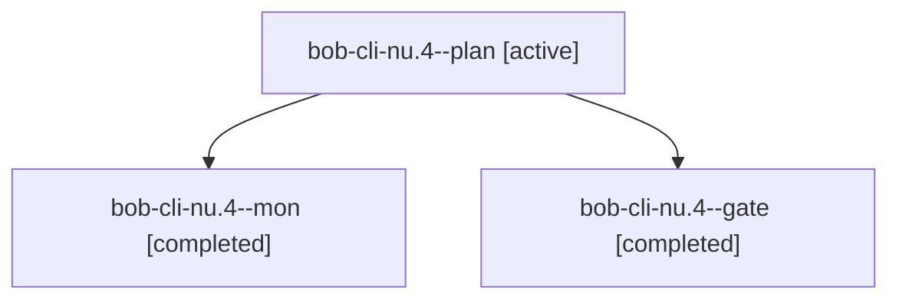

# Session: bob-cli-nu.4

[Agent Hoods](../README.md) / [bbugyi200](../users/bbugyi200/README.md) / [apollo](../users/bbugyi200/machines/apollo/README.md) / [bob-cli-nu](../users/bbugyi200/machines/apollo/hoods/bob-cli-nu/README.md) / bob-cli-nu.4

Owner: `bbugyi200.apollo` · Hood: `bob-cli-nu` · Members: 3 · Bead: [bob-cli-nu.4](https://github.com/bobs-org/bob-cli--beads/blob/main/pages/bob-cli-nu/bob-cli-nu.4.md)

## Lineage

The diagram is an optional enhancement; the ordered table below contains the same lineage in accessible text.

| Role | Agent | State | Model / provider | Timing | Commits | Prompt | Chat |
|---|---|---|---|---|---:|---|---|
| plan | bob-cli-nu.4--plan | active | gpt-6-astra / codex | 2026-11-20T12:27:50.150935+00:00 → 2026-11-20T12:37:01.224590+00:00 | 0 | [Prompt](../agents/bbugyi200.apollo.bob-cli-nu.4--plan/prompt.md) | [Chat](../agents/bbugyi200.apollo.bob-cli-nu.4--plan/chat.md) |
| mon | bob-cli-nu.4--mon | completed | gpt-6-astra / codex | 2026-11-20T12:36:51.071654+00:00 → 2026-11-20T12:38:30.101086+00:00 | 0 | — | [Chat](../agents/bbugyi200.apollo.bob-cli-nu.4--mon/chat.md) |
| gate | bob-cli-nu.4--gate | completed | gpt-6-astra / codex | 2026-11-20T12:36:35.099385+00:00 → 2026-11-20T12:36:52.788504+00:00 | 0 | — | [Chat](../agents/bbugyi200.apollo.bob-cli-nu.4--gate/chat.md) |

## Neighbors

| Agent | Relation | State |
|---|---|---|
| [bob-cli-nu.4.1.1](../agents/bbugyi200.apollo.bob-cli-nu.4.1.1/README.md) | descendant | completed |
| [bob-cli-nu.4.1.2](../agents/bbugyi200.apollo.bob-cli-nu.4.1.2/README.md) | descendant | completed |
| [bob-cli-nu.4.1.3](../agents/bbugyi200.apollo.bob-cli-nu.4.1.3/README.md) | descendant | completed |
| [bob-cli-nu.4.1.4](../agents/bbugyi200.apollo.bob-cli-nu.4.1.4/README.md) | descendant | completed |
| [bob-cli-nu.4.1.5](../agents/bbugyi200.apollo.bob-cli-nu.4.1.5/README.md) | descendant | completed |
| [bob-cli-nu.4.1.land](../agents/bbugyi200.apollo.bob-cli-nu.4.1.land/README.md) | descendant | completed |
| [bob-cli-nu.1](../agents/bbugyi200.apollo.bob-cli-nu.1/README.md) | bob-cli-nu hood | completed |
| [bob-cli-nu.2](bbugyi200.apollo.bob-cli-nu.2.md) (session · 5) | bob-cli-nu hood | completed 3, failed 2 |
| [bob-cli-nu.3](../agents/bbugyi200.apollo.bob-cli-nu.3/README.md) | bob-cli-nu hood | completed |
| [bob-cli-nu.5](../agents/bbugyi200.apollo.bob-cli-nu.5/README.md) | bob-cli-nu hood | completed |
| [bob-cli-nu.6](../agents/bbugyi200.apollo.bob-cli-nu.6/README.md) | bob-cli-nu hood | completed |
| [bob-cli-nu.7](../agents/bbugyi200.apollo.bob-cli-nu.7/README.md) | bob-cli-nu hood | completed |
| [bob-cli-nu.8](../agents/bbugyi200.apollo.bob-cli-nu.8/README.md) | bob-cli-nu hood | waiting |
| [bob-cli-nu.land](../agents/bbugyi200.apollo.bob-cli-nu.land/README.md) | bob-cli-nu hood | waiting |
