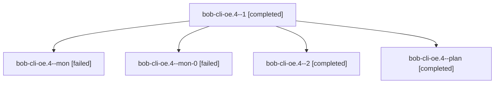

# Session: bob-cli-oe.4

[Agent Hoods](../README.md) / [bbugyi200](../users/bbugyi200/README.md) / [apollo](../users/bbugyi200/machines/apollo/README.md) / [bob-cli-oe](../users/bbugyi200/machines/apollo/hoods/bob-cli-oe/README.md) / bob-cli-oe.4

Owner: `bbugyi200.apollo` · Hood: `bob-cli-oe` · Members: 5 · Bead: [bob-cli-oe.4](https://github.com/bobs-org/bob-cli--beads/blob/main/pages/bob-cli-oe/bob-cli-oe.4.md)

## Lineage

The diagram is an optional enhancement; the ordered table below contains the same lineage in accessible text.

| Role | Agent | State | Model / provider | Timing | Commits | Prompt | Chat |
|---|---|---|---|---|---:|---|---|
| 1 | bob-cli-oe.4--1 | completed | gpt-6-luna / codex | 2026-11-20T23:40:42.288285+00:00 → 2026-11-20T23:43:41.052725+00:00 | 0 | [Prompt](../agents/bbugyi200.apollo.bob-cli-oe.4--1/prompt.md) | [Chat](../agents/bbugyi200.apollo.bob-cli-oe.4--1/chat.md) |
| mon | bob-cli-oe.4--mon | failed | gpt-6-luna / codex | 2026-11-20T23:36:55.450192+00:00 → 2026-11-20T23:40:42.681633+00:00 | 0 | — | [Chat](../agents/bbugyi200.apollo.bob-cli-oe.4--mon/chat.md) |
| mon-0 | bob-cli-oe.4--mon-0 | failed | gpt-6-luna / codex | 2026-11-20T23:42:45.990319+00:00 → 2026-11-20T23:48:33.643397+00:00 | 0 | — | [Chat](../agents/bbugyi200.apollo.bob-cli-oe.4--mon-0/chat.md) |
| 2 | bob-cli-oe.4--2 | completed | muse-spark-1.3-contributor / muse | 2026-11-20T23:48:33.269565+00:00 → 2026-11-20T23:53:12.931535+00:00 | 0 | [Prompt](../agents/bbugyi200.apollo.bob-cli-oe.4--2/prompt.md) | [Chat](../agents/bbugyi200.apollo.bob-cli-oe.4--2/chat.md) |
| plan | bob-cli-oe.4--plan | completed | gpt-6-luna / codex | 2026-11-20T23:08:44.774690+00:00 → 2026-11-20T23:38:02.542959+00:00 | 0 | [Prompt](../agents/bbugyi200.apollo.bob-cli-oe.4--plan/prompt.md) | [Chat](../agents/bbugyi200.apollo.bob-cli-oe.4--plan/chat.md) |

## Neighbors

| Agent | Relation | State |
|---|---|---|
| [bob-cli-oe.1](../agents/bbugyi200.apollo.bob-cli-oe.1/README.md) | bob-cli-oe hood | completed |
| [bob-cli-oe.2](../agents/bbugyi200.apollo.bob-cli-oe.2/README.md) | bob-cli-oe hood | completed |
| [bob-cli-oe.3](../agents/bbugyi200.apollo.bob-cli-oe.3/README.md) | bob-cli-oe hood | completed |
| [bob-cli-oe.5](../agents/bbugyi200.apollo.bob-cli-oe.5/README.md) | bob-cli-oe hood | completed |
| [bob-cli-oe.6](bbugyi200.apollo.bob-cli-oe.6.md) (session · 3) | bob-cli-oe hood | completed 3 |
| [bob-cli-oe.7](../agents/bbugyi200.apollo.bob-cli-oe.7/README.md) | bob-cli-oe hood | completed |
| [bob-cli-oe.8.1](bbugyi200.apollo.bob-cli-oe.8.1.md) (session · 3) | bob-cli-oe hood | completed 3 |
| [bob-cli-oe.8.2](bbugyi200.apollo.bob-cli-oe.8.2.md) (session · 2) | bob-cli-oe hood | active 2 |
| [bob-cli-oe.8.2](../agents/bbugyi200.apollo.bob-cli-oe.8.2/README.md) | bob-cli-oe hood | completed |
| [bob-cli-oe.8.3](../agents/bbugyi200.apollo.bob-cli-oe.8.3/README.md) | bob-cli-oe hood | completed |
| [bob-cli-oe.8.4](bbugyi200.apollo.bob-cli-oe.8.4.md) (session · 3) | bob-cli-oe hood | completed 3 |
| [bob-cli-oe.8.land](bbugyi200.apollo.bob-cli-oe.8.land.md) (session · 3) | bob-cli-oe hood | active 2, completed 1 |
| [bob-cli-oe.land](bbugyi200.apollo.bob-cli-oe.land.md) (session · 3) | bob-cli-oe hood | active 1, completed 2 |
