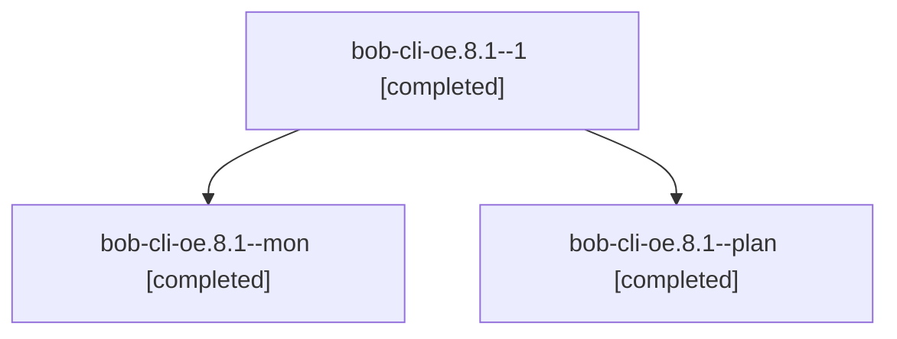

# Session: bob-cli-oe.8.1

[Agent Hoods](../README.md) / [bbugyi200](../users/bbugyi200/README.md) / [apollo](../users/bbugyi200/machines/apollo/README.md) / [bob-cli-oe](../users/bbugyi200/machines/apollo/hoods/bob-cli-oe/README.md) / bob-cli-oe.8.1

Owner: `bbugyi200.apollo` · Hood: `bob-cli-oe` · Members: 3 · Bead: [bob-cli-oe.8.1](https://github.com/bobs-org/bob-cli--beads/blob/main/pages/bob-cli-oe/bob-cli-oe.8.1.md)

## Lineage

The diagram is an optional enhancement; the ordered table below contains the same lineage in accessible text.

| Role | Agent | State | Model / provider | Timing | Commits | Prompt | Chat |
|---|---|---|---|---|---:|---|---|
| 1 | bob-cli-oe.8.1--1 | completed | grok-4.6 / grok | 2026-11-21T03:26:55.075763+00:00 → 2026-11-21T03:43:38.286705+00:00 | [1](../agents/bbugyi200.apollo.bob-cli-oe.8.1--1/README.md#commits) | [Prompt](../agents/bbugyi200.apollo.bob-cli-oe.8.1--1/prompt.md) | [Chat](../agents/bbugyi200.apollo.bob-cli-oe.8.1--1/chat.md) |
| mon | bob-cli-oe.8.1--mon | completed | grok-4.6 / grok | 2026-11-21T03:18:50.623866+00:00 → 2026-11-21T03:26:55.174358+00:00 | 0 | — | [Chat](../agents/bbugyi200.apollo.bob-cli-oe.8.1--mon/chat.md) |
| plan | bob-cli-oe.8.1--plan | completed | grok-4.6 / grok | 2026-11-21T02:41:23.991537+00:00 → 2026-11-21T03:20:11.293204+00:00 | 0 | [Prompt](../agents/bbugyi200.apollo.bob-cli-oe.8.1--plan/prompt.md) | [Chat](../agents/bbugyi200.apollo.bob-cli-oe.8.1--plan/chat.md) |

## Commits

| Role | Repo | Commit | Subject | Committed |
|---|---|---|---|---|
| 1 | bob-cli | [`d27041c`](https://github.com/bobs-org/bob-cli/commit/d27041cd82437310afa818909363f5e0c66cdae6) | fix(capture): settle ID-less successor jump landings | 2026-11-20 22:42:31 EST |

## Neighbors

| Agent | Relation | State |
|---|---|---|
| [bob-cli-oe.8.2](bbugyi200.apollo.bob-cli-oe.8.2.md) (session · 2) | bob-cli-oe.8 hood | active 2 |
| [bob-cli-oe.8.2](../agents/bbugyi200.apollo.bob-cli-oe.8.2/README.md) | bob-cli-oe.8 hood | completed |
| [bob-cli-oe.8.3](../agents/bbugyi200.apollo.bob-cli-oe.8.3/README.md) | bob-cli-oe.8 hood | completed |
| [bob-cli-oe.8.4](bbugyi200.apollo.bob-cli-oe.8.4.md) (session · 3) | bob-cli-oe.8 hood | completed 3 |
| [bob-cli-oe.8.land](../agents/bbugyi200.apollo.bob-cli-oe.8.land/README.md) | bob-cli-oe.8 hood | waiting |
| [bob-cli-oe.1](../agents/bbugyi200.apollo.bob-cli-oe.1/README.md) | bob-cli-oe hood | completed |
| [bob-cli-oe.2](../agents/bbugyi200.apollo.bob-cli-oe.2/README.md) | bob-cli-oe hood | completed |
| [bob-cli-oe.3](../agents/bbugyi200.apollo.bob-cli-oe.3/README.md) | bob-cli-oe hood | completed |
| [bob-cli-oe.4](bbugyi200.apollo.bob-cli-oe.4.md) (session · 5) | bob-cli-oe hood | completed 3, failed 2 |
| [bob-cli-oe.5](../agents/bbugyi200.apollo.bob-cli-oe.5/README.md) | bob-cli-oe hood | completed |
| [bob-cli-oe.6](bbugyi200.apollo.bob-cli-oe.6.md) (session · 3) | bob-cli-oe hood | completed 3 |
| [bob-cli-oe.7](../agents/bbugyi200.apollo.bob-cli-oe.7/README.md) | bob-cli-oe hood | completed |
| [bob-cli-oe.land](bbugyi200.apollo.bob-cli-oe.land.md) (session · 3) | bob-cli-oe hood | active 1, completed 2 |
