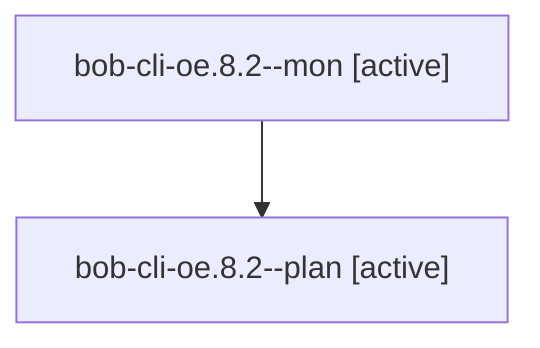

# Session: bob-cli-oe.8.2

[Agent Hoods](../README.md) / [bbugyi200](../users/bbugyi200/README.md) / [apollo](../users/bbugyi200/machines/apollo/README.md) / [bob-cli-oe](../users/bbugyi200/machines/apollo/hoods/bob-cli-oe/README.md) / bob-cli-oe.8.2

Owner: `bbugyi200.apollo` · Hood: `bob-cli-oe` · Members: 2 · Bead: [bob-cli-oe.8.2](https://github.com/bobs-org/bob-cli--beads/blob/main/pages/bob-cli-oe/bob-cli-oe.8.2.md)

## Lineage

The diagram is an optional enhancement; the ordered table below contains the same lineage in accessible text.

| Role | Agent | State | Model / provider | Timing | Commits | Prompt | Chat |
|---|---|---|---|---|---:|---|---|
| mon | bob-cli-oe.8.2--mon | active | gpt-6-luna / codex | 2026-11-21T03:19:06.699879+00:00 | 0 | — | — |
| plan | bob-cli-oe.8.2--plan | active | gpt-6-luna / codex | 2026-11-21T02:41:07.013466+00:00 → 2026-11-21T03:22:09.850038+00:00 | 0 | [Prompt](../agents/bbugyi200.apollo.bob-cli-oe.8.2--plan/prompt.md) | [Chat](../agents/bbugyi200.apollo.bob-cli-oe.8.2--plan/chat.md) |

## Neighbors

| Agent | Relation | State |
|---|---|---|
| [bob-cli-oe.8.1](bbugyi200.apollo.bob-cli-oe.8.1.md) (session · 3) | bob-cli-oe.8 hood | completed 3 |
| [bob-cli-oe.8.3](../agents/bbugyi200.apollo.bob-cli-oe.8.3/README.md) | bob-cli-oe.8 hood | completed |
| [bob-cli-oe.8.4](bbugyi200.apollo.bob-cli-oe.8.4.md) (session · 3) | bob-cli-oe.8 hood | completed 3 |
| [bob-cli-oe.8.land](bbugyi200.apollo.bob-cli-oe.8.land.md) (session · 3) | bob-cli-oe.8 hood | active 2, completed 1 |
| [bob-cli-oe.1](../agents/bbugyi200.apollo.bob-cli-oe.1/README.md) | bob-cli-oe hood | completed |
| [bob-cli-oe.2](../agents/bbugyi200.apollo.bob-cli-oe.2/README.md) | bob-cli-oe hood | completed |
| [bob-cli-oe.3](../agents/bbugyi200.apollo.bob-cli-oe.3/README.md) | bob-cli-oe hood | completed |
| [bob-cli-oe.4](bbugyi200.apollo.bob-cli-oe.4.md) (session · 5) | bob-cli-oe hood | completed 3, failed 2 |
| [bob-cli-oe.5](../agents/bbugyi200.apollo.bob-cli-oe.5/README.md) | bob-cli-oe hood | completed |
| [bob-cli-oe.6](bbugyi200.apollo.bob-cli-oe.6.md) (session · 3) | bob-cli-oe hood | completed 3 |
| [bob-cli-oe.7](../agents/bbugyi200.apollo.bob-cli-oe.7/README.md) | bob-cli-oe hood | completed |
| [bob-cli-oe.land](bbugyi200.apollo.bob-cli-oe.land.md) (session · 3) | bob-cli-oe hood | active 1, completed 2 |
