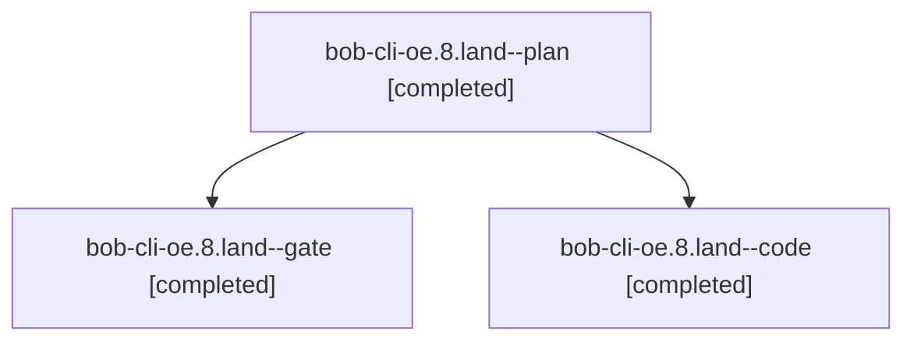

# Session: bob-cli-oe.8.land

[Agent Hoods](../README.md) / [bbugyi200](../users/bbugyi200/README.md) / [apollo](../users/bbugyi200/machines/apollo/README.md) / [bob-cli-oe](../users/bbugyi200/machines/apollo/hoods/bob-cli-oe/README.md) / bob-cli-oe.8.land

Owner: `bbugyi200.apollo` · Hood: `bob-cli-oe` · Members: 3 · Bead: [bob-cli-oe.8](https://github.com/bobs-org/bob-cli--beads/blob/main/pages/bob-cli-oe/bob-cli-oe.8.md)

## Lineage



The diagram is an optional enhancement; the ordered table below contains the same lineage in accessible text.

| Role | Agent | State | Model / provider | Timing | Commits | Prompt | Chat |
|---|---|---|---|---|---:|---|---|
| <a id="member-plan"></a>plan | bob-cli-oe.8.land--plan | completed | gpt-6-astra / codex | 2026-11-21T13:27:15.550226+00:00 → 2026-11-21T15:10:36.876901+00:00 | 0 | [Prompt](../agents/bbugyi200.apollo.bob-cli-oe.8.land--plan/prompt.md) | [Chat](../agents/bbugyi200.apollo.bob-cli-oe.8.land--plan/chat.md) |
| <a id="member-gate"></a>gate | bob-cli-oe.8.land--gate | completed | gpt-6-astra / codex | 2026-11-21T13:40:12.358940+00:00 → 2026-11-21T13:40:21.060569+00:00 | 0 | — | [Chat](../agents/bbugyi200.apollo.bob-cli-oe.8.land--gate/chat.md) |
| <a id="member-code"></a>code | bob-cli-oe.8.land--code | completed | grok-4.6 / grok | 2026-11-21T13:40:51.853499+00:00 → 2026-11-21T15:10:36.876901+00:00 | [1](../agents/bbugyi200.apollo.bob-cli-oe.8.land--code/README.md#commits) | — | [Chat](../agents/bbugyi200.apollo.bob-cli-oe.8.land--code/chat.md) |

## Commits

| Role | Repo | Commit | Subject | Committed |
|---|---|---|---|---|
| code | bob-cli | [`05c1679`](https://github.com/bobs-org/bob-cli/commit/05c1679a0c2377822b27d6915273acd26fa70d0f) | fix(capture): preserve ID-less jump identity across later insertions | 2026-11-21 09:55:39 EST |

## Variables

| Role | Variable | Value |
|---|---|---|
| plan | `artifacts` | \[{bead: bob-cli-oe.8, kind: markdown, label: Jump pin landing audit and reproductions, path: /home/bryan/.sase/artifacts/agents/gh\_bobs-org\_\_bob-cli/20261120214034/oe8\_landing\_audit-35a42eb622a8.md,… |

#### artifacts

**Role:** `plan`

```yaml
- bead: bob-cli-oe.8
  kind: markdown
  label: Jump pin landing audit and reproductions
  path: /home/bryan/.sase/artifacts/agents/gh_bobs-org__bob-cli/20261120214034/oe8_landing_audit-35a42eb622a8.md
  ref: file:explicit:73581b2443f045fcd5a90e60
  source_path: /tmp/oe8_landing_audit.md
```

Values are truncated for display; see each member's agent meta.json for the full values.

## Neighbors

| Agent | Relation | State |
|---|---|---|
| [bob-cli-oe.8.1](bbugyi200.apollo.bob-cli-oe.8.1.md) (session · 3) | bob-cli-oe.8 hood | completed 3 |
| [bob-cli-oe.8.2](bbugyi200.apollo.bob-cli-oe.8.2.md) (session · 2) | bob-cli-oe.8 hood | active 2 |
| [bob-cli-oe.8.2](../agents/bbugyi200.apollo.bob-cli-oe.8.2/README.md) | bob-cli-oe.8 hood | completed |
| [bob-cli-oe.8.3](../agents/bbugyi200.apollo.bob-cli-oe.8.3/README.md) | bob-cli-oe.8 hood | completed |
| [bob-cli-oe.8.4](bbugyi200.apollo.bob-cli-oe.8.4.md) (session · 3) | bob-cli-oe.8 hood | completed 3 |
| [bob-cli-oe.1](../agents/bbugyi200.apollo.bob-cli-oe.1/README.md) | bob-cli-oe hood | completed |
| [bob-cli-oe.2](../agents/bbugyi200.apollo.bob-cli-oe.2/README.md) | bob-cli-oe hood | completed |
| [bob-cli-oe.3](../agents/bbugyi200.apollo.bob-cli-oe.3/README.md) | bob-cli-oe hood | completed |
| [bob-cli-oe.4](bbugyi200.apollo.bob-cli-oe.4.md) (session · 5) | bob-cli-oe hood | completed 3, failed 2 |
| [bob-cli-oe.5](../agents/bbugyi200.apollo.bob-cli-oe.5/README.md) | bob-cli-oe hood | completed |
| [bob-cli-oe.6](bbugyi200.apollo.bob-cli-oe.6.md) (session · 3) | bob-cli-oe hood | completed 3 |
| [bob-cli-oe.7](../agents/bbugyi200.apollo.bob-cli-oe.7/README.md) | bob-cli-oe hood | completed |
| [bob-cli-oe.land](bbugyi200.apollo.bob-cli-oe.land.md) (session · 3) | bob-cli-oe hood | active 1, completed 2 |
