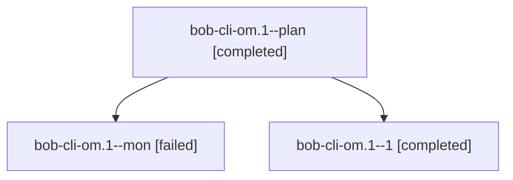

# Session: bob-cli-om.1

[Agent Hoods](../README.md) / [bbugyi200](../users/bbugyi200/README.md) / [apollo](../users/bbugyi200/machines/apollo/README.md) / [bob-cli-om](../users/bbugyi200/machines/apollo/hoods/bob-cli-om/README.md) / bob-cli-om.1

Owner: `bbugyi200.apollo` · Hood: `bob-cli-om` · Members: 3 · Bead: [bob-cli-om.1](https://github.com/bobs-org/bob-cli--beads/blob/main/pages/bob-cli-om/bob-cli-om.1.md)

## Lineage

The diagram is an optional enhancement; the ordered table below contains the same lineage in accessible text.

| Role | Agent | State | Model / provider | Timing | Commits | Prompt | Chat |
|---|---|---|---|---|---:|---|---|
| plan | bob-cli-om.1--plan | completed | gpt-6-luna / codex | 2026-11-21T15:34:04.025518+00:00 → 2026-11-21T16:05:19.524871+00:00 | 0 | [Prompt](../agents/bbugyi200.apollo.bob-cli-om.1--plan/prompt.md) | [Chat](../agents/bbugyi200.apollo.bob-cli-om.1--plan/chat.md) |
| mon | bob-cli-om.1--mon | failed | gpt-6-luna / codex | 2026-11-21T16:03:55.900301+00:00 → 2026-11-21T16:18:59.480389+00:00 | 0 | — | [Chat](../agents/bbugyi200.apollo.bob-cli-om.1--mon/chat.md) |
| 1 | bob-cli-om.1--1 | completed | gpt-6-luna / codex | 2026-11-21T16:18:59.385058+00:00 → 2026-11-21T16:23:45.301821+00:00 | [1](../agents/bbugyi200.apollo.bob-cli-om.1--1/README.md#commits) | [Prompt](../agents/bbugyi200.apollo.bob-cli-om.1--1/prompt.md) | [Chat](../agents/bbugyi200.apollo.bob-cli-om.1--1/chat.md) |

## Commits

| Role | Repo | Commit | Subject | Committed |
|---|---|---|---|---|
| 1 | bob-cli | [`746f4d5`](https://github.com/bobs-org/bob-cli/commit/746f4d5a4aa5ada921ca8bce5d454a473ab4d0ed) | fix(capture): preserve wikilink fields and rank candidates | 2026-11-21 11:23:05 EST |

## Neighbors

| Agent | Relation | State |
|---|---|---|
| [bob-cli-om.10](../agents/bbugyi200.apollo.bob-cli-om.10/README.md) | bob-cli-om hood | waiting |
| [bob-cli-om.2](../agents/bbugyi200.apollo.bob-cli-om.2/README.md) | bob-cli-om hood | completed |
| [bob-cli-om.3](../agents/bbugyi200.apollo.bob-cli-om.3/README.md) | bob-cli-om hood | waiting |
| [bob-cli-om.4](../agents/bbugyi200.apollo.bob-cli-om.4/README.md) | bob-cli-om hood | waiting |
| [bob-cli-om.5](../agents/bbugyi200.apollo.bob-cli-om.5/README.md) | bob-cli-om hood | waiting |
| [bob-cli-om.6](../agents/bbugyi200.apollo.bob-cli-om.6/README.md) | bob-cli-om hood | waiting |
| [bob-cli-om.7](../agents/bbugyi200.apollo.bob-cli-om.7/README.md) | bob-cli-om hood | waiting |
| [bob-cli-om.8](../agents/bbugyi200.apollo.bob-cli-om.8/README.md) | bob-cli-om hood | completed |
| [bob-cli-om.9](../agents/bbugyi200.apollo.bob-cli-om.9/README.md) | bob-cli-om hood | waiting |
| [bob-cli-om.land](../agents/bbugyi200.apollo.bob-cli-om.land/README.md) | bob-cli-om hood | waiting |
