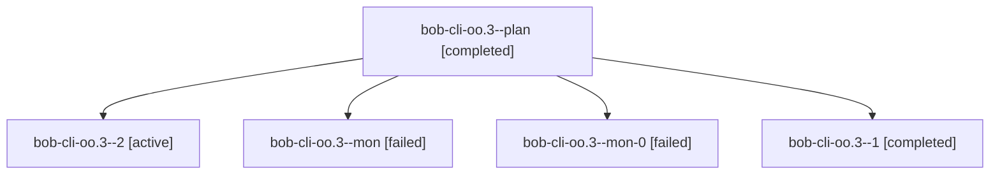

# Session: bob-cli-oo.3

[Agent Hoods](../README.md) / [bbugyi200](../users/bbugyi200/README.md) / [apollo](../users/bbugyi200/machines/apollo/README.md) / [bob-cli-oo](../users/bbugyi200/machines/apollo/hoods/bob-cli-oo/README.md) / bob-cli-oo.3

Owner: `bbugyi200.apollo` · Hood: `bob-cli-oo` · Members: 5 · Bead: [bob-cli-oo.3](https://github.com/bobs-org/bob-cli--beads/blob/main/pages/bob-cli-oo/bob-cli-oo.3.md)

## Lineage

The diagram is an optional enhancement; the ordered table below contains the same lineage in accessible text.

| Role | Agent | State | Model / provider | Timing | Commits | Prompt | Chat |
|---|---|---|---|---|---:|---|---|
| plan | bob-cli-oo.3--plan | completed | gpt-6-luna / codex | 2026-11-21T19:19:05.996549+00:00 → 2026-11-21T19:45:46.305941+00:00 | [1](../agents/bbugyi200.apollo.bob-cli-oo.3--plan/README.md#commits) | [Prompt](../agents/bbugyi200.apollo.bob-cli-oo.3--plan/prompt.md) | [Chat](../agents/bbugyi200.apollo.bob-cli-oo.3--plan/chat.md) |
| 2 | bob-cli-oo.3--2 | active | grok-4.6 / grok | 2026-11-21T20:03:26.239801+00:00 | 0 | [Prompt](../agents/bbugyi200.apollo.bob-cli-oo.3--2/prompt.md) | — |
| mon | bob-cli-oo.3--mon | failed | gpt-6-luna / codex | 2026-11-21T19:35:31.162679+00:00 → 2026-11-21T19:49:42.805637+00:00 | 0 | — | [Chat](../agents/bbugyi200.apollo.bob-cli-oo.3--mon/chat.md) |
| mon-0 | bob-cli-oo.3--mon-0 | failed | gpt-6-luna / codex | 2026-11-21T19:57:46.497748+00:00 → 2026-11-21T20:03:26.440842+00:00 | 0 | — | [Chat](../agents/bbugyi200.apollo.bob-cli-oo.3--mon-0/chat.md) |
| 1 | bob-cli-oo.3--1 | completed | gpt-6-luna / codex | 2026-11-21T19:49:42.486318+00:00 → 2026-11-21T19:59:11.316540+00:00 | 0 | [Prompt](../agents/bbugyi200.apollo.bob-cli-oo.3--1/prompt.md) | [Chat](../agents/bbugyi200.apollo.bob-cli-oo.3--1/chat.md) |

## Commits

| Role | Repo | Commit | Subject | Committed |
|---|---|---|---|---|
| plan | bob-cli | [`dfe20ca`](https://github.com/bobs-org/bob-cli/commit/dfe20ca3040b1328b7356083fbb0f8afd4d97d80) | docs(glossary): describe bank row notes | 2026-11-21 14:36:44 EST |

## Neighbors

| Agent | Relation | State |
|---|---|---|
| [bob-cli-oo.1](../agents/bbugyi200.apollo.bob-cli-oo.1/README.md) | bob-cli-oo hood | completed |
| [bob-cli-oo.2](../agents/bbugyi200.apollo.bob-cli-oo.2/README.md) | bob-cli-oo hood | completed |
| [bob-cli-oo.4](../agents/bbugyi200.apollo.bob-cli-oo.4/README.md) | bob-cli-oo hood | waiting |
| [bob-cli-oo.land](../agents/bbugyi200.apollo.bob-cli-oo.land/README.md) | bob-cli-oo hood | waiting |
