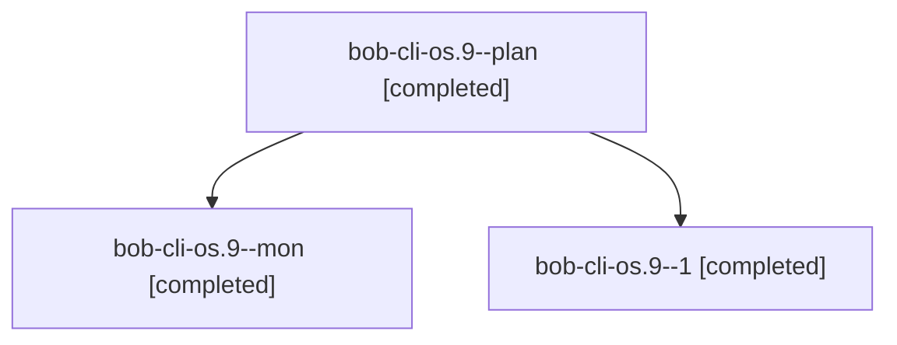

# Session: bob-cli-os.9

[Agent Hoods](../README.md) / [bbugyi200](../users/bbugyi200/README.md) / [apollo](../users/bbugyi200/machines/apollo/README.md) / [bob-cli-os](../users/bbugyi200/machines/apollo/hoods/bob-cli-os/README.md) / bob-cli-os.9

Owner: `bbugyi200.apollo` · Hood: `bob-cli-os` · Members: 3 · Bead: [bob-cli-os.9](https://github.com/bobs-org/bob-cli--beads/blob/main/pages/bob-cli-os/bob-cli-os.9.md)

## Lineage

The diagram is an optional enhancement; the ordered table below contains the same lineage in accessible text.

| Role | Agent | State | Model / provider | Timing | Commits | Prompt | Chat |
|---|---|---|---|---|---:|---|---|
| plan | bob-cli-os.9--plan | completed | grok-4.6 / grok | 2026-11-22T05:54:54.363227+00:00 → 2026-11-22T07:04:05.107929+00:00 | 0 | [Prompt](../agents/bbugyi200.apollo.bob-cli-os.9--plan/prompt.md) | [Chat](../agents/bbugyi200.apollo.bob-cli-os.9--plan/chat.md) |
| mon | bob-cli-os.9--mon | completed | grok-4.6 / grok | 2026-11-22T07:02:09.941248+00:00 → 2026-11-22T07:10:42.885763+00:00 | 0 | — | [Chat](../agents/bbugyi200.apollo.bob-cli-os.9--mon/chat.md) |
| 1 | bob-cli-os.9--1 | completed | grok-4.6 / grok | 2026-11-22T07:10:42.572555+00:00 → 2026-11-22T07:32:00.110781+00:00 | [1](../agents/bbugyi200.apollo.bob-cli-os.9--1/README.md#commits) | [Prompt](../agents/bbugyi200.apollo.bob-cli-os.9--1/prompt.md) | [Chat](../agents/bbugyi200.apollo.bob-cli-os.9--1/chat.md) |

## Commits

| Role | Repo | Commit | Subject | Committed |
|---|---|---|---|---|
| 1 | bob-cli | [`2f4fef6`](https://github.com/bobs-org/bob-cli/commit/2f4fef6dad5b749e944f3cf25fe31ceba351be42) | feat(ref): attach publisher feed notes and transcripts to episode dossiers | 2026-11-22 02:30:59 EST |

## Neighbors

| Agent | Relation | State |
|---|---|---|
| [bob-cli-os.1](../agents/bbugyi200.apollo.bob-cli-os.1/README.md) | bob-cli-os hood | completed |
| [bob-cli-os.10](../agents/bbugyi200.apollo.bob-cli-os.10/README.md) | bob-cli-os hood | completed |
| [bob-cli-os.2](../agents/bbugyi200.apollo.bob-cli-os.2/README.md) | bob-cli-os hood | completed |
| [bob-cli-os.3](../agents/bbugyi200.apollo.bob-cli-os.3/README.md) | bob-cli-os hood | completed |
| [bob-cli-os.4](../agents/bbugyi200.apollo.bob-cli-os.4/README.md) | bob-cli-os hood | completed |
| [bob-cli-os.5](../agents/bbugyi200.apollo.bob-cli-os.5/README.md) | bob-cli-os hood | completed |
| [bob-cli-os.6](../agents/bbugyi200.apollo.bob-cli-os.6/README.md) | bob-cli-os hood | completed |
| [bob-cli-os.7](../agents/bbugyi200.apollo.bob-cli-os.7/README.md) | bob-cli-os hood | completed |
| [bob-cli-os.8](../agents/bbugyi200.apollo.bob-cli-os.8/README.md) | bob-cli-os hood | completed |
| [bob-cli-os.land](../agents/bbugyi200.apollo.bob-cli-os.land/README.md) | bob-cli-os hood | completed |
