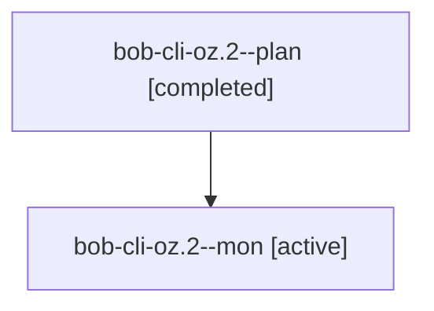

# Session: bob-cli-oz.2

[Agent Hoods](../README.md) / [bbugyi200](../users/bbugyi200/README.md) / [apollo](../users/bbugyi200/machines/apollo/README.md) / [bob-cli-oz](../users/bbugyi200/machines/apollo/hoods/bob-cli-oz/README.md) / bob-cli-oz.2

Owner: `bbugyi200.apollo` · Hood: `bob-cli-oz` · Members: 2 · Bead: [bob-cli-oz.2](https://github.com/bobs-org/bob-cli--beads/blob/main/pages/bob-cli-oz/bob-cli-oz.2.md)

## Lineage

The diagram is an optional enhancement; the ordered table below contains the same lineage in accessible text.

| Role | Agent | State | Model / provider | Timing | Commits | Prompt | Chat |
|---|---|---|---|---|---:|---|---|
| plan | bob-cli-oz.2--plan | completed | gpt-6-luna / codex | 2026-11-22T04:28:49.083464+00:00 → 2026-11-22T05:03:08.557627+00:00 | 0 | [Prompt](../agents/bbugyi200.apollo.bob-cli-oz.2--plan/prompt.md) | [Chat](../agents/bbugyi200.apollo.bob-cli-oz.2--plan/chat.md) |
| mon | bob-cli-oz.2--mon | active | gpt-6-luna / codex | 2026-11-22T05:00:34.720389+00:00 | 0 | — | — |

## Neighbors

| Agent | Relation | State |
|---|---|---|
| [bob-cli-oz.1](../agents/bbugyi200.apollo.bob-cli-oz.1/README.md) | bob-cli-oz hood | completed |
| [bob-cli-oz.3](../agents/bbugyi200.apollo.bob-cli-oz.3/README.md) | bob-cli-oz hood | waiting |
| [bob-cli-oz.4](../agents/bbugyi200.apollo.bob-cli-oz.4/README.md) | bob-cli-oz hood | waiting |
| [bob-cli-oz.5](../agents/bbugyi200.apollo.bob-cli-oz.5/README.md) | bob-cli-oz hood | waiting |
| [bob-cli-oz.6](../agents/bbugyi200.apollo.bob-cli-oz.6/README.md) | bob-cli-oz hood | active |
| [bob-cli-oz.7](../agents/bbugyi200.apollo.bob-cli-oz.7/README.md) | bob-cli-oz hood | waiting |
| [bob-cli-oz.land](../agents/bbugyi200.apollo.bob-cli-oz.land/README.md) | bob-cli-oz hood | waiting |
