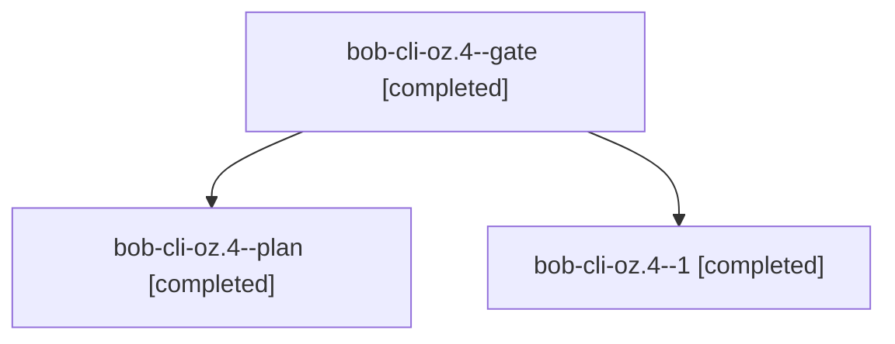

# Session: bob-cli-oz.4

[Agent Hoods](../README.md) / [bbugyi200](../users/bbugyi200/README.md) / [apollo](../users/bbugyi200/machines/apollo/README.md) / [bob-cli-oz](../users/bbugyi200/machines/apollo/hoods/bob-cli-oz/README.md) / bob-cli-oz.4

Owner: `bbugyi200.apollo` · Hood: `bob-cli-oz` · Members: 3 · Bead: [bob-cli-oz.4](https://github.com/bobs-org/bob-cli--beads/blob/main/pages/bob-cli-oz/bob-cli-oz.4.md)

## Lineage

The diagram is an optional enhancement; the ordered table below contains the same lineage in accessible text.

| Role | Agent | State | Model / provider | Timing | Commits | Prompt | Chat |
|---|---|---|---|---|---:|---|---|
| gate | bob-cli-oz.4--gate | completed | sonnet / claude | 2026-11-22T11:10:11.283513+00:00 → 2026-11-22T11:10:34.843388+00:00 | 0 | — | [Chat](../agents/bbugyi200.apollo.bob-cli-oz.4--gate/chat.md) |
| plan | bob-cli-oz.4--plan | completed | sonnet / claude | 2026-11-22T05:45:23.861218+00:00 → 2026-11-22T06:24:00.065963+00:00 | 0 | [Prompt](../agents/bbugyi200.apollo.bob-cli-oz.4--plan/prompt.md) | [Chat](../agents/bbugyi200.apollo.bob-cli-oz.4--plan/chat.md) |
| 1 | bob-cli-oz.4--1 | completed | sonnet / claude | 2026-11-22T11:11:26.704089+00:00 → 2026-11-22T11:12:39.577853+00:00 | 0 | [Prompt](../agents/bbugyi200.apollo.bob-cli-oz.4--1/prompt.md) | [Chat](../agents/bbugyi200.apollo.bob-cli-oz.4--1/chat.md) |

## Neighbors

| Agent | Relation | State |
|---|---|---|
| [bob-cli-oz.1](../agents/bbugyi200.apollo.bob-cli-oz.1/README.md) | bob-cli-oz hood | completed |
| [bob-cli-oz.2](bbugyi200.apollo.bob-cli-oz.2.md) (session · 5) | bob-cli-oz hood | completed 3, failed 2 |
| [bob-cli-oz.3](../agents/bbugyi200.apollo.bob-cli-oz.3/README.md) | bob-cli-oz hood | completed |
| [bob-cli-oz.5](bbugyi200.apollo.bob-cli-oz.5.md) (session · 3) | bob-cli-oz hood | completed 3 |
| [bob-cli-oz.6](../agents/bbugyi200.apollo.bob-cli-oz.6/README.md) | bob-cli-oz hood | completed |
| [bob-cli-oz.7](../agents/bbugyi200.apollo.bob-cli-oz.7/README.md) | bob-cli-oz hood | completed |
| [bob-cli-oz.land](../agents/bbugyi200.apollo.bob-cli-oz.land/README.md) | bob-cli-oz hood | waiting |
