# Session: bob-cli-pf.1.1.1

[Agent Hoods](../README.md) / [bbugyi200](../users/bbugyi200/README.md) / [apollo](../users/bbugyi200/machines/apollo/README.md) / [bob-cli-pf](../users/bbugyi200/machines/apollo/hoods/bob-cli-pf/README.md) / bob-cli-pf.1.1.1

Owner: `bbugyi200.apollo` · Hood: `bob-cli-pf` · Members: 13 · Bead: [bob-cli-pf.1.1.1](https://github.com/bobs-org/bob-cli--beads/blob/main/pages/bob-cli-pf/bob-cli-pf.1.1.1.md)

## Lineage

```mermaid
flowchart TD
  n0["bob-cli-pf.1.1.1--mon-0 [failed]"]
  n1["bob-cli-pf.1.1.1--3 [completed]"]
  n0 --> n1
  n2["bob-cli-pf.1.1.1--mon-2 [failed]"]
  n0 --> n2
  n3["bob-cli-pf.1.1.1--mon-4 [failed]"]
  n0 --> n3
  n4["bob-cli-pf.1.1.1--5 [completed]"]
  n0 --> n4
  n5["bob-cli-pf.1.1.1--mon [failed]"]
  n0 --> n5
  n6["bob-cli-pf.1.1.1--6 [completed]"]
  n0 --> n6
  n7["bob-cli-pf.1.1.1--mon-3 [failed]"]
  n0 --> n7
  n8["bob-cli-pf.1.1.1--1 [completed]"]
  n0 --> n8
  n9["bob-cli-pf.1.1.1--mon-1 [failed]"]
  n0 --> n9
  n10["bob-cli-pf.1.1.1--plan [completed]"]
  n0 --> n10
  n11["bob-cli-pf.1.1.1--4 [completed]"]
  n0 --> n11
  n12["bob-cli-pf.1.1.1--2 [completed]"]
  n0 --> n12
```

The diagram is an optional enhancement; the ordered table below contains the same lineage in accessible text.

| Role | Agent | State | Model / provider | Timing | Commits | Prompt | Chat |
|---|---|---|---|---|---:|---|---|
| mon-0 | bob-cli-pf.1.1.1--mon-0 | failed | gpt-6-luna / codex | 2026-11-22T20:25:53.433616+00:00 → 2026-11-22T20:31:22.308444+00:00 | 0 | — | [Chat](../agents/bbugyi200.apollo.bob-cli-pf.1.1.1--mon-0/chat.md) |
| 3 | bob-cli-pf.1.1.1--3 | completed | gpt-6-luna / codex | 2026-11-22T20:39:29.149678+00:00 → 2026-11-22T20:45:10.415862+00:00 | 0 | [Prompt](../agents/bbugyi200.apollo.bob-cli-pf.1.1.1--3/prompt.md) | [Chat](../agents/bbugyi200.apollo.bob-cli-pf.1.1.1--3/chat.md) |
| mon-2 | bob-cli-pf.1.1.1--mon-2 | failed | gpt-6-luna / codex | 2026-11-22T20:44:28.530351+00:00 → 2026-11-22T20:50:21.372127+00:00 | 0 | — | [Chat](../agents/bbugyi200.apollo.bob-cli-pf.1.1.1--mon-2/chat.md) |
| mon-4 | bob-cli-pf.1.1.1--mon-4 | failed | gpt-6-luna / codex | 2026-11-22T21:02:09.125651+00:00 → 2026-11-22T21:11:00.106263+00:00 | 0 | — | [Chat](../agents/bbugyi200.apollo.bob-cli-pf.1.1.1--mon-4/chat.md) |
| 5 | bob-cli-pf.1.1.1--5 | completed | gpt-6-luna / codex | 2026-11-22T20:59:55.227414+00:00 → 2026-11-22T21:02:53.979950+00:00 | 0 | [Prompt](../agents/bbugyi200.apollo.bob-cli-pf.1.1.1--5/prompt.md) | [Chat](../agents/bbugyi200.apollo.bob-cli-pf.1.1.1--5/chat.md) |
| mon | bob-cli-pf.1.1.1--mon | failed | gpt-6-luna / codex | 2026-11-22T20:14:00.868704+00:00 → 2026-11-22T20:20:38.950509+00:00 | 0 | — | [Chat](../agents/bbugyi200.apollo.bob-cli-pf.1.1.1--mon/chat.md) |
| 6 | bob-cli-pf.1.1.1--6 | completed | gpt-6-luna / codex | 2026-11-22T21:10:59.604158+00:00 → 2026-11-22T21:18:15.906064+00:00 | 0 | [Prompt](../agents/bbugyi200.apollo.bob-cli-pf.1.1.1--6/prompt.md) | [Chat](../agents/bbugyi200.apollo.bob-cli-pf.1.1.1--6/chat.md) |
| mon-3 | bob-cli-pf.1.1.1--mon-3 | failed | gpt-6-luna / codex | 2026-11-22T20:54:39.589389+00:00 → 2026-11-22T20:59:55.672460+00:00 | 0 | — | [Chat](../agents/bbugyi200.apollo.bob-cli-pf.1.1.1--mon-3/chat.md) |
| 1 | bob-cli-pf.1.1.1--1 | completed | gpt-6-luna / codex | 2026-11-22T20:20:38.724676+00:00 → 2026-11-22T20:26:53.765635+00:00 | 0 | [Prompt](../agents/bbugyi200.apollo.bob-cli-pf.1.1.1--1/prompt.md) | [Chat](../agents/bbugyi200.apollo.bob-cli-pf.1.1.1--1/chat.md) |
| mon-1 | bob-cli-pf.1.1.1--mon-1 | failed | gpt-6-luna / codex | 2026-11-22T20:34:01.483036+00:00 → 2026-11-22T20:39:29.188725+00:00 | 0 | — | [Chat](../agents/bbugyi200.apollo.bob-cli-pf.1.1.1--mon-1/chat.md) |
| plan | bob-cli-pf.1.1.1--plan | completed | gpt-6-luna / codex | 2026-11-22T19:47:16.584449+00:00 → 2026-11-22T20:16:03.061840+00:00 | 0 | [Prompt](../agents/bbugyi200.apollo.bob-cli-pf.1.1.1--plan/prompt.md) | [Chat](../agents/bbugyi200.apollo.bob-cli-pf.1.1.1--plan/chat.md) |
| 4 | bob-cli-pf.1.1.1--4 | completed | gpt-6-luna / codex | 2026-11-22T20:50:21.066669+00:00 → 2026-11-22T20:55:27.259310+00:00 | 0 | [Prompt](../agents/bbugyi200.apollo.bob-cli-pf.1.1.1--4/prompt.md) | [Chat](../agents/bbugyi200.apollo.bob-cli-pf.1.1.1--4/chat.md) |
| 2 | bob-cli-pf.1.1.1--2 | completed | gpt-6-luna / codex | 2026-11-22T20:31:21.830473+00:00 → 2026-11-22T20:34:52.064058+00:00 | 0 | [Prompt](../agents/bbugyi200.apollo.bob-cli-pf.1.1.1--2/prompt.md) | [Chat](../agents/bbugyi200.apollo.bob-cli-pf.1.1.1--2/chat.md) |

## Neighbors

| Agent | Relation | State |
|---|---|---|
| [bob-cli-pf.1](bbugyi200.apollo.bob-cli-pf.1.md) (session · 3) | ancestor | active 1, completed 2 |
| [bob-cli-pf.1.1.2](../agents/bbugyi200.apollo.bob-cli-pf.1.1.2/README.md) | bob-cli-pf.1.1 hood | completed |
| [bob-cli-pf.1.1.3](../agents/bbugyi200.apollo.bob-cli-pf.1.1.3/README.md) | bob-cli-pf.1.1 hood | completed |
| [bob-cli-pf.1.1.4](bbugyi200.apollo.bob-cli-pf.1.1.4.md) (session · 7) | bob-cli-pf.1.1 hood | completed 4, failed 3 |
| [bob-cli-pf.1.1.5](../agents/bbugyi200.apollo.bob-cli-pf.1.1.5/README.md) | bob-cli-pf.1.1 hood | completed |
| [bob-cli-pf.1.1.land](bbugyi200.apollo.bob-cli-pf.1.1.land.md) (session · 3) | bob-cli-pf.1.1 hood | completed 3 |
| [bob-cli-pf.2](bbugyi200.apollo.bob-cli-pf.2.md) (session · 3) | bob-cli-pf hood | active 1, completed 2 |
| [bob-cli-pf.2.1.1](bbugyi200.apollo.bob-cli-pf.2.1.1.md) (session · 3) | bob-cli-pf hood | completed 3 |
| [bob-cli-pf.2.1.2](bbugyi200.apollo.bob-cli-pf.2.1.2.md) (session · 5) | bob-cli-pf hood | completed 4, failed 1 |
| [bob-cli-pf.2.1.3](../agents/bbugyi200.apollo.bob-cli-pf.2.1.3/README.md) | bob-cli-pf hood | completed |
| [bob-cli-pf.2.1.land](bbugyi200.apollo.bob-cli-pf.2.1.land.md) (session · 3) | bob-cli-pf hood | completed 3 |
| [bob-cli-pf.3](../agents/bbugyi200.apollo.bob-cli-pf.3/README.md) | bob-cli-pf hood | completed |
| [bob-cli-pf.4](bbugyi200.apollo.bob-cli-pf.4.md) (session · 3) | bob-cli-pf hood | active 1, completed 2 |
| [bob-cli-pf.4.1.1](../agents/bbugyi200.apollo.bob-cli-pf.4.1.1/README.md) | bob-cli-pf hood | completed |
| [bob-cli-pf.4.1.2](../agents/bbugyi200.apollo.bob-cli-pf.4.1.2/README.md) | bob-cli-pf hood | completed |
| [bob-cli-pf.4.1.3](bbugyi200.apollo.bob-cli-pf.4.1.3.md) (session · 5) | bob-cli-pf hood | completed 3, failed 2 |
| [bob-cli-pf.4.1.4](../agents/bbugyi200.apollo.bob-cli-pf.4.1.4/README.md) | bob-cli-pf hood | completed |
| [bob-cli-pf.4.1.5](../agents/bbugyi200.apollo.bob-cli-pf.4.1.5/README.md) | bob-cli-pf hood | completed |
| [bob-cli-pf.4.1.6](bbugyi200.apollo.bob-cli-pf.4.1.6.md) (session · 3) | bob-cli-pf hood | completed 2, failed 1 |
| [bob-cli-pf.4.1.7.1](../agents/bbugyi200.apollo.bob-cli-pf.4.1.7.1/README.md) | bob-cli-pf hood | completed |
| [bob-cli-pf.4.1.7.2](../agents/bbugyi200.apollo.bob-cli-pf.4.1.7.2/README.md) | bob-cli-pf hood | completed |
| [bob-cli-pf.4.1.7.3](bbugyi200.apollo.bob-cli-pf.4.1.7.3.md) (session · 8) | bob-cli-pf hood | active 1, completed 4, failed 3 |
| [bob-cli-pf.4.1.7.4](../agents/bbugyi200.apollo.bob-cli-pf.4.1.7.4/README.md) | bob-cli-pf hood | waiting |
| [bob-cli-pf.4.1.7.land](../agents/bbugyi200.apollo.bob-cli-pf.4.1.7.land/README.md) | bob-cli-pf hood | waiting |
| [bob-cli-pf.4.1.land](bbugyi200.apollo.bob-cli-pf.4.1.land.md) (session · 3) | bob-cli-pf hood | active 1, completed 2 |
| [bob-cli-pf.5](../agents/bbugyi200.apollo.bob-cli-pf.5/README.md) | bob-cli-pf hood | waiting |
| [bob-cli-pf.6](../agents/bbugyi200.apollo.bob-cli-pf.6/README.md) | bob-cli-pf hood | waiting |
| [bob-cli-pf.land](../agents/bbugyi200.apollo.bob-cli-pf.land/README.md) | bob-cli-pf hood | waiting |
