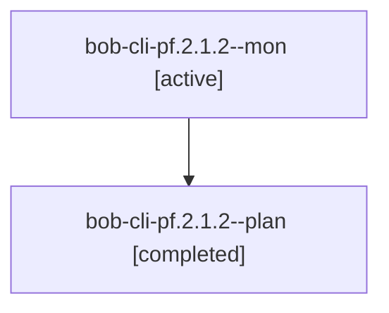

# Session: bob-cli-pf.2.1.2

[Agent Hoods](../README.md) / [bbugyi200](../users/bbugyi200/README.md) / [apollo](../users/bbugyi200/machines/apollo/README.md) / [bob-cli-pf](../users/bbugyi200/machines/apollo/hoods/bob-cli-pf/README.md) / bob-cli-pf.2.1.2

Owner: `bbugyi200.apollo` · Hood: `bob-cli-pf` · Members: 2 · Bead: [bob-cli-pf.2.1.2](https://github.com/bobs-org/bob-cli--beads/blob/main/pages/bob-cli-pf/bob-cli-pf.2.1.2.md)

## Lineage

The diagram is an optional enhancement; the ordered table below contains the same lineage in accessible text.

| Role | Agent | State | Model / provider | Timing | Commits | Prompt | Chat |
|---|---|---|---|---|---:|---|---|
| mon | bob-cli-pf.2.1.2--mon | active | grok-4.6 / grok | 2026-11-22T23:19:11.959599+00:00 | 0 | — | — |
| plan | bob-cli-pf.2.1.2--plan | completed | grok-4.6 / grok | 2026-11-22T22:08:14.372666+00:00 → 2026-11-22T23:21:08.323229+00:00 | 0 | [Prompt](../agents/bbugyi200.apollo.bob-cli-pf.2.1.2--plan/prompt.md) | [Chat](../agents/bbugyi200.apollo.bob-cli-pf.2.1.2--plan/chat.md) |

## Neighbors

| Agent | Relation | State |
|---|---|---|
| [bob-cli-pf.2](bbugyi200.apollo.bob-cli-pf.2.md) (session · 3) | ancestor | active 1, completed 2 |
| [bob-cli-pf.2.1.1](bbugyi200.apollo.bob-cli-pf.2.1.1.md) (session · 3) | bob-cli-pf.2.1 hood | completed 3 |
| [bob-cli-pf.2.1.3](../agents/bbugyi200.apollo.bob-cli-pf.2.1.3/README.md) | bob-cli-pf.2.1 hood | waiting |
| [bob-cli-pf.2.1.land](../agents/bbugyi200.apollo.bob-cli-pf.2.1.land/README.md) | bob-cli-pf.2.1 hood | waiting |
| [bob-cli-pf.1](bbugyi200.apollo.bob-cli-pf.1.md) (session · 3) | bob-cli-pf hood | active 1, completed 2 |
| [bob-cli-pf.1.1.1](bbugyi200.apollo.bob-cli-pf.1.1.1.md) (session · 13) | bob-cli-pf hood | completed 7, failed 6 |
| [bob-cli-pf.1.1.2](../agents/bbugyi200.apollo.bob-cli-pf.1.1.2/README.md) | bob-cli-pf hood | completed |
| [bob-cli-pf.1.1.3](../agents/bbugyi200.apollo.bob-cli-pf.1.1.3/README.md) | bob-cli-pf hood | completed |
| [bob-cli-pf.1.1.4](bbugyi200.apollo.bob-cli-pf.1.1.4.md) (session · 6) | bob-cli-pf hood | active 1, completed 3, failed 2 |
| [bob-cli-pf.1.1.5](../agents/bbugyi200.apollo.bob-cli-pf.1.1.5/README.md) | bob-cli-pf hood | waiting |
| [bob-cli-pf.1.1.land](../agents/bbugyi200.apollo.bob-cli-pf.1.1.land/README.md) | bob-cli-pf hood | waiting |
| [bob-cli-pf.3](../agents/bbugyi200.apollo.bob-cli-pf.3/README.md) | bob-cli-pf hood | completed |
| [bob-cli-pf.4](../agents/bbugyi200.apollo.bob-cli-pf.4/README.md) | bob-cli-pf hood | waiting |
| [bob-cli-pf.5](../agents/bbugyi200.apollo.bob-cli-pf.5/README.md) | bob-cli-pf hood | waiting |
| [bob-cli-pf.6](../agents/bbugyi200.apollo.bob-cli-pf.6/README.md) | bob-cli-pf hood | waiting |
| [bob-cli-pf.land](../agents/bbugyi200.apollo.bob-cli-pf.land/README.md) | bob-cli-pf hood | waiting |
