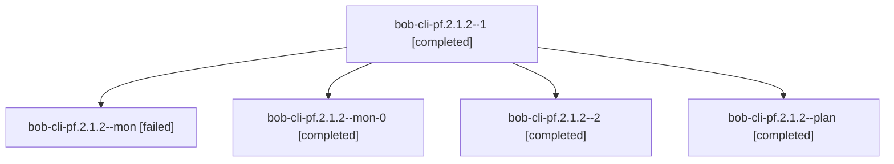

# Session: bob-cli-pf.2.1.2

[Agent Hoods](../README.md) / [bbugyi200](../users/bbugyi200/README.md) / [apollo](../users/bbugyi200/machines/apollo/README.md) / [bob-cli-pf](../users/bbugyi200/machines/apollo/hoods/bob-cli-pf/README.md) / bob-cli-pf.2.1.2

Owner: `bbugyi200.apollo` · Hood: `bob-cli-pf` · Members: 5 · Bead: [bob-cli-pf.2.1.2](https://github.com/bobs-org/bob-cli--beads/blob/main/pages/bob-cli-pf/bob-cli-pf.2.1.2.md)

## Lineage

The diagram is an optional enhancement; the ordered table below contains the same lineage in accessible text.

| Role | Agent | State | Model / provider | Timing | Commits | Prompt | Chat |
|---|---|---|---|---|---:|---|---|
| 1 | bob-cli-pf.2.1.2--1 | completed | grok-4.6 / grok | 2026-11-22T23:34:00.713156+00:00 → 2026-11-22T23:44:58.066470+00:00 | 0 | [Prompt](../agents/bbugyi200.apollo.bob-cli-pf.2.1.2--1/prompt.md) | [Chat](../agents/bbugyi200.apollo.bob-cli-pf.2.1.2--1/chat.md) |
| mon | bob-cli-pf.2.1.2--mon | failed | grok-4.6 / grok | 2026-11-22T23:19:11.959599+00:00 → 2026-11-22T23:34:01.172294+00:00 | 0 | — | [Chat](../agents/bbugyi200.apollo.bob-cli-pf.2.1.2--mon/chat.md) |
| mon-0 | bob-cli-pf.2.1.2--mon-0 | completed | grok-4.6 / grok | 2026-11-22T23:43:28.016806+00:00 → 2026-11-23T00:00:21.133939+00:00 | 0 | — | [Chat](../agents/bbugyi200.apollo.bob-cli-pf.2.1.2--mon-0/chat.md) |
| 2 | bob-cli-pf.2.1.2--2 | completed | grok-4.6 / grok | 2026-11-23T00:00:20.676961+00:00 → 2026-11-23T00:13:01.802290+00:00 | [1](../agents/bbugyi200.apollo.bob-cli-pf.2.1.2--2/README.md#commits) | [Prompt](../agents/bbugyi200.apollo.bob-cli-pf.2.1.2--2/prompt.md) | [Chat](../agents/bbugyi200.apollo.bob-cli-pf.2.1.2--2/chat.md) |
| plan | bob-cli-pf.2.1.2--plan | completed | grok-4.6 / grok | 2026-11-22T22:08:14.372666+00:00 → 2026-11-22T23:21:08.323229+00:00 | 0 | [Prompt](../agents/bbugyi200.apollo.bob-cli-pf.2.1.2--plan/prompt.md) | [Chat](../agents/bbugyi200.apollo.bob-cli-pf.2.1.2--plan/chat.md) |

## Commits

| Role | Repo | Commit | Subject | Committed |
|---|---|---|---|---|
| 2 | bob-cli | [`fdd9472`](https://github.com/bobs-org/bob-cli/commit/fdd94725e315babce6ff79668d2b01ec97016b72) | feat(props): add strict span operations and byte-exact undo | 2026-11-22 19:11:52 EST |

## Neighbors

| Agent | Relation | State |
|---|---|---|
| [bob-cli-pf.2](bbugyi200.apollo.bob-cli-pf.2.md) (session · 3) | ancestor | active 1, completed 2 |
| [bob-cli-pf.2.1.1](bbugyi200.apollo.bob-cli-pf.2.1.1.md) (session · 3) | bob-cli-pf.2.1 hood | completed 3 |
| [bob-cli-pf.2.1.3](../agents/bbugyi200.apollo.bob-cli-pf.2.1.3/README.md) | bob-cli-pf.2.1 hood | completed |
| [bob-cli-pf.2.1.land](bbugyi200.apollo.bob-cli-pf.2.1.land.md) (session · 3) | bob-cli-pf.2.1 hood | completed 3 |
| [bob-cli-pf.1](bbugyi200.apollo.bob-cli-pf.1.md) (session · 3) | bob-cli-pf hood | active 1, completed 2 |
| [bob-cli-pf.1.1.1](bbugyi200.apollo.bob-cli-pf.1.1.1.md) (session · 13) | bob-cli-pf hood | completed 7, failed 6 |
| [bob-cli-pf.1.1.2](../agents/bbugyi200.apollo.bob-cli-pf.1.1.2/README.md) | bob-cli-pf hood | completed |
| [bob-cli-pf.1.1.3](../agents/bbugyi200.apollo.bob-cli-pf.1.1.3/README.md) | bob-cli-pf hood | completed |
| [bob-cli-pf.1.1.4](bbugyi200.apollo.bob-cli-pf.1.1.4.md) (session · 7) | bob-cli-pf hood | completed 4, failed 3 |
| [bob-cli-pf.1.1.5](../agents/bbugyi200.apollo.bob-cli-pf.1.1.5/README.md) | bob-cli-pf hood | completed |
| [bob-cli-pf.1.1.land](bbugyi200.apollo.bob-cli-pf.1.1.land.md) (session · 3) | bob-cli-pf hood | completed 3 |
| [bob-cli-pf.3](../agents/bbugyi200.apollo.bob-cli-pf.3/README.md) | bob-cli-pf hood | completed |
| [bob-cli-pf.4](bbugyi200.apollo.bob-cli-pf.4.md) (session · 3) | bob-cli-pf hood | active 1, completed 2 |
| [bob-cli-pf.4.1.1](../agents/bbugyi200.apollo.bob-cli-pf.4.1.1/README.md) | bob-cli-pf hood | completed |
| [bob-cli-pf.4.1.2](../agents/bbugyi200.apollo.bob-cli-pf.4.1.2/README.md) | bob-cli-pf hood | completed |
| [bob-cli-pf.4.1.3](bbugyi200.apollo.bob-cli-pf.4.1.3.md) (session · 5) | bob-cli-pf hood | completed 3, failed 2 |
| [bob-cli-pf.4.1.4](../agents/bbugyi200.apollo.bob-cli-pf.4.1.4/README.md) | bob-cli-pf hood | completed |
| [bob-cli-pf.4.1.5](../agents/bbugyi200.apollo.bob-cli-pf.4.1.5/README.md) | bob-cli-pf hood | completed |
| [bob-cli-pf.4.1.6](bbugyi200.apollo.bob-cli-pf.4.1.6.md) (session · 3) | bob-cli-pf hood | completed 2, failed 1 |
| [bob-cli-pf.4.1.7.1](../agents/bbugyi200.apollo.bob-cli-pf.4.1.7.1/README.md) | bob-cli-pf hood | completed |
| [bob-cli-pf.4.1.7.2](../agents/bbugyi200.apollo.bob-cli-pf.4.1.7.2/README.md) | bob-cli-pf hood | completed |
| [bob-cli-pf.4.1.7.3](bbugyi200.apollo.bob-cli-pf.4.1.7.3.md) (session · 13) | bob-cli-pf hood | completed 7, failed 6 |
| [bob-cli-pf.4.1.7.4](bbugyi200.apollo.bob-cli-pf.4.1.7.4.md) (session · 21) | bob-cli-pf hood | completed 12, failed 9 |
| [bob-cli-pf.4.1.7.land](bbugyi200.apollo.bob-cli-pf.4.1.7.land.md) (session · 3) | bob-cli-pf hood | completed 3 |
| [bob-cli-pf.4.1.land](bbugyi200.apollo.bob-cli-pf.4.1.land.md) (session · 3) | bob-cli-pf hood | active 1, completed 2 |
| [bob-cli-pf.5](bbugyi200.apollo.bob-cli-pf.5.md) (session · 3) | bob-cli-pf hood | active 1, completed 2 |
| [bob-cli-pf.5.1.1](bbugyi200.apollo.bob-cli-pf.5.1.1.md) (session · 3) | bob-cli-pf hood | completed 3 |
| [bob-cli-pf.5.1.2](../agents/bbugyi200.apollo.bob-cli-pf.5.1.2/README.md) | bob-cli-pf hood | completed |
| [bob-cli-pf.5.1.3](../agents/bbugyi200.apollo.bob-cli-pf.5.1.3/README.md) | bob-cli-pf hood | completed |
| [bob-cli-pf.5.1.4](../agents/bbugyi200.apollo.bob-cli-pf.5.1.4/README.md) | bob-cli-pf hood | completed |
| [bob-cli-pf.5.1.5](../agents/bbugyi200.apollo.bob-cli-pf.5.1.5/README.md) | bob-cli-pf hood | completed |
| [bob-cli-pf.5.1.6](../agents/bbugyi200.apollo.bob-cli-pf.5.1.6/README.md) | bob-cli-pf hood | completed |
| [bob-cli-pf.5.1.7](../agents/bbugyi200.apollo.bob-cli-pf.5.1.7/README.md) | bob-cli-pf hood | completed |
| [bob-cli-pf.5.1.land](../agents/bbugyi200.apollo.bob-cli-pf.5.1.land/README.md) | bob-cli-pf hood | completed |
| [bob-cli-pf.6](bbugyi200.apollo.bob-cli-pf.6.md) (session · 3) | bob-cli-pf hood | active 1, completed 2 |
| [bob-cli-pf.6.1.1](../agents/bbugyi200.apollo.bob-cli-pf.6.1.1/README.md) | bob-cli-pf hood | completed |
| [bob-cli-pf.6.1.2](../agents/bbugyi200.apollo.bob-cli-pf.6.1.2/README.md) | bob-cli-pf hood | completed |
| [bob-cli-pf.6.1.3](../agents/bbugyi200.apollo.bob-cli-pf.6.1.3/README.md) | bob-cli-pf hood | completed |
| [bob-cli-pf.6.1.4](bbugyi200.apollo.bob-cli-pf.6.1.4.md) (session · 31) | bob-cli-pf hood | active 1, completed 15, failed 15 |
| [bob-cli-pf.6.1.5](../agents/bbugyi200.apollo.bob-cli-pf.6.1.5/README.md) | bob-cli-pf hood | waiting |
| [bob-cli-pf.6.1.land](../agents/bbugyi200.apollo.bob-cli-pf.6.1.land/README.md) | bob-cli-pf hood | waiting |
| [bob-cli-pf.land](../agents/bbugyi200.apollo.bob-cli-pf.land/README.md) | bob-cli-pf hood | waiting |
